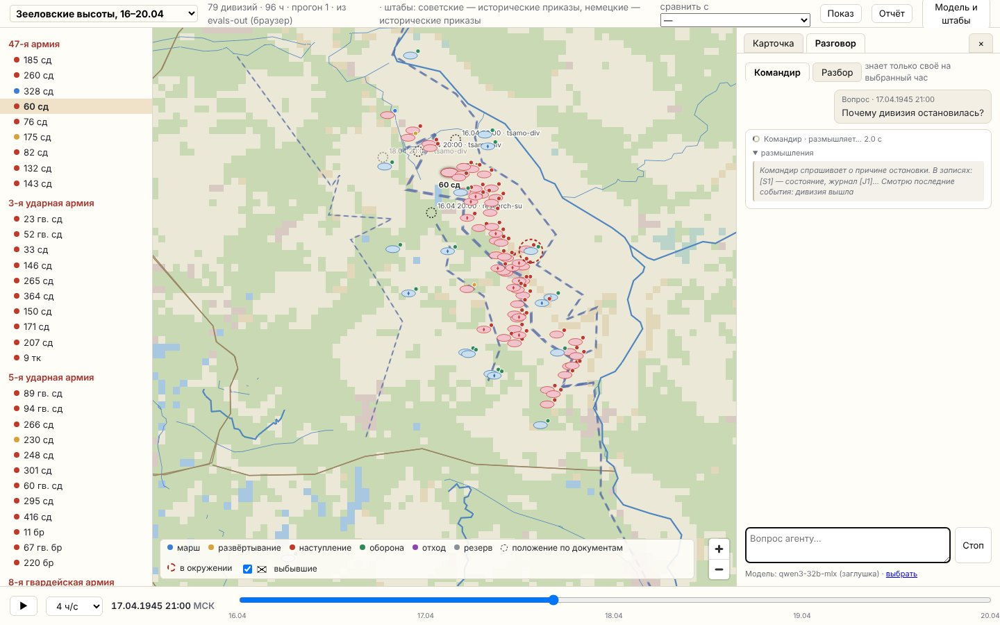

# План: агентная модель снизу вверх

Черновик для обсуждения. Принятые решения — в разделе 1, открытые вопросы — в конце.

Сейчас модель переигровки устроена сверху вниз. Единица — армия или корпус: точка с полосой и
суммарной силой, ход 24 часа. Темп и потери задаются таблицами, подобранными по истории операции
(часть II описания, разделы 19–21). Агентная модель строит операцию снизу: дивизии действуют по
своему состоянию, обстановке и приказам, штабы над ними планируют и управляют. Итог операции
складывается из их действий, а история служит проверкой, а не материалом для подгонки.

Это развитие этапа 6 общего плана ([simulation.md](simulation.md), «Дивизионный уровень») от трёх
участков до всей операции, с отдельным приложением и полной моделью обеих сторон.

## 1. Принятые решения

1. **Агент нижнего уровня — дивизия.** Ниже, на полках и батальонах, нет данных для проверки
   историей. Полки входят во внутреннее состояние дивизии (раздел 3.2).
2. **Главный критерий — точность и историчность.** Модель смотрят штабные специалисты, знающие
   историю и военное искусство. Каждая цифра имеет источник и достоверность A/B/C, и это видно
   в интерфейсе.
3. **Расширение генеральной модели, а не замена.** Армии и фронты остаются, они становятся
   штабами над дивизиями. Нынешняя откалиброванная модель служит контрольной (раздел 9).
4. **Охват — все соединения Берлинской операции** обеих сторон, а также населённые пункты,
   мосты, переправы, полосы обороны и узлы снабжения. Перепись того, что есть в данных, —
   [agents-census.md](agents-census.md) (`npm run sim:census`).
5. **Немецкая сторона моделируется полностью**, так же подробно, как советская: дивизии-агенты
   и штабы, которые принимают решения сами (раздел 5).
6. **Отдельное приложение** для macOS, Windows и Linux из одного кода. Машина показа — MacBook Pro M4 Max, 128 ГБ общей памяти.
   Показ идёт в реальном времени, поэтому параллельный расчёт закладывается в ядро с самого
   начала (раздел 7).

## 2. Уровни и сущности

```
 Среда: местность, погода, время суток, воздушные армии, решения Ставки / ОКХ
   │  воздействия (вылеты по районам, ввод резервов, передача армий)
   ▼
 Штабы: фронт / группа армий → армия → корпус        агенты-штабы
   │  приказы вниз (с задержкой доведения)   ▲ донесения вверх (с задержкой и ошибкой)
   ▼                                          │
 Дивизии: сд, пд, тк, мк, кд, бригады, УР, артдивизии, боевые группы    агенты
   │  взаимодействуют через местность и объекты
   ▼
 Объекты: населённые пункты, мосты и переправы, полосы обороны, станции, склады
```

- **Дивизия** — единица, которая двигается, ведёт бой и расходует ресурсы. На этот уровень
  ставится всё, что действует как одно целое: стрелковые и пехотные дивизии, танковые и
  механизированные корпуса (по численности и применению — дивизии), отдельные бригады,
  укрепрайоны, кавалерийские дивизии, артиллерийские дивизии прорыва, немецкие боевые группы,
  бригады штурмовых орудий, гарнизоны крепостей и секторов обороны.
- **Штаб** — агент без собственной боевой силы: получает задачу, оценивает обстановку по
  донесениям, планирует, отдаёт приказы подчинённым, распределяет приданные средства
  (артиллерию, танки непосредственной поддержки, резервы).
- **Объект** — агент без собственной воли, но со своим состоянием: мост бывает цел, повреждён
  или взорван, на месте взорванного наводится переправа; населённый пункт обороняется или нет,
  он подготовлен или нет; склад пополняется и пустеет.
- **Среда** — то, что действует на всех: местность (`data/theatres/`), время суток, погода,
  воздушные армии (вылеты по районам и задачам), стратегические решения как события по
  данным: ввод 3-й и 28-й армий, передача корпусов, прибытие пополнений.

Артиллерия и авиация по решению общего плана — ресурсы штабов. Это сохраняется: артдивизия
прорыва — агент, который совершает марш, занимает позиции и тратит боеприпасы, но её огонь
распределяет штаб как плотность на участке. Авиация — вылеты воздушной армии по районам,
отдельные авиадивизии агентами не становятся.

## 3. Агент-дивизия

### 3.1. Параметры и переменные

**Параметры** задаются один раз из данных и не меняются в прогоне. У каждого есть источник:
норматив из `norms.json`, документ, литература или явное допущение.

| Группа | Примеры |
|---|---|
| Состав | тип, штат, качество (опыт, гвардия, сводная часть), подчинение по датам |
| Подвижность | скорость марша по классу дороги, днём и ночью; длина колонны; время развёртывания и свёртывания |
| Огонь и бой | нормы огня на подавление, ширина полосы наступления и обороны, глубина задач |
| Тыл | нормы расхода боеприпасов, горючего и продовольствия по видам действий; ёмкость своих запасов |

**Переменные** меняются в ходе прогона, и инспектор показывает их историю.

| Группа | Примеры |
|---|---|
| Силы | люди (боевая и списочная численность), танки и САУ, орудия по видам, миномёты |
| Запасы | боекомплекты, заправки, сутодачи |
| Состояние | усталость, боеспособность, организованность (дезорганизация после боя и марша), подготовленность обороны |
| Место | положение головы и хвоста колонны или занимаемый район, маршрут, направление |
| Знание | что известно о противнике и соседях, давность сведений |
| Управление | действующий приказ, от кого и когда получен, его выполнение |

### 3.2. Внутреннее построение

Полки отдельными агентами не становятся, но входят в состояние дивизии как построение:
- один или два эшелона и резерв;
- сколько полков в бою, сколько в резерве, сколько выведено;
- где стоит артиллерийская группа.

Это нужно потому, что эксперт отличает дивизию, введённую в бой целиком, от дивизии со свежим
вторым эшелоном. Ввод второго эшелона — отдельное решение со своим временем и эффектом.

### 3.3. Состояния

Поведение дивизии — иерархическая машина состояний. Переход вызывается приказом или условием
(потери, запасы, угроза флангу, окружение). Каждый переход записывается в журнал с причиной.

```
 Резерв / сосредоточение
   ├─► Марш ─────────────┬─ по дороге / вне дорог / затор / переправа
   │     └─► Развёртывание (время по нормативу)
   ├─► Наступление ──────┬─ артподготовка → атака → бой в глубине → закрепление
   │                     └─ преследование
   ├─► Оборона ──────────┬─ поспешная → подготовленная (растёт со временем)
   │                     └─ контратака
   ├─► Отход (организованный)  ─► Отступление (беспорядочное)
   ├─► Окружение ────────┬─ круговая оборона / прорыв / капитуляция
   ├─► Восстановление (вывод, пополнение)
   └─► Небоеспособна / расформирована
```

Пороги переходов (при каких потерях атака прекращается, сколько часов нужно на подготовку
обороны, когда начинается отступление) — это строки в `norms.json`: норматив с источником или
допущение без опоры. Переходы различаются по сторонам и по 1945 году: у немецкой стороны есть
приказ «держаться» (Haltebefehl), у советской — ввод подвижных групп в прорыв.

## 4. Штабы

Штаб живёт циклом управления: сбор обстановки → решение → планирование → доведение приказов.
Длительность цикла зависит от уровня; она берётся из документов (`orders-timing-1945.json`,
сроки директив и приказов) и нормативов.

- **Приказ вниз** — задача, рубеж, направление, срок, приданные средства, разграничительные
  линии. Задержка доведения зависит от уровня и связи.
- **Донесение вверх** — положение, потери, запасы, сведения о противнике. Оно запаздывает и
  может быть неточным, так что штаб решает по тому, что ему доложили, а не по истине.
- **Распределение средств** — артиллерия на участки прорыва (плотность на км), танки
  непосредственной поддержки, резервы, подвоз.

## 5. Обе стороны

Физика одна для обеих сторон: движение, бой, расход и подвоз считаются одинаково. Различаются
параметры (штат, доктрина, нормы) и источник решений штабов. Источник решений выбирается для
каждой стороны и уровня отдельно.

| Режим | Кто решает за штабы | Зачем |
|---|---|---|
| Исторический | приказы из документов (ЦАМО, трофейные документы, литература) | проверка: при исторических приказах дивизии должны прийти туда, куда пришли |
| По доктрине | правила штаба: оценка обстановки и выбор из типовых решений своей стороны | полностью автономная сторона без внешних вызовов |
| Языковая модель | «немецкий штаб» и при желании советский — по общему плану (раздел 6 [simulation.md](simulation.md)) | осмысленные решения вне истории |
| Человек | эксперт отдаёт приказы за сторону | игра |

Дивизии в любом режиме действуют сами в рамках полученного приказа. Штаб говорит «взять рубеж»,
а как идти, когда развёртываться и когда прекращать атаку, решает дивизия по своему состоянию.

Немецкая сторона требует отдельного сбора данных: состав и численность дивизий и боевых групп
по датам, приказы группы армий «Висла» и армий, оборонительные полосы. Это уже начато
(трофейные документы ЦАМО, ф. 500).

## 6. Карта и движение

- **Шаг времени — 1 час.** Тогда марш, артподготовка, время суток и бой выглядят реалистично.
  Берлинская операция занимает около 550 шагов.
- **Марш — по дорожному графу** (`roadnet.ts` уже строит граф из линий театра). Колонна
  дивизии занимает отрезок дороги своей длиной. Участки дорог и мосты имеют пропускную
  способность, и колонны за неё спорят: так возникают заторы у переправ.
- **Вне дорог** — по растру проходимости местности, со скоростью по классу клетки.
- **Положение** — не точка, а район: в обороне — полоса по фронту и в глубину, в наступлении —
  боевой порядок, на марше — колонна. Это снимает расхождение «соединение — точка»
  (часть II, раздел 25.1).
- **Обстановка влияет на агента**: местность (лес, болото, пойма, город, высоты), укрытия,
  видимость, ночь, соседи и угроза флангу.

## 7. Быстродействие и параллельность

### 7.1. Где дорого

400 агентов — немного, их решения дёшевы. Дорого другое:
- поиск маршрутов по дорожной сети для сотен колонн;
- обнаружение соприкосновения и видимость: кто кого видит, кто по кому может стрелять;
- спор за дороги и мосты;
- отрисовка сотен движущихся знаков, колонн и районов.

### 7.2. Схема шага

1. **Оценить и решить — параллельно.** Каждый агент читает неизменный снимок мира. Агенты
   делятся между потоками по районам карты, гонок нет.
2. **Разрешить — по порядку.** Бои, очередь на мосту, занятие районов разрешаются в
   фиксированном порядке, независимо от числа потоков.
3. **Применить** — новый снимок мира. Старые снимки хранятся, по ним работает перемотка.

У каждого агента свой генератор случайных чисел, зависящий от зерна прогона, номера агента и
номера шага. Результат одинаков на любом числе ядер, и любой прогон повторяется точно.

### 7.3. Отрисовка

- Расчёт идёт в своих потоках, интерфейс рисует со своей частотой (60 кадров в секунду) и
  сглаживает движение между часовыми шагами.
- Скорость показа выбирается: от «час за секунду» до «сутки за несколько секунд».
- Свободные ядра считают пачку вариантов вперёд — разброс исходов для «что будет, если…».

### 7.4. Технология

Предложение — уточнить до начала этапа 2:

- **Ядро на Rust**: настоящие потоки с общей памятью, предсказуемая скорость без пауз сборки
  мусора, плоские массивы состояния агентов, легко воспроизводимый расчёт.
- **Оболочка — Tauri**: приложение macOS, интерфейс на веб-технологиях. Карта (MapLibre),
  знаки и панели переиспользуются из редактора.
- **Данные общие с нынешней системой**: театры, сценарии, исторические наборы, нормативы.
  Ядро читает те же файлы, отдельной копии данных нет.

**Три платформы.** Приложение собирается для macOS, Windows и Linux из одного кода: Rust и
Tauri переносимы, карта и интерфейс — веб-технологии. Что при этом учесть:

- Оболочка Tauri рисует интерфейс системным веб-движком: WebKit на macOS, WebView2 на Windows,
  WebKitGTK на Linux. Карта работает через WebGL везде, но скорость отрисовки различается, и
  на Linux WebKitGTK заметно слабее. Если это станет помехой, карта переводится на
  отрисовку в ядре (wgpu: Metal, DirectX, Vulkan из одного кода), а веб-движок остаётся
  только для панелей.
- Ядро не зависит от платформы: потоки, общая память и воспроизводимость одинаковы везде.
  Цели раздела 7.5 заданы для M4 Max; на другой машине показ идёт медленнее, но
  результат тот же.
- Языковая модель для разговора с агентом и штабов: LM Studio есть на всех трёх платформах
  (на Mac — MLX, на Windows и Linux — llama.cpp с CUDA или Vulkan). Нужен протокол OpenAI,
  как в общем плане, и выбор сборки модели под машину.
- Сборка: один конвейер с тремя сборочными машинами, подпись пакетов для macOS и Windows,
  офлайн-пакет с данными и моделью для каждой платформы.
- Пути, шрифты знаков и системные диалоги различаются; это закладывается в оболочку
  с первого этапа, а не переносится потом.

Альтернатива — Electron с ядром на TypeScript в потоках Node. Переиспользование кода больше, но
запас по быстродействию меньше. Полностью нативное приложение (Swift и Metal) даёт лучшую
отрисовку, но требует переписать весь интерфейс.

### 7.5. Цели по быстродействию

Проверяются на синтетике (раздел 10, этап 2) и затем на всей операции:
- шаг на 400 агентов и 2000 объектов — не дольше 20 мс;
- вся операция (около 550 шагов) — меньше 15 с без показа;
- показ — 60 кадров в секунду при любой скорости;
- в фоне — 100 прогонов варианта за несколько минут.

## 8. Инспектор агента и разговор с ним

### 8.1. Инспектор

- **Шкала времени** с перемоткой на любой час.
- **Карточка агента**: параметры с источником и достоверностью (клик по цифре — откуда она),
  графики переменных во времени, диаграмма состояний с подсвеченным текущим, лента переходов
  с причинами, действующий приказ и его история.
- **Иерархия**: от фронта до дивизии и обратно; у штаба — его решения и донесения, по которым
  он решал.
- **Карта**: колонны на марше, районы обороны и боевые порядки, следы движения, заторы,
  состояние мостов.
- **Сравнение с историей** прямо на карте: где дивизия была по документам и где она в расчёте.

### 8.2. Разговор с агентом

С любым агентом — дивизией, штабом, объектом — можно говорить через языковую модель. Модель
местная (LM Studio, как в общем плане), отвечает на русском. Разговор ведётся на выбранный час
шкалы времени, и агент отвечает из этого момента.

**Два голоса.** Выбираются переключателем в карточке.

| Голос | Кто отвечает | Что знает | Для чего |
|---|---|---|---|
| Командир | командир дивизии или начальник штаба на этот час | только своё состояние, свой приказ, свои донесения и сведения о противнике на этот момент; будущего и истории не знает | понять решение изнутри: «почему остановились?», «что вам известно о противнике?», «хватит ли боеприпасов на завтра?» |
| Разбор | аналитик стенда | всё: расчёт, журнал, параметры с источниками, историческое положение и расхождение с ним, базу знаний | разобрать модель: «почему в расчёте ты отстал от истории на 6 км?», «какой норматив ограничил темп?», «откуда взята численность?» |

**На чём стоит ответ.** Модель не придумывает, а пересказывает то, что ей дано, и ссылается на
это: записи журнала (переходы состояний с причинами, бои, приказы, донесения), значения
параметров и переменных с источником, справки из базы знаний (доктрина, нормативы, документы
по этому соединению), в голосе разбора — историческое положение и события. Ответ без опоры
помечается как мнение модели. Карточка показывает, на какие записи модель опёрлась, по клику
они открываются в инспекторе.

**Инструменты модели.** Модель отвечает не по одной выгрузке, а запрашивает нужное: состояние
агента на час, выборку журнала за промежуток, положение соседей и известного противника,
справку из базы знаний, историческое положение (только в разборе). Вопрос «что было бы, если
бы приказ был другим?» запускает вариантный прогон с изменённым приказом на свободных ядрах
и возвращает разброс исходов (раздел 7.3).

**Штаб.** У штаба те же два голоса. Командир объясняет замысел, распределение средств и
почему приказ подчинённому именно такой; разбор показывает, по каким донесениям он решал и
где донесения расходились с истиной.

**Запись.** Разговоры хранятся вместе с прогоном с привязкой к часу и агенту: вопрос, ответ,
записи, на которые модель опёрлась. Их можно вывести в отчёт по разбору.

## 9. Проверка

- **Положения дивизий по дням** — главный критерий. Источники уже есть: Зееловские высоты
  (165 положений), котёл под Хальбе (187), бой в Берлине, выписки ЦАМО.
- **События**: время форсирования, взятия пунктов, ввода подвижных групп, выхода к рубежам.
- **Потери и расход** там, где они известны по документам.
- **Согласие с генеральной моделью**: сумма исходов дивизий армии сверяется с нынешней
  откалиброванной моделью и с историей на уровне армий. Если они разошлись, видно, где именно.
- **Параметры не подгоняются под итог.** Если расчёт расходится с историей, ищется причина
  (данные, правило, норматив), и она записывается.
- **Экспертная проверка**: отдельный разбор решений штабов и поведения дивизий со специалистами.

## 10. Этапы

| № | Что | Результат |
|---|---|---|
| 0 | Концепция и перепись данных | этот документ, [agents-census.md](agents-census.md) |
| 1 | Данные: реестр дивизий с подчинением по датам, численность, положения; объекты (мосты, переправы, пункты, полосы); нормативы для переходов состояний | реестр, задания на выписки из ЦАМО |
| 2 | Ядро: агент, штаб, объект, часовой шаг, двухфазный параллельный расчёт, воспроизводимость; замер на синтетических 400 агентах | сделано, раздел 10а |
| 3 | Зееловские высоты 16–19.04, обе стороны, исторические приказы | первый прогон — раздел 10б |
| 4 | Приложение: карта, перемотка, инспектор, разговор с агентом | первая версия — раздел 10г |
| 5 | Штабы по доктрине, затем на языковой модели | по доктрине — раздел 10е; на языковой модели с выбором модели и настройками скорости — раздел 10ж |
| — | Остатки разгромленных дивизий | раздел 10з |
| — | Калибровка немецких потерь; даёт ли агентный подход прирост точности | раздел 10и; немецкие силы вне дивизий — раздел 10м; повторные артподготовки и сверка потерь по суткам — раздел 10н |
| 5 | Советские штабы по доктрине; развёрнутость к началу | раздел 10о |
| 6 | Вся операция: все дивизии и объекты | первая версия и проверка вне настройки — раздел 10к; вехи и сравнение вариантов — раздел 10л |

## 10а. Ядро: что сделано (этап 2)

Ядро — `crates/agents-core` (Rust). Проверки — `npm run agents:test`, замер — `npm run agents:bench`.

**Что есть.**
- Театр читается из того же файла, что у нынешней модели (`oder-berlin-1945.json`): растр местности и
  дорог около 1 км, большие реки, мосты с датами наведения и подрыва. Переход между клетками через
  большую реку возможен по мосту рядом (не дальше 1,5 км); без моста — пешим порядком с
  задержкой форсирования (`riverCrossHours`), технике — по наведённой переправе через 4 ч (`march.bridgingHours`,
  раздел 10к). Разрывы в линиях рек до 4 км
  замыкаются, срезать проток углом между клетками воды нельзя.
- Дивизия: параметры, переменные (раздел 3.1) и машина состояний — резерв, марш (по дороге, вне
  дорог, привал, затор, переправа), развёртывание, наступление, оборона (поспешная, подготовленная),
  отход, отступление, остатки (выход из боя), небоеспособна, сведена в другую дивизию (раздел 10з). Каждая смена
  состояния записывается в журнал с причиной.
- Марш по маршруту A* на растре: скорость по дороге и местности, ночью медленнее, суточная норма
  часов марша (обычная или форсированная). Мост держит колонну, пока она не пройдёт (по глубине
  колонны); следующая колонна ждёт в состоянии «затор».
- Штаб доводит приказы сценария подчинённым с задержкой своего уровня (из профилей сторон).
- Бой: сила по разделу 19.1 части II описания; темп, потери, участки и срыв атаки — по нормативам
  дивизионного уровня (раздел 10в).
- Объекты: мосты театра и населённые пункты; чей пункт — по ближайшей дивизии.
- Шаг в три фазы (раздел 7.2) на пуле потоков; случайные числа по номеру агента и шага. Проверка:
  один прогон на 1, 2 и 4 потоках даёт одинаковую свёртку состояния.

**Правила** — `packages/sim/data/rules/agents-v0.json`: у каждого числа источник (БУП-42 для
скорости марша и суточной нормы) или пометка «допущение». Остальное берётся из профилей сторон и из
правил армий (`ww2-berlin-cal`).

**Замер** на синтетическом сценарии: 400 дивизий вдоль главной полосы на Одере (советские
наступают на Берлин, немецкие держатся), 2000 объектов, 552 часовых шага (23 суток). Машина
разработки — 4 ядра:

| Потоков | Вся операция | Шаг: среднее | Шаг: 95 % | Шаг: максимум |
|---|---|---|---|---|
| 1 | 1,0 с | 1,9 мс | 2,1 мс | 207 мс |
| 2 | 0,8 с | 1,4 мс | 1,6 мс | 105 мс |
| 4 | 0,6 с | 1,1 мс | 1,3 мс | 51 мс |

Максимум — шаг, на котором сотни дивизий одновременно ищут маршрут; он делится на потоки почти
линейно. 2000 дивизий и 10 000 объектов на 4 потоках — около 10 мс на шаг. Цели раздела 7.5
выполнены на синтетике с запасом; на M4 Max запас больше.

**Чего ещё нет**: окружение и подвоз по своей территории; штабы, решающие сами; выгрузка прогона
для показа и инспектора. Проливы Свина, Дзивна и Пенештром внесены в рецепт театра как большие реки: технике без мостов обхода Одера через побережье больше нет; на нынешнюю модель правка не повлияла (Берлинская: 70–75 % положений, 8 из 11 событий, как прежде).

## 10б. Зееловские высоты: первый прогон (этап 3)

Сценарий — `packages/sim/data/scenarios/agents/seelow-1945.json`, собирается `npm run agents:seelow-data`
(из реестра, переписи и сценария нынешней модели); прогон и сверка — `npm run agents:seelow` (отчёт и ход
по часам — `evals-out/agents/seelow/`). Для сравнения с нынешней моделью сначала `npm run sim:demo`.

**Состав.** 61 советское соединение семи армий центра 1 БФ (47, 3 уд., 5 уд., 8 гв., 69 А, 1 и 2 гв. ТА):
стрелковые дивизии, танковые и механизированные корпуса, отдельные бригады; 14 немецких дивизий 9 А на
участке (CI ак, LVI тк, XI тк СС). Численность советских дивизий — из переписи у 35 (Исаев по ведомостям
армий, A), у остальных — медиана известных дивизий той же армии (C). Танки и орудия армий — из сценария
нынешней модели, поровну между соединениями (C); численность отдельной бригады (1200) и танкового корпуса в
общевойсковой армии (8000) — допущения. Немецкие дивизии, их положения и приказы — как в сценарии нынешней
модели. Исходные положения советских дивизий — положение корпуса утром 16.04 с разносом 2 км.

**Приказы** — исторические задачи сценария нынешней модели: приказ армии получают все её дивизии, цель каждой
сдвинута на её смещение от центра армии. Сроки — с задержкой доведения штаба.

**Бой** — по нормативам дивизионного уровня (раздел 10в).

**Территория.** Клетка театра принадлежит стороне ближайших войск (в начале — по ближайшей дивизии, дальше —
где прошли войска). По территории противника дивизия идёт не маршем, а наступлением в глубине: не быстрее
плановых темпов Берлинской операции — 14 км/сут общевойсковые, 37 км/сут танковые (РА-15, вводная статья, B).

**Сверка** — мерило нынешней модели: превышение расстояния над радиусом неопределённости источника, допуск
10 км; исходные положения в мерило не входят. Положения дивизий — из наборов переписи (журналы фронтов,
«Русский архив», Исаев, Le Tissier и др.); положение дальше 30 км от своей армии в тот же день
отбраковывается как ошибка привязки (одно: 117 сд «у Котбуса» 19.04).

| | Положений | В допуске | Медиана расстояния |
|---|---|---|---|
| Дивизии, 17–19.04, 5 прогонов | 273 | 85–86 % | 6,7 км |
| — советские (seed 1) | 226 | 83 % | 6,7 км |
| — немецкие (seed 1) | 47 | 94 % | 6,6 км |
| Армии (центр дивизий) и немецкие дивизии, 5 прогонов | 73 | 92–93 % | — |

На тех же 73 положениях, что сверяет нынешняя модель (seed 1): агентная — 92 % в допуске, нынешняя — 85 %;
по отдельным положениям агентная ближе к истории в 21 случае, нынешняя — в 24, остальные — в пределах 0,5 км.
Лучше всего агентная модель держит 69 А и 8 гв. А, хуже всего — 2 гв. ТА (в допуске 63 %).

Прорыв: советские соединения в 8 км от Мюнхеберга — 18.04 около 05:00, по истории — 19.04 (в пределах ±2
суток). Потери за четыре дня (все, не только безвозвратные): советские — 19 тыс. из 343 тыс., немецкие — 10,6 тыс.
из 66 тыс.; танки — 560 из 2340 и 360 из 520. По источникам потери 1 БФ на Зееловских высотах — около 20 тыс.
(Исаев, B), 9 А потеряла 12 тыс. одними убитыми за 16–19.04 (Le Tissier): советские потери модель воспроизводит,
немецкие — занижает.

Расчёт 96 часов на 75 дивизиях — около 0,1 с.

**Что дальше.** Темп танковых армий в прорыве; немецкие потери (раздел 10д); численность советских дивизий по
донесениям (задание по ЦАМО); положения 2 гв. ТА; выгрузка хода для показа в приложении (этап 4) уже есть —
`trace.json`.

## 10в. Бой на нормативах дивизионного уровня

Нормативы собраны в `docs/sources/division-combat-norms.json` (62 нормы: Радзиевский «Тактика в боевых
примерах (дивизия)», БУП-42, TM-E 30-451, Дюпюи — QJM, TNDM, база боёв), в правила они перенесены в раздел
`combat` файла `packages/sim/data/rules/agents-v0.json` со ссылкой на норму.

- **Участки.** Советская стрелковая дивизия наступает на участке 2 км (Радзиевский: 1,2–3 км в 1944–45 гг.),
  немецкая — 4,5 км; полоса обороны немецкой дивизии — 8 км (TM-E 30-451: 6–10 км). На полосе обороняющейся
  дивизии в бой вступает столько наступающих, сколько умещается участков; наступающий выбирает ближайшую
  досягаемую дивизию противника, на полосе которой есть место. Кому места нет — второй эшелон: потерь не несёт и
  идёт за первым с темпом боя на своём направлении.
- **Темп** — стандартные темпы Дюпюи (км/сут по соотношению сил) для поспешной, подготовленной и укреплённой
  обороны; укреплённая — своя полоса театра 2-го уровня и выше, подготовленная — полоса 1-го уровня или оборона,
  готовившаяся сутки и больше. Танковым соединениям — ×1,5 (танковая таблица Дюпюи). Местность — множители
  нынешней модели (допущение).
- **Потери** — база QJM: наступающий 2,8 %, обороняющийся 1,5 % в сутки, с поправкой на размер (меньше 5 тыс. —
  ×2, 5–10 тыс. — ×1,5); у обороны по мере продвижения противника — до 6,4 % в сутки при темпе прорыва
  11,3 км/сут (Дюпюи, C). Танки теряются в 6 раз быстрее людей, орудия — в 10 раз медленнее.
- **Срыв атаки** — при потере 40 % боевой силы (Clark: средние потери к срыву).

Что показала проверка чувствительности (каждое изменение — отдельно, не в правила): если укреплённой считать
только полосу 3-го уровня, в допуске 76–79 % (было 75–77 % до второго эшелона); вес артиллерии ×2 и ×3 в силе
дивизии почти ничего не меняет. Главным оказалось поведение второго эшелона: пока он стоял на месте, армии
главного удара отставали на 12–17 км, а дивизии были в допуске 75–77 %; когда он стал идти за первым, — 84–86 %.

Чего нет в нормативах и что пока допущение: часы развёртывания дивизии и ввода второго эшелона, артиллерийская
подготовка как отдельное действие (у Радзиевского — доля огня и потерь по позициям, но на Зееловских высотах
немцы в ночь на 16.04 отвели войска с первой позиции, и это нужно учитывать отдельно), поправки Дюпюи по позе и
местности для потерь (в открытых источниках только названия таблиц).

## 10г. Приложение (этап 4)

`apps/agents` — приложение на Tauri 2: окно с интерфейсом на веб-технологиях, расчёт — ядро `agents-core`
напрямую, без сервера (команда `run_scenario`, расчёт в отдельном потоке). Запуск — `npm run agents:app`, сборка
пакета для своей платформы (macOS, Windows, Linux) — `npm run agents:app:build`. Для разработки тот же интерфейс
открывается в браузере (`npm run agents:web`, ход прогона — из `evals-out/agents/seelow/trace.json`).

- **Карта** — без внешних подложек: растр местности, реки, шоссе, укреплённые полосы и пункты из файла театра,
  работает офлайн. Знаки дивизий — из библиотеки знаков редактора (`@def-ops/core`); точка у знака — группа
  состояния (марш, развёртывание, наступление, оборона, отход, резерв). Выбывшая дивизия (небоеспособна или сведена
  в другую) не исчезает: знак остаётся на месте выбытия, приглушён и перечёркнут крест-накрест, под ним — состояние
  и время выбытия; переключатель «выбывшие» в легенде скрывает их.
- **Шкала времени** — перемотка на любой час и показ со скоростью 1, 4, 12 или 24 часа модели в секунду; между
  часовыми кадрами положение сглаживается.
- **Иерархия** — армии и корпуса со своими дивизиями; выбор на карте или в списке.
- **Карточка агента** — состояние и действующий приказ, переменные с графиками за весь прогон, машина состояний с
  подсвеченным текущим, исходные данные с источниками, положения по документам с расстоянием от расчёта (по щелчку
  — переход на это время), журнал с причинами. На карте — след дивизии и её положения по документам.
- **Разговор** (раздел 8.2) — голоса «Командир» и «Разбор», локальная модель по протоколу OpenAI (LM Studio,
  адрес задаётся в окне). Модели выдаются записи (состояние, журнал, противник рядом; в разборе — ещё исходные
  данные и положения по документам), ответ ссылается на них, ссылки ведут к записи и на её время. Ответ идёт
  потоком: пока модель загружается и читает записи — «ждём модель…» с часами; пока размышляет — её размышления
  видны по мере прихода (поле `reasoning_content`/`reasoning` сервера или текст в `<think>…</think>`); затем ответ
  печатается по мере прихода, а размышления сворачиваются (их можно раскрыть). У ответа — время и токены; «Стоп»
  прерывает ответ. Уровень размышлений в разговоре задаётся отдельно от штабов. Инструменты модели (запрос записей
  самой моделью, вариантный прогон по вопросу «а если бы…») — следующий шаг.


*Зееловские высоты, 18.04 19:00 МСК: 57-я гв. сд выбрана — на карте её след и положение по документам (пунктир),
справа — состояние «наступление: атака», приказ, переменные с графиками и машина состояний.*



*Разговор с командиром 60-й сд через сервер-заглушку: через 2 с после начала размышлений они видны по мере прихода,
под вопросом — «Командир · размышляет… 2.0 с», вместо «Спросить» — «Стоп».*

## 10д. Артподготовка и отвод с первой позиции

Источники — `docs/sources/berlin-1945-artillery-prep.json` (по открытым пересказам, достоверность в основном C, местами
B; оригиналы Stich, Lakowski, Le Tissier, мемуары не открывались), нормы — Радзиевский (раздел 10в).

- **Артподготовка** — событие сценария: армия, время, длительность, плотность. 16.04 в 05:00 МСК, около 30 мин
  (план 60 мин сокращён из-за нехватки боеприпасов — Антипенко, B; ГА «Висла» доносила о 1,5 ч — расхождение);
  плотность: 5 уд. А — 286, 47 А — 270, 8 гв. А — 268, 3 уд. А — 266, 69 А — 253 ствола на км (B).
- **Действие**: потери дивизии противника = Σ по позициям главной полосы (доля войск × потери от огня по позиции)
  × доля нормы. Потери по позициям — 65 / 10 / 5 % (Радзиевский, A); доли войск — 0,5 / 0,3 / 0,2, по распределению
  огня 50 / 27,5 / 17,5 % (допущение: огонь планировали по плотности войск); доля нормы — по плотности (норма
  225 стволов на км) и длительности (норма 85 мин) линейно — допущение. Полосу дивизии противника обрабатывает
  одна армия — та, чьи дивизии к ней ближе.
- **Отвод** 9 А на Großkampf-HKL в ночь на 16.04: на первой позиции — охранение в 1/6 силы (de-wiki по Stich, C),
  остальное — на второй. Атрибуция спорная (у Зимке Хейнрици 14.04 рассматривал вывод войск из этой линии), поэтому
  считаются два варианта; в сценарии — с отводом.

| Вариант (5 прогонов, seed 1 для потерь) | Дивизии в допуске | Армии в допуске | Немецкие потери: 1-е сутки / 4 суток | Мюнхеберг |
|---|---|---|---|---|
| без артподготовки | 84–86 % | 89–95 % | 1,9 / 8,4 тыс. | 18.04, 04:00 |
| артподготовка без отвода | 84–86 % | 90–93 % | 7,3 / 13,6 тыс. | 18.04, 01:00 |
| артподготовка с отводом | 85–86 % | 92–93 % | 3,9 / 10,6 тыс. | 18.04, 05:00 |

При 30 минутах огня доля нормы — 0,35: без отвода дивизия на полосе теряет около 13 %, с отводом — около 5 %.
Положения от варианта почти не зависят; потери — зависят: с отводом немецкие потери ниже 12 тыс. одних убитых по Le
Tissier, без отвода — ближе к ним. Чтобы выбрать вариант по данным, нужны документы 9 А за 15–16.04 (задание по
ф. 500) и донесения о потерях дивизий по дням. Прорыв в обоих вариантах на сутки раньше истории.

Сравнение вариантов: `npm run agents:seelow -- --without-withdrawals` и `-- --without-fires`.

## 10е. Немецкие штабы по доктрине (этап 5, первая часть)

Источник решений выбирается для каждой стороны (`crates/agents-core/src/staff.rs`): приказы сценария или штабы по
доктрине; прогон — `npm run agents:seelow -- --de doctrine`. Правила с источниками — `docs/sources/
german-defence-doctrine-1945.json` (30 правил: TM-E 30-451 — A; DA Pam 20-233, 20-234 — B; апрель 1945 г. — C), в
правила модели перенесены в раздел `doctrine` файла `agents-v0.json`.

Штаб корпуса раз в цикл управления (6 ч — допущение, чисел в источниках нет) оценивает свои дивизии:
- **Прорыв** — дивизия противника в полосе дивизии продвинулась вглубь дальше исходного на глубину главной полосы
  обороны (5,5 км; БУП-42 §619 — советская норма, немецкой нет). Направление «в тыл» и исходная глубина противника
  берутся по исходной обстановке: на плацдарме дивизии — точки в центрах районов, и иначе «прорыв» видится с первого
  часа.
- **Обойдённая или разбитая дивизия** (меньше половины боевой силы или организованность ниже 0,3 — допущения) отходит
  на следующий свой рубеж театра, а если его нет — на 10 км (тыловые позиции через 6 миль, Pam 20-233, B). Частичный
  отход разрешает командующий армией, общего отхода без приказа сверху нет (Pam 20-233, с. 58, B).
- **Резерв** (дивизия не в соприкосновении) контратакует прорвавшегося во фланг, если его сила не меньше 1/3 силы
  прорвавшегося (Pam 20-233, с. 9, B), иначе занимает рубеж в 4 км за обойдённой дивизией (допущение).
- **В соприкосновении** — удерживать полосу.

Каждое решение — запись журнала с обоснованием («танковая дивизия „Мюнхеберг“ — отойти: в тылу — 68-я танковая
бригада (угроза охвата)»; «18-я танко-гренадерская дивизия — наступать: контратака во фланг вклинения…»).

| Немецкая сторона (5 прогонов; потери и прорыв — seed 1) | Дивизии в допуске | Армии | Немецкие дивизии (seed 1) | Потери СССР / Германии | Мюнхеберг |
|---|---|---|---|---|---|
| исторические приказы | 85–86 % | 92–93 % | 94 % | 19,2 / 10,6 тыс. | 18.04, 05:00 |
| штабы по доктрине | 85–86 % | 89–93 % | 91 % | 15,0 / 8,7 тыс. | 17.04, 12:00 |

По доктрине немецкие дивизии отходят раньше и дальше, чем по историческим приказам («держать Зееловские высоты»):
советские войска выходят к Мюнхебергу на двое суток раньше истории, обе стороны несут меньше потерь. Это ожидаемо:
доктрина 1943–44 гг. разрешала частичный отход, а в апреле 1945 г. действовал приказ держаться. Вариант с приказом
«держаться» (`holdOrders`) — в правилах; первые решения штабов — вечером 16.04, когда главная полоса прорвана.

Вторая часть этапа — штаб на языковой модели (раздел 10ж): та же оценка обстановки уходит модели, приказы
возвращаются в том же виде, что у штаба по доктрине.

## 10ж. Немецкие штабы на языковой модели и выбор модели (этап 5, вторая часть)

Третий источник решений — `llm` (`crates/agents-core/src/staff.rs`, `llm.rs`). Штаб корпуса в тот же цикл (6 ч)
отправляет модели по протоколу OpenAI (LM Studio, Ollama, любой совместимый сервер):
- **постановку** — кто он, доктрина обороны 1944–45 гг. в тех же правилах, что у штаба по доктрине (контратака
  резервом во фланг при силе не меньше 1/3 прорвавшегося, рубеж за обойдённой дивизией, отход обойдённой или разбитой
  на следующий рубеж, без общего отхода; при `holdOrders` — отход запрещён), список действий и формат ответа;
- **обстановку** в JSON по каждой подчинённой дивизии: состояние, люди, танки, доля исходной силы, организованность,
  боекомплекты, отношение сил противника в досягаемости к своим, кто прорвался в полосу, текущий приказ, до четырёх
  дивизий противника в 15 км с расстоянием и состоянием, расстояние до следующего рубежа.

Модель отвечает списком приказов `{division, action, target, reason}`; действия — `hold`, `defend`, `withdraw`,
`counterattack` (цель — дивизия противника не дальше 25 км), `block` (рубеж за своей дивизией). Приказы проходят ту же
проверку, что у доктрины; неверные (чужая дивизия, нет цели) отклоняются с записью в журнал. Рассуждения модели
(`<think>…</think>`) отбрасываются, из ответа берётся JSON. Если сервер недоступен или ответ не разобран, штаб в этот
цикл решает по доктрине — в журнале «по доктрине: модель не дала решения — …», и прогон не останавливается. Каждый
запрос и ответ записываются в ход прогона (`staff`), в приложении их можно раскрыть под решением.

**Выбор модели.** В приложении — кнопка «Модель и штабы»: адрес сервера, «Обновить список моделей» (список берётся
с сервера, `/v1/models`), отдельно модель немецкого штаба и модель разговора с агентом, источник решений немецких
штабов (исторические приказы, по доктрине, языковая модель) и «Пересчитать». Расчёт идёт в ядре, ход решений штабов
показывается в заголовке; настройки сохраняются между запусками. Без выбора агента справа — лента решений штабов
до выбранного часа со сводкой: настройки, число запросов, неразобранные ответы, время ответов и токены; у каждого
решения — время и токены ответа. Из командной строки — `npm run agents:seelow -- --de llm --llm-model <id>` (сервер
по умолчанию `http://localhost:1234/v1`, иначе `--llm-url`).

**Скорость штабов на модели.** На локальной модели время уходит на порождение ответа, а модели с размышлениями
пишут их в разы больше самого ответа. Поэтому в той же панели (и флагами `agents-run`):
- **Уровень размышлений** (`--llm-reasoning default|off|low|medium|high`): «как задано в модели», «выключить»,
  низкий, средний, высокий. Серверы понимают его по-разному, поэтому отправляется всё распространённое:
  `reasoning_effort` (OpenAI, LM Studio, Ollama), для «выключить» — ещё `enable_thinking: false` шаблона чата
  (vLLM, llama.cpp), `think: false` (Ollama) и метка `/no_think` (Qwen3). Если сервер отверг запрос из-за этих полей,
  запрос повторяется без них. Подействовал ли уровень, видно по токенам ответа в ленте.
- **Потолок токенов ответа** (`--llm-max-tokens N`, 0 — без ограничения, по умолчанию 0); размышления входят в
  потолок. Если ответ оборван потолком и приказы из него не разобрать, штаб в этот цикл решает по доктрине, а в журнале
  — «ответ оборван потолком токенов (N) — поднимите потолок или поставьте 0».
- **Одновременных запросов** (`--llm-parallel auto|N`): вручную или «авто». «Авто» — замер перед расчётом:
  короткие одинаковые ответы на 1, 2, 4, 8, 16 одновременных запросах, берётся ступень, после которой суммарная
  скорость (токенов в секунду) растёт меньше чем на 20 % или появляются ошибки. Так учитывается и сервер (сколько
  запросов он обслуживает сразу), и пропускная способность чипа. Кнопка «Замерить» показывает таблицу ступеней,
  «взять N» ставит найденное число вручную; только замер — `--llm-probe`. Результат замера пишется в ход прогона.
  Ответы применяются в порядке штабов, а не в порядке прихода: прогон воспроизводим при любой параллельности.
- **Штабы решают в один час** (`--llm-sync`, в приложении включено по умолчанию). Штабы по доктрине разнесены по часам
  цикла; на модели это значит, что в каждый час спрашивает один корпус и параллельности нет. В один час запросы всех
  корпусов уходят одновременно.
- **Один запрос на армию** (`--llm-by-army`): штаб армии получает обстановку по всем своим корпусам и отдаёт приказы
  их дивизиям одним ответом. Запросов меньше, но корпус уже не отдельный агент со своей картиной обстановки — режим
  для быстрых черновых прогонов. В журнале — «штаб «9-я армия» (языковая модель …, за корпуса: …)».

Проверка на сервере-заглушке, который обслуживает 4 запроса одновременно и отвечает за 0,4 с (5 прогонов по 96 ч):

| Режим | Запросов за прогон | Время 5 прогонов |
|---|---|---|
| по корпусу, вразнобой, по одному | 51 | 103 с |
| по корпусу, в один час, «авто» (замер выбрал 4) | 48 | 47 с |
| запрос на армию | 16 | 33 с |

Замер на заглушке нашёл ровно её 4 «слота» (1, 2, 4 запроса — рост скорости вдвое, 8 — прироста нет). На настоящей
модели числа будут другими: от модели, размера, сервера и уровня размышлений.


*Панель «Модель и штабы» с двумя моделями проверочного сервера-заглушки (в названиях — «заглушка»): выбран
источник «языковая модель», размышления выключены, потолок 4096 токенов, одновременных запросов — «авто»; под
кнопкой «Замерить» — таблица замера (выбрано 4), включено «штабы решают в один час».*

**Ответы штабов по мере прихода.** Запросы штабов тоже идут потоком: во время расчёта справа (пока агент не выбран)
— панель «Штабы думают»: по каждому штабу, который сейчас спрашивает модель, — «ждёт модель», «размышляет»,
«отвечает» с часами и хвостом размышлений или ответа; готовые уходят вниз. Ожидание каждой части ответа — не дольше
5 мин: долгие размышления не обрываются, а замолчавший сервер не вешает расчёт. Размышления сохраняются в ходе
прогона и раскрываются в ленте решений под запросом.

Проверено на сервере-заглушке; тесты `staff_on_language_model`, `staff_on_language_model_options` и
`language_model_stream` поднимают его сами (запрос на корпус и на армию, параллельные запросы, оборванный ответ,
поток с размышлениями). С настоящей моделью прогон ещё не сверялся с
историей: время расчёта, качество решений и разброс между прогонами — следующая проверка, вместе с экспертами.

## 10з. Остатки разгромленных дивизий

Раньше дивизия меньше 500 человек просто становилась «небоеспособной» и пропадала. Теперь — по практике сторон в
1944–45 гг. Источники собраны в `docs/sources/division-remnants-1945.json` и `.md` (53 правила: A — 7, B — 26,
C — 20; 20 примеров; отдельно — чего найти не удалось). Правила модели — раздел `remnants` файла `agents-v0.json`
(`crates/agents-core/src/world.rs`, `apply_remnants`).

| Правило | Значение | Опора |
|---|---|---|
| Немецкая дивизия разгромлена («zerschlagen»), линию не держит | меньше 25 % исходной численности | к 19–21.04 «Мюнхеберг» ≈10 %, 20-я пгд ≈17–25 %, 9-я парашютная ≈7 % (Lakowski, DRZW 10/1; Исаев) — B; сама граница — допущение |
| Остатки выходят из боя | на 10 км в тыл, форсированным маршем, приказов не получают | тыловые позиции в 6 милях (DA Pam 20-233) — B; для остатков — допущение |
| Немецкие остатки сводятся в соседнюю дивизию | через 24 ч; своя дивизия корпуса, иначе армии, не дальше 30 км | передача под другое управление в пределах суток (Zimmermann, DRZW 10/1) — B; соседняя подбирала остатки («Нордланд» — части 9-й парашютной) — C; 30 км — допущение |
| Что доходит до соседней | 80 % людей, 50 % танков и орудий | тяжёлая техника при отходе почти вся терялась (Хальбе, корпус Вейдлинга) — B/C; доли — допущения, данных по дивизиям нет |
| Советская стрелковая дивизия выводится в резерв армии | меньше 2000 человек; в пределах операции не сводится | 145-я сд расформирована при ≈2000 (март 1945) — C; дивизии 28 А при 2800–3000 ещё наступали — B; числового порога в уставах не найдено, сводных отрядов в операции нет — C |
| Дивизия рассеяна | меньше 200 человек | «Мюнхеберг» при ≈200 ещё действовала как группа — B; порог — допущение |

Немецкая дивизия при разгроме сохраняет номер и штаб, а остатки становятся боевой группой при соседней — формального
расформирования почти не было (DRZW 10/1, B); в модели это сведение людей и техники в соседнюю дивизию с записью в
журнале обеих («приняла остатки „…“: N человек…»). У советской стороны порога вывода в резерв в доступных
источниках нет — это самое слабое правило раздела, его стоит проверить по ЦАМО.

На карте остатки показаны как отход, выбывшие (рассеяна или сведена) — перечёркнутыми на месте выбытия, с подписью
«сведена в „…“» и временем (раздел 10г). Механизм проверяет тест `remnants_withdraw_and_merge`.

**Что показал прогон.** На Зееловских высотах ни одна дивизия до порогов не доходит — результаты сверки не
изменились (дивизии 85–86 %, армии 92–93 %). Причина — немецкие потери в модели: за 96 ч немецкие дивизии теряют
12–25 % людей, тогда как по источникам 606-я дивизия «прекратила существование» уже 16.04, а «Мюнхеберг»,
9-я парашютная и 20-я пгд к 19–21.04 сохранили 7–25 %. Модель занижает немецкие потери в разы; калибровка — раздел 10и.

## 10и. Калибровка немецких потерь и прирост точности

**Что поменялось.** Потери обороняющейся дивизии теперь растут с перевесом наступающего на её полосе: норма QJM
(1,5 % в сутки, при прорыве до 6,4 %) умножается на (перевес)^0,5, потолок — 50 % в сутки (`combat.defenderRatio`).
Форма — допущение (у Дюпюи только качественно: чем больше перевес наступающего, тем выше потери обороны), показатель
подобран перебором по Зееловским высотам (5 прогонов на значение):

| Показатель | Немецкие потери за 96 ч | Советские потери | Дивизии в допуске | Армии | Общие с нынешней моделью точки |
|---|---|---|---|---|---|
| 0 (было) | 10,6 тыс. (16 %) | 19,2 тыс. | 85–86 % | 92–93 % | 93 % |
| 0,25 | 13,2 тыс. (20 %) | 18,8 тыс. | 85–86 % | 93–95 % | 95 % |
| **0,5 (принято)** | **16,3 тыс. (25 %)** | **17,6 тыс.** | **85–86 %** | **92–95 %** | **96 %** |
| 0,75 | 22,0 тыс. (34 %) | 17,4 тыс. | 83–86 % | 90–93 % | 92 % |
| 1,0 | 26,7 тыс. (41 %) | 15,7 тыс. | 82–85 % | 85–93 % | 88 % |

Выше 0,5 сверка положений ухудшается: ослабленная немецкая оборона отходит быстрее, чем по документам, а
советские войска выходят к Мюнхебергу раньше (при 0,5 — в 8 км от города 18.04 около 00:00, по истории — 19.04). Тем
самым поднять немецкие потери до источников (606-я дивизия распалась 16.04; «Мюнхеберг», 9-я парашютная, 20-я пгд к
20–21.04 сохранили 7–25 % — раздел 10з) одной поправкой нельзя. Вероятные недостающие части модели:
- **немецкие части вне дивизий** — в модели 14 дивизий 9 А общей боевой численностью около 66 тыс., а в армии на
  16.04 было около 200 тыс. (фольксштурм, крепостные батальоны, зенитчики в наземной обороне, артиллерия,
  бригады штурмовых орудий). Они держали фронт и несли потери, и без них советский перевес на полосах завышен;
- **огонь после 16.04** — повторные артподготовки 17–19.04 и удары авиации; в модели артподготовка только утром
  16.04, данных по армиям за следующие дни нет.

Данные для этого запрошены заданием [soviet-doctrine-agent-task.md](../soviet-doctrine-agent-task.md), часть Б
(потери по суткам, огонь 17–19.04, немецкая численность по датам, части вне дивизий). До их получения принято 0,5;
правила остатков (раздел 10з) по-прежнему не срабатывают — немецкие дивизии в модели сохраняют 64–80 %.

**Даёт ли агентный подход прирост точности.** Сравнение на тех же 73 положениях (армии и немецкие дивизии, 16–19.04),
что сверяет нынешняя модель (история сценария `berlin-1945-tasks`), допуск — 10 км сверх радиуса источника:

| | Агентная | Нынешняя |
|---|---|---|
| В допуске, все | 96 % | 85 % |
| — советские армии (28) | 96 % | 79 % |
| — немецкие дивизии (45) | 96 % | 89 % |
| Среднее превышение, км: советские армии | 1,7 | 5,5 |
| Среднее превышение, км: немецкие дивизии | 3,0 | 2,9 |
| Точек, где агентная ближе / дальше | 28 / 24 | |
| Точек в допуске только у одной модели | 9 | 1 |

Вывод: на этом участке агентная модель реже грубо промахивается (9 точек против 1, точный критерий Макнемара
p ≈ 0,02), особенно по советским армиям — нынешняя модель уводит 69-ю армию на 18–24 км, агентная держит её на
месте; по немецким дивизиям и по типичной ошибке модели равны. Подтверждением прироста это ещё не считается:
- участок один, 4 суток и 73 точки, а промахи нынешней модели повторяются по одной армии (69 А — 3 из 9);
- часть правил агентной модели (порог прорыва, второй эшелон, показатель потерь) выбиралась, глядя на этот же участок;
- нынешняя модель считает всю операцию, агентная — только Зееловские высоты.

Честная проверка — прогон агентной модели без перенастройки на участке, который в её настройке не участвовал (1 УФ
на Нейсе, 2 БФ на Одере или вся операция — этап 6), и сравнение с нынешней моделью на тех же положениях.

## 10к. Вся операция (этап 6, первая версия) и проверка вне настройки

**Сценарий.** `packages/sim/data/scenarios/agents/berlin-1945.json` — 16.04 05:00 – 2.05 05:00 (384 ч), 311 агентов:
231 советское соединение трёх фронтов и 80 немецких, 52 штаба; собирается `npm run agents:berlin-data`
(`packages/sim/tools/agents/build-berlin.ts`), прогон — `npm run agents:berlin` (5 прогонов — около 6 с). Тот же
порядок, что у Зееловских высот, на весь реестр дивизий:
- **Состав** — все соединения реестра, кроме артиллерийских дивизий (огонь — артподготовкой); немецкий корпус без
  дивизий в реестре (LVII тк) — один агент «корпусная группа».
- **Подчинение** — на 16.04; приказ армии или корпуса получают соединения, подчинённые ему на дату приказа;
  фронтовые кавалерийские и танковые корпуса — фронту.
- **Численность** — перепись; советские без числа — медиана армии, немецкие — остаток численности корпуса из
  сценария нынешней модели поровну (C), иначе типовая по виду (допущение).
- **Исходные положения**: корпуса 1 БФ утром 16.04 (45), собственные положения из переписи строго до начала операции —
  10–15.04 и утро 16.04 (12), немецкие дивизии сценария нынешней модели (15). Остальные (238, C) — вдоль линии фронта
  на вечер 16.04 из истории сценария нынешней модели (Одер, Кюстринский плацдарм, Нейсе): стрелковые двумя эшелонами
  на своей стороне (первый — две трети, через 3 км по фронту; второй — на 6 км глубже через 4 км; центр — на удалении
  штаба от линии), подвижные — группой у своего штаба, а соединения штабов дальше 40 км от фронта (гарнизон Берлина,
  12 А на Эльбе, резервы) — компактно вокруг штаба через 3 км.
- **Приказы** — исторические задачи сценария нынешней модели (1202 приказа дивизиям из 246 задач объединений).
  Резервам фронтов без задач в нём (кавалерийские и танковые корпуса фронтового подчинения) — раз в сутки
  выдвигаться за своим фронтом к центру его соединений (210 приказов, допущение до правил советской доктрины).
- **Артподготовка** 16.04: 1 БФ — как у Зееловских высот; 1 УФ — около 150 мин на Нейсе (C), плотность не найдена —
  норматив правил. Отвод с первой позиции — только 9 А.

Ядро для этого научилось трём вещам:
- **ввод в операцию по времени** (`enterAt`, состояние «не введена в операцию»): 28 А с 20.04, её 3 гв. ск с 26.04,
  III тк СС, XX и XXXXI ак 12 А, «Нордланд» и «Недерланд» с 17.04; до ввода соединения нет на карте, приказы ждут;
- **цель-соединение** («наступать вместе с 3 гв. ТА»): место соединения в момент приказа (центр его дивизий), а не
  исходное положение;
- **наведение переправ** (`march.bridgingHours`): технике, подошедшей к большой реке без действующего моста, наводят
  переправу за 4 ч (на Нейсе 16.04 мосты под 60 т — за 4 ч, понтонный мост для танков у Кёбельна — за 1 ч 40 мин;
  ENG70, A). Раньше техника без моста искала объезд: 3 гв. ТА 16.04 уходила на 70 км на юго-восток в обход Нейсе по
  своему тылу. На Зееловских высотах правило ничего не меняет.

**Проверка вне настройки.** Правила модели выбирались на Зееловских высотах 16–19.04 (разделы 10б–10и); остальные
участки и дни — проверка без перенастройки. Сравнение с нынешней моделью на тех же положениях армий, корпусов и
немецких дивизий (история сценария `berlin-1945-tasks`), допуск — 10 км сверх радиуса источника, seed 1:

| Участок | Период | Положений | В допуске: агентная | нынешняя | Среднее превышение, км: агентная | нынешняя |
|---|---|---|---|---|---|---|
| 1 БФ, Зееловские высоты (настройка) | 16–19.04 | 28 | 89 % | 79 % | 2,6 | 5,5 |
| 9 А, Зееловские высоты (настройка) | 16–19.04 | 45 | 89 % | 89 % | 3,4 | 2,9 |
| 1 БФ, Зееловские высоты | 20.04 и позже | 83 | 90 % | 76 % | 2,8 | 8,2 |
| 1 БФ, фланги | 16–19.04 | 12 | 100 % | 83 % | 0,4 | 2,4 |
| 1 БФ, фланги | 20.04 и позже | 48 | 71 % | 69 % | 8,8 | 9,3 |
| 1 УФ | 16–19.04 | 25 | 72 % | 76 % | 9,0 | 6,9 |
| 1 УФ | 20.04 и позже | 92 | 70 % | 72 % | 9,9 | 9,3 |
| 2 БФ | 20.04 и позже | 16 | 88 % | 69 % | 3,7 | 8,0 |
| немецкие армии и корпуса вне Зееловских высот | 16.04 и позже | 33 | 79 % | 76 % | 8,3 | 8,3 |

Вне настройки (309 положений): в допуске агентная модель — 79 %, нынешняя — 73 %; только агентная попадает в 34
положениях, только нынешняя — в 18 (точный критерий Макнемара p ≈ 0,04). По дивизиям (собственные положения по
документам, 1446): 57–58 % в допуске по 5 прогонам; армии и корпуса (центр дивизий) — 78–80 %.

Вывод: **на участках и днях, которые в настройке не участвовали, агентная модель точнее нынешней** — на 6 пунктов
по доле положений в допуске и реже грубо промахивается. Это уже не один участок: прирост виден на 2 БФ, флангах 1 БФ
и на Зееловских высотах после 19.04. Исключение — 1 УФ: по доле в допуске модели почти равны, среднее отклонение у
агентной немного больше (у немецкой 4 ТА в реестре мало дивизий с положениями — обороны на Нейсе и Шпрее по дивизиям
нет).

Что честно оговорить:
- исправления сборщика и ядра сделаны после первого прогона всей операции, глядя на него: ввод в операцию по времени,
  цель-соединение, исходные положения строго до начала (раньше брались вечерние положения 16.04 — 1 УФ стартовал за
  Нейсе), расстановка вдоль линии фронта и наведение переправ. Это общие ошибки и правила с источниками, а не подбор
  чисел; разброс по ходу правок — от 77 до 81 % в допуске при 73 % у нынешней модели;
- у 238 соединений из 311 исходное положение — расстановка вдоль линии фронта или вокруг штаба (C);
- нынешняя модель на части положений 28 А и 1 УФ после 23.04 держит превышение 0 — у неё приказы ближе к ходу
  событий; агентная выполняет те же приказы через бой.


*Берлинская операция, 22.04 21:00 МСК: 311 соединений на карте театра от Штеттина до Шпремберга; слева — штабы с
соединениями (фронтовые кавалерийские и танковые корпуса — под фронтами), в заголовке — выбор сценария.*

## 10л. Вехи операции и сравнение вариантов (к показу)

**Вехи.** В историю сценария всей операции перенесены вехи сценария нынешней модели: «выход к пункту» — первая
советская дивизия в радиусе пункта, «встреча» — дивизии обоих объединений в радиусе, «отсечение» (котёл 9 А, V ак у
Котбуса) расчётом пока не проверяется. Отчёт прогона (`npm run agents:berlin`) выводит таблицу вех, в приложении —
панель «Ход операции» (пока не выбрана дивизия): потери сторон к выбранному часу и вехи — по истории, в расчёте и в
варианте, с отклонением в сутках; щелчок по времени — переход к этому часу.

| Веха | По истории | В расчёте (seed 1) |
|---|---|---|
| Советские войска у Мюнхеберга | 19.04 | 18.04 06:00 |
| 1 УФ форсировал Шпрее у Шпремберга | 18.04 | 16.04 20:00 |
| 3 гв. ТА у Цоссена | 21.04 | 20.04 00:00 |
| Советские войска на окраинах Берлина (≤13 км от центра) | 21.04 | 21.04 00:00 |
| Кольцо вокруг Берлина замкнуто (47 А и 4 гв. ТА у Кетцина) | 25.04 | 24.04 23:00 |
| Выход к Эльбе у Торгау | 25.04 | 21.04 09:00 |
| Штеттин | 26.04 | 18.04 14:00 |
| Бой за Рейхстаг | 30.04 | 24.04 06:00 |

Вехи показывают, где модель спешит, и это видно сразу:
- **город**: Рейхстаг в расчёте — на 6 суток раньше. Уличных боёв на уровне дивизий нет: гарнизон Берлина — 10
  агентов-секторов, темп в городе — как в поле;
- **Торгау** — на 4 суток раньше: 1 УФ на западном направлении почти не встречает немецких дивизий (у 4 ТА и 12 А в
  реестре мало соединений с положениями);
- **Шпремберг** — на 2 суток раньше: переправа через Шпрее наводится за 4 ч, а обороны 4 ТА на Шпрее по дивизиям нет;
- **Штеттин**: веха проверяется по выходу в 3 км от центра, а восточный берег Одера у Штеттина советские войска
  держали с марта — для неё нужна проверка по занятию города, а не по расстоянию.
Кольцо вокруг Берлина, окраины Берлина, Цоссен и Мюнхеберг — в пределах суток–двух.

**Сравнение вариантов.** В заголовке приложения — «сравнить с»: тот же сценарий в другом варианте. На карте —
полые кружки там, где та же дивизия в варианте (если дальше 1,5 км) и пунктир от расчёта к ним; в карточке дивизии —
её состояние, численность и расстояние в варианте; в «Ходе операции» — потери и вехи варианта. В приложении вариант
считается ядром сразу; для браузера — `npm run agents:berlin:variants` (готовые ходы в `evals-out/agents/berlin-*`).
Варианты: немецкие штабы по доктрине; без артподготовки; без отвода с первой позиции. Потери, тыс. человек (seed 1):

| Вариант | СССР к 20.04 05:00 | Германия к 20.04 05:00 | СССР за операцию | Германия за операцию |
|---|---|---|---|---|
| исторические приказы | 38,5 | 50,2 | 130,5 | 129,5 |
| немецкие штабы по доктрине | 33,5 | 44,3 | 72,1 | 80,5 |
| без артподготовки | 41,1 | 34,9 | 136,0 | 118,2 |
| без отвода с первой позиции | 38,3 | 53,4 | 130,9 | 132,3 |

Без артподготовки немецкие потери за первые четверо суток меньше на треть, советские — больше; по доктрине немецкие
дивизии отходят раньше, и обе стороны теряют почти вдвое меньше за операцию; вехи при этом сдвигаются на часы, а не на
сутки — ход операции определяют приказы и темпы, а не эти условия. Потери за операцию в модели ниже исторических в
разы (по Кривошееву безвозвратные и санитарные потери трёх фронтов — около 352 тыс.): это та же недооценка потерь, что
в разделе 10и, и она ждёт данных о потерях по суткам (сбор идёт).


*Берлинская операция, 19.04 09:00 МСК, сравнение с вариантом «немецкие штабы по доктрине»: на карте полые кружки —
где дивизии в варианте, справа — потери сторон и вехи по истории, в расчёте и в варианте с отклонением в сутках.*

## 10м. Немецкие силы вне дивизий

Источник — `docs/sources/berlin-1945-german-forces.json` и `.md` (57 записей численности, 51 часть вне дивизий,
главное — таблицы Lakowski, DRZW 10/1, S. 598, 607, 614–616, уровень A). «Около 200 тыс.» в 9 А — общая численность
(Gesamtstärke) со всеми тылами; боевая численность армии на 1.04 — 74 703, из них дивизии и крепости — 49 009, части
вне дивизий (66 частей: армейская артиллерия, зенитчики в наземной обороне, истребительно-противотанковые и учебные
части, фольксштурм в линии) — 25 694, треть боевого состава. Вне нумерованных дивизий было и 195 из 482 исправных
танков и САУ (7.04, B).

В сценарии (общий модуль `packages/sim/tools/agents/german-forces.ts`, оба сценария):
- у каждого корпуса 9 А — агент «части усиления (вне дивизий)» во второй позиции, в 8 км за дивизиями корпуса:
  25 694 боевых за вычетом агентов вне дивизий, уже стоящих в сценарии (бригады штурмовых орудий, боевые группы),
  пропорционально дивизиям корпуса (C); так же — остаток 195 машин и орудия (695 зенитных в наземной обороне и
  41 батарея армейской артиллерии, по 4 ствола — допущение); качество 0,8 — допущение;
- крепость Франкфурт — 9 039 боевых (17.03, A), около 87 орудий и 24 Jagdpanzer вместо типовых 3 000;
- гитлерюгенд-истребители танков — 2 000 у Бескова и Шторкова (A);
- части усиления и гитлерюгенд с начала операции обороняют свою вторую позицию;
- небоевой состав (около 120 тыс.) боевыми агентами не добавляется.
Заодно исправлена ошибка сборщика всей операции: исходные числа переписи берутся только на дату не позже 16.04
(у «Недерланда» стояло 300 человек — остаток группы, вышедшей из котла 28.04).

Что изменилось:
- Зееловские высоты (5 прогонов): дивизии в допуске 85–86 %, армии 92–95 %, на общих с нынешней моделью положениях
  96 % против 85 %; немецкая боевая численность на участке — 93,3 тыс. вместо 65,6 тыс., потери за 96 ч —
  18,7 тыс. (20 %), советские — 20,1 тыс.;
- вся операция: вне настройки 78 % против 73 % у нынешней модели (было 79 % — в пределах разброса), на Зееловских
  высотах 16–19.04 советские армии — 96 % против 89 % прежде.
Поздние вехи от этого почти не сдвинулись: части усиления стоят во второй позиции и вступают в бой, когда до них
доходят. Недооценка немецких потерь по-прежнему ждёт данных о потерях по суткам.

## 10н. Повторные артподготовки и сверка потерь по суткам

Источники — `docs/sources/berlin-1945-losses-daily.json` (175 записей: потери по армиям и суткам, заявки о потерях
противника, огонь по армиям; Исаев, «Русский архив» т. 15, сборники боевых документов) и
`docs/sources/soviet-offensive-doctrine-1945.json` (79 правил, вопрос 8 — артиллерийское наступление).

**Повторные артподготовки 17–19.04** (`packages/sim/tools/agents/soviet-fires.ts`, оба сценария): 17.04 — по директиве
фронта № 00558, 250–270 стволов на км, 30–40 мин перед атакой в 08:00 (A), по армиям — время по Исаеву (B) и докладу
артиллерии 8 гв. А (A); 18.04 — 47 и 69 А (Исаев, B); 19.04 — по всему фронту в 12:00 по приказу № 00566 (A). Где
плотности нет — минимум Ставки 250 стволов на км (A).

**Сверка советских потерь по армиям и суткам** (Зееловские высоты, seed 1; убитые и раненые по таблицам Исаева, B,
где они есть — 47, 3 уд., 5 уд., 69 А, 1 гв. ТА): модель — 13,2 тыс., история — 19,2 тыс. (0,69); сильнее всего
занижен день штурма 16.04 — 2,4 тыс. против 6,8 тыс.: в модели дивизии сначала развёртываются, и бой первого дня
короче, чем был. Немецких потерь по суткам в открытых источниках нет (только «около 12 тыс. погибших» 9 А за
16–19.04 — C).

Что изменилось на Зееловских высотах (5 прогонов): немецкие потери за 96 ч — 32,3 тыс. (35 % боевой численности)
вместо 18,7 тыс., советские — 18,6 тыс.; дивизии в допуске 84–85 %, армии 92–96 %, на общих с нынешней моделью
положениях 93 %. Вся операция: вне настройки 77 % против 73 % у нынешней модели. Правила остатков (раздел 10з) пока
не срабатывают: немецкие дивизии теряют в среднем треть, а не три четверти.

## 10о. Советские штабы по доктрине

Источники — два файла по одним вопросам задания `docs/soviet-doctrine-agent-task.md`:
`docs/sources/soviet-offensive-doctrine-1945-tsamo.json` (35 правил: документы ЦАМО — отчёты артиллерии и выводы
8 гв. А, доклад 1 гв. ТА, очерк 3 уд. А — и полный перевод Радзиевского «Прорыв», 1979; собран локальным агентом,
перечень просмотренного — `docs/sources/berlin-1945-tsamo/doctrine-task-manifest.json`) и
`docs/sources/soviet-offensive-doctrine-1945.json` (79 правил по открытым публикациям). Данные о потерях и огне по
документам ЦАМО — `berlin-1945-losses-daily-tsamo.json` рядом с `berlin-1945-losses-daily.json`.

**Как решает штаб** (`crates/agents-core/src/staff_su.rs`, правила — `doctrine.su` в `agents-v0.json` со ссылками на
id правил): исторические задачи сценария остаются замыслом армии — куда наступать, а кем и когда, решает штаб армии
раз в 3 ч:
- **два эшелона**: две трети стрелковых дивизий, ближние к противнику, атакуют сразу, остальные ждут (корпус и
  дивизия — в два, иногда три эшелона, Радзиевский, B; у 8 гв. А две дивизии корпуса впереди, одна позади, A);
  танковые и самоходные бригады стрелковых армий идут с первым эшелоном как танки непосредственной поддержки;
- **ввод второго эшелона** — когда первый продвинулся на 7 км (ближайшая задача корпуса — главная полоса, 6–8 км,
  Радзиевский, B), на смену остановившейся дивизии первого эшелона или на 2–3-й день (очерк 3 уд. А, ЦАМО, A; 48 ч —
  середина);
- **ввод танковой армии** — после прорыва тактической зоны: стрелковые дивизии в 25 км продвинулись на 13 км
  (13–17 км, Радзиевский, B), а если за 48 ч прорыва нет — для завершения прорыва (допущение);
- задачи, кроме наступления, и задачи уже введённым дивизиям доводятся сразу.

В приложении — «Модель и штабы» → «Советские штабы: по доктрине»; в сравнении — варианты «советские штабы по
доктрине» и «обе стороны по доктрине»; из командной строки — `--su doctrine`.

**Повторные артподготовки уточнены** по отчёту артиллерии 8 гв. А (ЦАМО, A): фактическая плотность на 2-й день —
около 183 стволов на км, на 4-й (19.04) — около 100 (по плану 17.04 — 250–270); время 8 гв. А — 17.04 в 09:45, 19.04
в 11:30, 20.04 в 08:00 (20 мин). Для других армий берётся та же плотность по дням (перенос, допущение).

**Развёрнутость к началу.** Советские соединения с задачей наступать с первого часа, стоящие в исходном районе не
дальше 8 км от противника, к 05:00 16.04 уже развёрнуты (исходные районы заняты ночью, атака — через 20–25 мин после
начала артподготовки, A): 48 на Зееловских высотах, 88 во всей операции. Советские потери в день штурма от этого
выросли мало (2,9 тыс. против 2,4 тыс.; по Исаеву — 6,8 тыс.), зато стал виден слишком быстрый темп первого дня:
выход к Мюнхебергу — 17.04 вечером (по истории 19.04). Раньше его скрывало лишнее развёртывание.

**Что показал вариант** (вся операция, seed 1; вехи «в расчёте»):

| Веха | История | Исторические приказы | Советские штабы по доктрине | Обе стороны по доктрине |
|---|---|---|---|---|
| Шпрее у Шпремберга | 18.04 | 16.04 20:00 | 17.04 05:00 | 17.04 04:00 |
| Бой за Рейхстаг | 30.04 | 24.04 06:00 | 25.04 00:00 | 23.04 22:00 |
| Рейхстаг взят | 30.04 | 24.04 16:00 | 27.04 02:00 | 24.04 16:00 |

На Зееловских высотах по доктрине танковые армии ждут прорыва тактической зоны и входят 17.04 в 23:00 (в истории —
16.04 днём по приказу Жукова, до прорыва второй полосы); к Мюнхебергу выходят лишь на 3 ч позже. Сверка с историей
у варианта по доктрине ниже (дивизии 71–72 %, армии 86–89 %) — это не история, а «что если бы штабы шли по уставу».
Основной прогон: Зееловские высоты — дивизии 84–86 %, армии 90–93 %; вся операция вне настройки — 77 % против 73 %.

## 11. Риски

- **Данных на уровне дивизий мало**, особенно по немецкой стороне: численность и положения
  известны выборочно. Перепись показывает пробелы, добор идёт по ЦАМО; где данных нет — оценка
  с пометкой C, видимая в интерфейсе.
- **Число параметров.** Каждый должен быть нормативом с источником или явным допущением,
  иначе модель станет непроверяемой.
- **Эмерджентность трудно отлаживать.** Журнал причин и инспектор — это инструмент отладки,
  а не украшение.
- **Модель в разговоре может домыслить.** Ответ строится только на выданных записях и
  помечает, где записи нет; это проверяется контрольными вопросами с известным ответом.
- **Ожидания экспертов.** Разброс исходов и достоверность цифр показываются честно, вместо
  одного «предсказания».

## 12. Открытые вопросы

1. Технология приложения (раздел 7.4): Rust и Tauri или другой вариант.
2. Где в инспекторе граница подробности: показывать ли построение полков на карте или только
   в карточке.
3. Первый участок для проверки — Зееловские высоты (лучшие данные) или сразу весь 1-й
   Белорусский фронт.
4. Немецкие потери: модель занижает их в 2–4 раза (разделы 10з, 10и); нужны немецкие части вне дивизий и огонь
   после 16.04 — данные запрошены заданием `docs/soviet-doctrine-agent-task.md`, часть Б.
