# Тактическая карта и переигровка операций: описание системы

Система для работы с военно-историческими операциями на карте: нанесение обстановки условными
знаками, хранение карт и сведений об объектах во времени, карты-подложки в закрытом контуре,
переигровка операций с арбитром и языковой моделью в роли противника, база знаний по операциям.

Документ описывает систему целиком. Часть I — что система умеет, из каких частей состоит, как
они связаны, где хранятся данные, как развернуть и проверить. Часть II — модель переигровки:
как считается ход операции, на каких данных, откуда взяты числа, как модель проверяется по
истории и где она ошибается; она написана и для специалистов-историков, которые оценивают
достоверность, и для разработчиков, которые развивают модель.

---

# Часть I. Система

## 1. Назначение

| Задача | Чем решается |
|---|---|
| Нанести обстановку на карту так, как это делают на исторических и штабных картах | редактор тактической карты и библиотека из 250 условных знаков |
| Показать ход операции во времени | шкала времени: знаки появляются, исчезают и движутся по датам |
| Хранить сведения об объектах один раз для всех карт | реестр объектов: формирования, сооружения, пункты; характеристики во времени |
| Работать без интернета | настольное приложение — вся система на одной машине: карты-подложки, карты и база знаний хранятся в папке данных приложения, языковая модель — LM Studio на этой же машине; установка — установщиком для macOS, Windows или Linux |
| Проверить, как могла пойти операция при других решениях | переигровка: арбитр считает движение, бои, подвоз и окружения |
| Сыграть за одну сторону против модели | игра: противником командует языковая модель, советник помогает игроку |
| Собрать и проверить материалы по операции | база знаний: тексты, сканы, таблицы и пакеты внешнего агента разбираются в факты; проверки решают, что идёт в базу сразу, а что — на проверку человеку; полнота материалов считается по каркасу |
| Держать модель в согласии с источниками | входы модели собираются из фактов базы знаний: у каждого числа видно, на каком источнике оно держится; пересчёт модели после уточнения данных |

## 2. Разделы приложения

Основной вид системы — **настольное приложение** (окно «Тактическая карта» для macOS, Windows и Linux, раздел 13):
вся система на одной машине, без Docker и СУБД, агентная модель считается в самом приложении. Та же система
открывается и в браузере — с сервисами в Docker (раздел 13) или без сервера; в браузере нет агентной модели
(раздел 6). Слева — разделы:

| Раздел | Что в нём |
|---|---|
| **Редактор** | тактическая карта: палитра знаков, слои, инспектор знака, шкала времени, файлы и экспорт |
| **Переигровка** | расчёт операции с историческими задачами на нынешней или агентной модели, сравнение с историей, карта по ходам, сохранённые переигровки; принятие командования и игра |
| **Моделирование** | правила арбитра и профили сторон, языковые модели по ролям, сравнение с историей, настройка и калибровка правил, сравнение и калибровка агентной модели, подготовка операций и основа модели — на каких фактах базы держится каждый её вход; ассистент — вопросы об устройстве модели |
| **Карты** | карты-подложки (свои, офлайн) и карты местности для переигровки (театры), исторический слой |
| **Знаки** | справочник условных знаков: описание, оформления, источник |
| **Знания** | база знаний по операциям: записи и их факты, очередь «На проверку», документы, полнота материалов, вопросы к модели |
| **ИИ** | связь с языковой моделью (LM Studio на этом компьютере): адрес, модель, размышление; как подготовить LM Studio. Модели по ролям — в «Моделировании», модель смыслового поиска — в «Знаниях» |

Внизу колонки разделов — точка состояния сервисов: зелёная — сервисы на связи (в настольном приложении они
запускаются вместе с окном). Подтверждения (удалить, заменить проект вариантом советника), ввод короткого текста
(название подложки, участка, текст надписи) и сообщения об ошибках — диалогами внутри окна: системные окна браузера
в окне настольного приложения не показываются.

## 3. Редактор тактической карты

### 3.1. Знаки и оформления

Знаки рисуются в географических координатах поверх любой подложки. Одна система знаков имеет
три оформления, которые меняют только начертание:

- **Уставные знаки РККА** — нормативные, по первоисточнику TM 30-430 «Handbook on U.S.S.R.
  Military Forces», гл. XII (1946): штабы флажками по ступеням, ромбы танков, ДОТ и ДЗОТ,
  заграждения, разграничительные линии; свои — красным, противник — синим;
- **Историческая карта** — манера атласов: стрелки-клинья с градиентом вдоль оси, линии фронта
  по датам, оборонительные рубежи, овалы танковых армий;
- **Инфографика** — манера современных схем: сплошные стрелки и стрелки с растворяющимся
  хвостом, окружённые группировки со штриховкой.


*Пример «Берлинская операция — инфографика» (меню «Файл → примеры»): стрелки ударов фронтов с привязкой хвостов к линии фронта, окружённые группировки, населённые пункты, железные дороги. Слева — палитра знаков по категориям, справа — слои.*


*Тот же редактор в оформлении «Историческая карта»: стрелки-клинья, овалы танковых армий, резервы «Р», рубежи обороны.*

Стрелка рисуется щелчками от хвоста к острию; хвост, начатый у линии фронта, привязывается к
ней и следует за линией при её правке. У стрелок настраиваются ширина и её сужение,
наконечник, заливка вдоль изогнутой оси, контур, блик и украшения на оси. Линии собираются из
параллельных слоёв с зубцами, засечками и пунктиром — так строятся многоцветные линии фронта,
рубежи, позиции подразделений. Правка: перетаскивание объекта и узлов, добавление и удаление
узлов, ручки ширины и наконечника; отмена и повтор, дублирование.

Для сложной графики исторических атласов у знаков есть дополнительные свойства:

- **Разветвлённая стрелка.** Ствол за развилкой расходится на сколько угодно ветвей, у каждой —
  своё острие; ветви уже ствола (доля задаётся). Контур и заливка общие, без швов в развилке.
  Знак «Разветвлённый удар» ставится с одной ветвью, пресет «Удар на три направления» — с двумя.
  Ещё одна ветвь — кнопкой «+» у острия выделенной стрелки на карте или «+ ветвь» в инспекторе:
  новая ветвь выходит из той же развилки в ту сторону от ствола, где ветвей меньше. Развилка
  (ромбик на стволе) и точки ветви перетаскиваются на карте; двойной клик по точке ветви удаляет
  её, по последней точке — ветвь целиком.
- **Окончание и дата.** Вместо наконечника — поперечная черта («рубеж достигнут») или ничего;
  у острия ствола и у каждой ветви — надпись, обычно дата выхода («25.4»). Надпись ставится за
  остриём по ходу стрелки, цветом наконечника (у контурной стрелки — цветом обводки).
- **Отметки на знаках соединений.** Штриховка всего знака (формируется) или его половины
  (выдвигается) и перечёркивание одной чертой (разгромлена) или крестом (уничтожена).

В палитре оформления «Историческая карта» к ним добавлены готовые знаки: разветвлённый удар,
выход на рубеж (стрелка с чертой), контурная стрелка (намеченный удар, перегруппировка), ось
наступления танковой армии (линия с ромбами), контрудар противника вилкой, передний край на
начало операции с подсветкой, положение на две даты, армии выдвигаются и формируются,
группировки противника разгромлена и уничтожена (поиск по слову «атлас»).


*Новые знаки «Исторической карты» на пустой карте: выбрана разветвлённая стрелка (ромбик на стволе — развилка, квадратики — точки ствола и ветви) с датами «25.4» и «24.4»; слева — передний край на начало операции с подсветкой, посередине — положение на две даты (сплошная и пунктир); ниже — ось наступления танковой армии с ромбами, выход на рубеж с чертой «22.4», контурная стрелка «2.5», контрудар противника; вверху справа — армии со штриховкой (выдвигается, формируется), ниже — перечёркнутые группировки противника. Справа в инспекторе — разделы «Окончание и дата» и «Ветви».*

### 3.2. Слои, масштаб, подложки

- **Слои.** Каждый знак лежит в слое: основа, линии фронта, свои войска, противник, подписи и
  свои слои. Слой можно скрыть, заблокировать, сделать полупрозрачным, переименовать,
  переставить. Новые знаки в режиме «авто» ложатся в слой по смыслу знака. В заголовке панели
  «Слои» — «👁 все» и «◌ все»: показать или скрыть все слои сразу (отменяется, как любая правка);
  Alt+щелчок по глазу слоя оставляет видимым только его.


*Сводная карта в редакторе после «◌ все»: все пять слоёв скрыты (в панели «Слои» — серые, с пустым
глазом), на карте остались подложка, линейка масштаба и кнопки; «👁 все» в заголовке панели
возвращает их.*
- **Масштаб.** Размер знаков задаётся на масштабе, на котором они нарисованы; при зуме
  оформление растёт и уменьшается в пределах ×0,5–×1,5 (или постоянно, или как на местности).
  Слою и знаку можно задать масштабы, на которых он виден: стрелки фронтов — на мелких,
  дивизии — на крупных, как на штабных картах. Экспорт — всегда со всеми знаками.
- **Подложки.** «Бумага», OpenStreetMap, OpenTopoMap, спутник, любая XYZ/WMS без кода, свои
  карты из раздела «Карты» (работают без интернета), карта OpenHistoricalMap на дату (дата шкалы
  времени или год — поле «Год карты», по умолчанию 1945, карта — на 1 января этого года; раздел 5)
  и сканы, привязанные за углы,
  с прозрачностью.

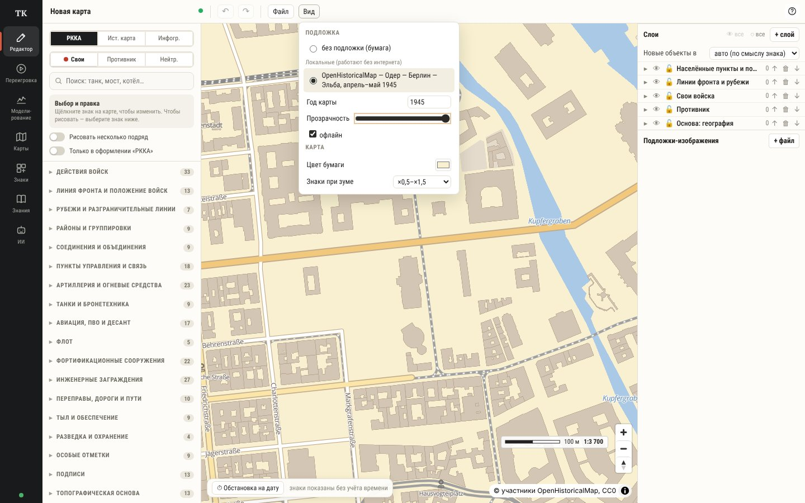

*Редактор, новая пустая карта без шкалы времени; открыто меню «Вид»: в группе «Локальные (работают без
интернета)» выбрана подложка «OpenHistoricalMap — Одер — Берлин — Эльба, апрель–май 1945», «Год карты» 1945,
прозрачность 1, флажок «офлайн». На карте — центр Берлина в 1945 г. (1:3 700): здания — заливкой, со
дворами; улицы с подписями (Behrenstraße, Charlottenstraße, Markgrafenstraße, Friedrichstraße,
Jägerstraße), широкая Унтер-ден-Линден (в OHM — без имени), пунктиром — рельсовые пути, справа —
Купферграбен, рукав Шпрее. Здания показаны на 1945 г.: построенные позже скрыты.*

### 3.3. Время и реестр объектов

Под картой — шкала времени: карта показывает обстановку на выбранный момент, знаки появляются и
исчезают по своим периодам и движутся между положениями плавно или скачком; есть проигрывание с
выбором скорости. Время — московское и местное (по месту событий, с историческими правилами
часовых поясов).

При проигрывании перерисовывается только то, что изменилось за кадр: отрисованный знак
запоминается, и неподвижные знаки (линии фронта, рубежи, разграничительные линии, стоящие части)
берутся готовыми, а на карте обновляются лишь сдвинувшиеся знаки; панель итогов и легенда
переигровки на кадрах не перерисовываются. Знак, который при отрисовке смотрит на другой знак
(стрелка, привязанная к линии или к знаку), рисуется заново каждый кадр.

Знак можно связать с **объектом реестра** («5 уд. А», «Рейхстаг»): характеристики объекта
(номер, ступень, род войск; во времени — подчинение, командир, численность, положение) хранятся
один раз и видны со всех карт. Изменения записываются фактами «с даты» со ссылкой на источник.
Реестр отвечает и на пространственно-временные вопросы: «какие объекты были в этом районе на
25 апреля».


*Выбранная надпись «5 Уд. А»: слой и оформление, масштабы видимости, связь с объектом реестра (найти или создать), период присутствия на карте и положения по датам, параметры текста.*

### 3.4. Совместная работа, обмен, экспорт

- **Хранение карт.** «Файл → Сохранить на сервер» (Ctrl+S) сохраняет карту с ревизиями (хранятся 50 последних).
  В настольном приложении «сервер» — служба документов на этой же машине, карты лежат в папке данных приложения
  (раздел 11). В серверном варианте (раздел 13) карту могут изменить другие пользователи или внешняя система: если
  карту успели изменить, редактор предлагает перезаписать или загрузить свежую версию, чужие правки приходят
  потоком событий и подгружаются сами.
- **Черновик.** Текущая карта сохраняется черновиком в хранилище окна автоматически; в браузере без сервисов
  редактор работает только с черновиком и файлами.
- **Файлы:** документ JSON; GeoJSON в обе стороны (на выбранный момент времени); SVG со слоями —
  группами Inkscape и Illustrator; PNG как на экране (с картой) и PNG только знаков, со
  встроенными шрифтами.
- **Внешние системы** (в серверном варианте, раздел 12) могут владеть своим слоем карты и заливать в него
  данные в GeoJSON — остальная карта не затрагивается.

## 4. Библиотека знаков

250 элементов в 18 категориях: действия войск; линия фронта и положение войск; рубежи и
разграничительные линии; районы и группировки; соединения и объединения; пункты управления и
связь; артиллерия; танки и бронетехника; авиация, ПВО и десант; флот; фортификационные
сооружения; инженерные заграждения; переправы, дороги и пути; тыл; разведка и охранение;
особые отметки; подписи; топографическая основа. У каждого знака — описание, оформления,
учёт принадлежности (свои, противник, нейтральные) и источник со страницей. Знаки, которых в
первоисточнике нет, помечены «сверить» (28).


*Справочник знаков: переключение оформления, поиск, описание и источник у каждого знака. Полный перечень — [library.md](library.md), печатный справочник — [library.pdf](library.pdf).*

## 5. Карты: подложки и театры

**Подложки в закрытом контуре.** Сервис картографии хранит тайловые карты у себя и отдаёт их
редактору. Карты попадают туда четырьмя путями: загрузкой тайлов внешнего сервиса, пока он доступен
(район и уровни задаются, ход загрузки виден); нарезкой привязанного скана; пакетом из другой
установки; загрузкой карты OpenHistoricalMap района (ниже). Импортируются и карты других программ: MBTiles, Locus/RMaps `.sqlitedb`,
OziExplorer `.map` с растром. Подложку можно показать районом или подложить под любую карту
системы. Подробно — [cartography.md](cartography.md).


*«Карты → Подложки»: слева выбрана подложка «OpenHistoricalMap — Одер — Берлин — Эльба, апрель–май 1945»,
«Год карты» 1945, «офлайн»; в «Локальных картах» — кнопки «+ скачать», «+ OpenHistoricalMap», «из файла»
и открытая форма OpenHistoricalMap: район — театр «Одер — Берлин — Эльба» (11.000, 50.900, 15.600,
54.450), «по текущему виду», название, оценка «Участков 285 · ≈ 10 мин · ≈ 137 МБ», «Скачать». Ниже —
скачанная карта театра: «94 373 объектов · 137.2 МБ · данные на …» и кнопки «подложить»,
«показать район», «обновить», «пакет ↓». Справа — она же на 1945 г. (1:940 100): дороги по классам,
реки и озёра, пунктиром — границы, названия того времени (Landsberg an der Warthe, Königsberg in der
Neumark); внизу справа — подпись «© участники OpenHistoricalMap, CC0».*

**OpenHistoricalMap без интернета.** OpenHistoricalMap (OHM) — карта мира по образцу OpenStreetMap,
где у объектов есть даты начала и конца (`start_date`, `end_date`; данные — CC0). Кнопка
«+ OpenHistoricalMap» в «Картах → Подложки» скачивает все объекты OHM района — театра операции из
списка или текущего вида — и до начала показывает оценку: участков, минут, мегабайт. Загрузка идёт
участками 0,25° × 0,25° через сервер Overpass OHM: запросы по одному, с паузой не меньше секунды,
с повторами при отказе; каждый скачанный участок сохраняется, поэтому остановленную или
сорвавшуюся загрузку можно «продолжить» с места. Потом служба картографии сама режет объекты в
векторные тайлы (один файл MBTiles):

| Слой | Что | С уровня |
|---|---|---|
| дороги | магистрали и основные, второстепенные, улицы, проезды и тропы | 0 / 8 / 10 / 13 |
| железные дороги | ж/д; трамвай, метро, узкоколейки | 0 / 10 |
| вода | реки и каналы, ручьи и канавы, водоёмы | 0 / 10 / 0 |
| земли | лес, поля, луга, застройка, кладбища, парки | 8 |
| здания | все здания | 13 |
| границы | государства и земли (уровень до 4), округа | 0 / 8 |
| пункты | города, городки; сёла; районы и хутора | 0 / 8 / 10 |
| значки | церкви, ратуши, вокзалы, замки и памятники | 13 |

Тайлы нарезаны до z16, глубже растягиваются при показе (до z19) — видны отдельные здания.
Карта показывается **на дату**: виден объект, у которого начало не позже даты, а конец не раньше
неё; объект без даты виден всегда. Дата — шкалы времени, а без шкалы — 1 января года из поля
«Год карты»; в переигровке — начало операции. Шрифты (латиница и кириллица) и значки стиля скачиваются вместе
с данными, так что карта работает без интернета целиком. У карты в списке — «обновить» (скачать
район заново: OHM постоянно дорисовывают), «пакет ↓» (перенос на другую машину, загрузка там —
«из файла»; пока карта не скачана, кнопка недоступна), строка «N объектов · X МБ · данные на дд.мм.гггг».
Район — не больше 400 участков: объекты района служба держит в памяти целиком, и больший район
надо делить на части.

Театр «Одер — Берлин — Эльба» (11,0–15,6° в. д., 50,9–54,45° с. ш.) — 285 участков. В проверочном
прогоне (пауза 1 с) участки скачаны за 8 мин 27 с — 1,8 с на участок, без повторов: все 285 запросов
к Overpass ответили с первого раза; сборка объектов и нарезка заняли ещё 1 мин 5 с, всего — 9 мин 32 с.
Объектов — 94 373: дороги 44 888, здания 16 987, границы 15 965 (один путь входит в границы разных
лет, но признак на путь — один на слитый промежуток лет), вода 5296, железные дороги 4996, пункты
3960, земли 1432, значки 849; тайлов — 324 313, файл — 137 МБ (тайл z4–5 — до 0,27 МБ). Ответы
Overpass весили вместе около 1,8 ГБ, поэтому на медленной связи загрузка идёт дольше. Пик памяти
службы — 1,3 ГБ; повторная нарезка из скачанных участков («продолжить» после сбоя замены файла) —
1 мин 34 с без запросов к Overpass, пик 0,9 ГБ. Оценка в форме (2 с на участок, 8,4 МБ на
квадратный градус) взята из этого прогона.

Ограничения: полнота OHM неравномерна (города и отдельные земли нарисованы подробно, многие районы —
только дорогами, реками и границами); мультиполигон, часть которого лежит за краем
района, не показывается; даты в OHM — обычно год или месяц (неполная дата начала — с 1 января,
конца — по 28 декабря).

**Театры** — карты местности для переигровки: сетка клеток с покровом (ESA WorldCover),
рельефом (Copernicus DEM), реками, дорогами, мостами, районами (OpenStreetMap) и укреплениями.
Новый театр собирается по области сборщиком на Python с GDAL — в серверном варианте и в разработке; в настольном
приложении сборка выключена (готовый театр загружается файлом, исторический слой работает). **Исторический слой**: по подложенной карте того
времени стенд распознаёт по образцам цвета дороги, застройку, воду, лес и сравнивает дороги
карты с дорогами театра — современные дороги, которых в 1945 г. не было, можно убрать. Дороги можно
распознать и без образцов — по современной сети: цвет дорог узнаётся вдоль дорог театра, каждый отрезок
проверяется по карте (раздел 17.2).
По цвету с карты берутся только классы её легенды: у дорожной карты РККА — дороги и вода (типы дорог и
сёла по цвету не различить). Классы дорог (магистрали, основные, второстепенные, местные) и районы
(города, городки, сёла, районы городов) задаются при сборке театра из OpenStreetMap — «Что извлекать».

Слой **«Местность: контуры»** — многоугольники местности: у растровых театров они строятся из растра
по краям клеток (лес и болото — их знаками, застройка, высоты и вода — заливкой), с дырами (озеро в лесу);
в редакторе и в выгрузке GeoJSON — те же контуры.


*Театр Одер — Берлин: рельеф, реки, железные дороги, мосты и укреплённые полосы («Вотан»); слева — слои театра, область и выгрузка.*

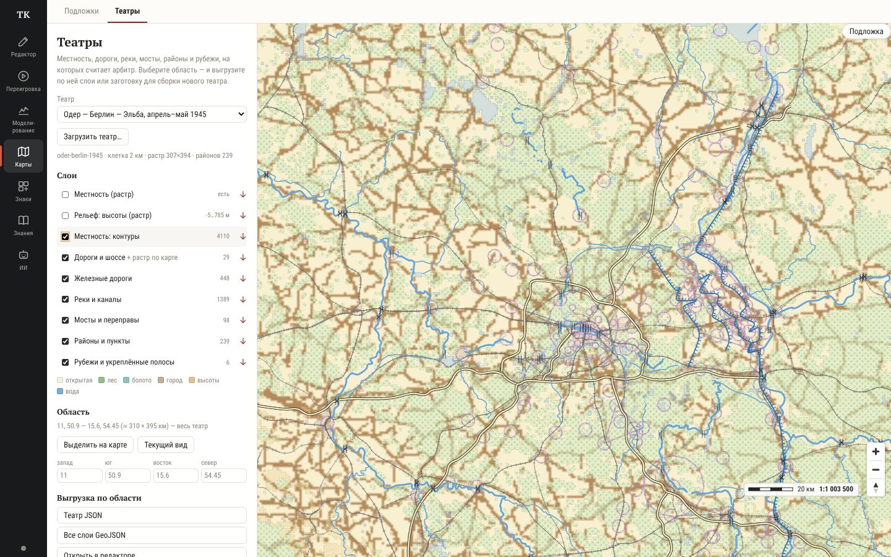

*Тот же театр со слоем «Местность: контуры» (4110 контуров) вместо растра: леса — знаком леса, озёра —
голубой заливкой; коричневые клетки — дороги, распознанные по карте РККА («+ растр по карте»), сиреневые
круги — районы и пункты.*

## 6. Переигровка и игра

**Переигровка.** Выбирается операция (Берлинская, бой в Берлине, Висло-Одерская или своя),
набор правил и число прогонов. Обе стороны получают исторические задачи; арбитр считает
движение (по дорогам, с разбросом путей вне городов), бои, подвоз, окружения, территорию.
Результат сравнивается с историей: доля положений в допуске, ключевые события по дням. Карта
показывает расчёт по ходам на трёх масштабах — тактическом, оперативном, стратегическом — с
историческими положениями и фронтом для сравнения, боями, рубежами, участками, полосами фронтов
и разграничительными линиями.


*Тактический масштаб, 23 апреля: расчётный фронт хода (красный), он же сутки назад (тонкий пунктир), передний край на начало операции (с жёлтой подсветкой) и исторический фронт (серый); бледные знаки — исторические положения, стрелки — бои за ход; штрихпунктиром — разграничительная линия по директиве; Берлин и Франкфурт (справа) — обводом крепости по застройке города, знаки понтонного моста — переправы. Слева — события по пяти прогонам.*

**Сохранённые переигровки.** Под результатом расчёта — «Сохранить»: переигровка сохраняется целиком
(карта, сводная карта, отчёт, события, сверка с историей; у агентной модели — и ход дивизий по часам с
историей) в хранилище браузера или окна приложения на этой машине. Вкладка «Сохранённые» над выбором
операции — список: название (по умолчанию — операция, модель или правила, seed), модель, когда сохранено,
доля положений в допуске и события; «Открыть» показывает переигровку без пересчёта — с теми же
настройками формы, картой и плеером, у агентной модели — с карточками агентов, разговором и «Принять
командование». Название можно изменить, сохранение — удалить.


*Вкладка «Сохранённые»: две переигровки Берлинской операции — на нынешней модели (правила ww2-berlin-cal)
и на агентной (выделена — открыта); на карте — открытая агентная переигровка, 22 апреля, оперативный
масштаб.*

**Модель расчёта: нынешняя или агентная.** В настольном приложении (раздел 13) у Берлинской и
Висло-Одерской операций есть выбор «Модель»: нынешняя (армии и корпуса, ход — сутки, считается в фоновых потоках окна) или агентная (каждая
из 347 дивизий со своим состоянием и штабами, шаг — час; раздел 7). Агентную модель считает ядро на
Rust внутри приложения (`crates/agents-core`, команды — `crates/agents-tauri`), карту по её ходу строит
тот же код, что и для нынешней: снимки через 6 ч, дивизии подчинены штабам армий и фронтов сценария,
поэтому работают все три масштаба, полосы, котлы и крепости. Сверка — с положениями дивизий по
документам (допуск сверх неопределённости источника) и с теми же ключевыми событиями; отчёт — краткий,
с таблицей событий. Правила и число прогонов у агентной модели не выбираются; вместо правил —
«Параметры»: базовые или сохранённый вариант из калибровки (раздел 7). В браузере без приложения выбора нет.

**Висло-Одерская операция на агентной модели — с допущениями.** Реестра советских дивизий на январь 1945 г.
пока нет, поэтому сценарий (`npm run agents:vistula-data`, `packages/sim/tools/agents/build-vistula.ts`)
собран из сценария нынешней модели. Немецкая сторона — его 39 дивизий, каждая агентом с численностью,
положением и сроком ввода, и корпусные группы. Корпуса и крепости без разбивки — группа Заукена, V горный
корпус СС, крепости Познань, Бреслау, Шнайдемюль — по одному агенту. Советская сторона разложена из армий
(всё — достоверность C):
- общевойсковая армия — 9 стрелковых дивизий (3 корпуса по 3), силы армии поровну;
- танковая армия — 2 танковых и 1 механизированный корпус;
- отдельный танковый корпус — агентом, кавалерийский — тремя кавдивизиями;
- расстановка — двумя эшелонами поперёк направления первого удара армии;
- артподготовка: у 1-го Украинского фронта 12.01 — 1 ч 47 мин, у 1-го Белорусского 14.01 — огневой налёт
  25 мин, плотность — норматив правил.

Всего 176 советских и 44 немецких агента, 41 штаб, 1006 приказов. Сверка — по положениям немецких дивизий
и советских танковых корпусов из истории сценария (126 положений) и по 13 событиям. Прогон занимает около
4 с. Сходство: 36–42 % положений в допуске (медиана превышения 19–23 км) и 6 из 13 событий в пределах
±2 сут (seed 1 и 2). Советская сторона идёт быстрее истории: Катовице — на 7 суток раньше, выход к Одеру у
Оппельна — на 5. Допущения заменяются данными по мере сбора реестра советских дивизий.

**Карточка соединения.** Щелчок по знаку соединения на карте переигровки открывает справа его
карточку — на любом масштабе и у любой стороны: дивизия, корпус или армия на тактическом масштабе,
объединение на оперативном, надпись фронта или группы армий на стратегическом. В карточке:

- название, сторона, ступень и вышестоящий на этот момент — с переподчинениями по датам, если сценарий
  их несёт; щелчок по вышестоящему открывает его карточку;
- положение (наступает, обороняется, на марше, отходит, в резерве), люди и танки с долей от исходных,
  боеприпасы в боекомплектах, отрезано ли от снабжения;
- подчинённые соединения списком — силы и положение каждого; щелчок по строке открывает его карточку.

Данные — снимок расчёта после хода, последний не позже момента на плеере: при проигрывании карточка
меняется вместе с картой. У штаба без своих войск (фронт, группа армий, армия, все силы которой — в
корпусах) силы — сумма его действующих соединений вниз по подчинённости; положение — то, в котором
больше 40 % его людей; отрезанные — сколько соединений из скольких; боеприпасы — средние по людям. Доля
считается от исходных сил введённых соединений с пополнениями, пришедшими к этому моменту; не введённые
ещё соединения в сумму не входят и в списке помечены «не введено». Знак выбранного обведён кольцом.
Щелчок мимо знаков карточку не закрывает, закрывают «×» и Esc. Знак связан с формированием расчёта по
его id, а не по названию. Переигровки, сохранённые до появления карточек, карточек не показывают — их
нужно рассчитать заново.

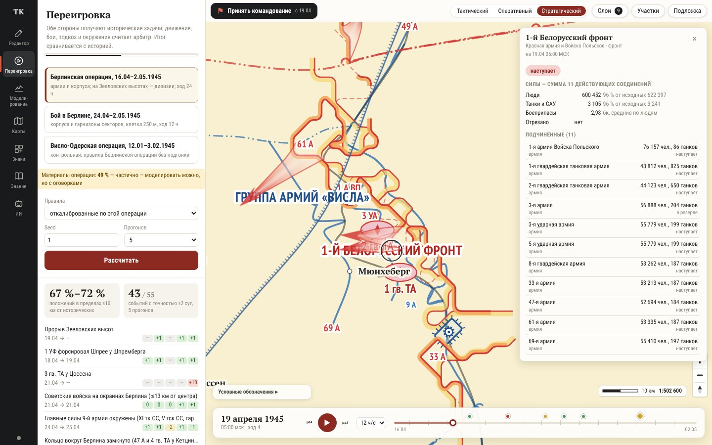

*Карточка 1-го Белорусского фронта, 19 апреля 05:00, стратегический масштаб: надпись фронта на карте
обведена кольцом; справа — «наступает», силы — сумма 11 действующих соединений: люди 600 452 (96 % от
исходных), танки и САУ 3 105, боеприпасы 2,98 бк; ниже — подчинённые армии с людьми, танками и
положением (3-я армия — в резерве).*

**Агент на карте.** После расчёта на агентной модели щелчок по дивизии открывает справа её карточку —
на час, показанный на карте; выбранная дивизия обведена кольцом. «Карточка»: состояние и приказ,
окружение, переменные (люди, танки, орудия, боекомплекты, заправки, усталость, организованность) с
графиками за всю операцию, машина состояний с текущим подсостоянием, исходные данные с источниками,
положения по документам с расстоянием от расчёта и журнал агента с причинами; щелчок по строке
документа или журнала переводит карту на этот час. «Разговор» — вопрос агенту через языковую модель
(раздел 9): голос «Командир» знает только своё на этот час (состояние, свои приказы и события,
противника в 15 км), «Разбор» видит ещё исходные данные и документы. Модель отвечает по выданным
записям со ссылками вида [J3]; щелчок по ссылке переводит карту на час записи, записи раскрываются
под ответом.

Щелчок по штабу — армии, корпусу или фронту — открывает карточку штаба, устроенную как карточка соединения
выше, но по ходу агентной модели на час: его дивизии вниз по штабам, их суммарные люди и танки (доля — от
них же на начало; не введённые в операцию не считаются), положение по большинству людей, сколько дивизий в
окружении, средние боеприпасы. Подчинённые — штабы и дивизии; щелчок по дивизии открывает карточку агента.
Кнопка «Показать дивизии» переключает карту на тактический масштаб с приближением к штабу.


*Агентная модель в «Переигровке», 20 апреля 22:00, оперативный масштаб: армии собраны из дивизий агентной
модели — удары 3-й и 4-й гв. танковых армий к Цоссену и в обход Берлина, бледные знаки — исторические
положения дивизий; слева выбрана «агентная — дивизии»: 56 % положений в допуске, 7 событий из 15 с
точностью ±2 сут.*


*Карточка 39-й гв. стрелковой дивизии (8-я гв. армия), 20 апреля 22:00, тактический масштаб: дивизия на
карте обведена кольцом; справа — «наступление: атака», приказ штаба армии «наступать», переменные с
графиками (люди 3 810, усталость 0,64, организованность 0,34) и машина состояний с выделенной группой
«Наступление»; вкладка «Разговор» — вопросы агенту.*

**Игра на агентной модели.** «Принять командование» после расчёта на агентной модели открывает тот же
экран командования, что и на нынешней модели (абзац «Игра» ниже в этом разделе): доклады, разведка с туманом войны,
решение, приказы, журнал, посредник, советник и варианты решения, штаб противника на языковой модели,
сохранение и продолжение игры. Меняется расчёт: ход (12 ч) считает ядро приложения по дивизиям.
Доклады — по дивизиям и по армиям и корпусам (силы — суммой по их дивизиям); приказ армии или корпусу
ядро доводит до всех их дивизий с задержкой штаба, приказ дивизии — ей одной, цель — пункт, соединение
противника (его место сейчас) или точка. Донесения за ход — значимые события дивизий из журнала агентов
(бой, отход, окружение, выход из строя, выполнение задачи). Штаб противника на модели получает свою
обстановку так же и отдаёт приказы через ядро; без него немецкая сторона идёт по приказам сценария.
Штабы корпусов и армий агентной модели, решающие на языковой модели, получают с каждым ходом текст
доктрины своей стороны из базы знаний (раздел 8.9) на время игры — до 8 правил, не длиннее 4000 знаков,
группы поводов по очереди (первое правило каждой группы, затем второе…), чтобы в текст попали все группы:
немецкие — правила обороны армии, корпуса и дивизии к вклинению, давлению и окружению (контрудары, резервы,
отход, построение обороны), советские — правила наступления армии и корпуса (эшелоны, ввод подвижных
групп, темп, глубина задач) и обхода узлов обороны. Правило, в котором есть дата позже времени игры
(приказ или опыт после него), не берётся. Так же при расчёте агентной модели в «Переигровке» и
«Моделировании» — на начало сценария. Текст из базы заменяет в промпте штаба только зашитые правила
доктрины; словарь полей обстановки и жёсткие ограничения остаются всегда: у немецких штабов — общий отход
армии без приказа сверху запрещён, окружённой дивизии (encircled_hours, own_lines_km) — прорыв к своим; у
советских — числа эшелонов и ввода, узлы обходить, не штурмовать с ходу неподавленного противника. База
недоступна или правил стороны нет — штаб получает прежний текст доктрины, зашитый в ядро; числа доктрины,
по которым ядро считает штабы по доктрине, текст не меняет (они — в `agents-v0.json`).
Игра может идти дольше сценария агентной модели — до победы или предельного срока.

Распоряжения штаба — вкладки «Тыл», «Переправы», «Резервы», «Полосы» — работают так же, как на нынешней
модели: проверку, сроки и учёт ведёт она, а последствия исполняет ядро. Подвоз — от баз снабжения по
своей территории (территорию сторон даёт ядро): дальше предела в пути — подвоза нет, база далеко —
меньше, приоритетным объединениям — ×1,5, остальным — ×0,75; ядро получает множитель подвоза на ход
для каждой дивизии. Наведённая переправа к своему сроку позволяет дивизиям в 3 км от неё переходить
реку без задержки форсирования; подорванный мост перестаёт действовать. Будущие исторические наводки
переправ стороны игрока при передаче командования снимаются. Резервы стороны игрока сами не вводятся:
ввод — по распоряжению, дивизия появляется в районе сосредоточения к сроку. Линии между фронтами (по
директивам и решениям Ставки) и между армиями (распоряжения игрока) делят полосы: дивизии выбирают
путь своей полосой — клетки полосы соседа при выборе пути «дороже», время движения то же. Ставка на
модели рассматривает ходатайства и в игре на агентной модели. Посредник с поправками к боям — только
на нынешней модели.


*Вкладка «Тыл» на агентной модели после хода, 20 апреля 11:00: база «Кюстринский плацдарм» переносится
и заработает 21.04 02:00, остальные базы действуют; рядом — вкладки «Переправы», «Резервы», «Полосы».*


*Экран командования на агентной модели, 19 апреля 23:00: в шапке — «агентная модель: дивизии, расчёт по
часам»; во вкладке «Приказы» 8-й гвардейской армии отдан приказ «наступать» с целью Мюнхеберг (выбран из
ближайших пунктов), внизу — «Провести 12 ч».*

**Масштабы карты.** Переключатель над картой («Тактический», «Оперативный», «Стратегический»)
меняет степень обобщения — как на штабных картах разных инстанций. Расчёт один и тот же:
обобщённые знаки строятся из положений соединений по ходам. Выбор масштаба запоминается и
действует и в переигровке, и в игре.

| Масштаб | Что на карте | Направления | Окно |
|---|---|---|---|
| Тактический | каждое действующее соединение (дивизия, корпус, армия — как в сценарии) своим знаком, бои за ход | стрелки боёв | ход |
| Оперативный | объединения: армии и соединения, не входящие в армию; знак — овал, у танковых и механизированных — знак механизированного соединения | удар объединения, отход, рубеж обороны | сутки |
| Стратегический | в манере исторического атласа: фронты и группы армий — крупной надписью прописными, армии — подписью, танковые армии — овалом с ромбом; линия фронта — красная с оранжевой полосой; крепости и ключевые пункты | главный удар фронта (клин атласа), отход, оборона | двое суток |

Как строятся обобщённые знаки (оперативный и стратегический масштабы):

- **Группировка.** Каждое действующее соединение относится к ближайшему вышестоящему объединению
  нужной ступени по подчинённости сценария: на оперативном — к армии, на стратегическом — к
  фронту или группе армий. Соединение, у которого такого старшего нет, показывается само:
  например, 12-я армия, подчинённая ОКВ, на стратегическом масштабе идёт под надписью «ОКВ».
- **Место.** Знак или надпись стоит в центре тяжести своих соединений — среднем положении,
  взвешенном по численности; уничтоженные и ещё не введённые не учитываются. Знак движется по
  ходам вместе с войсками.
- **Состояние.** Подсказка у знака: сколько соединений, численность, танки и что объединение
  делает — наступает, обороняется, отходит или на марше и в резерве (если в этом положении больше
  40 % его людей). Состояние видно и по знаку (оперативный масштаб): на марше или в резерве
  (меньше 20 % людей наступают, обороняются или отходят) — правая половина овала заштрихована;
  разгромлено — осталось меньше половины наибольшей численности объединения или большая часть
  отрезана и потеряно больше 45 % — овал перечёркнут (у противника — красной чертой). Знак
  меняется не чаще раза в сутки, кроме перехода в «разгромлено»; из него — только если численность
  вернулась выше 75 %. На тактическом масштабе уничтоженное соединение остаётся на месте гибели
  перечёркнутым крестом.
- **Котлы.** На всех масштабах — контур окружения (кромка с зубцами внутрь): у противника — синяя,
  у своих — красная. Котёл — кусок территории стороны, отделённый от её основной территории не
  меньше чем тремя клетками чужой земли и не выходящий к краю театра, где есть её войска и большая
  часть их людей отрезана от подвоза; без учёта территории — отрезанные соединения, стоящие рядом.
  Подсказка: кто в котле и сколько людей. Слой «Котлы» и строка легенды.
- **Крепости** (гарнизоны с правом обхода — Festung: Франкфурт, Штеттин, Берлинский оборонительный
  район, Познань, Варшава) на оперативном и стратегическом масштабах — знаком города-крепости с
  названием; павшая — перечёркнута. Вокруг гарнизона — обвод крепости по застройке города
  (кромка с зубцами наружу, цветом стороны): контур клеток городской застройки слоя местности
  театра — по снимкам WorldCover или, если для театра применён исторический слой с местной
  карты РККА или плана города (раздел «Карты»), по нему; у Берлина — по плану 1945 г. Слой
  «Крепости» и строка легенды. В сценарии боя в городе (клетка мельче километра) обвода нет:
  там застроено всё. На обоих масштабах подписаны и места событий истории (кружок и
  название, одноимённые и близкие — один раз).
- **Переправы.** Наведённые переправы театра и переправы, наведённые сапёрами по ходу расчёта
  (раздел 19.5), — знаком понтонного моста, только на тактическом масштабе: на обзорных их знаки
  сливаются в «молотки».
- **Линия фронта по датам.** Кроме расчётной линии фронта хода на карте — та же линия суточной
  давности пунктиром (видно, куда сдвинулся фронт за сутки) и передний край на начало операции с
  жёлтой подсветкой — на всю операцию. Оба слоя включаются вместе с линией фронта (флажок
  «Линия фронта (расчёт)», строки легенды).
- **Направления армий** (оперативный масштаб). Стрелка — куда сместился центр тяжести армии
  за сутки, если не меньше 3 клеток. Удар — если армия наступает (в наступлении не меньше 30 %
  людей); отход — если больше 40 % людей отходит; иначе — по направлению на противника.
- **Ось танковой армии** (оперативный масштаб). Танковая армия вместо суточных стрелок ведёт
  ось с ромбами — линию через её положения на начало каждых суток от начала операции до текущего
  хода, с остриём у знака армии. У пройденных точек — даты («17.4», «18.4»): дата появляется,
  когда армия оттуда ушла, и остаётся до конца операции.
- **Главные удары фронта** (стратегический масштаб) собираются из ударов его армий за двое
  суток: удары, близкие по месту (до 30 км) и направлению (до 40°), сливаются в один, с весом по
  численности. На фронт — до трёх главных ударов и до двух отходов; слабее 6 км за двое суток
  не рисуются. Подпись стрелки называет армии, из которых сложен удар, например
  «1 БФ: удар на 24 км за 2 сут (8 гв. А, 1 гв. ТА)».
- **Расходящиеся удары** (стратегический масштаб). Два удара фронта из одного района (хвосты
  ближе 30 км), расходящиеся на 25–90°, рисуются одной разветвлённой стрелкой: ствол идёт от
  середины хвостов по общему направлению на половину меньшего из ударов, дальше каждая ветвь —
  своим направлением на остаток своей длины.
- **Удар остановлен.** Если за следующие сутки объединение (его центр тяжести) сместится меньше
  чем на полторы клетки, на острие вместо наконечника — поперечная черта «рубеж достигнут» и
  дата («23.4»), как на картах атласов. Размер даты — как у подписей знаков. У прочих стрелок
  даты нет: на карте по ходам все видимые стрелки относятся к одному моменту.
- **Привязка к линии фронта.** Хвост стрелки стоит на расчётной линии фронта этого хода —
  ближайшей к войскам (не дальше 20 км для армии, 35 км для фронта) и крепится к ней, как в
  редакторе. Остриё уходит в глубину на пройденное за окно расстояние, но не короче полутора
  порогов, — направление удара видно, даже если войска только начали движение. Если линии рядом
  нет, стрелка идёт от прежнего положения войск.
- **Оборона.** Если объединение почти не сдвинулось, а больше половины его людей в обороне, —
  рубеж обороны поперёк направления на противника, по ширине расположения его соединений,
  чуть впереди центра.
- **Туман войны.** В игре обобщённые знаки противника строятся только из обнаруженных
  разведкой соединений: группа армий, у которой видна одна дивизия, стоит там, где эта дивизия.

**Полосы фронтов и разграничительные линии.** На карте два слоя:

- **по директивам** — исторические разграничительные линии (раздел 17.1): 1-го Белорусского и
  1-го Украинского фронтов с 15.04 (до Люббен), с 23.04 (до Ангальтского вокзала), с 24.00 28.04
  (в Берлине — до ст. Рулебен) и с 6.05; 2-го и 1-го Белорусских фронтов (Арнсвальде — Шведт —
  Ангермюнде — Гранзее — Виттенберге); бомборазграничительная линия с ВВС союзников с 21.04.
  Каждая видна в сроки своего действия; в подсказке — пункты, документ, архивный шифр и
  достоверность;
- **расчётные полосы** — границы полос между фронтами (на всех масштабах) и между армиями
  одного фронта (на оперативном), по ходам: от переднего края в глубину до 40 км (в городе —
  до 5 км). Где действует директива, расчётная граница идёт по её линии; где директивы нет или
  за концами её линии — по расположению войск: клетка принадлежит тому объединению, чьи войска
  к ней ближе.

Оба слоя включаются в «Слоях» («Разграничительные линии: директивы и распоряжения», «Полосы фронтов и
армий (расчёт)») и строками легенды. В игре видны только свои полосы.

**Управление картой.** Управление — отдельной полосой над картой, карта начинается под ней и
кнопками не закрывается. В полосе: «Принять командование» (в переигровке), переключатель
масштаба, меню **«Слои»** (число — сколько слоёв включено), «Участки» и «Подложка». На узком
экране полоса переносится во вторую строку, а карта сдвигается ниже. В «Слоях» вверху — «Показать все» и
«Скрыть все» (все слои меню и подписи сразу; войска и подложка остаются), ниже флажками включаются подписи знаков, исторические положения, линия фронта
по истории и расчётная, бои за ход (только на тактическом масштабе), рубежи, разграничительные
линии по директивам и расчётные полосы; в игре — ещё
замысел (проект приказов), тыл и реки для переправ. Слои от масштаба не зависят, кроме исторических
положений: на тактическом масштабе — положения действующих соединений (у агентной модели —
дивизий), на оперативном — положения армий (у агентной модели — по её истории армий), на
стратегическом их нет, как в атласе; знаки исторических событий видны на всех масштабах. Легенда
показывает знаки выбранного масштаба; её строки тоже включают и выключают слои.


*Полоса управления над картой и открытое меню «Слои»: вверху кнопки «Показать все» (сейчас неактивна —
всё уже включено) и «Скрыть все», ниже — флажки подписей и слоёв.*

**Подложка OpenHistoricalMap.** В меню «Подложка» переигровки и игры есть и скачанные карты
OpenHistoricalMap (раздел 5). Такая карта показывается на дату начала операции — строка «Карта на
дату: начала операции, дд.мм.гггг» — и по ходу не меняется: за две-три недели операции данные OHM
не меняются, даты в них — обычно год или месяц. В расчёт подложка не входит.

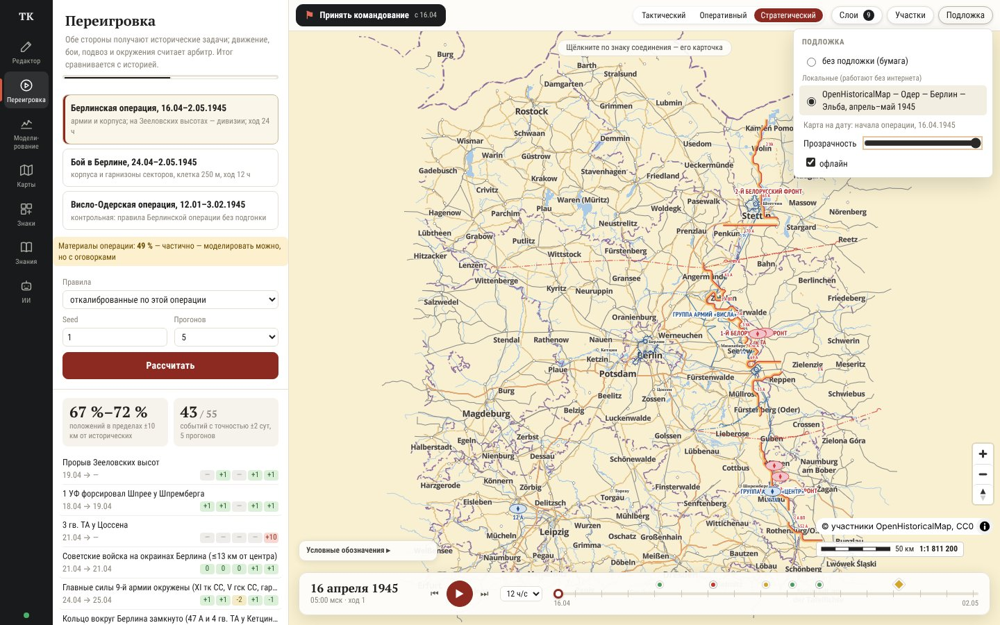

*Переигровка Берлинской операции, стратегический масштаб, 16 апреля 1945 г., ход 1; весь театр
«Одер — Берлин — Эльба» (1:1 811 200). Открыто меню «Подложка»: «OpenHistoricalMap — Одер — Берлин —
Эльба, апрель–май 1945», строка «Карта на дату: начала операции, 16.04.1945», прозрачность 1,
«офлайн». На подложке — реки и озёра, дороги по классам (главные — оранжевым, прочие — серым),
пунктиром — границы, города и сёла с названиями того времени (Stettin, Seelow, Reppen, Zielenzig).
Поверх — передний край на начало операции, подписи фронтов, армий и групп армий («Висла», «Центр»),
крепости Штеттин и Берлин, штрихпунктиром — разграничительные линии фронтов. Внизу справа подпись
«© участники OpenHistoricalMap, CC0» стоит над линейкой масштаба.*

**Подписи.** Подписи соединений — сокращениями штабных карт: «8 гв. А», «26 гв. ск», «7 гв. кк»,
«545 нгд», «309 пд», «11 тгд СС», «XI тк СС», «гарн. Штеттин»; собственное имя номерной дивизии
(«Берлин», «Нордланд») на карту не выносится, у дивизии без номера подпись — её имя
(«Курмарк»). Полное название — в подсказке при наведении. Флажок «Подписи знаков» выключает
подписи на карте (остаются при наведении). На карте подписи **разрежаются**: подписи идут по важности — объединения выше
соединений, расчёт выше исторических положений, армия выше корпуса, корпус выше дивизии.
Подпись, которая налезла бы на уже поставленную подпись или зашла бы под чужой знак, не
рисуется. У знаков, лежащих прямо друг на друге, подпись одна — у верхнего, видимого. Знак без
подписи остаётся на месте, его название и состояние — в подсказке при наведении. Разрежение
действует только на экране: в выгрузке SVG и PNG все подписи на месте. Внутри коридора размеров
знаков результат от зума не зависит: знаки и расстояния между ними растут вместе.


*23 апреля в оперативном масштабе (исторические положения скрыты): объединения в центре тяжести своих соединений; удары, после которых армия встала, — с чертой и датой «23.4»; справа вверху — ось 2-й гв. танковой армии с ромбами и датами «17.4», «18.4»; Берлин — обвод крепости по застройке города (синяя кромка с зубцами наружу); линия фронта хода — сплошная, сутки назад — пунктиром, передний край на начало — с жёлтой подсветкой; штрихпунктиром — разграничительные линии. Внизу — легенда в две колонки со строкой «крепость: обвод по застройке».*


*Стратегический масштаб, 20 апреля (исторические положения скрыты): надписи фронтов и групп армий, подписи армий, удар 69-й и 33-й армий — клином атласа; линия фронта с оранжевой полосой, исторический фронт — серый; Берлин и Франкфурт — знаком крепости и обводом по застройке города (синяя кромка с зубцами наружу); внизу штрихпунктиром — разграничительная линия 1 БФ / 1 УФ по директиве.*


*25 апреля в манере атласа: «1-й Белорусский фронт», «Группа армий „Висла“» — прописными; армии — подписями, танковые — овалами с ромбом; удары фронта — клиньями атласа, слева — разветвлённый (расходящиеся удары с датой «25.4»); сине-белым — остановленный удар немецких войск; Берлин — знаком крепости внутри обвода по застройке, Франкфурт (справа) — обводом; Кетцин и Мюнхеберг — места событий; линия фронта — красная с оранжевой полосой.*


*Бой в Берлине (клетка 250 м, ход 12 ч), 27 апреля: советские корпуса у кольца S-Bahn, немецкие гарнизоны секторов A–H и Z. С юга на север — разграничительная линия 1 БФ / 1 УФ по директиве от 23.04 (Мариендорф — Ангальтский вокзал); западнее вокзала, где директива линию не установила, граница полос расчётная. В допуске ±2 км — 79–90 % положений.*

**Сводная карта операции.** Кнопка «Сводная карта →» под итогами прогона открывает в редакторе
одну карту всей операции — без шкалы времени, как лист исторического атласа. Её можно править,
выгрузить в SVG или PNG и сохранить, как любую карту.

- **Этапы.** Операция делится на этапы поровну по суткам: три — для операции от 9 суток, два —
  от 4, иначе один. Удары каждого этапа — своим цветом, как в атласе: 1-й — жёлто-красный,
  2-й — розово-красный, 3-й — бледный.
- **Линии фронта на рубежах этапов.** Передний край на начало операции — с жёлтой подсветкой,
  к концу каждого этапа — пунктиром, на конец операции — сплошной; у каждой линии одна дата (на
  самом длинном её куске).
- **Удары армий.** Для каждой армии и каждого этапа — стрелка через её положения (центр тяжести
  соединений) на начало каждых суток этапа. Хвост — на линии фронта начала этапа (если она ближе
  четырёх порогов), остриё — чуть впереди положения на конец этапа. У острия — дата конца этапа;
  если армия к ней встала или операция кончилась — черта «рубеж достигнут». У танковых армий —
  ромбы на оси. На карту выносятся только удары: армия наступала (в среднем за этап не меньше
  четверти людей), сместилась не меньше чем на два порога и шла, а не петляла (смещение — не
  меньше половины пройденного пути). Удары противника — сине-жёлтыми стрелками, его отход —
  тонкими синими.
- **Подписи и состояния.** Армии подписаны у исходного положения, фронты и группы армий —
  крупной надписью. Объединение, разгромленное к концу (по тому же правилу, что на оперативном
  масштабе), перечёркнуто на месте, где оно оказалось; отрезанные к концу соединения противника,
  стоящие рядом (до 25 км), обведены контуром окружения.
- **Заголовок и условные обозначения** — на самой карте: название операции, даты, правила и
  seed прогона; образцы ударов по этапам и линий фронта с короткими пояснениями — легенда узкая и
  стоит внизу у левого края окна, не заходя под линейку масштаба и кнопки карты. Карта открывается в
  исходном масштабе: лист целиком, с запасом снизу под полосу времени.


*Сводная карта Берлинской операции по прогону (seed 1), открытая в редакторе: заголовок, удары армий по трём этапам (16.4–21.4, 21.4–27.4, 27.4–2.5) с датами у острий, у танковых армий — ромбы; синим — удары и отходы немецких войск; передний край на начало — с подсветкой, линии к концу этапов — пунктиром; заголовок вверху и узкая легенда внизу у левого края — на белых подложках с тонкой рамкой; справа от легенды — линейка масштаба и кнопки карты. Справа — слои сводной карты.*

**Игра.** С любого момента переигровки можно принять командование одной стороной. Противником
командует **штаб на модели**: на каждом ходу он получает только то, что мог знать (свои войска,
противник в пределах разведки, итоги суток, ограничения сверху), и отдаёт приказы в той же форме,
что и человек. Игрок получает доклады и разведсводку (туман войны), принимает решение на ход
(оценка обстановки, замысел, риски, донесение), отдаёт приказы войскам и распоряжения по тылу,
переправам и резервам. Арбитр исполняет только приказы в строгой форме; свободный текст идёт в
журнал и советнику.

**Щелчок по знаку в игре.** Щелчок по знаку своего объединения (на агентной модели — и дивизии) выбирает
его и показывает доклад: если открыта не вкладка «Доклады» и не «Приказы», открываются «Доклады» с
раскрытым докладом этого объединения; во «Приказах» оно выбирается в списке войск. Щелчок по знаку
обнаруженного противника открывает справа поверх карты его карточку по разведсводке хода: положение,
оценка сил (округлённо), где он, ближайшее наше объединение и расстояние до него, когда обнаружен (впервые
за прошедший ход, к принятию командования или раньше). Кнопки карточки — «Разведсводка» и, если выбрано
своё объединение, «Целью удара» для него (приказ попадает во вкладку «Приказы»). Знак противника обведён
кольцом; «×» и Esc закрывают карточку. Щелчок по надписи своего фронта открывает «Доклады». Пока на карте
выбирается точка (цель приказа, район сосредоточения, место базы или переправы, разграничительная линия),
щелчок служит этому выбору.

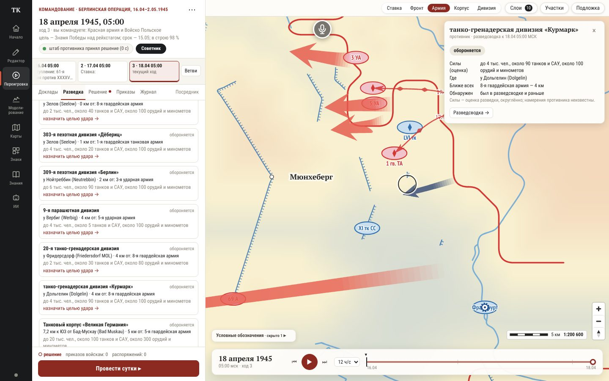

*Карточка противника в игре, 19 апреля 05:00 (ход 1), тактический масштаб: знак танко-гренадерской
дивизии «Курмарк» обведён кольцом; справа — «обороняется», силы по оценке — до 4 тыс. чел., около
80 танков и САУ, около 100 орудий и минометов, у Нойентемпель, ближе всех 8-я гвардейская армия —
5,7 км, обнаружена к принятию командования; слева открыта вкладка «Разведка».*

**Состояние соединений при передаче командования.** До момента передачи операция считается по
сценарию, как в переигровке. Затем состояние действующих соединений обеих сторон уточняется по
фактам базы знаний на этот момент (раздел 8.6): численность, танки и орудия — по факту не старше
суток; положение — по факту не старше суток с координатами, если его неопределённость не больше
допуска ступени (армия 15 км, корпус 8, дивизия 5); подчинённость — по последнему действующему
факту. Дата без времени, как в документах «к исходу дня»: численность и положение на дату — конец
этого дня, подчинённость с даты — с начала дня. Из нескольких фактов берётся самый надёжный (A, B, C),
затем ближайший по дате, затем из более свежего документа; у подчинённости — сначала начавшаяся
позже, надёжность — среди фактов с тем же началом. Закрепления «Основы модели» (раздел 8.6) действуют
на собранные входы операции — начальное состояние и изменения по датам, — а здесь факт выбирается по
правилу, закрепления здесь не действуют. Численность и положение ставятся по фактам, когда подходящий факт есть
(сводка считает такие соединения). Подчинённость берётся, только если меняет состояние: подчинённость, совпадающая с нынешней (по сценарию
с данными базы и переподчинениям к этому моменту), и подчинение старшему над нынешним штабом (фронту
вместо армии) — не поправка; уничтоженные и сведённые соединения не трогаются. Соединение,
о котором подходящих фактов нет, остаётся в расчётном состоянии. Окно «Принять командование» показывает
сводку — сколько соединений поправлено по фактам (численность, положение, подчинённость) и сколько
осталось на допущениях — и ссылку «Основа модели». Состояние и данные базы, с которыми игра началась,
записываются в сохранение: продолженная игра восстанавливается с ними, даже если база с тех пор
изменилась. На агентной модели состояние передаётся ядру по дивизиям.

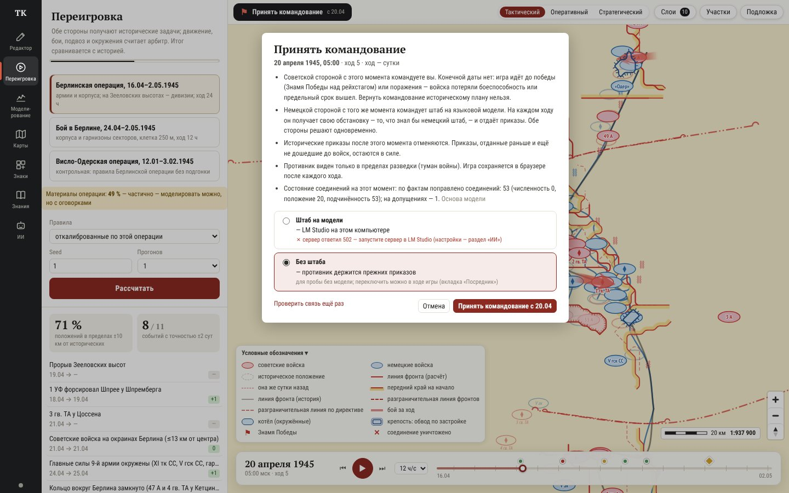

*Окно «Принять командование» на 20 апреля 1945, 05:00 (ход 5): последний пункт — «Состояние соединений
на этот момент: по фактам поправлено соединений: 20 (численность 0, положение 20, подчинённость 0); на
допущениях — 34» и ссылка «Основа модели»; ниже — выбор штаба противника (сервер модели не отвечает,
выбрано «Без штаба»).*

Цели в приказах штаба на модели и советника — названия словами; стенд сопоставляет их с театром.
Пункт ищется сразу среди ближних к войскам и всех пунктов театра. Точное название (с «ё» и
оригиналом в скобках, без «у», «в районе» и т. п. впереди) важнее похожего, поэтому «Альтфридланд»
не становится «Фридландом», «Берлин, Александерплац» — «Берлином», а «Лёкниц» (Loecknitz) —
«Лекницем» (Leknica). При равной похожести берётся ближний пункт. Место, переписанное из доклада
(«8,2 км к ЮЗ от Крайник»), — точка в стольких километрах по румбу от пункта, а не сам пункт.
Полное название соединения противника («Танковая дивизия «Мюнхеберг»») — цель «против него», а не
одноимённый город. Как понят каждый приказ, видно в «Посреднике».

Модель штаба противника выбирается в «Посреднике» отдельно от раздела «ИИ» — своя модель и размышление
(пусто — как в «ИИ»). На агентной модели обстановка штаба сжата, чтобы запрос помещался в контекст небольшой
модели: армии и корпуса — сводкой по дивизиям, полностью — дивизии с поводом (бой за сутки, окружение, меньше
половины людей, мало боеприпасов или горючего), остальные — названиями под своей армией; из разведсводки
полностью — 30 ближних к нашим войскам соединений, остальные — названиями (Берлинская операция: около
11 тыс. токенов вместо 28 тыс.). Если ответ модели не разобран и он пустой или обрывочный, ошибка называет
размер запроса и нужную длину контекста в LM Studio.

**Резервы в игре.** Вкладка «Приказы → Резервы» собирает резервы по армиям. Сверху — сводка:
сколько объединений ждут ввода и сколько в них людей, танков и орудий. В карточке армии — её фронт,
число соединений, силы, с какого срока она готова к вводу и где стоит сейчас («на карте» показывает
это место). Армию можно ввести целиком: выбрать район сосредоточения из ближних пунктов или
щелчком по карте. Её соединения встают в этот район, разнесённые на 3–4 км (точка за линией фронта
пропускается — соединение встаёт в следующую), распоряжение — одной строкой с общим сроком. Отдельное соединение вводится из списка «Соединения». Ниже — то, что уже
вводится: введённые резервы и войска, прибывающие по графику сценария, со сроком и районом. Ещё
ниже — **резервы на театре**: свои соединения в резерве или на марше без боя; «приказ…» открывает
приказ этому соединению. На агентной модели резерв — дивизии армии (например, девять дивизий 28-й
армии), на нынешней — армия целиком.


*Вкладка «Приказы → Резервы» на агентной модели, 17 апреля: 28-я армия (1-й Украинский фронт,
9 соединений) введена в район у Кюстрина одним распоряжением, срок сосредоточения — 20.04 05:00;
ниже — резервы на театре: дивизии на марше и в резерве с кнопкой «приказ…».*

**Полосы и директивы в игре.** В переигровке по истории линии действуют по расписанию
директив. После передачи командования они устроены как в жизни — сверху вниз:

- **Директивы Ставки вступают по обстановке.** Историческая директива вступает в силу, когда
  в игре сложилось то, что её вызвало: линию 23.04 — когда войска 1-го Украинского фронта вышли
  в район Ланквица, линию 28.04 — когда они вышли к Ангальтскому вокзалу; через несколько часов
  на её отдачу (6 и 4 ч). Не сложилось — действует прежняя линия. Уже вступившие к моменту
  передачи командования остаются.
- **Модель-Ставка** решает, когда директив по истории не хватает: срок исторической директивы
  прошёл, а её условие в игре не наступило; войска фронта второй ход подряд стоят в полосе
  соседа; командующий подал **ходатайство в Ставку** (поле во вкладке «Решение»). Модель
  видит фронты и их армии, действующие линии, повод, исторические директивы как образец и
  список пунктов; отвечает «оставить линии» или издаёт линию по пунктам. Директива проверяется
  (оба фронта есть, войска по разные стороны линии) и вступает в силу через указанные часы;
  ответ Ставки — в донесениях и в «Журнале». Включается в «Посреднике» («Модель-Ставка»),
  работает, когда в игре есть модель.
- **Линии армий — распоряжение игрока.** Во вкладке «Приказы → Полосы» выбирается фронт. Под ним —
  его армии с севера на юг: где стоят, какие линии с соседями у них уже есть; щелчок по строке
  показывает армию на карте. Дальше выбирается армия, и ближайшая общевойсковая армия того же
  фронта сама подставляется соседней (список соседей — по удалению, с километрами). Линию можно
  провести своими точками на карте (от тыла к переднему краю) или кнопкой «Предложить линию»:
  она пройдёт через середину между войсками двух армий в сторону противника — направление
  считается по ближайшему обнаруженному противнику для своих соединений в 40 км вокруг;
  предложенную линию можно поправить. Кто справа по ходу линии, стенд определяет по положению
  армий; линия вступает с задержкой доведения армиям и делит полосы армий этого фронта — армии
  идут к целям своей полосой.
- **За немецкую сторону — так же, по-немецки.** Линии между группами армий устанавливает
  **ОКХ** — та же модель высшего командования с немецкой постановкой (группы армий, приказы ОКХ;
  войска, подчинённые ОКВ, например 12-я армия, — тоже на нём); у игрока за вермахт — «Ходатайство
  в ОКХ», «Резервы ОКХ». Линии между армиями одной группы армий — распоряжение игрока
  («Приказы → Полосы»: группа армий, две её армии) или **штаба на модели**: в его решении есть
  распоряжение line — две свои армии и пункты линии по порядку; армии и пункты сопоставляются с
  обстановкой, линия проверяется теми же правилами (армии одного объединения, войска по разные
  стороны) и вступает с задержкой доведения. У немецкой стороны армии — штабы над корпусами и
  дивизиями: кто справа по ходу линии, стенд определяет по среднему положению их войск. Это
  распоряжение есть и у советского штаба на модели, когда игрок командует вермахтом.

Там же — свои полосы словами: с кем граничит каждый фронт и каждая армия, по каким пунктам
проходит линия (будущие директивы игрок не видит), кто стоит в полосе соседа. Если цель
приказа лежит в полосе соседа по действующей линии, редактор приказа предупреждает: войска
пойдут туда, но своей полосой, где можно, а выход в чужую полосу отметится в разборе. Штаб на
модели и советник получают те же сведения в обстановке. Директивы Ставки и распоряжения
записываются в игру, поэтому она восстанавливается по записи точно.


*Вкладка «Приказы → Полосы» на агентной модели, 17 апреля: вверху — распоряжение, линия между 3-й и 5-й ударными армиями, проведённая кнопкой «Предложить линию» (вступит в силу 17.04 17:00); ниже — армии 1-го Белорусского фронта с севера на юг с пунктами, у которых они стоят, и форма новой линии. На карте — линии между фронтами по директивам.*


*Журнал хода: распоряжение о линии армий, директива Ставки по ходатайству командующего (подставная модель), донесения о вступлении обеих линий в силу.*


*Командование 1-м Белорусским фронтом: оперативная сводка, донесения за ход, доклады объединений.*

**Советник** отвечает на вопросы игрока, видя то же, что игрок, и точные правила арбитра;
готовит варианты решения на ход (решительный, осторожный, манёвренный), которые можно принять
целиком или по частям. Сколько вариантов готовить (один, два или три; один — быстрее, что важно на
локальной модели) выбирается рядом с кнопкой «Варианты от советника» во вкладке «Решение» и в самом
советнике — настройка общая и запоминается; подготовку можно остановить. Варианты с приказами, которых
не исполнить (формирования нет среди сил игрока, цель не опознана), советник исправляет одним общим
запросом по такой же подсказке, как штаб противника (ниже), — варианты в ней пронумерованы, — и
исправленные варианты показываются заново (остановка подготовки оставляет их как были): в его сводке — «исправление по
подсказке: N из M приказов исправлено», оставшиеся неисполнимые приказы помечены. Распоряжения — часть каждого варианта: перенос баз и приоритет подвоза,
наводка и подрыв переправ, ввод резервов, разграничительные линии между армиями. Для этого в
обстановке советника — до каких объединений подвоз не доходит или ослаблен, действующие мосты рядом с
войсками, наводимые переправы и свободные понтонные парки, резервы, готовые к вводу (по армиям). На
агентной модели советник и штаб противника видят не только дивизии, но и армии и корпуса — сводкой
по их дивизиям, с пометкой, что приказ армии ядро доводит до всех её дивизий; у каждой дивизии
указано, в какую армию она входит. Поэтому советник отдаёт приказы армиям, называет армии в
разграничительных линиях и вводит резервную армию целиком (в распоряжении — название армии): её
дивизии встают в районе на своей территории, точки за линией фронта пропускаются. Темы «По резервам»
в дереве вопросов — тоже по армиям. Ответ, где названы соединения противника вне разведки, проверяется
программно; противник, с которым свои войска вели бой за ход, считается опознанным (его название
есть в докладе о бое). **Посредник** показывает решения штаба противника — после игры или по желанию; по
выбору модель-посредник даёт ограниченную поправку к бою (в пределах 0,8–1,25) с опорой на
справку из базы знаний.

**На что опираются штаб противника, Ставка и посредник.** Все языковые модели игры берут знания из
одной базы — той, что в разделе «Знания»: встроенная база, материалы и исправления пользователя,
закрепления, смысловой поиск; что может знать каждая роль — таблица в разделе 9.

- **Штаб противника** перед решением получает два блока. «Доктрина вашей стороны» — правила своей
  стороны (раздел 8.9), подходящие к обстановке: стенд смотрит на последний ход и на свои войска —
  окружены ли свои, вклинился ли противник в оборону (прорыв или продвижение от 3 км в бою, где свои
  обороняются), давит ли он (свои обороняются при соотношении от 3), наступают ли свои, есть ли резервы
  в тылу — и берёт группы правил по этим поводам (у немецкой стороны: вклинение — контрудары и резервы,
  давление — отход и построение обороны, окружение — отход и контрудары; у советской: наступление —
  эшелоны, ввод подвижных групп, темп и глубина задач); поводов нет — построение обороны (у советской —
  ширина полос и эшелоны); за ними — правила других групп, близкие по словам к поводам. Из правил с одним
  id берётся одно — закреплённое, иначе надёжнее и свежее; правило, в котором есть дата позже хода (в
  условии, действии, id правила или страницах источника: «18.04.1945», «19.04», «19-apr»; у даты без года —
  год, ближайший к ходу), не берётся — так приказ 1-го Белорусского фронта № 00566 от 18.04 штаб получит не
  раньше 18.04. Не больше 8 правил и 4000 знаков. «Справка из базы знаний» — до 5 записей по
  700 знаков по тем же поводам и о местности у ориентира: организация и техника, местность — только из
  значений правил и доктрины (описания позиций, мостов и переправ рассказывают ход операции и не берутся);
  без хода операции, без сведений из документов операции, без того, что начинается или датировано позже
  хода, и без записей доктрины — их правила уже в первом блоке. Правила и
  справки пронумерованы [R1]…; в ответе штаб перечисляет номера, на которые опирается, — несуществующие
  отбрасываются. В «Посреднике» у решения штаба — строка **«по базе: R1, R3»**: у номера всплывает
  заголовок записи, щелчок открывает запись в «Знаниях».
- **Ставка (у немецкой стороны — ОКХ)** при обращении получает доктрину своей стороны уровня фронта и
  армии на время игры (без правил с датой позже): ширину полос и эшелоны (у ОКХ — построение обороны) и
  правила, близкие по словам к поводу обращения, с теми же номерами; номера, на которые опирается директива,
  записываются в игру вместе с ответом.
- **Посредник на модели** получает справку роли «посредник»: до 8 записей по 900 знаков по условиям
  ожидаемых боёв — укреплённая полоса, ввод танковой армии, окружение, контратака — без хода операции и
  без будущего (отбор — как у справки штаба; записи доктрины остаются, но без правил с датой позже хода).
  Окно не дало справку (база не открылась, срок вышел) — справка по встроенной базе с тем же отбором, в
  журнале хода — заметка «справка без слоя пользователя».

Справку и доктрину готовит окно приложения, где лежит база: поток игры просит их и ждёт до 8 с. Не
дождался или окно ответило ошибкой — справка считается по встроенной базе (без материалов пользователя
и закреплений), а в журнале хода — заметка «Справка из базы знаний без слоя пользователя: окно не дало
справку — справка по встроенной базе».

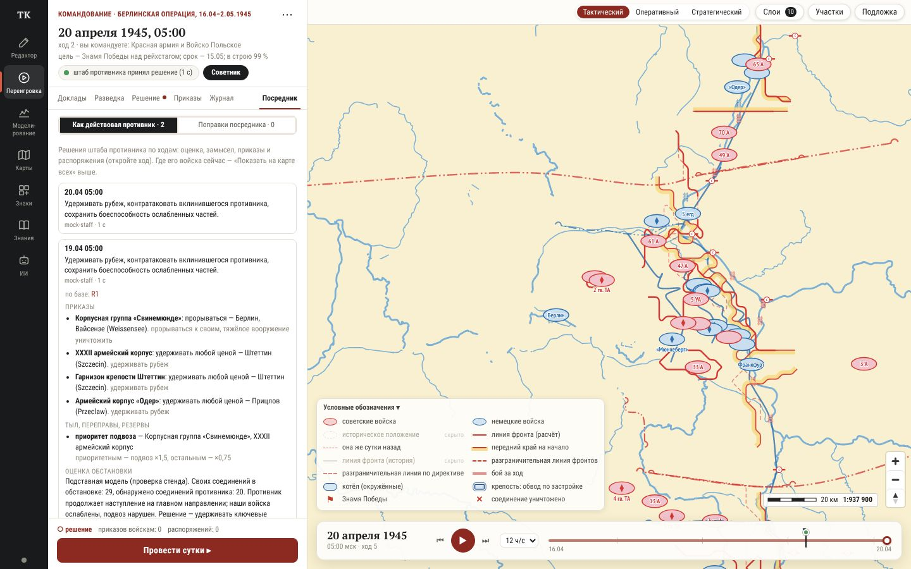

*«Посредник» → «Как действовал противник · 2» в игре на Берлинской операции против штаба на подставной
модели, 20 апреля 05:00, после хода: раскрыто решение на 19.04 05:00 — строка «по базе: R1» (номер ведёт к
записи базы знаний), приказы соединениям, распоряжение о приоритете подвоза и начало оценки обстановки; выше —
свёрнутое решение на 20.04.*

Пока штаб противника думает, «Посредник» показывает, на каком этапе запрос: ждёт очереди (модель занята
советником), модель читает обстановку (с размером запроса — на локальной модели до первого слова может
пройти минута-две), размышляет или пишет решение (со скоростью генерации — токенов в секунду); текст ответа идёт ниже по
мере генерации (на экране — последние строки); если в конце ответа идут сотни пробелов подряд, под ним —
пометка, что модель, похоже, зациклилась и запрос повторится без схемы. В игре штаб противника отвечает коротко — оценка в 3–4 предложения, приказы объединениям,
отдельным дивизиям только при другой задаче: на локальной модели каждое слово — время, и пространная
оценка шла минутами. Время хода штаба противника определяет прежде всего модель: крупная (27–32 млрд
параметров) на ноутбуке пишет в разы медленнее малой, поэтому для противника разумно выбрать малую
быструю модель, а крупную оставить советнику. Если модель
зациклилась — после первых слов выдаёт сотни пробелов или один и тот же кусок (бывает у локальных моделей
при ответе по JSON-схеме), — генерация обрывается и запрос повторяется без схемы на сервере, с просьбой
ответить одним JSON-объектом. Приказ «Все соединения» («остальные войска») получают те старшие объединения
и соединения, у кого нет отдельного приказа; приказ группе, которой нет среди своих сил, не исполняется
(в замечаниях — с причиной). Если в решении есть неисполнимые приказы — исполнителя нет среди своих сил
(например, в поле формирования — целая фраза «Все наступающие армии продолжают наступление…»), цель не
опознана или у задачи нет цели, — штаб один раз получает подсказку: ошибки по каждому такому приказу,
точный список своих сил и пунктов поблизости, у кого приказы уже есть, — и возвращает исправленные приказы
только для них (этап «исправляет приказы…»). Исправленный приказ заменяет отброшенный, если ответ называет
номер отброшенного приказа, задача та же, приказ сам исполним и его формированию ещё не отдан другой приказ;
иначе остаётся прежний с замечанием и пометкой, почему исправление отклонено («задача изменена», «уже есть
приказ»), второго исправления за ход нет. В «Посреднике» у решения — «исправление по подсказке: N из M
приказов исправлено». Так же и на агентной модели: штаб противника там тот же.


*Варианты решения на ход: оценка, замысел, приказы и распоряжения — каждый можно взять в проект.*

Игра идёт до победы или поражения, сохраняется в хранилище окна приложения (в браузере — браузера) после каждого хода и восстанавливается
по записи целиком (движок детерминирован). **Разбор операции** — отчётный документ модели по
записи игры от лица экспертов (замысел и ведение операции, разведка, тыл, переправы,
управление, резервы, сравнение с историей, оценка и уроки), с выгрузкой в PDF.

## 7. Моделирование

Раздел для тех, кто проверяет и развивает модель:

- **Модели** — наборы правил арбитра словами и числами (бой, оборона, движение, подвоз,
  калибровка), «Основа правил» — на каком нормативе или допущении держится каждое число (ниже),
  профили сторон, языковые модели по ролям;
- **Сравнение** — до четырёх наборов правил на одной операции против истории: положения по
  дням, события, отчёт;
- **Настройка** — свой вариант правил;
- **Калибровка** — подбор множителей правил по истории операции (обучение — первая половина,
  проверка — вторая) в коридорах нормативов базы знаний, в фоновых потоках окна, параллельно;
- **Агентная модель** — сравнение вариантов параметров агентной модели (дивизии) с историей и калибровка;
  прогоны считает ядро настольного приложения (в браузере вкладка только напоминает об этом).
- **Операции** — загрузка своей операции пакетом (сценарий, театр, история), проверка,
  контрольный прогон, подготовка к переигровке; материалы, полнота, сверка с базой, пересчёт
  (раздел 8); вкладка «Основа модели» — на каких фактах базы знаний держится каждый вход модели
  (раздел 8.6).
- **Ассистент** — ответы языковой модели на вопросы об устройстве модели, по описанию, нормативам и коду (ниже).


*Набор правил `ww2-berlin-cal`: блок «Калибровка по истории» (операция, мерило до и после, 11 множителей) и под ним
начало блока «Основа правил»: итог — 14 % входов правил и профилей на нормативах (A 1, B 9, допущений 59 из 69), из
подбираемых калибровкой — 19 % (A 1, B 2, допущений 13 из 16), агентная модель — 100 % (A 11, B 24, C 1, допущений
0 из 36); первые строки таблицы
множителей. Слева в списке наборов — и `ww2-berlin-cor`, откалиброванный в коридорах нормативов.*


*Исходные и откалиброванные правила на Берлинской операции: доля положений в допуске, события, отклонение по дням.*

**Основа правил.** У каждого набора правил в «Моделях» — блок «Основа правил»: на чём держится каждое
число правил и профилей. Его собирает сборщик «база → правила» из нормативов базы знаний (раздел 8.8):

- **итог** — доля входов правил и профилей (69) на нормативах A, B, C и на допущениях; отдельно — входы,
  которые подбирает калибровка (16), и параметры агентной модели (36: они общие для всех наборов и в итог
  набора не входят). У всех 36 параметров агентной модели во встроенной базе есть норматив (A 11, B 24,
  C 1; опоры — `docs/sources/agents-norms-1945.json`, часть II, раздел 21);
- **множители калибровки** — у каждого коридор подбора, основа (норматив с достоверностью и источником или
  «доп. прежние границы», пометка «шире прежних границ») и у откалиброванного набора — значение множителя;
  в пределах 2 % ширины коридора от края — «упирается в нижнюю/верхнюю границу», ниже таблицы —
  предупреждение «проверьте источник: возможно, норматив слишком узок или модели не хватает другого
  механизма»; значение за пределами коридора — «вне коридора (ниже/выше)»: у набора, подобранного по
  записанным в нём коридорам, — за их пределами, у прежних наборов — вне нынешнего коридора базы;
- **входы по группам** (бой, оборона и местность, движение, подвоз, усталость, окружение, профили): значение
  в наборе, значок достоверности или «доп.», коридор норматива, а у откалиброванного набора — исходное
  значение и что сделала калибровка: «→» — подобрала само значение, «×» — множитель к исходному (у марша —
  к значению профиля), «^» — степень к поправке местности. Щелчок по входу раскрывает норматив: формальную
  часть, источник со страницами, цитату и ссылку на запись базы, а у допущения — что добавить, чтобы
  модель взяла коридор;
- **расхождения нормативов** — у каждого: выбранный («✓ в модели») и остальные, «Закрепить этот» и «Снять
  закрепление»;
- **нормативы-итоги** по операциям: ожидаемый диапазон и по кнопке «Проверить» — один прогон набора с
  историческими приказами (seed 101): значение модели и «в допуске / вне допуска». Результат проверки
  хранится в этом окне (в хранилище браузера) до изменения набора; у откалиброванного набора — ещё доля
  итогов в допуске до и после калибровки, если набор её записал.

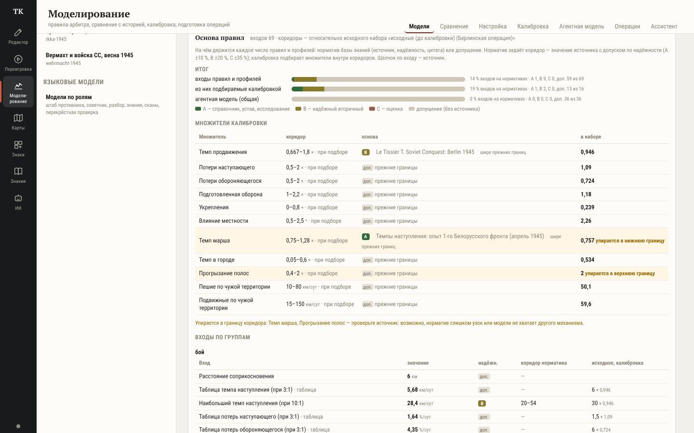

*«Основа правил» набора `ww2-berlin-cor` (коридоры — относительно исходного набора `ww2-draft`): в итоге 14 %
входов правил и профилей на нормативах (A 1, B 9, допущений 59 из 69), подбираемые — 19 % (A 1, B 2,
допущений 13 из 16), агентная модель — 100 % (A 11, B 24, C 1, допущений 0 из 36). В таблице множителей у темпа продвижения —
коридор 0,667–1,8, норматив B по Le Tissier «шире прежних границ», в наборе 0,946; у темпа марша — коридор
0,75–1,28, норматив A из записи «Темпы наступления: опыт 1-го Белорусского фронта (апрель 1945)», в наборе
0,757 — «упирается в нижнюю границу»; у прогрызания полос — коридор 0,4–2 «доп. прежние границы», в
наборе 2 — «упирается в верхнюю границу»; у остальных — прежние границы. Под таблицей — предупреждение
об упёршихся множителях, ниже — начало входов группы «бой»: наибольший темп наступления 28,4 км/сут
(B, коридор 20–54, 30 × 0,946).*

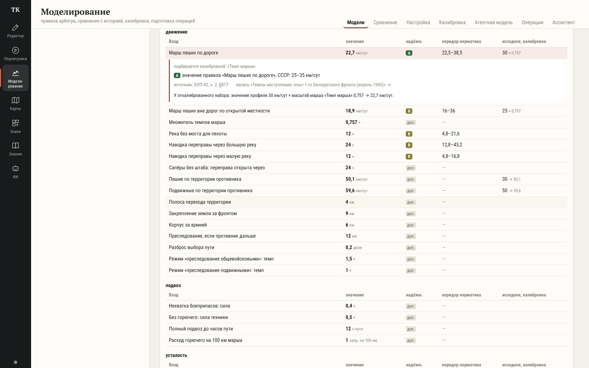

*Группа «движение» того же набора: раскрыт вход «Марш пеших по дороге» — 22,7 км/сут, A, коридор
22,5–38,5; «подбирается калибровкой: «Темп марша»», норматив «значение правила «Марш пеших по дороге», СССР:
25–35 км/сут», источник — БУП-42, ч. 2, §817, ссылка на запись базы и строка «значение профиля 30 км/сут ×
масштаб марша 0,757 → 22,7 км/сут». Ниже — марш вне дорог (B, 16–36), переправы (B), темп по территории
противника 30 → 50,1 и 50 → 59,6 км/сут (подобраны калибровкой) и допущения; внизу — группа «подвоз»,
все входы на допущениях.*

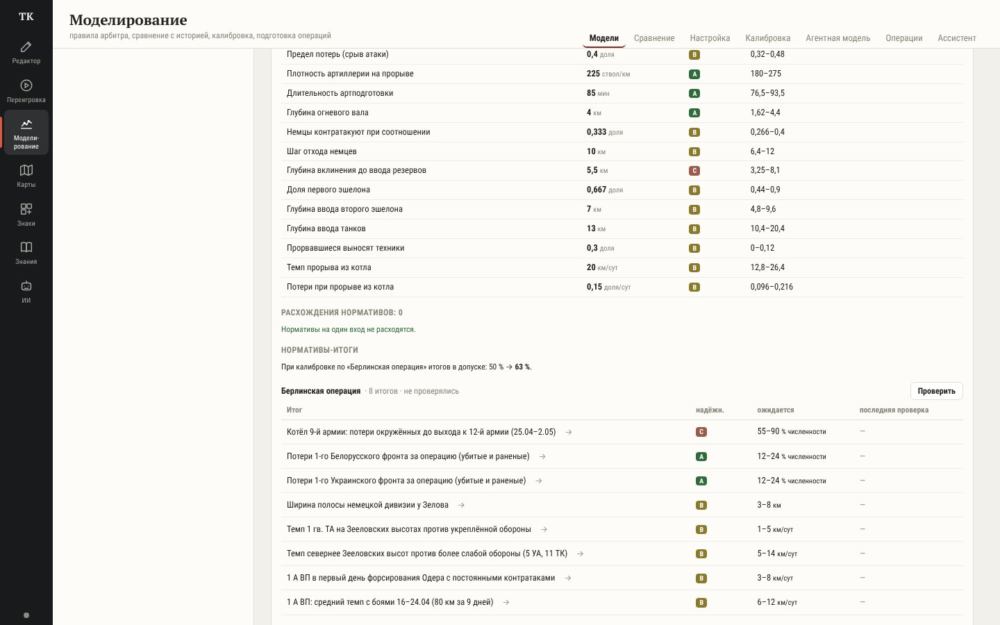

*Раскрытая группа «агентная модель» того же блока, вторая половина: предел потерь 0,4 (B, коридор 0,32–0,48),
артиллерия — плотность 225 ствол/км, артподготовка 85 мин, огневой вал 4 км (A), доктрина немцев и советская
доктрина (B, глубина вклинения до ввода резервов — C), окружение: «Прорвавшиеся выносят техники» 0,3 доли при
коридоре 0–0,12 — значение модели вне коридора источника, темп прорыва из котла 20 км/сут и потери 0,15 в сутки (B).
Ниже — «Расхождения нормативов: 0» и начало нормативов-итогов Берлинской операции.*

**Калибровка в коридорах.** Во вкладке «Калибровка» рядом с каждым множителем в «Что подбирать» —
коридор подбора и его основа: значок достоверности норматива или «доп.» (норматива нет — прежние
границы). Коридоры пересобираются при изменении базы. Подбор не выходит за коридоры; исходный
множитель вне коридора переносится к ближнему краю и оценивается отдельно (строка «перенесены»).
Нормативы-итоги операции (от трёх) входят в мерило с весом 1/8 (раздел 21). Итог подбора — таблица
множителей: коридор, основа, «шире прежних», исходный → лучший и «упирается в нижнюю/верхнюю границу —
проверьте источник»; сохранённый набор записывает коридоры, по которым подбирался. Те же коридоры и итоги
действуют в «Пересчёте модели» (раздел 8.5) и в калибровке агентной модели: там множители параметров вне
коридора не пробуются (список «не пробовались»), а у параметра с нормативом видна подпись «коридор
норматива ×a–b».

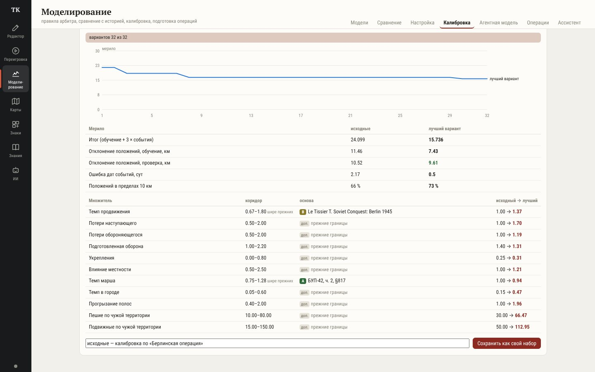

*Итог калибровки в стенде на Берлинской операции от исходных правил (32 варианта, один прогон): мерило лучшего
варианта по ходу подбора, мерило — итог 24,099 → 15,736, обучение 11,46 → 7,43 км, проверка 10,52 → 9,61 км,
ошибка дат событий 2,17 → 0,5 сут, положений в пределах 10 км 66 → 73 %. В таблице множителей у темпа
продвижения — коридор 0,67–1,80 «шире прежних», B, Le Tissier (1,00 → 1,37); у темпа марша — 0,75–1,28
«шире прежних», A, БУП-42, ч. 2, §817 (1,00 → 0,94); у остальных девяти — «доп. прежние границы». Внизу —
название нового набора и «Сохранить как свой набор».*

**Сравнение и калибровка агентной модели.** Вкладка «Агентная модель»: операция (Берлинская или
Висло-Одерская с допущениями),
число прогонов на вариант (разные seed, итог — средний) и кто решает за штабы сторон (приказы сценария или
доктрина). Ядро принимает поправки параметров — путь параметра в `agents-v0.json` и значение (у параметра
меняется только значение, источник и пояснение остаются; неизвестный путь — ошибка). Сверка — та же, что в
«Переигровке»: доля положений дивизий в допуске ±10 км сверх неопределённости источника, медиана превышения,
события в пределах ±2 сут, доля в допуске по армиям; итог для калибровки — среднее положений и событий
(при 10 и больше контрольных точках численности и потерь — на четверть их доля в допуске, раздел 21).
Прогоны ядра получают и поправки из базы знаний (раздел 8.6): подчинённость, численность и ввод дивизий,
изменения по датам.
«Сравнение вариантов» — базовые параметры и сохранённые варианты (до четырёх) с таблицами событий и армий.
«Калибровка» — покоординатный перебор: для каждого выбранного параметра (темп наступления против поспешной,
подготовленной и укреплённой обороны — множитель к км/сут кривой, темп в прорыве, вес танков, потери сторон,
предел потерь, скорости марша, глубина ввода второго эшелона, доля сил, при которой немцы отходят) — множители
×0,7…×1,3 вокруг лучшего, кроме выходящих за коридор норматива базы (коридор множителя — коридор норматива,
делённый на значение параметра; нормативы есть у всех 36 параметров «Основы правил», часть II, раздел 21),
принимается лучший, если итог вырос. Итог сохраняется вариантом: он появляется в
сравнении и в «Переигровке» («Параметры» у агентной модели).

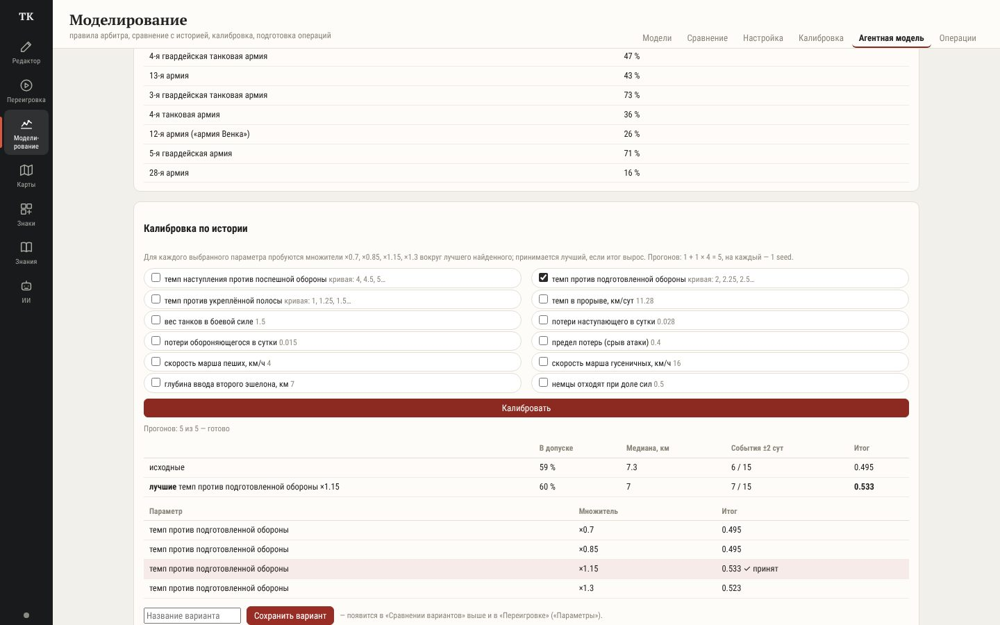

*Калибровка агентной модели на Берлинской операции (1 прогон): по армиям — доля положений в допуске;
перебран один параметр — темп против подготовленной обороны: ×1,15 принят (итог 0,533 против 0,495 у
исходных: положений в допуске 60 % против 59 %, событий 7 из 15 против 6), ×1,3 — 0,523; ниже — сохранение
варианта.*

**Ассистент модели.** Вкладка «Ассистент» отвечает на технические вопросы о модели: как считаются бой, темп,
подвоз и окружение, как устроены агенты, откуда берутся коэффициенты. Ответ строится только по выжимке, которая
собирается из описания и кода командой `npm run model:index` (`packages/knowledge/data/model-index.json`):

- часть II этого описания и разделы 6–7 части I (там описаны переигровка и агентная модель) — по подразделам,
  длинные — кусками до 2500 знаков, таблицы целиком, без снимков и подписей;
- нормативы (`norms.json`) — значение, источник или пометка «допущение», правила модели, к которым норматив
  относится;
- код модели — функции, константы и типы нынешней модели (`packages/sim/src`) и ядра агентов
  (`crates/agents-core/src`) с комментариями; тело длиннее 80 строк обрезается с номерами строк, тесты и
  вспомогательные программы ядра не берутся.

Тест сверяет выжимку с исходниками: поменяли код модели или описание и не пересобрали выжимку — тест падает.

Поиск идёт в два хода: сначала до 6 разделов описания и нормативов по словам вопроса, затем до 6 фрагментов кода —
функции, названные в найденных разделах, и найденные по вопросу. Код ищется по комментарию и строке объявления
и по русским словам к частям английского имени: `resolveCombat` находится по слову «бой», `supplyState` — по
«подвозу». Всё вместе — не больше 24 000 знаков. Отвечает модель роли «база знаний» (раздел 9) только по этим
фрагментам, со ссылками [n]; формулы — простой записью с пояснением каждого множителя; если во фрагментах ответа
нет, она так и говорит. Если фрагментов не хватает, модель может один раз попросить конкретное — функцию, номер
раздела или норматив (до четырёх), — их добавляют, и следует окончательный ответ. Справа — источники ответа:
раздел описания, норматив или код (файл, строка, функция); добавленные дозапросом помечены. Щелчок по ссылке в
ответе раскрывает фрагмент. Разговор хранится на этой машине (в хранилище окна приложения или браузера) — последние 20 вопросов с ответами; в запрос уходят
три последних. Если сервер моделей недоступен, ассистент так и пишет, а найденные фрагменты показывает — по ним
можно прочитать самому.

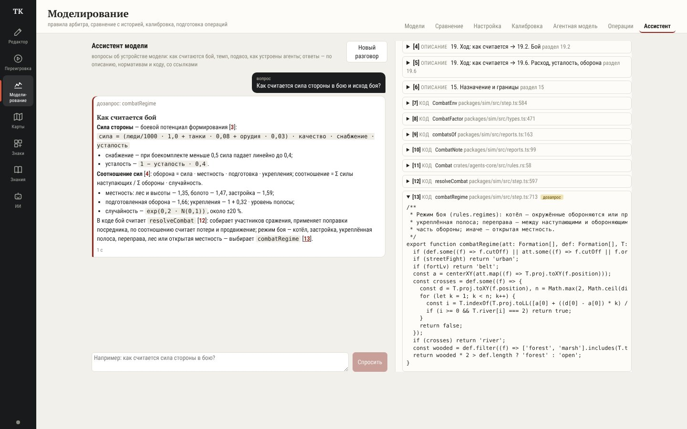

*Вопрос «Как считается сила стороны в бою и исход боя?» на записанном ответе модели (подставной сервер): модель
дозапросила `combatRegime`; в ответе — формула боевого потенциала со ссылкой [3], соотношение сил и поправки
обороны со ссылкой [4], функции `resolveCombat` [12] и `combatRegime` [13]. Справа — источники: разделы 19.2,
19.6 и 15 описания, фрагменты кода `CombatEnv`, `CombatFactor`, `combatsOf`, `CombatNote`, `Combat` (ядро
агентов), `resolveCombat` и раскрытый щелчком по ссылке [13] `combatRegime` с пометкой «дозапрос».*

Как устроен расчёт, откуда числа и насколько модель совпадает с историей, — часть II.

## 8. База знаний и подготовка операции

**База знаний** — сведения по операциям в каркасе категорий: операции, сражения и бои,
формирования, командование, организация и доктрина, вооружение, театр, хронология, источники;
рубрикатор с нумерацией. У каждого факта — источник, достоверность (A, B, C) и, для извлечённых
из документов, дословная цитата. Материалы сгруппированы по операциям. Поиск — по словам и по
смыслу (эмбеддинги модели). Модель отвечает на вопросы и рассказывает по теме только по
материалам базы, со ссылками; советник в игре получает из неё справки (доктрину, технику — без
хода боёв в истории), а штаб противника, Ставка и посредник — правила доктрины и справки по своей роли
(разделы 6, 8.9, 9).

Начальная база собирается из данных проекта (`npm run kb:seed`): выписок из книг и справочников
(`docs/sources`), профилей сторон, части II этого описания и выписок из документов ЦАМО
(`docs/sources/vistula-oder-1945-tsamo*`, `berlin-1945-tsamo`). Каждое дело ЦАМО — запись-источник
(фонд, опись, дело, что прочитано и чего в деле нет). Из выписок в записи армий и корпусов идут
положения по дням, приказы и распоряжения с временем отдачи, запас горючего и боеприпасов; в записи
операций — все приказы и разведка о противнике; численность немецкой дивизии по разведке — фактом
её записи (достоверность B: оценка штаба противной стороны); рубежи армий — в хронологию по дням.
Тексты документов в базу не попадают: только короткие пересказы из выписок со ссылкой на лист.

В базу входит всё, на чём стоят модели: доктрины сторон — положения советского наступления (по
уставам, исследованиям и документам ЦАМО) и немецкой обороны 1945 г. по темам (ширина полос, эшелоны,
ввод подвижных групп, остановка, обход, артиллерия; построение обороны, контратаки, отход, резервы) с
нормативами; нормативы боя дивизии (ширина, темп, артиллерия, потери, соотношение сил, сроки, предел
потерь); правила распада дивизий и сведения остатков; все параметры агентной модели — значение и
источник или допущение с обоснованием; проверки нормативами (исторический показатель и ожидаемый
диапазон расчёта); артподготовка 16 апреля и отвод немцев с первой позиции; суточные потери и
численность армий; численность немецких соединений по датам, части вне дивизий и немецкий тыл
(запасные, учебные, тревожные части); мосты и переправы с состоянием по датам, полосы обороны,
крепости, узлы снабжения; составы и подчинённость по датам, положения по дням из исследований
источников; немецкие разграничительные линии; сроки отдачи приказов и исходные положения; реестр
всех дивизий-агентов; исследовательские отчёты о подвижности пехоты и автотранспорте и о немецкой
обороне на Висле. Источник каждого набора данных — своя запись-источник (одинаковое сокращение с
другой библиографической записью — под префиксом файла). Числа модели из профилей сторон и
откалиброванных правил (типы объединений, скорости марша, расход и подвоз, задержки приказов,
местность, укрепления, форсирование, потери) — тоже записями «Как это устроено в модели» с рубрикой
темы. Записи доктрины и нормативов разложены по рубрикам своей темы (прорыв, подвижные группы,
оборона, контрудары, артиллерия, авиация, управление). Справочные сведения общего характера —
вооружение и техника сторон (танки и САУ, артиллерия, стрелковое и противотанковое оружие, авиация),
окружение, подвижные группы и организация танковых войск, штурмовые группы, разведка боем,
артиллерийское наступление, ночные атаки с прожекторами и дымы, авиационное обеспечение, управление
и связь, погода и грунт, ремонт и медицинское обеспечение — черновиками с пометкой «сверить по
справочнику». Всего около 2150 записей.

Перед моделированием операции нужны материалы: численность и состав формирований, задачи,
положения по дням, события, состояние мостов и дорог. Стенд помогает их собрать и показывает,
чего не хватает.

### 8.1. Материалы операции и база знаний

Документы загружаются в карточке операции («Моделирование → Операции», блок «Материалы операции») или в
разделе «Знания» (вкладка «Документы», операция выбрана вверху) одной кнопкой «Загрузить…». Тип входа
определяется сам:

| Вход | Файлы | Чем разбирается |
|---|---|---|
| текст | PDF с текстовым слоем, Word, HTML, txt, md | модель роли «разбор документов», по частям около 3000 знаков |
| скан | PDF без текстового слоя (меньше 50 знаков на странице), JPG, PNG | модель со зрением (роль «чтение сканов»), по страницам |
| таблица | CSV, XLSX | код: шаблон — сразу, другая таблица — после сопоставления столбцов |
| пакет фактов | JSON формата `def-ops-facts` (ответ внешнего агента) | код |

Рядом — достоверность документа (A, B, C) и заметка о нём. Разбор идёт по частям и страницам; под
документом — полоса хода «часть N из M; принято автоматически X, на проверку Y, отброшено Z» и кнопка
«Остановить». Остановленный или прерванный разбор (сервер моделей недоступен, таймаут) продолжается с места
остановки («Продолжить разбор»); у PDF больше одной страницы можно задать диапазон страниц. Таблицы и пакеты
фактов разбираются и без сервера моделей. Текст документа сразу участвует в поиске и ответах по базе.

Из документа выписываются **факты с формальной частью** — численность на дату, пополнение, потери за
период, подчинённость, ввод в бой, положение, разграничительная линия, состояние переправы, событие
(раздел 17.1) — с цитатой; из текста, кроме того, текстовые записи по каркасу базы и сведения о дорогах и
рубежах. Каждый факт — **кандидат**: восемь проверок решают, идёт он в базу сразу («принято
автоматически»), в очередь «На проверку» к человеку или отбрасывается с причиной (раздел 8.7). Текстовые
записи и сведения о дорогах и рубежах всегда идут в очередь.

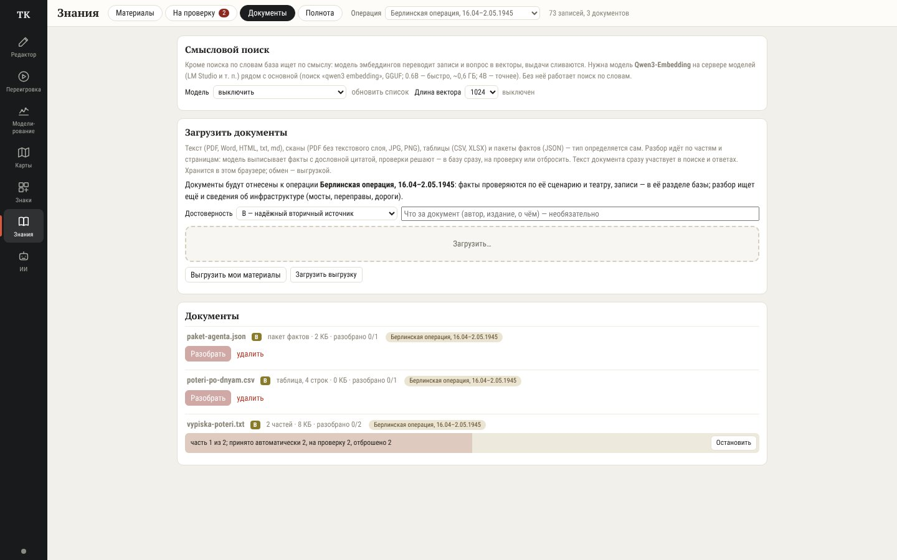

*Раздел «Знания», вкладка «Документы», операция — Берлинская: загружены три вымышленных материала (выписка о потерях, таблица потерь по дням, пакет агента). Выписка из двух частей разбирается: после первой части — «часть 1 из 2; принято автоматически 2, на проверку 2, отброшено 2» и кнопка «Остановить»; у таблицы и пакета — «Разобрать» (неактивна, пока идёт разбор); на вкладке «На проверку» — 2.*

**Итоги документа** — кнопка «Итоги» под документом (после разбора открываются сами): счётчики «принято
автоматически», «на проверку» (сколько ещё ждут в очереди), «отброшено», повторы и не разобранные части;
строки таблицы с ошибкой — с номером строки и причиной; отброшенное и отклонённое человеком — с причинами;
принятое в базу — таблицей со ссылками на записи и отметкой «авто» или «человек». «Откатить документ»
снимает из базы факты, принятые из него автоматически; принятые человеком остаются с пометкой «документ
откачен». «На проверку: N» под документом открывает очередь с фильтром по этому документу. Удалить документ,
из которого есть принятые автоматически факты, можно двумя способами: «Откатить и удалить» (факты снимаются,
как при откате) или «Только удалить» (факты остаются в базе); после удаления откатить их уже нельзя.

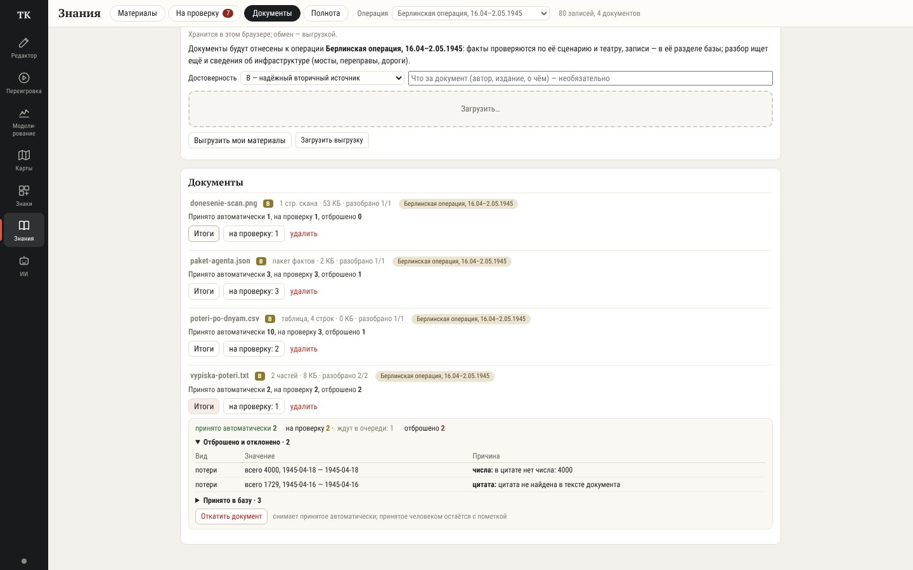

*Итоги вымышленной выписки о потерях: принято автоматически 2, на проверку 2 (в очереди ждёт 1), отброшено 2 — «всего 4000» за 18.04 («числа: в цитате нет числа: 4000») и «всего 1729» за 16.04 («цитата: цитата не найдена в тексте документа»); ниже — свёрнутое «Принято в базу · 3» и «Откатить документ». Выше — скан донесения, пакет агента и таблица со своими счётчиками и кнопками «Итоги», «на проверку: N», «удалить».*

В карточке операции блок «Материалы операции» показывает документы операции с теми же счётчиками,
итогами и разбором, строку «На проверку по операции: N · Открыть очередь» (переход в «Знания → На проверку»
с выбранной операцией), положения и линии, принятые из документов до проверок (раздел 8.4), и состояние
инфраструктуры в расчёте. Мост или переправу можно добавить вручную: сведение с состоянием «цел», «наведён»
или «разрушен» ложится фактом базы о переправе (тем же путём, что принятый кандидат), прочие сведения
(дороги, рубежи) — в состояние инфраструктуры и текстовым фактом в базу.


*Блок «Материалы операции» Берлинской операции после загрузки четырёх вымышленных материалов: скан — принято автоматически 1, на проверку 1, отброшено 0; пакет агента — 3, 3, 1; таблица — 10, 3, 1; выписка — 2, 2, 2; «На проверку по операции: 7 · Открыть очередь»; свёрнутые «Разграничительные линии в сценарии · 8»; состояние инфраструктуры в расчёте — сведений нет; ниже — начало панели «Пересчёт модели» с отметкой «данные изменились: 6».*

База знаний сгруппирована по операциям: у каждой операции свой раздел, а общие сведения
(организация, вооружение, доктрина) — отдельно, чтобы материалы разных операций не смешивались.
В разделе «Знания» операция выбирается вверху; модель отвечает на вопросы только по материалам
базы, со ссылками.


*Раздел «Знания», Берлинская операция: рубрикатор слева, запись «Берлинская стратегическая наступательная операция» с фактами (даты, стороны и объединения, итог, потери), источниками и достоверностью, справа — вопросы к модели по базе; вверху — вкладки «Материалы», «На проверку» (7), «Документы», «Полнота».*

### 8.2. Полнота материалов по каркасу

Полнота — **не мнение модели**, а проверка по каркасу базы знаний: из данных операции
(сценарий, история, театр) стенд выводит, какие элементы должны быть описаны, и для каждого —
какие сведения должны быть, а затем ищет их в записях базы.

| Раздел | Группа | Что требуется | Вес |
|---|---|---|---|
| Войска и командование | Формирования | по каждому действующему: подчинённость, командир, состав, численность, танки, орудия, боевой путь в операции | 0,16 |
| | Командование | командующие армий и фронтов: звание, должность, ключевые решения | 0,06 |
| | Положения по дням | в какие дни известно положение формирования | 0,10 |
| | Исходные положения войск | положение каждого формирования на начало операции — входные данные расчёта: известно, достоверность A/B, неопределённость не больше 5 км | 0,12 |
| | Разграничительные линии | по каждой паре соседних фронтов (групп армий) стороны: линия известна (директива в сценарии или факт базы), источник, достоверность A/B | 0,02 |
| Местность и инфраструктура | Пункты и районы | цели приказов и места событий: что это, где, особенности, оборона, значение | 0,10 |
| | Рубежи и укрепления | где, устройство, кто оборонял, значение | 0,09 |
| | Реки | особенности, мосты и переправы, значение | 0,02 |
| | Мосты и переправы | известно ли состояние моста на большой реке района | 0,04 |
| Ход операции | Операция | даты, стороны, замысел, силы, итог, потери, разграничительные линии | 0,05 |
| | Сражения и бои | по каждому участку: даты, место, силы, ход, исход, потери | 0,08 |
| | События | запись о каждом ключевом событии истории (±1 сут) | 0,12 |
| | Погода и грунт | погода, дороги, ледостав | 0,02 |
| Стороны | Организация и тактика | наступление, оборона, бой в городе, форсирование, рода войск, тыл | 0,04 |
| | Вооружение и техника | тип, вооружение, броня, масса, скорость, экипаж, дальность | 0,04 |
| | Нормативы | нормативы и допущения модели для проверки правил: запись, источник, достоверность A/B (у допущения источника нет — пробел) | 0,02 |
| Источники | Источники | ≥ 3 документов операции, из них хотя бы один A; 80 % фактов с источником | 0,02 |

Полнота элемента — доля требуемых сведений, полнота группы — среднее по элементам (формирования
взвешены по уровню: фронт и армия весят больше дивизии), итог — взвешенное среднее групп.
Уровни: **от 75 %** — достаточно (✓, зелёный), **45–75 %** — частично (◐, жёлтый), **меньше 45 %** —
мало (✕, красный): сначала собрать материалы. Уровень всегда показан значком и словом, не только
цветом. Полнота видна в карточке операции, в «Знаниях» (вкладка «Полнота») и в «Переигровке».


*Полнота Берлинской операции: 39 % («мало»). По разделам: войска и командование 45 %, местность и инфраструктура 16 %, ход операции 51 %, стороны 36 %, источники 24 %. Ниже — что искать в первую очередь: орудия и миномёты (нет у 66 из 66 формирований), боевой путь, численность, дни с положением.*

**Полнота общих знаний.** Когда вверху выбрано «общие (без операции)» или «все материалы», вкладка
«Полнота» считает рубрики каркаса, не привязанные к операции: войска сторон, военное искусство,
вооружение, тыл, театр, управление, источники. По каждой рубрике — сколько записей и сколько из них
черновиков; сводка «заполнено — мало (1–2 записи) — пусто» и список «чего не хватает» со ссылками:
щелчок открывает рубрику в «Материалах». Операции и хронология считаются у операций. Ниже —
нормативы модели (norms.json): у каждого ли есть запись в базе с источником.


*Полнота общих знаний: 2054 записи без операции; из 51 рубрики 40 заполнены, в 10 — по одной-две
записи (окружение, бой в городе, форсирование, ночные действия, авиация, инженерные войска, общие
черты армий, переправы, ремонт и медицина, погода) — они перечислены вверху; ниже — таблица рубрик
с числом записей и черновиков.*

**Веса — по чувствительности к данным.** Веса групп сведены по тому, сколько сходства с историей
стоит плохое или отсутствующее сведение (раздел 21): исходные положения войск — новая группа с весом
0,12 (ошибка положений на допуск сравнения стоит 7–14 п. п.), рубежи и укрепления выросли до 0,09
(без полос Берлинская теряет 9,5 п. п.), формирования снизились до 0,16 (численность на положения
влияет слабо), а разграничительные линии (0,02), реки (0,02) и мосты (0,04) — снизились: сейчас
они сходство почти не меняют. Это не оценка важности для игрока и не пожелание, а следствие
двух расчётов; пересматривать веса нужно после каждого заметного изменения модели. Группа «Исходные
положения войск» берёт положение формирования на начало из истории операции (первая запись
в пределах полутора суток от начала) и считает его заполненным на треть за каждое из трёх: положение
известно, достоверность A или B, неопределённость не больше 5 км. По сценариям (формирования
кроме фронтов; известно / A или B / точность до 5 км):

| Операция | СССР | Германия |
|---|---|---|
| Берлинская | 23 / 20 / 0 из 23 | 24 / 15 / 9 из 24 |
| Бой в Берлине | 16 / 16 / 15 из 16 | 15 / 6 / 15 из 15 |
| Висло-Одерская | 14 / 6 / 0 из 27 | 28 / 14 / 1 из 28 |

Пробел главный в Висло-Одерской у советской стороны (положение на начало есть только у половины)
и во всех операциях по точности: оценки, а не привязки к документам.

**Наглядность дефицитов.** У каждой группы — полоса полноты и раскрывающаяся матрица «элемент ×
сведение» (есть / нет) с фильтром по стороне; над матрицей — по каждому сведению, у скольких
элементов оно есть. **Карта пробелов** показывает элементы на местности цветом уровня:
формирования (▲ СССР, ▼ Германия), пункты, мосты и переправы, участки боёв, события; щелчок по
знаку раскрывает его группу.


*Группа «Формирования»: подчинённость есть у 32 из 32, командир — у 59 из 66, а состав, численность, танки, орудия и боевой путь — почти ни у кого.*


*Карта пробелов: красное — мало сведений, зелёное — достаточно. Хорошо описаны мосты на Одере (зелёные квадраты), плохо — пункты и формирования в глубине.*

**Разграничительные линии.** Пары соседей стенд находит по полосам в начале операции (раздел
19.8): чьи полосы граничат, те и соседи. Линия считается известной, если в сценарии есть линия
по директиве для этой пары или в записи одного из соседей есть факт «разграничительные линии», где
назван другой. Без линии полоса в модели — расчётная (по расположению войск); это и показывает
группа.


*Берлинская операция: обе пары советских фронтов — по директивам (A и B), пары немецких групп армий («Висла» / «Центр», «Висла» / ОКВ) — без записей: в модели расчётные.*

**Подсказки, что искать.** По дефицитам стенд составляет подсказки: что найти («Численность —
нет у 52 из 66 формирований»), зачем это модели (на что влияет в расчёте), где обычно есть такие
сведения (типы источников и известные издания: ЦАМО и «Память народа», «Боевой состав Советской
армии», журналы боевых действий, Le Tissier, Исаев, Ziemke), готовые поисковые запросы по-русски,
по-немецки и по-английски и элементы, у которых сведений нет. Порядок — по пользе для модели:
вес группы × важность сведения для расчёта × доля, которой не хватает. Весь список выгружается
файлом «Что собрать (.md)» — задание на поиск материалов.

### 8.3. Сверка базы знаний со сценарием

База знаний — общее место сведений об операции. Факты с формальной частью (раздел 17.1) — встроенные
данные, принятые факты из документов (раздел 8.7) и свои факты, введённые формой, — идут в модель сами,
через сборку «база → модель» (раздел 8.6). Панель «Сверка с базой знаний» в карточке операции связывает
со сценарием остальное — факты без формальной части (текстовые записи и прежние свои факты) — и
показывает, чего в базе нет.

**База → сценарий.** Для каждого действующего формирования стенд находит записи базы (по id
сценария в синонимах записи или по названию) и факты «численность», «танки и САУ», «орудия» на
начало операции: без даты или датированные не позже чем через двое суток после начала; факты с
оговоркой «не численность на …» и факты с формальной частью (их берёт сборка) не берутся. Из нескольких выбирается самый достоверный (A, затем
B, C). Танки и САУ, записанные отдельными фактами, складываются — в сценарии они вместе.
Численность в сценарии боевая (раздел 18.1), поэтому списочная численность из базы умножается на
долю боевых войск (0,6 — советские, 0,75 — немецкие), если факт не назван боевым. Расхождение
больше 5 % (и больше 500 человек, 5 танков, 20 орудий) — предложение исправить сценарий, с
источником, достоверностью и цитатой.

Принятое ложится **правкой операции** поверх сценария (встроенный сценарий в сборке не
меняется): прежнее значение запоминается, правку можно вернуть. Правки действуют везде — в
переигровке, игре, сравнении и калибровке. Собранное из базы накладывается после ручных правок:
если у формирования есть факт численности на начало, он важнее ручной правки. Отклонённое
предложение о численности — закрепление «не брать» (раздел 8.6): численность, танки и орудия этого
формирования на начало операции сборка из базы не берёт. Прежние принятые правки при первой сборке
становятся закреплениями, если нашёлся факт с тем же числом (иначе правка остаётся и это записывается
в журнал операции), прежние отклонения — закреплениями «не брать».

**Сценарий → база.** Сведения, которыми расчёт уже пользуется, а в базе их нет, предлагается
внести в базу: цифры сценария (как оценку стенда — достоверность C, с пометкой, как получены),
подчинённость, а также **боевой путь** — положения по дням из истории сценария с её источниками.
Записи формирований, которых в базе нет, создаются. Так база знаний описывает то, на чём стоит
модель, и видно, что ещё держится на оценках.


*Берлинская операция: семь расхождений «база → сценарий» — видны танки и САУ 309-й пд «Берлин» и 20-й тгд (в сценарии — по распределению численности армии, в базе — исправные на 13.04 по Исаеву), численность 18-й тгд (9 900 по оценке 1 гв. ТА, в боевой — 7 425) и орудия 712-й пд; во вкладках «В базу» — 124 сведения, которых в базе нет: численность, танки и САУ, орудия, подчинённость, боевой путь.*

### 8.4. Положения, линии и переправы из документов

Положение формирования (кто, в какой день, у какого пункта или по координатам), разграничительную линию (два
объединения, с какого и до какого числа, пункты по порядку, чьи пункты включительно) и состояние переправы
(проходима, разрушена или наведена — с даты) модель выписывает кандидатами-фактами, как и численность
(раздел 8.7). Если директива адресована одному из объединений («с 1-м Белорусским фронтом»), второе берётся
адресатом. Формирование сопоставляется со сценарием и записями базы, пункт — с театром операции. Переправа —
не о формировании: её название из источника («мост через Одер у Франкфурта») так и остаётся в факте, по нему
сборка находит мост театра; переправа без названия ждёт человека с сомнением «не названа переправа». Положение
без даты или без места, линия без двух объединений или двух пунктов не собирается и отбрасывается; пункт,
не найденный на театре, — сомнение: кандидат ждёт человека в очереди.

Принятый факт ложится в запись формирования (линия — в запись первого объединения пары, переправа — в запись
«Состояние инфраструктуры» операции) и идёт в модель **только через сборку «база → модель»** (раздел 8.6):

- **положение** — в историю операции на свой день, с неопределённостью из факта или по ступени (фронт
  ±25 км, армия ±15, корпус ±8, дивизия ±5) и с достоверностью факта; по нему сверяется расчёт и идёт
  калибровка, растёт полнота «Положения по дням»;
- **разграничительная линия** — в сценарий: пункты находятся на театре, чья полоса справа по ходу линии —
  по положению войск объединений в начале операции, чьи пункты включительно — по названию объединения;
  нужно хотя бы два найденных пункта. Если в сценарии уже есть линия той же пары с тем же началом (встроенная
  или принятая из документа до проверок), то та же линия (те же пункты, срок и чьи пункты включительно) второй
  раз не добавляется, а другая — **заменяет** линию сценария: база — источник, и исправленная встроенная линия
  доходит до модели; условие вступления в игре и задержка остаются от линии сценария;
- **переправа** — в состояние инфраструктуры операции: мост театра находится по названию переправы или по
  месту («… у Франкфурта») и реке («через Одер»); переправа встроенной базы, записанная за объектом, — по
  названиям объекта, и только мост с тем же названием на той же реке. Переправа, которая не привязалась к
  театру, в расчёт не идёт (вход виден в «Основе модели»); сведение с тем же названием, днём и состоянием,
  которое уже есть, не повторяется.

Линии и переправы из базы действуют в переигровке, игре, сравнении и калибровке; прогоны ядра агентной
модели в «Моделировании» получают из базы подчинённость, численность, ввод и изменения по датам, но не линии
и переправы.

Положения, линии и переправы, принятые из документов до появления проверок, при первом открытии базы стали
фактами с отметкой «проверено человеком»; ждавшие решения и отклонённые — кандидатами в очереди (раздел
8.7). Положения, которые тогда легли в историю операции правкой, и линии сценария видны в «Материалах
операции» списками; добавленное из документа можно убрать (в базе факт остаётся).

### 8.5. Пересчёт модели

Каждое изменение данных операции записывается: правка сценария, положение в истории, сведение
об инфраструктуре, внесение в базу, пересборка входов модели из базы знаний (раздел 8.6: «изменено
из базы: …» с перечнем изменённых входов). Панель «Пересчёт модели» показывает, что изменилось после
последнего пересчёта, и одной кнопкой:

1. прогоняет операцию на текущих правилах (5 прогонов) — «до»;
2. подбирает множители правил (раздел 21) по первой половине операции: каждый вариант — по двум
   прогонам; 32, 64 или 128 вариантов;
3. перепроверяет три лучших варианта на тех же пяти прогонах, что и «до», и берёт лучший по
   мерилу; если лучше текущих правил ничего нет — правила остаются прежними, и это сказано;
4. прогоняет контрольную операцию (для Берлинской — Висло-Одерскую) со старыми и новыми
   правилами: стало хуже больше чем на 2 % положений — предупреждение о подгонке;
5. сохраняет новые правила своим набором и пишет отчёт: что изменилось в данных, до и после,
   множители, контрольная.

Основными новые правила делает человек («Сделать основными»): набор становится первым в
«Переигровке» и исходным для следующего пересчёта; вернуть встроенные можно в любой момент.
Если на контрольной операции стало хуже, стенд просит подтверждения.

**Итог пересчёта пишется в базу знаний** — в запись «Калибровка модели: <операция>» (рубрика
«Устройство модели стенда»): отчёт целиком и факт с числами до и после. Советнику в игре такие
записи не подаются.


*Пересчёт после сверки и положений из документа (64 варианта): положения 79 → 80 %, события 47 → 49 из 55, но на контрольной операции положения 50 → 45 % — стенд предупреждает о подгонке и не предлагает делать такие правила основными без подтверждения.*


*Запись «Калибровка модели» в разделе «Знания»: что изменилось в данных, мерило до и после, сдвинутые множители.*

### 8.6. Основа модели: входы из фактов базы

Модель берёт данные операции из базы знаний. У факта базы, кроме текста, источника и достоверности,
может быть **формальная часть**: вид, о каком формировании или объекте, на какую дату и значение
(численность на дату, пополнение, подчинённость с даты, ввод в бой, положение, разграничительная линия,
состояние переправы, событие, потери за период — раздел 17.1). Встроенные данные операций получают её
при сборке базы, факты из документов — при разборе (раздел 8.7), свои факты — в форме записи («+ Факт»,
«изменить», «исправить»); факты без неё остаются справкой и идут в сверку (раздел 8.3).

**Сборка «база → модель».** При запуске и после каждого изменения базы (через секунду) стенд
пересобирает входы всех операций — встроенных и своих — из записей базы и закреплений:

- **на начало операции** — численность, танки и орудия (факт в пределах двух суток от начала),
  подчинённость, срок ввода;
- **по ходу операции** — пополнения и переподчинения по датам: модель исполняет их в своё время
  (раздел 19.12);
- **контрольные точки для сверки** — численность на дату и потери, накопленные с начала операции:
  они не подставляются в расчёт, а сверяются с ним (раздел 20);
- **положения по дням** — в историю операции, кроме дней, на которые положение формирования уже есть;
- **даты событий** — у событий истории с тем же обозначением (новые события из базы в историю пока не
  добавляются: у факта о событии нет условия проверки — места, окружения);
- **разграничительные линии** — в сценарий, **состояние переправ** — в состояние инфраструктуры операции
  (раздел 8.4); прогоны ядра агентной модели их не получают.

Собранное ложится поверх сценария и истории после ручных правок и действует в переигровке, игре,
сравнении, калибровке и в прогонах агентной модели (ей — по дивизиям). Если сборка изменилась, в журнал
операции пишется, что именно («изменено из базы: потери 3-й ударной армии 16.04–18.04: …»), а
расчёты в фоне начинаются заново на новых данных. Сборка идёт при запуске приложения и через секунду
после каждого изменения базы; расчёт в «Переигровке», начатый раньше, ждёт её окончания (на кнопке —
«сборка данных из базы знаний…»), иначе первый расчёт после запуска шёл бы по сценарию без поправок
базы и тот же seed давал бы другой итог.

**Выбор из нескольких фактов.** Если об одном формировании на один момент в базе несколько фактов,
берётся закреплённый; иначе — самый надёжный (A, затем B, C; без достоверности — как C), затем
ближайший по дате к нужному моменту, затем из более свежего документа, и последним — как факт проверен:
«проверено человеком» и факты без отметки проверки (встроенные и свои, принятые до проверок) выше
«проверено автоматически» — при прочем равенстве автоматический факт уступает. У состояния, действующего с даты
до смены (подчинённость, переправа), сначала берётся последнее начавшееся к моменту, а надёжность решает
только среди фактов с тем же началом: давний факт A «в составе фронта с 1.04» не перекрывает смену
B «в 33-й армии с 16.04». Если у фактов на тот же момент разные значения, это **расхождение**:
численность и потери — больше чем на 5 % и больше порога сверки (500 человек, 5 танков, 20 орудий,
раздел 8.3), остальное — любое различие. Оно видно списком рядом с источниками, и выбор можно
закрепить вручную. Закрепление помнит и место факта в записи, и сам факт (формальную часть и текст):
если факт удалён, изменён или сдвинут вставкой других, закрепление больше не действует — выбор идёт по
правилу, а в списке расхождений у ключа отметка «закреплённый факт удалён». Закрепления хранятся в слое
пользователя базы знаний и входят в выгрузку и загрузку материалов.

**Вкладка «Основа модели»** («Моделирование → Операции», над карточкой операции — «Операция | Основа
модели»):

- **Итог** — сколько входов модели держится на фактах A, B, C и сколько на допущениях сценария, по видам:
  численность и пополнения, подчинённость, положения, разграничительные линии, переправы, и кем проверены
  факты, на которых они держатся: «человеком», «автоматически», «встроенное» (и «ваши без проверки», если
  такие есть). Считаются только настоящие входы расчёта — действующие формирования и дивизии агентной
  модели; численность штабов и фронтов, которую модель не читает, в итог не входит. Контрольная точка
  потерь, накопленных с начала операции, держится на всех суточных фактах периода и считается по каждому
  из них. Кнопка «Задание для агента» — md-файл по пробелам операции (раздел 8.7).
- **Формирования** — дерево по подчинённости (по сборке): у каждого входа (люди, танки, орудия,
  подчинён, ввод) значение и значок достоверности или «доп.»; щелчок по значению показывает факт —
  формальную часть, источник со страницами, как принят («проверено человеком», «принято автоматически»,
  «встроенная база»), доказательство (цитата, строка таблицы, страница скана, выписка агента) и ссылку на
  запись базы; для допущения — откуда
  оно и что добавить, чтобы модель взяла факт. Вход, факты которого исключены закреплением «не брать»,
  помечен «искл.» — «исключено закреплением», а не «в базе нет факта». «По ходу N» — пополнения, переподчинения, контрольные
  точки и положения формирования с их фактами.
- **Расхождения** — у каждого: что выбрано («✓ в модели») и остальные кандидаты с достоверностью,
  источником и датой; «Закрепить этот», «Снять закрепление». Здесь же — закрепления, требующие внимания:
  «закреплённый факт удалён» (выбор снова по правилу) и «закреплено: не брать», в том числе перенесённые
  из прежней сверки (раздел 8.3); их можно снять. После закрепления модель пересобирается за
  несколько секунд, в журнале операции появляется запись.
- **Не сопоставлено** — факты в пределах времени операции о формированиях, которых в её сценарии нет
  (другой id или формирование стоит добавить).

На Берлинской операции во встроенной базе — 2884 входа. Положения, линии и переправы держатся
на фактах целиком; подчинённость — на 85 % (A 180, B 83, C 70, допущений 57); численность и пополнения —
лишь на 7 % (A 25, B 54, C 1, допущений 1143): начальная численность известна в основном для фронтов
и отдельных армий, остальное распределено сборщиком сценария (раздел 18.1), а у 347 дивизий агентной
модели фактов численности в базе нет. Расхождений 106 (положения 94, подчинённость 6, переправы 6),
не сопоставлено 11.

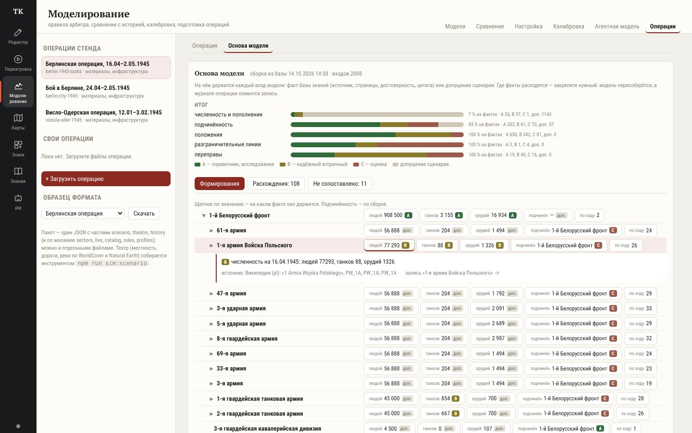

*«Основа модели» Берлинской операции после загрузки вымышленных материалов (раздел 22.5): в итоге численность и пополнения — 9 % на фактах (A 25, B 85, C 1, допущений 1140; человеком 1, автоматически 30, встроенное 80), подчинённость 85 %, положения, линии и переправы 100 % (всё встроенное); «Входы на фактах: проверено человеком 1 · автоматически 30 · встроенное 1569»; справа вверху — «Задание для агента»; вкладки «Расхождения: 107», «Не сопоставлено: 12». В дереве 1-го Белорусского фронта у 5-й ударной армии люди 86 000 и танки 140 — факты B, у 8-й гвардейской армии раскрыта численность: факт B «численность на 15.04.1945: людей 72000» с отметкой «авто», источник — пакет агента, «принято автоматически (проверки пройдены)», доказательство — выписка агента с условным шифром и цитатой; у 1-й армии Войска Польского люди, танки и орудия — факты B (77 293, 88, 1 326); у 61-й, 47-й, 3-й ударной, 69-й, 33-й и 3-й армий люди, танки и орудия — допущения сценария («доп.»), у 5-й ударной и 8-й гвардейской армий орудия (и танки у 8-й гв.) — тоже; у 1-й и 2-й гв. танковых армий танки — факты B (854 и 667), люди и орудия — допущения; подчинённость армий — факты C.*

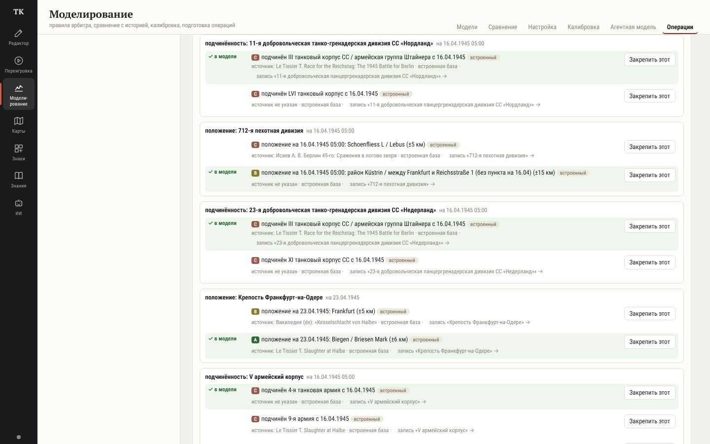

*Вкладка «Расхождения» на встроенной базе: подчинённость «Нордланда» на 16.04.1945 05:00 — в модели факт C по Le Tissier
(III танковый корпус СС / армейская группа Штайнера), второй кандидат — C без источника (LVI танковый
корпус); так же у «Недерланда» (III танковый корпус СС против XI танкового корпуса СС); между ними —
положения 712-й пехотной дивизии и ниже — крепости Франкфурт-на-Одере из двух источников на один момент,
внизу — подчинённость V армейского корпуса; у каждого кандидата — отметка «встроенный», «встроенная база» в
строке источника и «Закрепить этот».*

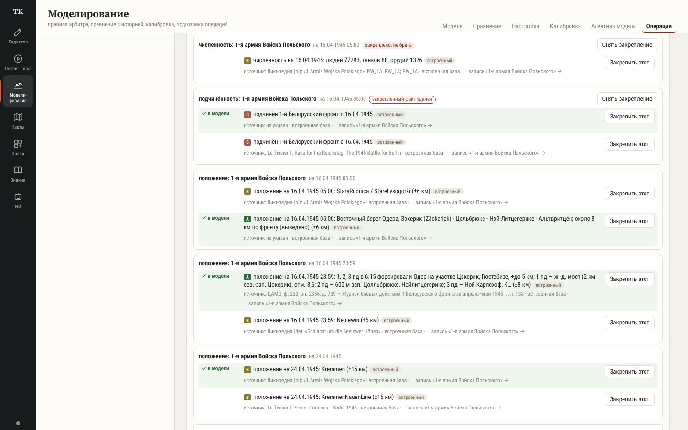

*Та же вкладка с двумя закреплениями у 1-й армии Войска Польского: численность на 16.04.1945 05:00 —
«закреплено: не брать» (единственный кандидат — факт B, 77 293 человека, в модель не идёт) и
подчинённость — «закреплённый факт удалён»: закреплённый факт с тех пор изменился, в модели снова факт
по правилу («✓ в модели», C, 1-й Белорусский фронт); у обоих — «Снять закрепление». Ниже — положения
армии из двух источников; у всех кандидатов — отметка «встроенный».*

**Факты в записи базы.** В разделе «Знания» у записи с формальными фактами (и у записей формирований,
театра, операций и хронологии без них) — таблица «Формальные факты — входы модели»: вид, значение,
достоверность, кто проверил факт («авто», «человек», «встроенный», «ваш, без проверки» — свой факт,
принятый до появления проверок) и по столбцу на каждую операцию, к которой относится запись или где её
факты в ходу: «✓ в модели» — факт выбран сборкой, «перекрыт» — выбран другой (в подсказке — какой), «—» —
не используется. Свои факты можно «изменить» и «удалить», встроенные — «исправить»; «+ Факт» добавляет
факт в запись (раздел 8.7, «Правка фактов»).

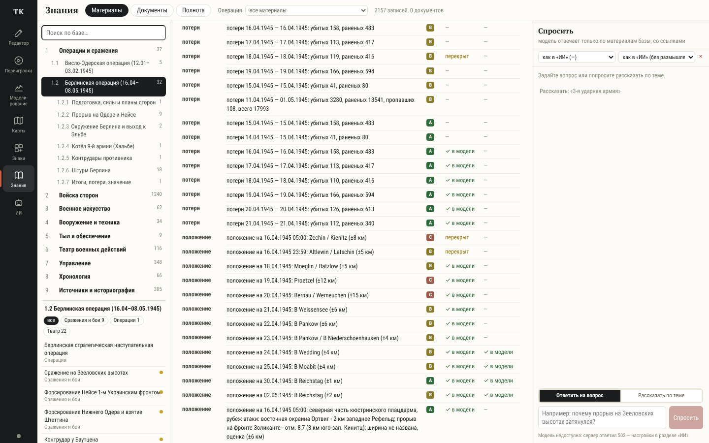

*Запись «8-я гвардейская армия» в разделе «Знания» (таблица прокручена к концу, её заголовок выше кадра): встроенные положения A и B с отметкой «встроенный» и действием «исправить», у положения на 02.05 — «перекрыт» в обоих столбцах операций; внизу — четыре факта из вымышленных материалов с отметкой «авто» и действиями «изменить», «удалить»: потери за 16.04 (убитых 1020, раненых 3410) и за 17.04 (всего 2870), численность на 15.04 (людей 72000) — «✓ в модели», положение на 17.04 «Зелов» — «перекрыт»; под таблицей — «+ Факт».*

### 8.7. Из документа в базу: кандидаты, проверки, очередь, правка

Всё, что приходит в базу, — из текста, скана, таблицы, пакета внешнего агента или ручной правки — сначала
становится **кандидатом-фактом**: формальная часть (с id формирования, если оно сопоставлено), названия
как в источнике, текст факта, источник со страницами, достоверность документа, происхождение и
**доказательство** — цитата из части текста, кусок расшифровки страницы скана с местом на странице, строка
таблицы с ячейками, выписка или шифр документа от агента. В модель принятое попадает только через сборку
«база → модель» (раздел 8.6).

**Проверки.** Первые семь — код (у нормативов ещё проверка «норматив», ниже), восьмая — вторая языковая модель. У проверки три исхода: пройдена,
сомнение, ошибка.

| № | Проверка | Сомнение — в очередь | Ошибка — отбросить |
|---|---|---|---|
| 1 | цитата | скан: в числах цитаты «?»; у агента ни выписки, ни шифра | текст: цитаты нет в части документа; скан: нет в расшифровке полосы; таблица: строки нет |
| 2 | числа | скан: цифры помечены «?»; у агента только шифр — сверить не с чем | числа факта нет в цитате |
| 3 | соединение | не найдено; подходит к нескольким; найдено только по сходству названия; запись базы без соединения сценария; переправа без названия | — |
| 4 | место | пункт положения или линии не найден на театре, координат нет | — |
| 5 | дата | вне операции: раньше начала минус 7 суток или позже конца | не дата |
| 6 | правдоподобие | за порогом (ниже) | — |
| 7 | повтор | — | тот же факт из того же источника уже в базе или в очереди |
| 8 | перекрёстное прочтение | модель прочла цитату иначе | — |

- **Числа** сверяются без учёта разрядов: «4 910», «4 910» с неразрывным пробелом и «4.910» — одно число;
  «4,9 тыс.» — не 4910. В строке таблицы числа берутся по ячейкам, соседние ячейки не склеиваются.
- **Соединение** ищется в сценарии операции и в записях базы: точное название, синонимы записи, номер с
  родом войск; понимаются сокращения («8 гв. А», «5 уд. А», «79 ск»). Совпадение только по сходству
  основ слов (нужны хотя бы две общие основы, из них одна — номер или имя собственное) ставит соединение,
  но с сомнением «сопоставлено по сходству названия — проверьте»; общие слова (корпус, дивизия, армия,
  гвардейский, танковый…) сами по себе не сопоставляют. Синоним записи с перечнем частей («28-й гв. ск (39,
  79, 88 гв. сд)») может дать второе совпадение по номеру — тогда факт ждёт человека (раздел 22.5). В факт
  пишется обозначение формирования в сценарии (`su_8gva`), а не записи базы: найдена запись — берётся её
  синоним-обозначение сценария; у записи его нет — соединение остаётся пустым с сомнением «запись базы без
  соединения сценария». У переправы соединения нет — проверяется только, что она названа; у события проверки
  соединения нет.
- **Правдоподобие** — пороги-допущения без опоры в источниках, строки `norms.json` (раздел 21, «Нормативы опыта войны и
  допущения»; отчёт `docs/norms-check.md`): численность по ступени — дивизия до 20 000, корпус до 60 000, армия до 150 000,
  фронт и группа армий до 1 200 000; потери за период — не больше численности соединения (последний
  факт численности в базе или сценарий), за сутки — не больше трети; вышестоящий — выше по ступени, чем
  соединение; пополнение — не больше половины численности.
- **Норматив** (значение правила и итог прогона, раздел 8.8) — своя проверка кодом: диапазон упорядочен
  и есть число или объяснение допущения (иначе ошибка), параметр есть в перечне входов модели (иначе
  сомнение «неизвестный параметр»), у итога названа операция (иначе сомнение); соединение у значения правила
  не проверяется, у итога — если названо.
- **Доктрина** — своя проверка кодом у правил «условие → действие»; что она проверяет — в разделе 8.9.
- **Повтор** не попадает в отброшенное: он молча не добавляется и считается в «повторах».
- **Перекрёстное прочтение** — отдельный запрос модели роли «перекрёстная проверка», которая получает
  только цитату и отвечает: чья это численность или потери — наших войск, противника или неясно (сторону
  модель называет, только если сама выписка показывает, чей это документ), план или свершившееся, какое
  соединение названо, за какой день или период, что значит каждое число (люди, танки, орудия, убитые,
  раненые, пропавшие, всего, иное). Ответ с формальной частью сравнивает код: другая сторона, «план»,
  другое соединение (после сопоставления), другой период или другое значение числа — сомнение с
  объяснением модели. Проверка идёт для фактов из текста и сканов, которые не отброшены проверками 1–7.
  Если она выключена в настройках, всё из текста и сканов, что прошло бы само, идёт в очередь с сомнением
  «перекрёстная проверка выключена»; таблицы, пакеты агента и ручная правка — как обычно.

**Итог.** Есть ошибка — кандидат отброшен (виден в итогах документа с причиной); есть сомнение — ждёт
человека в очереди «На проверку»; иначе он сразу ложится в базу с отметкой «проверено автоматически». Факт
ложится в запись формирования (записи нет, но формирование есть в сценарии — запись создаётся), событие —
в хронологию операции, переправа — в запись «Состояние инфраструктуры» операции (у документа без операции —
в общие записи «События (без операции)» и «Состояние инфраструктуры (без операции)»). Переправа из документа
без операции всегда ждёт человека: мост театра находится по названию, и такая переправа вошла бы в расчёт
всех операций, где есть мост с этим названием. Если соединение не
найдено ни в сценарии, ни в базе, кандидат ждёт в очереди, пока человек не укажет его.

**Текст.** Части около 3000 знаков с перекрытием. Модель получает часть, название документа и операцию
(сроки, стороны) и отвечает по схеме: факты с формальной частью и цитатой, текстовые записи по каркасу,
сведения о дорогах и рубежах. Зацикливание или ответ не по схеме — повтор без схемы на сервере; вторая
неудача — часть «не разобрана» (видна в итогах), разбор идёт дальше.

**Скан.** Страница становится картинкой (PDF — через pdfjs, JPG и PNG — как есть); высокая страница (высота
больше 1,6 ширины, обычно таблица) режется на 2–4 полосы с перекрытием не меньше 10 %. Модель роли «чтение
сканов» получает полосу и даёт дословную расшифровку (неразборчивые знаки и цифры — «?», таблицы — строка
за строкой, ячейки через « | ») и факты, у каждого цитата — кусок расшифровки — и место на изображении;
место пересчитывается в доли страницы. Цитата должна найтись в расшифровке своей полосы. Картинки страниц и
расшифровки хранятся при документе. Распознаёт только модель со зрением: если сервер отказывает в запросе
(ответ 4xx) и говорит, что модель не принимает изображений, документ «ждёт распознавания» — нужно выбрать
модель со зрением и продолжить разбор; ошибка сервера (5xx) или недоступность — обычная остановка разбора.

**Таблицы.** Таблица по шаблону (`docs/facts-template.md`, образцы `facts-template.csv` и
`facts-template.json` — в `apps/editor/public/samples/`, в браузерном варианте — по адресу `/samples/`) читается сразу: столбцы `kind`, `subject`, `date`,
`date_to`, `personnel`, `tanks`, `guns`, `killed`, `wounded`, `missing`, `total`, `parent`, `place`, `lat`,
`lon`, `approx_km`, `source`, `pages`, `reliability`, `quote`, `note`. CSV — с разделителем «,» или «;», в
UTF-8 или Windows-1251; XLSX — первый лист. Числа людей и техники — целые, разряды («52.000», «1 200»)
понимаются, дробное — ошибка; даты — ГГГГ-ММ-ДД или ДД.ММ.ГГГГ. Любая другая таблица — через
**сопоставление столбцов**: модель роли «разбор документов» получает заголовок и первые 10 строк и
предлагает смысл каждого столбца (или «не нужен») и вид фактов; человек подтверждает или правит в окне
сопоставления, дальше строки разбирает код, без модели. Без сервера моделей окно открывается с «не нужен»
у всех столбцов. **Дни в столбцах** (заголовки — даты, строки — соединения): столбец-дата с выбранным
числом («потерь всего», «людей»…) даёт по факту на каждый день строки; если за день несколько столбцов
(«убито» и «ранено» под одной датой), это один факт со всеми числами дня, и сверяются они с ячейками этого
дня. Одинаковые заголовки не сливаются. Строка с ошибкой (дата — не дата, число — не число, нет
обязательного) отбрасывается с номером строки; в днях в столбцах ошибка одного дня не отбрасывает остальные.
Несопоставленные столбцы перечислены в итогах.

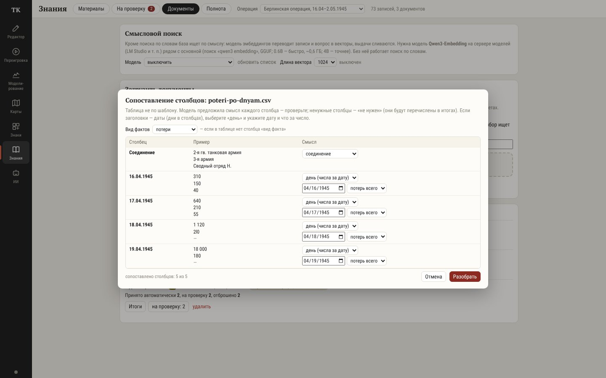

*Окно сопоставления столбцов для вымышленной таблицы потерь по дням (CSV в Windows-1251 с разделителем «;»): вид фактов — «потери»; у столбца «Соединение» — «соединение», у столбцов 16.04.1945–19.04.1945 — «день (числа за дату)» с датой и «потерь всего» (предложение записанного ответа модели); в примерах — числа с разрядами («1 120», «18 000») и опечатка «2l0»; внизу — «сопоставлено столбцов: 5 из 5», «Отмена» и «Разобрать».*

**Пакет агента** — JSON `{ "format": "def-ops-facts", "version": 1, "source": {…}, "facts": […] }`: поля
фактов — столбцы шаблона, числа можно писать числами, допустимы естественные ключи `state`, `title`,
`between`, `points`, `dateTo`; `source.reliability` — достоверность по умолчанию. Факт с шифром документа
(`ref` у факта или в `source` пакета) — выписка агента; без шифра — строка таблицы. Другой `format` —
ошибка. Таблицы и пакеты разбираются без сервера моделей.

**Задание для агента.** Кнопка «Задание для агента» в «Основе модели» и в подсказках «Полноты» сохраняет
md-файл по операции: зачем нужны факты; пробелы — фронты, армии и корпуса операции, у которых численность
или подчинённость держится на допущениях сценария или нет фактов положения или потерь; где искать
(подсказки полноты, раздел 8.2); общие правила (только документ с шифром и ссылкой, пересказ своими словами
до 300 знаков, цитата до 25 слов, координаты WGS84 с радиусом неопределённости, время как в документе,
пустой результат — тоже результат, с перечнем просмотренного) и точный формат ответа — пакет
`def-ops-facts`. Ответ агента загружается как документ.

**Очередь «На проверку»** — вкладка раздела «Знания» со счётчиком по выбранной операции. Вверху — фильтры
по документу, виду, соединению и причине, причины с числами (щелчок — фильтр), «Принять все, где сомнение
только в …» и, при фильтре по документу, «Отклонить все из документа». Карточка кандидата: вид и значения
правятся на месте (числа — «4 910», «4.910» или «4910»); соединение выбирается (предложенное — первым,
затем формирования сценария, «другая запись базы…» — поиск по всей базе: у записи берётся её обозначение в
сценарии, запись без него помечена «без соединения сценария» — факт ляжет в неё, но в модель не пойдёт); у
переправы вместо соединения — её название, оно правится на месте; источник; сверху — причины
сомнения; справа — доказательство: цитата с подсвеченными числами, картинка страницы скана с рамкой вокруг
места цитаты и расшифровкой под ней, строка таблицы или выписка агента. «Принять» («Принять с правкой»
после правки), «Отклонить»; «Почему сомнение» и «Предложи исправление» — подсказки модели роли «разбор
документов» по кнопке: её правки подставляются в карточку, принимает человек. Принятое — «проверено
человеком». Текстовые кандидаты — новые записи и дополнения, сведения о дорогах и рубежах — показывают, что
добавится в базу. Очередь заменила прежние отдельные списки (предложения записей, сведения об
инфраструктуре, положения, разграничительные линии).

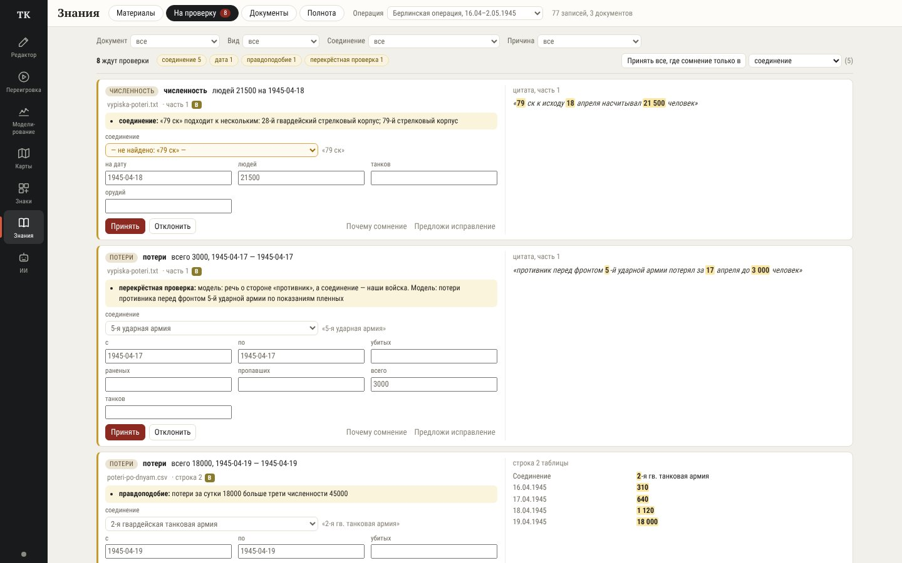

*Вкладка «На проверку» сразу после разбора трёх вымышленных материалов: «8 ждут проверки», причины — соединение 5, дата 1, правдоподобие 1, перекрёстная проверка 1; справа — «Принять все, где сомнение только в: соединение (5)». Первая карточка — численность «79 ск» на 18.04 (21 500 человек): название подходит к двум записям (28-й гвардейский и 79-й стрелковый корпуса), соединение не выбрано; вторая — потери 5-й ударной армии за 17.04 (3000): перекрёстное прочтение увидело, что речь о потерях противника; третья — потери 2-й гв. танковой армии за 19.04 (18 000) больше трети её численности; справа — цитаты с подсвеченными числами и строка таблицы.*

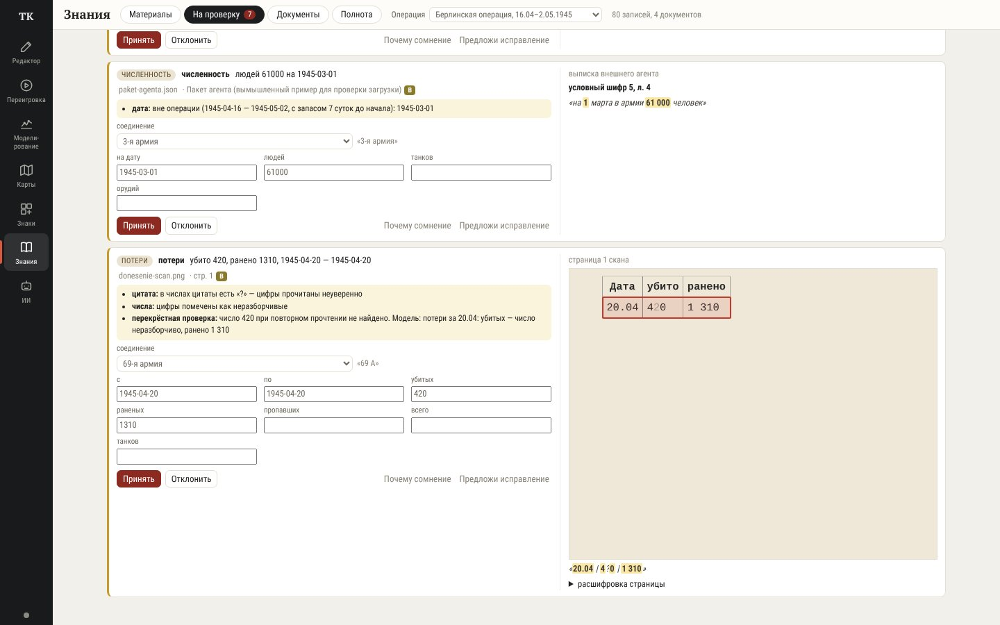

*Кандидат со скана вымышленного донесения (разбор на записанном ответе модели): потери 69-й армии за 20.04 — убито 420, ранено 1310; сомнения — «в числах цитаты есть «?»», «цифры помечены как неразборчивые», перекрёстное прочтение не нашло число 420; справа — страница скана с красной рамкой вокруг строки таблицы за 20.04 (вторая цифра числа убитых бледная), ниже — цитата из расшифровки с подсвеченными числами и свёрнутая расшифровка страницы. Выше — кандидат из пакета агента с датой вне операции (численность 3-й армии на 1 марта).*

**Правка фактов.** «+ Факт», «изменить» и «исправить» в записи открывают форму по виду факта: поля
формальной части (соединение — из сценариев операций записи или по названию), источник, страницы,
достоверность, заметка; ниже — «Будет записано: …» и предупреждения проверок 3–7 (соединение, место, дата,
правдоподобие, повтор): сохранить можно и с ними. Факт без источника ложится допущением — без
достоверности. Сохранённое — «проверено человеком». Свои факты можно изменить и удалить, встроенный факт не
правится и не удаляется — только исправляется.

**«Исправить» встроенный факт.** Форма открывается с его значениями; сохранение создаёт факт пользователя
с источником и пометкой «исправляет встроенный». Чтобы в модель шло исправление, на началах операций, где
встроенный факт в ходу или в расхождении (и операций его записи, начавшихся не раньше его даты), а также на
его собственной дате, если у исправления та же дата, закрепляется само исправление, а не «не брать»: «не
брать» исключило бы на этом месте и исправление. Если исправление — о другом соединении или другого вида
(или с другой датой — на дате встроенного), встроенный факт там закрепляется «не брать». Исправление
помнит, какие закрепления оно поставило и что было на этих местах раньше: удаление исправления возвращает
прежнее (в том числе «не брать», поставленное человеком до того), правка снимает их и ставит заново. Место,
где человек после исправления выбрал другое, не трогается ни удалением, ни правкой. Удаление факта и откат
документа сдвигают закрепления и адреса следующих фактов той же записи: закреплённый выбор остаётся за тем же
фактом.
Исправленный встроенный факт в записи помечен «исправлен — в модель идёт исправление». Если при
обновлении встроенной базы (`npm run kb:seed`) исправленный факт изменился, у исправления появляется
пометка «встроенный факт изменился — пересмотрите» — в записи и в «Основе модели».

**Как принят факт** виден в записи, в «Основе модели» и в итогах документа: «проверено человеком» (принят
из очереди, введён или исправлен вручную), «проверено автоматически» (прошёл все проверки), «встроенное»
(встроенная база) и «ваш, без проверки» — свой факт, принятый до появления проверок. При выборе из
нескольких фактов (раздел 8.6) последним звеном уступает только «проверено автоматически»; факты без
отметки проверки — встроенные и прежние свои — стоят наравне с проверенными человеком.

**Перенос прежних материалов.** При первом открытии базы новой версии принятые ранее из документов
положения, линии и переправы стали фактами с формальной частью и отметкой «проверено человеком» (то, для чего
формальную часть не собрать — место или соединение не найдены, — осталось текстовым фактом); ждавшие решения
и отклонённые — кандидатами в очереди с прежним состоянием; предложения записей — текстовыми кандидатами.
Выгрузка материалов («Выгрузить мои материалы», версия 2) содержит кандидатов, отметки проверки и
доказательства, но не картинки страниц и расшифровки сканов (скан загружается заново); выгрузка прежней
версии загружается с тем же переносом.

Пример на Берлинской операции — три вымышленных материала и скан: что принято, что ушло в очередь, как
изменились «Основа модели» и сверка численности — в разделе 22.5.

### 8.8. Нормативы модели в базе знаний

Нормативы, по которым проверяются и подбираются правила модели (темпы, поправки обороны, потери, сроки
переправ, котлы и крепости), — тоже факты базы знаний. У них два вида формальной части:

- **значение правила** — параметр правил арбитра или профиля стороны (как он назван в перечне входов,
  раздел 7, «Основа правил»), значение или диапазон, единица, сторона (если норматив только советский или
  только немецкий) и «дано на 1/n входа», если источник даёт величину в иных единицах. Факт без источника
  и достоверности — **допущение**: вместо источника у него объяснение, почему это допущение и чего не
  хватает;
- **итог прогона** — то, что проверяется по прогону операции: мера (темп, потери, ширина полосы обороны…),
  операция, соединение (если названо), период и ожидаемый диапазон.

**Встроенные нормативы.** Таблица `packages/sim/data/rules/norms.json` — исходник встроенных нормативов;
`npm run kb:seed` превращает каждую её строку в факт записи, на которую строка ссылается (например,
«Темпы наступления: опыт 1-го Белорусского фронта (апрель 1945)»), а строку без такой записи — в запись
«Модель: <раздел описания>». Во встроенной базе 77 нормативов: 66 значений правил (47 с источником —
A 12, B 34, C 1, из них 36 — параметры агентной модели; 19 допущений), 10 итогов прогона (A 2, B 7, C 1)
и один текстовый — то, чего модель не считает. Главной стала база: проверка `npm run sim:norms` (раздел 21) и сборка «база → правила» берут
нормативы из неё, и отчёт по встроенным нормативам тот же, что был по таблице.

**Из документов и вручную.** Разбор документа (раздел 8.7) выписывает оба вида. Перечень параметров модели
передаётся модели вместе с частью текста только тогда, когда в части или в названии документа есть
признаки норматива (норматив, устав, наставление, темп, км/сут, поправка, коэффициент, процент, «в сутки»,
«на 1 км», плотность); у скана — только по названию документа: так дешевле, а промах ловит проверка.
Параметры агентной модели в запрос не входят. Проверки нормативов: числа значения и границ диапазона — в
цитате (проверка 2); проверка «норматив» — диапазон упорядочен, есть число или объяснение допущения (иначе
ошибка), параметр есть в перечне входов (иначе сомнение «неизвестный параметр»); значение не отрицательно и не ноль там, где
вход — множитель или величина (иначе ошибка); единица факта совпадает с единицей входа (иначе сомнение); коридор
не дальше чем в 5 раз от нынешнего значения входа (иначе сомнение). Модель просят давать значение в единице входа
из перечня и переводить «на 35 %» в множитель 1,35 только для входов-множителей; такой пересчёт проверка чисел
принимает; у итога — названа
операция (иначе сомнение), конец периода не раньше начала. Форма факта («+ Факт») получила виды «значение
правила» и «итог прогона»: параметр выбирается из перечня входов по группам, единица подставляется из
перечня.

**Сборка «база → правила».** Из нормативов базы и закреплений стенд собирает основу правил каждого набора:

- **выбор** — закреплённый факт, иначе норматив с источником раньше допущения, затем выше достоверность,
  свежее запись, и при прочем равенстве «проверено автоматически» уступает (как в разделе 8.6);
- **не попадают в сборку** нормативы с нулевым или отрицательным коридором и нормативы одной стороны на
  входе, общем для обеих сторон: они видны в «Основе правил» среди расхождений с причиной;
- **коридор** — значение источника с допуском по достоверности: A ±10 %, B ±20 %, C ±35 %; значение
  `v` даёт коридор `v(1−t)…v(1+t)`, диапазон `a…b` — `a(1−t)…b(1+t)`. Коридор входа пересчитывается в
  коридор множителя калибровки (раздел 21); нет норматива или у входа допущение — прежние границы подбора;
- **происхождение** — у каждого входа выбранный норматив (запись, источник, достоверность, цитата) или
  «допущение»;
- **итоги** — нормативы-итоги по операциям;
- **расхождения** — нормативы одного параметра с непересекающимися коридорами; выбор закрепляется, как в
  «Основе модели».

Изменилась база так, что изменились коридоры или итоги операции, — в журнал операции пишется «основа правил
из базы: …», и панель «Пересчёт модели» (раздел 8.5) видит, что данные изменились. Сами наборы правил при
этом не меняются: коридоры действуют при следующей калибровке.

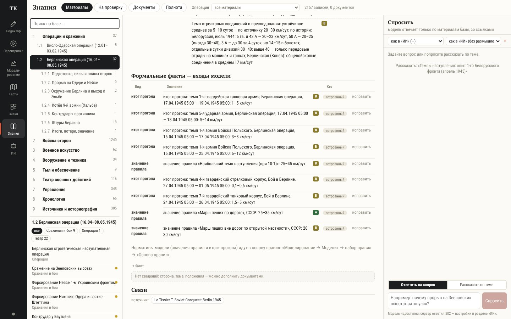

*Запись «Темпы наступления: опыт 1-го Белорусского фронта (апрель 1945)» в разделе «Знания» (выше — конец её
текстовых фактов): в таблице «Формальные факты — входы модели» шесть итогов прогона и три значения правила, все
встроенные, с действием «исправить»: темпы 1-й гв. танковой армии (1–5 км/сут), 5-й ударной армии (5–14),
1-й армии Войска Польского (3–8 и 6–12) на Берлинской операции, 4-го гв. стрелкового и 7-го гв. танкового
корпусов в бою в Берлине — B; «Наибольший темп наступления (при 10:1)» 25–45 км/сут — B; «Марш пеших по дороге»,
СССР, 25–35 км/сут — A; «Марш пеших вне дорог по открытой местности», СССР, 20–30 км/сут — B. Под таблицей —
«Нормативы модели (значения правил и итоги прогона) идут в основу правил…» и «+ Факт»; справа — панель
«Спросить» (сервер моделей в этом окружении недоступен).*

### 8.9. Доктрина и справка по роли

Правила доктрины сторон — тоже факты базы знаний с формальной частью: вид **«доктрина»** — правило
«условие → действие» с числами. Поля: сторона (советская или германская), ступень (фронт, армия, корпус,
дивизия), группа правил (ширина полос и участков прорыва, построение в эшелоны, глубина задач, темп
наступления, ввод вторых эшелонов и подвижных групп, остановка и переход к обороне, обход узлов обороны,
перегруппировка, резервы; артиллерийское наступление, авиационное обеспечение; построение обороны,
контратаки и контрудары, отход и отвод с первой позиции, резервы обороны; сроки), id правила (латиницей),
условие, действие и числа — по имени число или диапазон «от–до». Словами правило читается так:
«Доктрина (нем., корпус, контратаки и контрудары): условие → действие; force_share 0,33», с надёжностью
и источником, как у прочих фактов.

Ключ закрепления правила — сторона и id правила, без даты: правило действует всегда. Если по одному
правилу в базе несколько фактов с разными условием, действием или числами, выбирается закреплённый,
иначе надёжнее и свежее (как в разделе 8.6); разницу можно закрепить в записи.

**Встроенная доктрина.** `npm run kb:seed` превращает три свода — немецкая оборона 1945 г.
(`german-defence-doctrine-1945.json`), советское наступление 1945 г. по уставам и исследованиям
(`soviet-offensive-doctrine-1945.json`) и по документам ЦАМО (`soviet-offensive-doctrine-1945-tsamo.json`) —
в правила записей доктрины «Наступление Красной армии, 1945: …» и «Оборона вермахта, 1945: …» (по записи на
группу). Каждое правило свода со ступенью — факт с формальной частью при прежней текстовой строке положения:
144 правила в 16 записях — советских 114 (фронт 37, армия 49, корпус 12, дивизия 16), немецких 30 (армия 16,
корпус 8, дивизия 6). id и числа правила — из свода: числа и пары чисел сохраняются, словарь чисел — плоскими
ключами («ключ.подключ»), строки, пустые значения и перечни не из двух чисел отбрасываются; у 24 правил
чисел нет.

**Из документов.** Разбор документа (раздел 8.7) выписывает правила доктрины только из частей с признаками
устава или наставления — в тексте части или в названии документа есть «устав», «наставление»,
«инструкция», «указания по», «руководство по», «доктрина», Vorschrift, Merkblatt или Richtlinie: в журналах
и сводках правил нет, а лишний перечень удлиняет запрос. id правила даёт модель; не дала — он собирается
из начала действия латиницей с короткой меткой текста, чтобы разные правила не слились. Проверка
**«доктрина»**: сторона и ступень из перечня, действие названо, у правила из документа названо и условие
(при вводе вручную условие необязательно), группа латиницей (иначе ошибка); группа не из перечня — сомнение
«неизвестная группа». Числа правила проверка «числа» ищет в цитате. Принятое правило ложится в запись
доктрины своей стороны и группы; такой записи нет — создаётся запись «Доктрина Красной армии: …» или
«Доктрина вермахта: …». Доктрина общая для операций: операция документа к записи не прибавляется.

**Вручную.** В записи доктрины «+ Факт» открывает форму вида «доктрина» со стороной и группой записи;
встроенное правило поправляется кнопкой «исправить» — как другие факты (раздел 8.7). Под фактами записи
доктрины — строка **«Кто использует»**: штаб противника своей стороны («штаб противника (немецкой
стороны)», «(советской стороны)» — он берёт правила той стороны, за которую играет), Ставка (если в записи
есть советские правила фронта или армии), ОКХ (если есть немецкие фронта или армии), посредник, штабы
агентной модели (если есть правила тех уровней, что они берут: советские — армии и корпуса, немецкие —
армии, корпуса и дивизии).

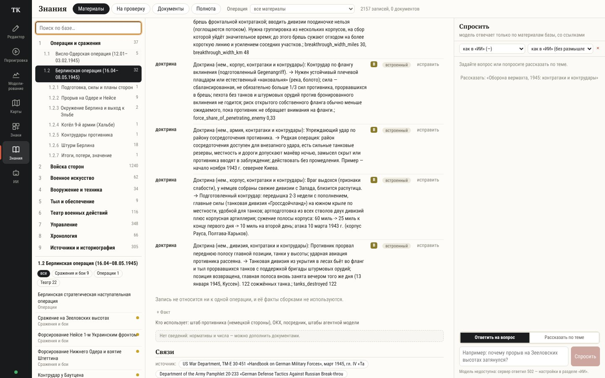

*Запись «Оборона вермахта, 1945: контратаки и контрудары» в «Знаниях»: в таблице формальных фактов — правила
вида «доктрина» словами, «Доктрина (нем., корпус, контратаки и контрудары): условие → действие», у одного —
число «force_share_of_penetrating_enemy 0,33»; у видимых — надёжность B, «встроенный» и «исправить». Под
таблицей — «+ Факт» и строка «Кто использует: штаб противника (немецкой стороны), ОКХ, посредник, штабы
агентной модели»; ниже —
связи с источниками (TM-E 30-451, Pamphlet 20-233), справа — панель «Спросить».*

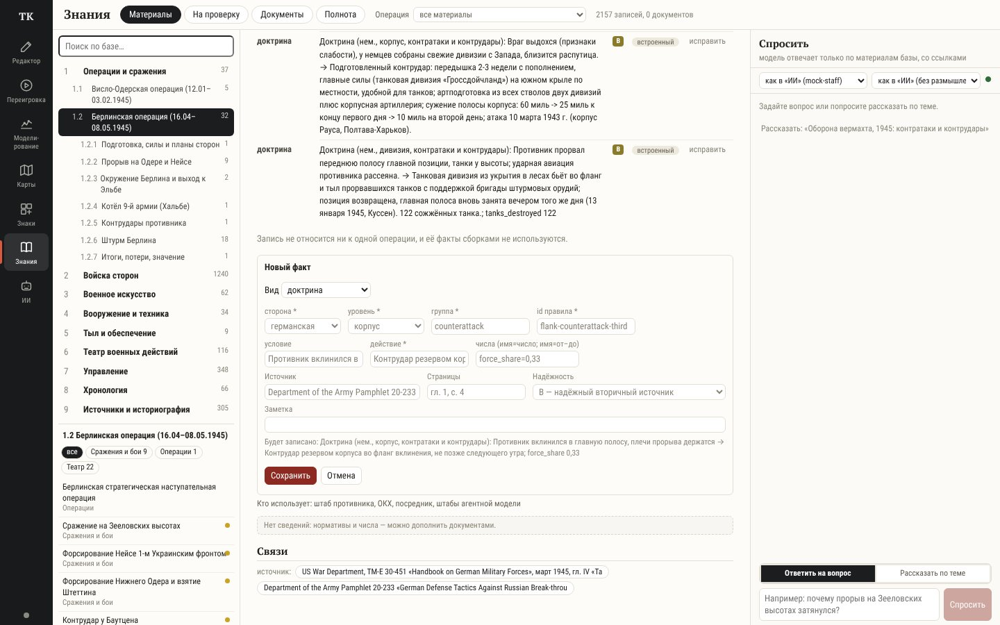

*Форма «Новый факт» вида «доктрина» в той же записи: сторона «германская», уровень «корпус», группа
counterattack, id правила, условие, действие и числа «force_share=0,33»; ниже — источник, страницы,
надёжность «B», заметка и строка «Будет записано: Доктрина (нем., корпус, контратаки и контрудары): … ;
force_share 0,33».*

**Справка по роли.** Справку из базы для языковых моделей игры отбирает одно правило — что может знать
роль (таблица в разделе 9): поиск по словам и смыслу по каждому запросу, записи берутся поочерёдно из
выдач запросов без повторов. Для всех ролей — без записей «Как это устроено в модели», без списка
источников и без материалов других операций. Штабу, Ставке и посреднику — только записи организации и
доктрины и техники; запись местности — только если все её факты — значения правил или правила доктрины
(описания позиций, мостов, переправ хранят их историю: «прорыв 17.04», «переправа 20.04»). Запись, где хоть
один факт из документа — не значение правила и не правило доктрины, не берётся (положения, состояние
мостов, гарнизоны из документов — обстановка, которой сторона знать не должна); запись, которая начинается
позже хода или в которой есть факт с датой позже хода, — тоже. Из записей доктрины в тексте справки
убираются правила с датой позже хода. Штабу и Ставке, которым доктрина дана отдельным блоком, записи
доктрины в справке не даются. Тот же отбор — у справки по встроенной базе, когда окно не ответило, и в
проверке посредника `npm run llm:umpire`. У записи организации сторон в заголовке —
«своя сторона» или «противник». Доктрина к обстановке отбирается отдельно (раздел 6, «На что опираются
штаб противника, Ставка и посредник»).

## 9. ИИ: языковые модели

Языковые модели работают на компьютере пользователя через LM Studio (или любой сервер с
совместимым API); данные наружу не уходят. В настольном приложении адрес по умолчанию — `/llm/v1`: сервисы
приложения проводят его к LM Studio на этой машине (`localhost:1234`); другой сервер задаётся полным адресом
в поле «Адрес сервера» раздела «ИИ». Роли:

| Роль | Что делает |
|---|---|
| Штаб противника | решение на ход за немецкую сторону: оценка, замысел, приказы, доклады |
| Советник | ответы игроку, варианты решения на ход |
| Посредник | ограниченные поправки к боям с опорой на базу знаний (по выбору) |
| Ставка | разграничительные линии между фронтами в игре, когда обстановка разошлась с историей или есть ходатайство (по выбору) |
| Разбор | отчётный документ по записи игры |
| Знания (разбор документов) | разбор документов в факты, сопоставление столбцов таблиц, подсказки в очереди «На проверку», ответы и рассказы по базе |
| Чтение сканов | дословная расшифровка страниц сканов и факты с них — только модель со зрением |
| Перекрёстная проверка | второе прочтение цитаты факта из текста или скана (раздел 8.7); выключается |
| Разговор с агентом | ответы дивизии на карточке агента в «Переигровке» (раздел 6) |
| Эмбеддинги | смысловой поиск по базе знаний; модель и длина вектора — в «Знаниях», блок «Смысловой поиск» |

Что из базы знаний получает каждая роль в игре (раздел 8.9, «Справка по роли»; общее для всех — без записей
модели, источников и материалов других операций):

| Роль | Что знает из базы | Доктрина | Пределы |
|---|---|---|---|
| Советник | организация и доктрина, техника; в вопросах темы «история» — всё, с пометкой «история» у записей хода операции; у записей организации сторон — «своя сторона» или «противник» | в справке, как прочие записи | 5 записей по 700 знаков |
| Посредник | организация и доктрина, техника; местность — только из значений правил и доктрины; на момент хода — без записей и фактов с датой позже; без хода операции и обстановки из документов | в справке, по условиям боёв, без правил с датой позже хода | 8 записей по 900 знаков |
| Штаб противника | то же, что посредник, с пометкой своей и чужой стороны, без записей доктрины | правила своей стороны к обстановке, без правил с датой позже хода (раздел 6) | доктрина — 8 правил, 4000 знаков; справка — 5 записей по 700 знаков |
| Ставка, ОКХ | то же, что штаб противника | правила своей стороны уровня фронта и армии, без правил с датой позже хода | 8 правил, 4000 знаков |
| Разбор | всё, включая ход операции | — | — |

Ссылки на правила и справки — номера [R1]…; решение штаба противника показывает их в «Посреднике» («по
базе: R1, R3»), ответ Ставки записывает в игру, поправка посредника — в «опоре». Штабы агентной модели на
языковой модели получают из базы только текст доктрины своей стороны (раздел 6).

Модель и режим размышления выбираются для советника, разбора, базы знаний, чтения сканов и перекрёстной
проверки («Моделирование → Модели → Модели по ролям»; пусто — как в разделе «ИИ»). Штаб противника, посредник,
Ставка и разговор с агентом берут модель раздела «ИИ»; штабу противника в игре можно задать свою модель в
«Посреднике». Названия моделей в системе не зашиты. У чтения сканов — кнопка «Проверить»:
модели отправляется картинка с числом; не назвала его или сервер отказал — «эта модель не видит
изображений». Для перекрёстной проверки лучше брать другую модель, чем для разбора: она читает цитату
независимо.

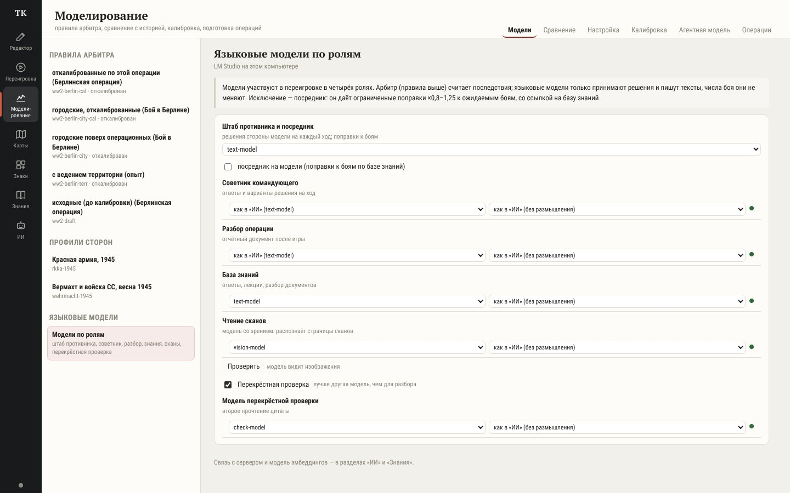

*«Моделирование → Модели → Модели по ролям» на подставном сервере моделей с тремя именами (text-model, vision-model, check-model): у штаба противника и посредника — одна модель (text-model) без выбора размышления и выключенный «посредник на модели»; у советника и разбора операции — «как в «ИИ» (text-model)»; база знаний — text-model; чтение сканов — vision-model, после «Проверить» — «модель видит изображения»; перекрёстная проверка включена, её модель — check-model; у советника, разбора, базы знаний, чтения сканов и перекрёстной проверки рядом — режим размышления «как в «ИИ» (без размышления)».*

Разработчики без LM Studio проверяют интерфейс на
подставной модели (`npm run llm:mock`, тот же адрес `localhost:1234`): её ответы простые.
Решения модели проверяются программно: что не сопоставилось с обстановкой, не исполняется и
помечается с причиной.


*Раздел «ИИ» в окне приложения: адрес `/llm/v1` — к LM Studio на этом компьютере через сервисы приложения, модель (здесь — подставная, mock-staff), размышление, «на связи · моделей: 1»; ниже — как подготовить LM Studio и что видит модель.*

## 10. Архитектура

Монорепозиторий: библиотеки, сервисы за API-шлюзом, редактор, настольное приложение (Tauri) и ядро агентной
модели на Rust. Схема ниже — серверный вариант; в настольном приложении всё так же, но без СУБД и ключей (под схемой).

```
                 ┌─────────────── окно приложения или браузер ─────────────────┐
                 │  apps/editor (React)                                         │
                 │   ├─ @def-ops/core        — знаки, слои, SVG, GeoJSON        │
                 │   ├─ @def-ops/sim         — арбитр (в фоновых потоках)       │
                 │   ├─ @def-ops/knowledge   — база знаний, поиск, полнота      │
                 │   ├─ @def-ops/api-client  — клиент API                       │
                 │   └─ engine/MapEngine     — адаптер карты (MapLibre)         │
                 └──────────────┬──────────────────────────────┬────────────────┘
   внешние системы ─ ключ ─►  /api/*                         /llm ──► LM Studio (на машине пользователя)
                 ┌──────────────▼───────────────┐
                 │ services/gateway :8080       │ ключ → организация, маршрутизация, статика
                 └──┬──────────┬──────────┬─────┴──────────────┐
                    ▼          ▼          ▼                    ▼
              documents     render     registry          cartography
               :8101         :8102      :8103               :8104
            карты, ревизии  SVG,       объекты,           подложки офлайн:
            слои, события   GeoJSON    факты во времени   тайлы, сканы, пакеты
                    │                     │                    │
                    └────────► PostgreSQL + PostGIS ◄───────────┘    том tiles-data
```

В настольном приложении те же сервисы запускает окно приложения фоновым процессом на `127.0.0.1`, шлюз — на
постоянном порту (записан в папке данных: хранилище окна привязано к адресу, и на новом порту окно не увидело бы
данных прошлых запусков), остальные — на свободных. СУБД и ключей нет: карты, тайлы, реестр и описания карт —
файлами в папке данных приложения. Агентную модель считает ядро в самом приложении (команды `crates/agents-tauri`).

| Часть | Ответственность |
|---|---|
| `packages/core` | модель документа, слои, геопривязка, рендер знаков в SVG, GeoJSON; без зависимостей от окружения — тот же код рисует в редакторе и на сервере |
| `packages/sim` | симулятор операций: театр, арбитр, игра, доклады, сравнение с историей, калибровка |
| `crates/agents-core` | ядро агентной модели (Rust; считает в «Переигровке» и «Моделировании → Агентная модель» настольного приложения и в `apps/agents`): дивизии с машиной состояний, штабы, объекты, часовой шаг с параллельным и воспроизводимым расчётом; сценарии — вся Берлинская операция (347 соединений), Висло-Одерская (с допущениями) и Зееловские высоты (79 дивизий) со сверкой с историей; замысел — [plans/agents.md](plans/agents.md) |
| `packages/knowledge` | база знаний: каркас, рубрикатор, поиск, извлечение из документов и сканов, кандидаты-факты и их проверки, разбор таблиц и пакетов фактов, задание для внешнего агента, полнота, подсказки, сверка со сценарием, сборка входов модели |
| `packages/service-kit`, `packages/db`, `packages/api-client` | каркас сервисов, PostgreSQL с миграциями по схемам, клиент API |
| `services/gateway` | единая точка входа: API-ключи → организации, маршрутизация, CORS, статика редактора |
| `services/documents` | хранение карт: ревизии, оптимистичная блокировка, слои, события (SSE) |
| `services/render` | SVG и GeoJSON по документу (в т. ч. на момент времени), импорт GeoJSON, каталог знаков; без состояния |
| `services/registry` | реестр объектов: типы и схемы характеристик, факты во времени, пространственно-временные запросы (PostGIS) |
| `services/cartography` | карты-подложки офлайн: тайловые пирамиды, загрузка тайлов, нарезка сканов, пакеты, импорт карт других программ |
| `services/staff` | промпты и разбор ответов языковой модели: штаб, советник, посредник, разбор; контрольные обстановки; подставная модель |
| `apps/editor` | приложение: все разделы |
| `crates/agents-tauri` | команды Tauri агентной модели (прогон, данные, языковая модель) — общие для `apps/agents` и `apps/desktop` |
| `apps/desktop` | настольное приложение (Tauri): редактор, сервисы фоновым Node-процессом, агентная модель в «Переигровке» (с карточкой агента, разговором и игрой) и в «Моделировании → Агентная модель» |
| `apps/agents` | приложение разработчика «Переигровка — агенты» (Tauri; в настольное приложение не входит, раздел 14): карта театра, ход по часам, карточка агента, разговор с агентом; расчёт — `crates/agents-core` |

Принципы: предметная логика — в библиотеках без окружения; сервисы по ответственности, общение
по HTTP/JSON; снаружи доступен только шлюз; открытые форматы (JSON по OpenAPI, GeoJSON, SVG со
слоями); заменяемые части за интерфейсами — хранилище, картографический движок, подложки, шина
событий. Подробно — [architecture.md](architecture.md).

## 11. Данные и хранение

Папка данных настольного приложения (идентификатор `ru.defops.desktop`): macOS —
`~/Library/Application Support/ru.defops.desktop`, Windows — `%APPDATA%\ru.defops.desktop`, Linux —
`~/.local/share/ru.defops.desktop`.

| Данные | Настольное приложение | Серверный вариант |
|---|---|---|
| Карты (документы) с ревизиями | папка данных, `documents/` | PostgreSQL, схема `documents` |
| Реестр объектов и факты во времени | папка данных, `registry.json` | PostgreSQL + PostGIS, схема `registry` |
| Карты-подложки | папка данных: тайлы — `tiles/`, описания — `cartography.json` | том `tiles-data` (по организациям), описание — схема `cartography` |
| Карта OpenHistoricalMap | папка данных: `tiles/<организация>/<карта>/ohm.mbtiles`, шрифты и значки — `tiles/.ohm-assets` | том `tiles-data` |

| Данные | Где |
|---|---|
| Встроенные операции: сценарии, театры, история, правила, профили | в сборке (`packages/sim/data`) |
| Исторические наборы данных (выписки из источников) | `docs/sources` — только факты и пересказы, без текстов книг |
| Начальная база знаний | в сборке (`packages/knowledge/data/seed.json`) |
| Свои операции, театры, правила, сведения об инфраструктуре, правки операций, сохранённые переигровки | хранилище окна приложения или браузера (IndexedDB) |
| Незавершённая игра, варианты параметров агентной модели, настройки ИИ, история ассистента | хранилище окна приложения или браузера (localStorage) |
| Слой пользователя базы знаний: записи и факты, документы, кандидаты-факты (очередь «На проверку» и отброшенные), картинки страниц и расшифровки сканов, закрепления | хранилище окна приложения или браузера (IndexedDB); выгрузка и загрузка файлом (без картинок страниц и расшифровок) |

Настольное приложение — однопользовательское. В серверном варианте у каждой организации — свои данные
(`X-Tenant-Id` выставляет шлюз по ключу). Модель реестра и
времени — [data-model.md](data-model.md).

## 12. Интеграция

Внешние системы подключаются к серверному варианту (раздел 13); в настольном приложении шлюз слушает только
`127.0.0.1` и доступен окну приложения.

- **REST API** через шлюз (`/api/...`), контракт — [openapi.yaml](openapi.yaml);
  типизированный клиент `@def-ops/api-client` для браузера и Node.
- **GeoJSON** в обе стороны; внешняя система может владеть своим слоем карты.
- **Поток событий** (SSE): изменения карт, реестра, ход заданий картографии.
- **Другие картографические движки** — реализацией интерфейса `MapEngine`; подложки XYZ/WMS — без кода.
- **Языковая модель** — любой сервер с API, совместимым с OpenAI (LM Studio по умолчанию).

## 13. Развёртывание

**Установка и первый запуск.** Настольное приложение ставится установщиком для своей платформы (собирается
`npm run desktop:build`; Node, сервисы и редактор — внутри). Для игры, советника и разбора документов запустить
LM Studio с загруженной моделью (раздел 9); без неё работают редактор, переигровка, моделирование и база знаний
без разбора моделью. Данные — в папке данных приложения (раздел 11); на другую машину их переносят выгрузкой:
карты — файлами JSON, материалы базы знаний — «Выгрузить мои материалы», подложки — пакетами из «Карт». В закрытом
контуре приложению ничего, кроме установщика и пакетов подложек, не нужно.

**Как устроено настольное приложение** (`apps/desktop`, Tauri: macOS, Windows, Linux) — вся система на одной машине без Docker и
СУБД: окно приложения поднимает сервисы фоновыми процессами на `127.0.0.1` (документы, рендер, реестр, картография,
шлюз), данные — в папке данных приложения (документы и тайлы — файлами, реестр и описания карт — в памяти с записью в
JSON-файл), редактор отдаёт шлюз, языковая модель — LM Studio на этой же машине (шлюз пропускает `/llm/…`). Сборка
театров (Python с GDAL) в приложении выключена. Агентная модель считается в самом приложении (ядро на Rust, данные —
`packages/sim/data` в ресурсах): «Переигровка» предлагает её как вторую модель расчёта (раздел 6). Разработка — `npm run desktop:app` (редактор из vite, сервисы из
исходников); сборка установщика — `npm run desktop:build` (Node, собранные сервисы и редактор — внутри приложения). Пока
сервисы поднимаются, окно показывает страницу запуска, затем открывает редактор. Backspace вне поля ввода
историю окна не листает (в WebKit это «Назад»); если окно всё же вернулось на страницу запуска при уже работающих
сервисах, оно сразу снова открывает редактор. Запуск не «висит» молча: если порт шлюза занят (в разработке — 8080,
обычно сервисами прошлого запуска), сервис остановился при запуске или сервисы не ответили за 2 минуты, на
странице запуска — причина и что сделать (например, `lsof -ti tcp:8080 | xargs kill`), подробности — в терминале.

**В браузере, с сервисами в Docker** — одной командой (Docker Desktop или Docker Engine с Compose v2; ~4 ГБ памяти):

```bash
./scripts/start-local.sh            # macOS / Linux
.\scripts\start-local.ps1           # Windows (PowerShell)
```

Открывается `http://localhost:8080/` — приложение со всеми сервисами и PostgreSQL + PostGIS.
`stop`, `logs`, `reset` — остановить, журналы, удалить данные; `PORT=…` — другой порт.

**Закрытый контур (серверный вариант).** На машине с интернетом `./scripts/offline-bundle.sh` собирает архив со
всеми образами и конфигурацией (~300 МБ); на целевой машине — распаковать и `./install.sh`
(Windows: `install.ps1`). Карты-подложки переносятся пакетами из раздела «Карты». Языковая модель —
LM Studio на машине пользователя.

**Доступ (серверный вариант).** `AUTH=keys` и `API_KEYS="ключ:организация,…"` — обязательные ключи по организациям;
в разработке ключ не нужен. Корпоративный прокси и свои сертификаты поддерживаются при сборке.

## 14. Разработка и проверка

```bash
npm ci                    # зависимости ровно по package-lock.json
npm run dev               # приложение: http://localhost:5173/
npm run dev:services      # сервисы для разработки (шлюз :8080); без БД — файлы и память
npm run llm:mock          # подставная модель вместо LM Studio
npm run sim:demo          # переигровка трёх операций из терминала, отчёты и карты
npm test                  # проверки: ядро, сервисы через шлюз, симулятор, база знаний, приложение
npm run typecheck
npm run agents:test       # ядро агентной модели (нужен Rust: cargo)
npm run agents:bench      # замер ядра: 400 дивизий, 23 суток по часу, на разном числе потоков
npm run agents:berlin     # агентная модель: вся Берлинская операция, сверка по участкам вне настройки (report.md, summary.json — для «Отчёта»)
npm run agents:berlin-data # сборка сценария всей операции из реестра и переписи
npm run agents:berlin:variants # варианты для сравнения в браузере: штабы по доктрине, без артподготовки, без отвода
                          # (agents:app и agents:web сами пересчитывают устаревшие прогоны — scripts/agents-prepare.mjs)
npm run agents:seelow     # агентная модель: Зееловские высоты на дивизиях, сверка с историей и нынешней моделью
                          # (--params '{"pocket.breakoutKeep": 0.05}' или --params файл.json — поправки параметров agents-v0.json)
                          # (--de doctrine — штабы по доктрине; --de llm --llm-model <id> — на языковой модели;
                          #  --llm-reasoning, --llm-max-tokens, --llm-parallel auto|N, --llm-sync, --llm-by-army, --llm-probe)
npm run agents:app        # приложение агентной модели (Tauri; в браузере — npm run agents:web)
npm run agents:vistula-data # сборка сценария Висло-Одерской операции для агентной модели
npm run desktop:app       # настольное приложение всей системы (Tauri): редактор, сервисы на этой машине (нужны Rust
                          # и системные зависимости Tauri для своей ОС)
npm run desktop:build     # установщик настольного приложения для этой платформы
```

PDF и Word этого документа — `npm run docs:system` (нужны pandoc, python3 с python-docx и браузер
Playwright). Описание обновляется в том же коммите, что и доработка.
Руководство пользователя простым языком, по задачам — [guide.md](guide.md); PDF и Word — `npm run docs:guide`.

### Приложение разработчика «Переигровка — агенты»

Отдельное приложение для разработки агентной модели (`apps/agents`, `npm run agents:app`); в настольное приложение
«Тактическая карта» не входит — там агентная модель считается в «Переигровке» (раздел 6) и в «Моделировании →
Агентная модель» (раздел 7). Агентная модель — переигровка снизу вверх: каждая дивизия — агент со
своим состоянием, штабы доводят приказы, бой — по нормативам дивизионного уровня; сценарии — вся Берлинская
операция (347 соединений трёх фронтов и немецкой стороны, 16.04–2.05) и Зееловские высоты (79 дивизий). Приложение показывает ход по часам на карте
театра, карточку агента с переменными, машиной состояний, журналом и сверкой с документами и разговор с агентом
через локальную языковую модель. Немецкие штабы корпусов действуют по историческим приказам, решают сами по
доктрине или на выбранной языковой модели (знают и об окружении — могут приказать прорыв к своим); советские штабы —
по историческим приказам, по доктрине или на модели: задачи берутся из документов, а кем и когда наступать решает
штаб армии одним запросом за все её дивизии; модель штаба и модель разговора выбираются из списка сервера в панели
«Модель и штабы». Там же для штаба на модели — уровень размышлений, потолок токенов ответа (0 — без ограничения),
число одновременных запросов (вручную или замером под сервер и чип), решение всех штабов в один час и один запрос на
армию вместо запроса на корпус. Ответы модели — и в разговоре, и у штабов во время расчёта — идут потоком: видно
ожидание, размышления модели по мере прихода и сам ответ. Кроме дивизий, у немецкой стороны — части вне дивизий и около трёх десятков частей в тылу (учебные, гарнизоны городов, фольксштурм, боевые группы) по собранным источникам. Разгромленная немецкая дивизия выходит из боя и через сутки сводится в
соседнюю, советская стрелковая выводится в резерв армии (правила — по источникам о практике сторон в 1944–45 гг.);
выбывшая дивизия остаётся на карте перечёркнутой на месте выбытия. Панель «Ход операции» показывает вехи
(история, расчёт, вариант) и потери сторон; любой прогон можно сравнить с вариантом — немецкие штабы по доктрине,
без артподготовки, без отвода с первой позиции, советские или обе стороны по доктрине. Советские штабы
по доктрине сами решают, кем и когда наступать: эшелоны армий, ввод второго эшелона и танковых армий по правилам
советской доктрины наступления 1944–45 гг. Берлин — по обводам обороны (внешний, кольцо S-Bahn, «Цитадель»)
с темпом боя кварталами. Модель видит окружение: дивизия, у которой сутки нет пути к своим в обход войск противника,
окружена — без подвоза, в красном пунктирном кольце на карте; немецкая без боеприпасов сдаётся, с приказом на
прорыв — идёт колоннами через бреши с потерями (котёл у Хальбе и выход остатков 9-й армии к 12-й 1.05).
Для показа — кнопка «Показ»: проводка по ключевым моментам операции (артподготовка, Зееловские высоты, прорыв у
Мюнхеберга, поворот 1-го Украинского фронта на Берлин, кольцо, котёл у Хальбе, прорыв 9-й армии к 12-й, Рейхстаг) —
час, вид карты и подпись: что было по источникам, когда это случилось в расчёте и как это считает модель; «▶ до
следующего» проигрывает ход до следующего момента. Кнопка «Отчёт» — сверка положений с документами против нынешней
модели по участкам и периодам, вехи в расчёте и во всех вариантах, потери сторон по дням, советские потери по армиям
и фронтам против таблиц ЦАМО и Кривошеева (по готовым прогонам).
Замысел, состояние и результаты — [plans/agents.md](plans/agents.md).


*Зееловские высоты, 18.04 19:00 МСК: выбрана 57-я гв. сд — её след и положение по документам на карте, справа
состояние, приказ, переменные с графиками и машина состояний; красным пунктиром обведены немецкие дивизии, которые
модель считает окружёнными.*


*Берлинская операция, 22.04 21:00 МСК: 347 соединений на карте театра, слева — штабы с соединениями, справа — потери
и вехи, в заголовке — выбор сценария, сравнение с вариантом, «Показ» и «Отчёт».*


*Показ, момент 6 из 8 — «Котёл у Хальбе», 28.04 18:00 МСК: подпись с историей и тем, как это считает модель; на
карте окружённые дивизии 9-й армии в красных пунктирных кольцах; кнопки «Назад», «▶ до следующего», «Далее».*


*Отчёт по Берлинской операции: доля положений в допуске вне настройки у агентной и у нынешней модели, на участке
настройки, таблица по участкам и периодам (участок настройки выделен) и начало таблицы вех — расчёт и пять вариантов.*


*Сравнение с вариантом «немецкие штабы по доктрине», 19.04 09:00 МСК: полые кружки на карте — где дивизии в
варианте, пунктирные кольца — окружённые; справа — потери сторон и вехи операции по истории, в расчёте и в варианте.*


*Панель «Модель и штабы»: сервер модели, список моделей с сервера (здесь — проверочная заглушка), модель штаба и
модель разговора, источники решений советских и немецких штабов (здесь обе стороны — на модели), настройки штаба на
модели и таблица замера одновременных запросов.*


# Часть II. Модель переигровки

Часть описывает, как устроена симуляция в `packages/sim`. Она отвечает на вопросы: как
считается ход операции, на каких данных, откуда взяты числа, как модель проверяется по
истории и где она ошибается. Она написана для двух читателей: для специалистов-историков,
которые оценивают достоверность, и для разработчиков, которые будут развивать модель
(в первую очередь — подключать слой ИИ).

Запуск и просмотр — в [simulation-quickstart.md](simulation-quickstart.md), замысел всего
стенда — в [plans/simulation.md](plans/simulation.md).

## 15. Назначение и границы

**Что это.** Арбитр оперативного уровня: на карте реальной местности он двигает фронты, армии,
корпуса и дивизии, разрешает бои, ведёт подвоз и окружения. Каждая сторона получает приказы, а
арбитр считает, что из них получится. Сейчас обе стороны получают **исторические задачи** (из
книг и мемуаров). На следующем этапе немецкой стороной будет командовать языковая модель
(«немецкий штаб»), и арбитр будет так же считать последствия её решений.

**Чего модель не делает.** Она не воспроизводит историю по записанным положениям: положения
войск в расчёте получаются из задач, сил, местности и боёв. Исторические положения служат
только для проверки. Модель не моделирует батальоны, отдельные танки и авиацию поимённо:
единица — соединение или объединение с численностью, числом танков и орудий.

**Принцип универсальности.** Движок не знает про Берлин. Всё, что относится к конкретной
операции, лежит в данных: карта местности, профили сторон, правила боя, сценарий. Новая
операция — это новые данные, а не новый код. Это проверено на второй операции (Висло-Одерской)
без изменения правил (раздел 22).

**Масштабы.** Оперативный: клетка местности 2 км, ход 24 часа (Берлинская и Висло-Одерская
операции). Городской: клетка 250 м, ход 12 часов (бой в Берлине 24.04–2.05).

## 16. Общая схема

```
 Источники: книги, мемуары, Ziemke, Википедия с опорой на монографии
   │  извлечение фактов: положения, задачи, численность, события
   │  (у каждой записи — источник и достоверность)
   ▼
 Исторические наборы ............................ docs/sources/*.json
   │
   ▼
 Рецепт сценария ................... data/scenarios/src/*.recipe.json
   │
   ▼
 Сценарий + ожидаемая история ........ data/scenarios/*.json, *.history.json
   │
   │   Карта местности ................... data/theatres/*.json
   │     ◄ сборщик ◄ рецепт местности
   │     ◄ ESA WorldCover, Copernicus DEM, OpenStreetMap
   │     ◄ дорожная карта РККА 1:1 000 000, «План г. Берлин» 1945
   │     ◄ исторический слой по карте пользователя (раздел «Карты»)
   │   Состояние инфраструктуры операции  мосты, переправы, дороги
   │     ◄ переправы — факты базы через сборщик (ниже); дороги и прочее — вручную
   │   Профили сторон, правила боя ....... data/profiles, data/rules
   ▼
 Движок: ход за ходом ................ packages/sim/src/step.ts
   ├─► сравнение с историей: положения, события ......... report.md
   ├─► калибровка правил по истории (обучение / проверка)
   └─► карта для редактора: знаки по ходам, фронт, бои, отметки ... map.json

 Документы операции ──► база знаний (раздел операции) ──► полнота по каркасу
                              │  ▲                        └─► подсказки: что искать
          сверка: цифры ──────┘  └── сведения сценария и истории, итоги калибровок
                    ▼
   сценарий, история (положения по дням) ──► пересчёт: калибровка, контрольная

 Тексты, сканы, таблицы, пакеты агента, ручная правка
   │  кандидаты-факты с доказательством ──► проверки 1–8 (раздел 17.5)
   │      ошибка → отброшено · сомнение → очередь «На проверку» → человек · иначе → авто
   ▼
 Факты базы с формальной частью (вид, о ком, когда, значение; источник, достоверность, кто проверил)
   │  выбор из нескольких: закрепление → A > B > C → ближе по дате → свежее → человек > авто
   │  (состояние: позже начало → A > B > C)
   ▼
 Сборщик «база → модель» ........... packages/knowledge/src/compile.ts
   ├─► сценарий: численность на начало, подчинённость, ввод, пополнения и переподчинения по датам,
   │             разграничительные линии; состояние инфраструктуры: переправы
   ├─► история: контрольные точки численности и потерь, положения по дням, даты событий
   └─► ядро агентной модели: то же по дивизиям; при передаче командования — состояние по фактам
```

## 17. Данные

### 17.1. Исторические наборы (`docs/sources/`)

| Файл | Что | Объём |
|---|---|---|
| `infantry-mobility-1944-45/` | Моторизация и темп стрелковых соединений 1944–45: штаты (04/550), автотранспорт армий (Davie, JSMS 2018 и 2021), нормы марша БУП-42, темпы в преследовании в других операциях (Glantz, Радзиевский, Сборник ВИМ ВОВ), русскоязычные источники; четыре файла заметок с достоверностью A/B/C, страницей и цитатой, выводы исследователей помечены как выводы | 4 файла |
| `german-defence-vistula-1945/` | Немецкая оборона перед Висло-Одерской: численность, плотность, глубина, резервы, соотношения сил — русские источники (БСЭ, Мурьев, Чуйков, Конев, Жадов) и зарубежные (Ziemke, Lakowski через Wikipedia); достоверность A/B/C, страница, цитата; чего нет — перечислено | 2 файла |
| `orders-timing-1945.json` | Сроки отдачи приказов и директив по документам: директивы Ставки и фронтов («Русский архив», тт. 15 и 16, A), воспоминания командующих (B); источник со страницей и цитатой; часовой пояс — МСК | 35 записей |
| `start-positions-1945.json` | Исходные положения войск на начало операций по источникам A/B: участки и районы с неопределённостью по самому источнику; точных (до 5 км) положений в доступных источниках нет; в сценарии не внесены | 48 записей |
| `berlin-1945-positions.json` | Берлинская операция: объединения (фронты, армии, корпуса), численность на 16.04, положения по дням, линии фронта, события; справочник мест | 54 объединения, 260 положений, 22 участка линии фронта, 40 событий |
| `berlin-1945-oob.md` | Боевой состав и численность с разбором источников | — |
| `berlin-1945-seelow-divisions.json` | Дивизии на Зееловских высотах (LVI тк, XI тк СС, CI ак) и советские корпуса первого эшелона; оборонительные полосы | 18 немецких дивизий и бригад, 23 советских корпуса, 165 положений |
| `berlin-1945-halbe.json` | Котёл Хальбе по Le Tissier, *Slaughter at Halbe* | 202 формирования, 187 положений, 91 приказ |
| `berlin-1945-reichstag.json` | Бой в Берлине по Le Tissier, *Race for the Reichstag*: секторы обороны A–H, Z, рубежи, положения, артиллерия, справочник мест города | 638 формирований, 208 положений, 50 приказов |
| `berlin-1945-conquest.json` | Факты для калибровки по Le Tissier, *Soviet Conquest: Berlin 1945* (темпы, потери, продолжительность боёв) | 89 фактов |
| `berlin-1945-city-garrison.json` | Гарнизоны секторов Берлина (доли от ~60 000) и гарнизон башни «Зоо» | — |
| `berlin-1945-plan-frontline.json` | Линия фронта на 29.04 по советскому «Плану г. Берлин» 1945 г. (обвод по карте) | 201 точка |
| `berlin-1945-boundaries.json` | Разграничительные линии фронтов по директивам Ставки ВГК № 11059/11060 (с 15.04), 11074 (с 23.04), 11077 (с 24.00 28.04), 11078 (с 6.05), линия 2 БФ / 1 БФ по мемуарам К. К. Рокоссовского, бомборазграничительная линия с ВВС союзников (директива Генштаба № 10850): пункты с координатами, сроки, чьи пункты включительно, архивные шифры (ЦА МО РФ, Ф. 3 Оп. 11556 Д. 18), короткие цитаты; пробелы в данных | 6 линий, 25 пунктов |
| `german-1945-boundaries.json` | Разграничительные линии немецких групп армий и армий: Берлинская операция — 3 ТА / 9 А (Хоэнзатен — Одерберг — Финов-канал — Либенвальде, 16–21.04), ГА «Висла» / ГА «Центр» с 16.04 (Фюрстенберг — Либерозе — Люббен) и с 20.04, когда V ак перешёл в 9 А (Форст — южнее Котбуса — Калау), ГА «Висла» / 12 А (ОКВ) с 23.04 (Хеннигсдорф — Кремен — Нойруппин — Кириц — Дёмиц); Висло-Одерская — ГА «А» / ГА «Центр» по Висле от Модлина, 9 А / 4 ТА, 4 ТА / 17 А (12–19.01), ГА «Висла» / ГА «А» с 27.01 (Глогау — Шпротау — Загань). Приказов и оперативных карт ОКХ в открытом доступе нет: линии восстановлены по Э. Зимке («Stalingrad to Berlin»), обзорам с опорой на журнал боевых действий ОКВ и по флангам соединений; достоверность B (точки стыка) и C (ход линии в глубину), у каждой точки — основание; пробелы и где их закрыть (фонды BArch RH 19-XV, NARA T-311) | 8 линий (7 в сценариях: в Висло-Одерском нет ГА «Центр»), 33 точки |
| `vistula-oder-1945.json`, `vistula-oder-1945-divisions.json` | Контрольная операция: армии, корпуса и дивизии, положения, задачи, события | 46 + 34 формирования, 220 + 83 положения, 137 + 61 задача |
| `vistula-oder-1945-tsamo.json` | Висло-Одерская по журналам боевых действий армий и корпусов (ЦАМО РФ, через портал «Память народа»): по дням — рубеж главных сил, передовые отряды, КП армии, характер действий; у каждой записи — шифр (фонд, опись, дело, лист) и ссылка на документ, координаты с радиусом неопределённости. Главные силы армий внесены в историю сценария (надёжность A) вместо прежних записей B/C тех же армий за те же дни | 12 армий, 403 записи (300 — главные силы, 56 — передовые отряды, 47 — КП) |
| `vistula-oder-1945-tsamo-2/` | Вторая выборка ЦАМО по Висло-Одерской: журналы 1 УФ за январь — 3.02, журналы 1 гв. ТА, 3 гв. ТА, 47, 60, 61 А, 5 гв. А, 9, 11, 31 тк, 7 гв. кк, доклад 4 ТА об операции. Пять файлов по схеме `docs/tsamo-agent-task.md`: положения по дням (`positions.json`), приказы и директивы с временем отдачи и получения (`orders.json`), немецкие соединения по разведсводкам — прибытие, район, численность (`enemy.json`), горючее и боеприпасы в заправках и боекомплектах, дни «без горючего» (`supply.json`), перечень дел с прочитанными листами и пробелами (`manifest.json`) | 25 дел; 431 положение, 133 приказа (в том числе директива 1 БФ на прорыв от 2.01), 82 записи о противнике, 52 о снабжении (справки 1 БФ на 1, 10, 20.01, отчёт тыла 1 гв. ТА, тыловые сводки 3 гв. ТА за апрель) |
| `berlin-1945-tsamo/` | Берлинская операция по журналам 1 БФ за апрель — май, 1 УФ за апрель и май, 3, 28, 33 А: положения армий по дням (`positions.json`), распоряжения фронтов армиям (`orders.json`), разведсводки — окружённая 9-я армия, Берлинский гарнизон, группировка у Гёрлица и Бауцена (`enemy.json`); перечень дел — в `vistula-oder-1945-tsamo-2/manifest.json` | 404 положения, 47 приказов, 27 записей о противнике |
| `../document-requests.md` | Какие документы нужны для уточнения модели и где их искать (журналы боевых действий и отчётные карты армий, сводки фронтов, немецкие карты обстановки) | — |

**Каждая запись имеет источник и достоверность:**

- **A** — первоисточник или академическое исследование, прочитанное при составлении (журналы боевых действий армий из ЦАМО; Ziemke, *Stalingrad to Berlin*, CMH 1968; книги Le Tissier; Lexikon der Wehrmacht по дивизиям);
- **B** — Википедия (ru/de/en/pl) со ссылкой на монографии: Исаев, Lakowski, «История Второй мировой войны» т. 10, Конев, Рокоссовский и др.;
- **C** — вывод составителя (интерполяция между соседними фактами, положение по полосе корпуса, оценка численности). Причина указана в примечании записи.

У каждого положения есть **радиус неопределённости** `approx_km`: насколько точно известно,
где находились главные силы. В черте Берлина это 0,2–5 км, для армии в поле — 5–15 км, для оценок
составителя — 15–50 км. Этот радиус учитывается при сравнении с расчётом (раздел 20).

**Расхождения источников** не сглаживаются: оба варианта отмечены (⚠) в примечании, в данных
выбран один с объяснением. Например, окружение 9-й армии 24.04: у Ziemke встреча у Бонсдорфа,
по de-wiki — Шёнефельд; пункты в ~5 км, взята середина.

Тексты книг в репозитории не хранятся — только извлечённые факты и короткие пересказы.

**Формальные части фактов.** При сборке базы знаний (`npm run kb:seed`) записи наборов получают,
кроме текста, формальную часть — по ней модель берёт данные из базы (раздел 8.6). Вид, о ком (id
формирования сценария или объекта театра), когда (день или момент) и значение; источник и
достоверность — у самого факта:

| Вид | Из каких наборов | Что значит | Во встроенной базе |
|---|---|---|---|
| численность (`strength`) | численность объединений на начало операции (`berlin-1945-positions.json`, `vistula-oder-1945.json`) | люди, танки, орудия на дату | 20 |
| пополнение (`reinforce`) | — (только из документов пользователя, раздел 17.5) | прибавка на дату | 0 |
| подчинённость (`parent`) | составы и подчинённость по датам | подчинён с даты | 603 |
| ввод (`enter`) | только явная дата прибытия в источнике | вступает в операцию | 0 |
| положение (`position`) | положения по дням, выписки ЦАМО | место, координаты, неопределённость | 2162 |
| разграничительная линия (`boundary`) | `*-boundaries.json` | между кем, с какого и до какого числа, пункты | 24 |
| переправа (`crossing`) | `berlin-1945-objects.json` | действует, взорвана, наведена — с даты; о ком — объект (`br_…`, запись `obj:br_…`) | 93 |
| событие (`event`) | события истории сценариев | дата события | 76 |
| потери (`losses`) | ежедневные потери (`berlin-1945-losses-daily*.json`) | убито, ранено, пропало (или всего), танки за период | 91 |

Не получают формальной части положения формирований, которых нет в сценариях (793), потери без числа
людей (13) и без формирования в сценарии (6), частичные записи о потерях (4), переправы в состоянии
«повреждена» (6). Переправа встроенной базы записана за объектом набора, а не за мостом театра: в расчёт она
идёт, если по названиям объекта нашёлся мост театра на той же реке (раздел 8.4; в Берлинской операции так
привязываются переправы Кюстринского плацдарма и у Лебуса, в городе — Обербаумбрюкке и Шлосс-брюкке),
остальные остаются справкой. Подчинённость из перечня состава без даты (например, приложение Le Tissier о составе на
начало операции) относится к началу операции; если в реестре дивизий подчинённость того же соединения
датирована раньше начала, перечень формальной части не получает — иначе он, оказавшись «позже», вытеснил
бы датированный факт (так 3-й и 8-й гв. танковые корпуса остаются во 2-м Белорусском фронте по «Боевому
составу» на 1.04, A, а не в 1-м Белорусском по перечню без даты). Частичная запись — потери не всего формирования, а одного рода войск или части:
составитель набора помечает её примечанием, которое начинается словом «только» (8 гв. А за 11–20.04 и
16–27.04 — только артиллерийские части, 4 гв. ТА за 16 и 17.04 — только 62-я гв. тбр). Расчёт считает
потери формирования целиком, поэтому такая запись остаётся справкой и контрольной точкой не становится. Достоверность
факта численности — худшая из его чисел (если танки — оценка C, а люди — по документу A, факт — C).
Допущения сборщика сценария (раздел 18.1: доли, распределение по числу дивизий) фактами не
становятся — в «Основе модели» они видны как допущения. Одна и та же цифра в двух наборах должна
иметь одну достоверность: численность LVI тк «до 50 000 вместе с тыловыми частями» (ru-wiki) — оценка
без ссылки, C в обоих.

**Разграничительные линии** взяты из опубликованных подлинных директив (сборник «Русский архив:
Великая Отечественная», т. 15 (4-5), М., 1995) — достоверность A; линия 2-го и 1-го Белорусских
фронтов — по пересказу директивы № 11053 в мемуарах Рокоссовского (B), её текст не найден.
Координаты пунктов — по OpenStreetMap (Nominatim) с пометкой, как определён пункт; «оз.
Енсдорфер-зее» прочитано по созвучию (озеро у Яновице, точность ~5 км). Не найдены: линия групп
армий «Висла» и «Центр», линии армий внутри фронтов, линия 1 БФ / 1 УФ в Висло-Одерской
операции — там полосы в модели расчётные (раздел 19.8); где искать — в файле и в подсказках
полноты (раздел 8.2). Сборщик сценария (`build_scenario.ts`, поле рецепта `boundaryFiles`)
берёт линии, оба объединения которых есть в сценарии и сроки которых пересекают его.

### 17.2. Местность (`data/theatres/`)

Карта местности — сетка клеток с классом покрова, дорогами, реками, мостами и укреплениями.
Её собирает `tools/theatre/build_theatre.py` по рецепту.

| Слой | Источник | Как используется |
|---|---|---|
| Покров (открытая, лес, болото, застройка, вода) | ESA WorldCover 10 m 2021 | доля классов в клетке по порогам рецепта (вода ≥ 50 %, застройка ≥ 35 %, болото ≥ 30 %, лес ≥ 50 %) |
| Высоты | Copernicus DEM GLO-90 | перепад в окрестности 3×3 клеток после сглаживания; «высоты» — перепад ≥ 35 м |
| Реки и каналы | OpenStreetMap (Overpass) | большие реки (Одер, Нейсе, Шпрее, Эльба, Хафель, Варта…) и проливы у побережья (Свина, Дзивна, Пенештром) — преграда; малые — задержка |
| Дороги, железные дороги | OpenStreetMap | шоссе — только автобаны, построенные к 1945 г. (по номерам дорог); остальные магистрали — обычные дороги |
| Мосты | пересечения дорог с большими реками | разрушены к датам по книгам (Одер — к 1.03, Нейсе — к 20.02, Эльба — к 20.04); советские переправы с датой открытия (Кюстрин с 31.03, Нейсе 16.04 и т. д.) |
| Оборонительные полосы | книги (Исаев, Le Tissier) | уровень укреплений 1–3, глубина, сторона: главная полоса на Одере (2, глубина 5 км), «Харденберг» (3), «Штейн», «Вотан», Нейсе; в городе — Цитадель, кольцо городской железной дороги (S-Bahn-Ring), внешнее кольцо |
| Районы | справочник мест наборов данных | цели задач и места событий |

**Историческая поправка.** Открытые данные описывают современность. Для Берлинской операции
подключены исторические карты:

- **дорожная карта РККА 1:1 000 000** заменяет современную сеть основных дорог на всём театре
  от Одера до Эльбы;
- **«План г. Берлин» 1945 г.** задаёт застройку, парки и воду города того времени;
  современная застройка, которой на плане нет, переводится в открытую местность.

Обе карты переведены в маски клеток инструментом `tools/theatre/raster_overlay.ts`: пиксели
классифицируются по цвету (тон, насыщенность, яркость) согласно «легенде» карты.

**Исторический слой по своей карте.** То же самое пользователь может сделать в стенде без
инструментов: в разделе «Карты → Театры» он выбирает подложенную карту того времени (свою,
загруженную в «Подложки»), выбирает способ — дороги по современной сети (цвет дорог узнаётся сам, см. ниже),
образцы цвета для дорог, шоссе, застройки, воды, леса и болота (у болота — флажок «штриховка», см. ниже) или готовую легенду, — допуск цвета и уровень тайлов — и стенд в фоновом потоке
классифицирует пиксели по тону, насыщенности и яркости, сводя их в маски клеток театра.

**Дороги по современной сети** — способ по умолчанию для дорог: образцы цвета не нужны. Дороги театра
(современные, из OpenStreetMap) подсказывают, где на исторической карте искать дороги. Вдоль каждой дороги
театра через несколько пикселей снимаются пиксели карты поперёк линии — в окне ±200 м (на ошибку привязки и
сдвиг трассы), и такие же окна в стороне, на 600 м. Цвет, который у дорог встречается не реже чем в 15 % точек и
в 2,5 раза чаще, чем в стороне, — цвет дороги на этой карте: бумага, лес, надписи есть и там и там и
отсеиваются. Цвета узнаются отдельно для дорог и для шоссе и показываются образцами. По узнанному цвету каждая
точка дороги театра проверяется в узком окне ±100 м (широкое в плотной сети задевает соседние улицы); итог по
соседним точкам той же линии — «есть на карте» (дорога того времени), «нет» (послевоенная) или «не ясно».
Отрезки «нет» длиной от 1 км при сохранении вырезаются из линий дорог театра — остальные дороги остаются
линиями, как были. Затем вся область распознаётся узнанными цветами, как по образцам; дорогами того времени,
которых в театре нет, считаются связные куски, уходящие от дорог театра дальше соседней клетки, — они ложатся в
растр дорог. Ограничения: нужна привязка карты (дороги театра должны ложиться на её дороги), и в густой сети
(город, лес с просеками) новая дорога, пересекающая много дорог театра, выделяется кусками. Результат
показывается на карте линиями: сверяемые дороги — серым, отрезки «нет на карте» — синим, новые дороги карты —
оранжевыми клетками.

**Дороги OpenStreetMap для охвата карты.** Сверять можно не с дорогами театра, а с дорогами OSM, загруженными
прямо для охвата карты (кнопка «Загрузить дороги, реки и болота OSM и OpenHistoricalMap»; запрос к Overpass — тот же сервер, что у сборщика театра,
при отказе — запасные: серверы Overpass бывают перегружены и отвечают 504 — тогда берётся следующий, а если не
ответил ни один, стенд просит повторить через минуту). Берутся шоссе (motorway, trunk, primary) и дороги (secondary, tertiary, unclassified),
без улиц и полевых дорог; линии обрезаются рамкой и упрощаются (~10 м); охват — не больше 120 × 120 км. Это
нужно, когда у театра своих линий дорог в охвате мало или нет: у Одер — Берлин дороги взяты из растра карты РККА,
линий всего 29. Сверка та же; при сохранении дороги театра в охвате карты (кроме железных) заменяются дорогами
OSM, подтверждёнными картой, — отрезки «нет на карте» от 1 км подряд не берутся. Растр дорог театра остаётся.

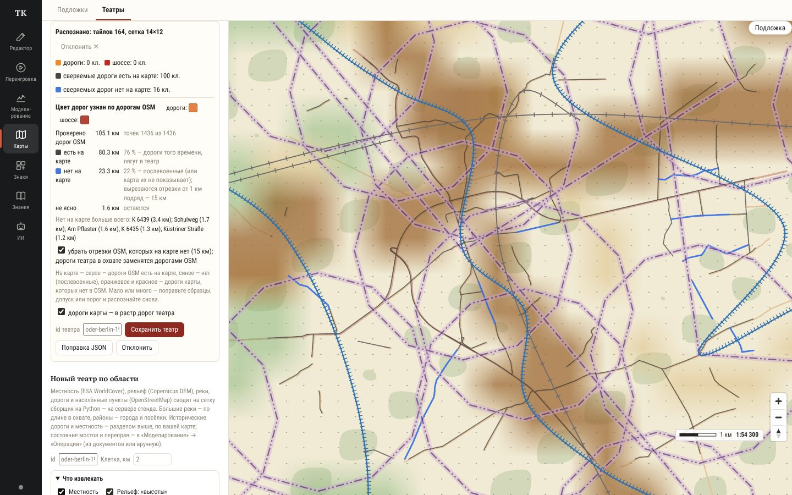

*Театр Одер — Берлин, проверочная карта района Зеелова: в охвате у театра линий дорог нет, из OSM загружено 308 линий (118 км). Проверено 105 км: 80 км есть на карте (лягут в театр), 23 км нет — вырезается 15 км отрезками от 1 км; больше всего нет у K 6439 (3,4 км). На карте: серым — дороги OSM, подтверждённые картой, синим — отрезки, которых на карте нет.*

**OSM + OpenHistoricalMap на дату.** Та же кнопка загружает и линии OpenHistoricalMap (OHM) — проекта по образцу
OSM, где у дорог, рек и каналов есть даты постройки и упразднения (`start_date`, `end_date`; лицензия CC0;
свой сервер Overpass). Сплошной сети 1944–1945 гг. в OHM нет: в районе Кюстрина — 60 линий против 435 в OSM, в
основном шоссе с датами (чаусси 1819–1833 гг.) и реки; плотнее покрыты Саксония и Лаузиц. Поэтому OHM не заменяет
OSM, а уточняет его — вариант линий «OSM + OpenHistoricalMap на дату» (дата задаётся, по умолчанию 1.01.1945):

- линия OHM, существующая на дату (начало не позже даты, конец позже или не указан; неполная дата «1936» — с
  1 января), берётся как линия того времени — вместо своего двойника из OSM (≥ 70 % длины в пределах 100 м);
- линия OSM, совпадающая с линией OHM, которой на дату не было (построена позже или уже упразднена), убирается
  до сверки как послевоенная — это знание из дат, а не из цвета карты;
- остальные линии OSM сверяются с картой как обычно.

На проверочной карте района Кюстрина на 16.04.1945: из OHM на дату — 22 линии с датой и 12 без даты, ими
заменены 54 двойника OSM; 26 линий OHM построены позже или упразднены — по ним до сверки убраны 40 линий OSM
(5 км, в том числе куски B 1). Если OHM не ответил, работают с одним OSM.

**Подложка OpenHistoricalMap.** Отдельно от сверки OHM скачивается целиком как подложка на дату
(раздел 5): все объекты района — дороги всех классов, улицы, здания, леса, границы, пункты. Она
только показывается под знаками переигровки на дату начала операции и в расчёт не входит: дороги
театра по OHM — в историческом слое выше. Данные театра «Одер — Берлин — Эльба»: 285 участков, 94 373 объекта
(дороги 44 888, здания 16 987, границы 15 965, вода 5296, железные дороги 4996, пункты 3960, земли 1432,
значки 849), 324 313 тайлов z0–16, 137 МБ; загрузка и нарезка — 9 мин 32 с.

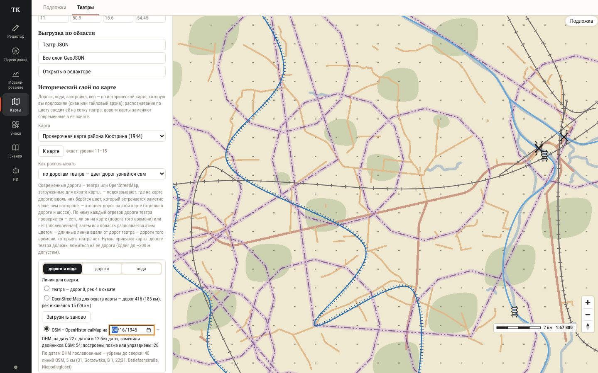

*Линии для сверки: театра (в охвате дорог нет, рек 4), OpenStreetMap (дорог 416 — 185 км, рек и каналов 15 — 28 км) и выбранный вариант «OSM + OpenHistoricalMap» на 16.04.1945: из OHM на дату 22 линии с датой и 12 без даты, заменили 54 двойника OSM; 26 построены позже или упразднены; по датам OHM до сверки убраны 40 линий OSM, 5 км (среди них B 1, Gorzowska). Справа — проверочная карта района Кюстрина.*

**Вода по современной сети.** Тот же приём — для воды; переключатель «дороги, вода, болота / дороги / вода / болота» выбирает,
что сверять (по умолчанию — всё за один проход по тайлам: цвета узнаются по классам линий, общий для двух классов
цвет достаётся тому, у кого он заметнее). Вода проверяется двумя способами:

- **Реки и каналы — линиями**, как дороги: цвет воды узнаётся вдоль рек театра (или рек и каналов OSM —
  waterway river и canal, загружаются той же кнопкой, что дороги), каждый отрезок — есть на карте, нет или не
  ясно. Отрезки «нет» от 1 км подряд (послевоенные каналы, спрямления) при сохранении вырезаются из рек театра;
  реки OSM заменяют малые реки театра в охвате карты, большие (с переправами) остаются свои.
- **Водоёмы — площадями**: водоём — связные клетки «вода» растра местности театра. Подтверждён, если не меньше
  30 % его клеток — вода по карте (или вдоль него подтверждена река); нет на карте — если меньше 10 %
  (послевоенное водохранилище, затопленный карьер): его клетки при сохранении становятся сушей — классом, самым
  частым среди соседних клеток, иначе открытой местностью. Вода карты, которой в театре нет (осушенные позже
  озёра, пруды, разливы), — куски от трёх клеток вдали от воды и рек театра — при сохранении становится водой.

Водоёмы видны, только если клетка театра мельче их: у Одер — Берлин клетка около километра, и даже Одер в растре
местности — не вода, там проверяются реки линиями. На карте вода показывается бирюзой (сверяемые реки), пурпурным (реки и водоёмы, которых на карте
нет) и голубым (новая вода карты).

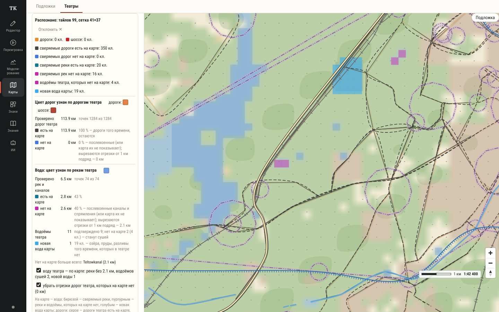

*Театр «Берлин», проверочная карта Груневальда и Ванзее, сверка дорог и воды за один проход: узнан цвет воды (голубой квадрат справа от «Вода: цвет узнан по рекам театра»); из 6,5 км рек и каналов 2,1 км Тельтов-канала на карте нет — вырезаются; из 11 водоёмов театра 9 подтверждены, 2 (4 клетки) — нет на карте, на карте пурпурным, станут сушей; пруд карты в Груневальде (19 клеток) — новая вода, на карте голубым.*

**Болота по штриховке.** Болото на картах 1940-х — не заливка, а штриховка: короткие горизонтальные чёрточки
(синие, зелёные или чёрные) с шагом по вертикали. По одному цвету её не распознать: чёрточки тонкие, а тем же
цветом на карте вода и надписи. Поэтому болото узнаётся по окнам. Признаки считаются не на пикселях тайла, а на
маске чернил, уменьшенной примерно до 24 м на пиксель: пиксель маски — блок f × f пикселей тайла (f — целое,
24 м, делённые на метры на пиксель уровня тайлов: на широте Берлина 1 на уровне 12, 2 — на 13, 4 — на 14, 8 — на
15, 17 — на 16), он — чернила, если чернила есть хоть в одном пикселе блока. Без этого на крупных уровнях
(14–16) чёрточки карты 1:100 000 выходят толще и реже порогов в пикселях и не узнаются. Окно — квадрат около
120 м на местности, от 12 до 48 пикселей маски (на деле 12 пикселей — около 280 м); окна кладутся внутри тайла,
без полей в соседние тайлы (последнее в ряду прижато к краю), итог переносится обратно на пиксели тайла. Окно —
штриховка, если пиксели цвета болота («чернила»):

- разрежены — 3–40 % пикселей окна (больше — заливка: вода, крупная надпись);
- вытянуты по горизонтали — средняя серия по строкам вдвое длиннее, чем по столбцам, не короче 3 пикселей и не
  длиннее трёх четвертей окна (линия через всё окно — дорога);
- лежат несколькими штрихами — отдельных штрихов (строк с чернилами под строкой без них) не меньше двух и не
  меньше восьмой части стороны окна, толщина штриха — не больше 2 пикселей (толстая линия, двойная дорога — не
  болото).

Все пиксели окна-штриховки считаются болотом; клетка театра — болото, если таких пикселей в ней не меньше 30 %.
Цвет штриховки берётся из образца «болото» с флажком «штриховка» (по умолчанию включён; без флажка образец
работает как заливка) или узнаётся сам — по современной сети, переключатель «болота» или «дороги, вода, болота».
Современные болота — клетки «болото» растра местности театра и болота OSM (`natural=wetland`: пути и
мультиполигоны с дырами; загружаются той же кнопкой, что дороги). Окна с центром внутри современных болот
сравниваются с окнами вне болот (с запасом в соседнюю клетку) и вне воды. Цвет узнан, если он есть не меньше чем
в 15 % окон внутри и в 2,5 раза чаще, чем снаружи (плюс 0,05), — как у дорог и воды, — и не меньше половины окон
внутри с этим цветом — штриховка; окон внутри и снаружи нужно не меньше 20, цветов берётся до трёх. Цвета
показываются образцами под заголовком «Болота: цвет штриховки узнан по болотам театра» (если в сверке были
болота OSM, которых нет в растре, — «… театра и OSM»). Строка «Окна проверки цвета» — сколько окон легло в
современные болота и сколько из них прошли проверку штриховки, и сколько окон вне болот. Тайлы у современных
болот читаются первым проходом, поэтому входят в число тайлов под выбором уровня (и в предел 4000).

Затем болота карты сверяются с современными: клетки «на карте и сейчас», «только на карте» (болота того времени,
осушенные позже) и «только сейчас». Современное болото (связные клетки) есть на карте, если болото карты — не
меньше 10 % его клеток в охвате, иначе все его клетки — «только сейчас». Если цвет штриховки по сети не узнан,
сводка так и говорит («цвет штриховки не узнан»), болот карты нет и ничего не отмечается как «только сейчас».
Болото карты пишется в местность только с согласия: при распознавании по образцам — флажком «вода, застройка,
лес, болото карты — поверх местности», по современной сети — флажком «болота карты — в местность (N кл.)»; он
появляется, когда болота карты найдены, и по умолчанию отмечен, только если выбрана проверка болот («болота» или
«дороги, вода, болота»).
При сохранении болото карты ложится в местность театра поверх открытой местности и леса (болото в лесу —
болото), но не поверх воды и застройки; среди классов карты оно идёт после воды и застройки и перед лесом.
Болота, которых на карте нет, убираются только по флажку «убрать болота, которых нет на карте» (по умолчанию
выключен: в 1945 г. болот было больше, чем сейчас): клетка «болото» растра становится открытой местностью или
лесом по соседним клеткам; болото только из OSM в растре не болото — его снимать нечего. На карте болота
показываются тремя оттенками: тёмно-бирюзовым — на карте и сейчас, светло-бирюзовым — только на карте, охрой —
только сейчас.

Ограничения: распознаётся только штриховка горизонтальными чёрточками — другие узоры (кустарник, пески,
вырубки) нет; без образца и без современных болот в охвате цвет штриховки не узнать. Масштаб карты важен, уровень
тайлов (12–16) — нет: штриховка узнаётся при шаге строк примерно 70–150 м на местности, это карты 1:100 000 и
1:200 000 (шаг до 0,75 мм). На картах крупнее (1:50 000, шаг около 50 м) строки на маске сливаются, на картах
мельче (шаг от 200 м) в окно попадает один штрих — такие болота не узнаются.

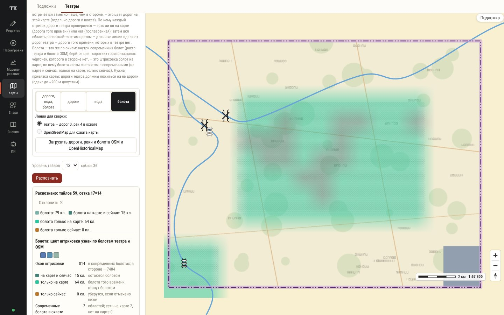

*Театр Одер — Берлин, проверочная карта района Кюстрина (штриховка как на карте 1:100 000: чёрточки около 140 м, шаг строк около 115 м), способ «по современной сети», сверяются только болота, уровень 13, тайлов 59. Слева: «Болота: цвет штриховки узнан по болотам театра» (болота OSM не загружались), три образца — серый и два синих; окна проверки цвета — 216 в современных болотах, из них 206 со штриховкой, 1878 вне болот; на карте и сейчас — 15 клеток, только на карте — 63, только сейчас — 0; обе современные области болот в охвате есть на карте; флажок «болота карты — в местность (78 кл.)» отмечен. На карте: светло-бирюзовым — болота только на карте (штрихованные участки в середине и в юго-западном углу), тёмно-бирюзовыми пятнами — на карте и сейчас; синяя заливка в юго-восточном углу болотом не стала.*

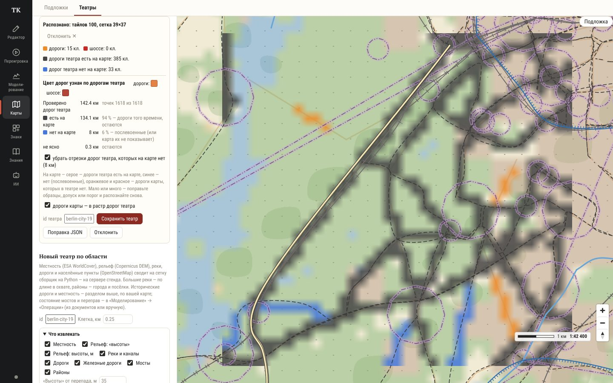

*Дороги по современной сети, театр «Берлин», проверочная карта Груневальда: слева узнанные цвета (оранжевый — дороги, красный — шоссе) и итог — из 142 км дорог театра 134 км есть на карте, 8 км нет (вырезается 8,2 км отрезками от 1 км). На карте линиями: серым — дороги театра, подтверждённые картой, синим — отрезки, которых на карте нет; оранжевыми клетками — дороги карты, которых нет в театре.*

Дороги — главное, ради чего это делается: современная сеть дорог гуще и проходит иначе, чем в
1945 г. При распознавании по образцам цвета после распознавания показывается **сравнение дорог** карты и театра: сколько
клеток с дорогой совпадает, сколько есть только на исторической карте (они добавятся) и сколько
только в театре (послевоенные или не распознанные). Перечисляются дороги театра, которых на
карте почти нет (≥ 70 % длины), — обычно это поздние автобаны и объездные. Пользователь
выбирает, что делать с современными дорогами в охвате карты: оставить, убрать дороги (шоссе
оставить) или убрать все. Если совпадений мало (меньше четверти), стенд предупреждает: скорее
всего распознаны надписи, реки или сетка, а не дороги, — образцы надо поправить. Неудачный результат
отклоняется («Отклонить» — в заголовке результата и рядом с «Сохранить театр»): он убирается с карты, театр
не меняется, образцы цвета остаются — их можно поправить и распознать снова.
В дорогах, шоссе и железных дорогах сначала остаются только линии: пиксели нужного цвета собираются в
связные куски, и короткие (отдельные буквы, цифры, значки) и толстые (заливка, крупные надписи) отбрасываются
— иначе тёмный образец дороги собирает все надписи карты. На тёмно-серый или чёрный образец дороги стенд
предупреждает: этим цветом на картах подписи, железные дороги и контуры. Заливкой считается кусок, внутри
которого есть сплошные места толще линии; сеть тонких дорог любой длины остаётся целиком. После сведения на
сетку обрывки короче трёх клеток, не связанные с сетью (слова надписей), убираются. Бледный образец с
оттенком (серо-голубая вода) сравнивается по тону — иначе под него попадает бумага карты; по одной яркости —
только действительно серые образцы, с узким допуском.
Дороги, шоссе и железные дороги после распознавания утончаются до осевой линии в одну клетку
(Чжан — Суэн): толстая линия скана задевает соседние клетки, и без этого дорога выходила полосой в 2–3
клетки «лесенкой». Растр дорог, уже вшитый в театр Одер — Берлин по карте РККА, собран раньше —
без утончения.


*Сравнение дорог: серое — совпадают, синее — есть только в театре (на исторической карте их нет), оранжевое — только на карте. Справа таблица: 195 клеток совпадают, 406 — только в театре.*

Результат сохраняется как новый театр (`id` задаёт пользователь) и используется в расчёте так
же, как встроенный.


*Раздел «Карты → Театры»: театр Одер — Берлин со слоем рельефа (Copernicus DEM) и реками; слои дорог, районов и растра местности выключены.*

**Состояние инфраструктуры операции.** Театр описывает мосты и переправы, известные при его
сборке. Сверх этого у операции есть список сведений об инфраструктуре: мост разрушен с такой-то
даты, переправа наведена, шоссе заминировано, железная дорога перекрыта. Сведения приходят из
документов операции (модель выписывает их с дословной цитатой, человек принимает) или вводятся
вручную. Каждое сведение привязывается к театру и ложится поверх него при расчёте и в игре:

| Сведение | Как действует в расчёте |
|---|---|
| мост разрушен | мост театра закрыт с даты сведения |
| мост цел, переправа наведена | переправа действует с даты (до даты окончания, если есть) |
| дорога перекрыта, заминирована, непроходима | в радиусе (по умолчанию 1,5 км) дорога не даёт дорожного темпа |
| железная дорога разрушена или перекрыта | препятствие в радиусе |
| повреждён, но проходим; рубеж без привязки | в расчёт не входит, остаётся сведением в базе знаний |

Исходный театр при этом не меняется: сведения хранятся отдельно, по операции, и попадают в
пакет операции при выгрузке.

**Ледостав.** Карта местности может указать период, когда большие реки скованы льдом.
Для Висло-Одерской операции это 20.12.1944–10.02.1945: реки преодолимы всеми родами войск с
задержкой на переправу. В Берлинской операции (апрель) льда нет.

| Карта | Охват | Клетка | Содержание |
|---|---|---|---|
| `oder-berlin-1945` | 11,0–15,6° в. д., 50,9–54,45° с. ш. | 2 км | 6 оборонительных полос, 98 мостов и переправ, 239 районов |
| `berlin-city-1945` | Берлин | 250 м | 3 кольца обороны, 21 мост, 246 районов |
| `vistula-oder-1945` | 14,0–22,6° в. д., 49,6–53,8° с. ш. | 2 км | 3 полосы, 132 моста и переправы, 163 района; без исторической поправки |

### 17.3. Профили сторон (`data/profiles/`)

Профиль описывает армию эпохи: типы частей, скорости, расход, подвоз, задержку доведения
приказов. Числа профилей — порядок величин по уставным нормам и обобщённым данным, не калибруются.

| | РККА 1945 | Вермахт 1945 |
|---|---|---|
| Скорость по дорогам, км/сут: пешие / авто / гусеничные | 30 / 150 / 100 | 28 / 120 / 80 |
| Вне дорог, открытая местность (пешие / авто / гусеничные) | 25 / 60 / 50 | 22 / 50 / 40 |
| Лес / болото / застройка (пешие) | 15 / 8 / 12 | 14 / 7 / 12 |
| Задержка доведения приказа, ч: армия / корпус / дивизия | 6 / 4 / 3 | 8 / 6 / 4 |
| Подвоз в сутки, боекомплектов / заправок | 0,6 / 0,6 | 0,3 / 0,2 (острый дефицит горючего) |
| Запас не более, боекомплектов / заправок | 3 / 2 | 2 / 1 |
| Дальность подвоза (автотранспортом по своей территории) | 48 ч | 48 ч |

Типы частей и их качество (выучка, слаженность; 1 — норма эпохи) и ширина полосы обороны:

| РККА | качество | полоса, км | Вермахт | качество | полоса, км |
|---|---|---|---|---|---|
| общевойсковая армия | 1,0 | 24 | армейский корпус | 0,95 | 24 |
| ударная армия | 1,05 | 20 | танковый корпус | 1,0 | 18 |
| гвардейская армия | 1,1 | 20 | танковый корпус СС | 1,05 | 18 |
| танковая армия | 1,1 | — | горный корпус | 0,9 | 20 |
| стрелковый корпус | 1,0 | 8 | пехотная / парашютная дивизия | 0,9 | 8 |
| танковый корпус | 1,05 | — | танковая дивизия | 1,0 | 5 |
| механизированный корпус | 1,05 | — | моторизованная дивизия (и СС) | 1,0 / 1,05 | 6 |
| кавалерийский корпус | 1,0 | — | гарнизон крепости | 0,8 | 6 |
| | | | фольксштурм | 0,5 | 6 |

Гарнизон крепости помечен как **узел, который обходят**: подвижные соединения, чья цель
дальше крепости, обходят её, а не штурмуют (Познань в январе 1945 г.).

### 17.4. Правила боя (`data/rules/`)

Правила — это таблицы и коэффициенты арбитра. Их форма задана по обобщённым данным о боях
Второй мировой войны, числа подобраны калибровкой по Берлинской операции (раздел 21).

| Файл | Что |
|---|---|
| `ww2-draft.json` | исходные правила до калибровки |
| `ww2-berlin-cal.json` | откалиброванные по Берлинской операции (основные; с блоком `calibration`: на чём и как подобраны) |
| `ww2-berlin-cor.json` | откалиброванные по Берлинской операции в коридорах нормативов (раздел 21, «Калибровка в коридорах нормативов»); блок `calibration` записывает и коридоры, по которым шёл подбор |
| `ww2-berlin-city.json`, `ww2-berlin-city-cal.json` | городской масштаб (раздел 23) |
| `norms.json` | исходник встроенных нормативов и допущений: при сборке базы становятся её фактами (часть I, раздел 8.8) |

Полные таблицы — в приложении А.

**Основа правил.** Каждое число правил и профилей — **вход** модели: 69 входов правил и профилей
(бой, оборона и местность, движение, подвоз, усталость, окружение, профили; таблицы темпа и потерь —
по входу на таблицу) и 36 параметров агентной модели (`agents-v0.json`, общие для всех наборов). Перечень
входов (`packages/sim/src/rule-inputs.ts`) знает у каждого путь, название, единицу, группу и, у
подбираемых калибровкой, множитель и как коридор норматива пересчитывается в коридор множителя (раздел 21).
Значение входа — из набора правил; источник — норматив базы знаний («значение правила», часть I,
раздел 8.8) или допущение. Сборщик «база → правила» (`packages/knowledge/src/compile-rules.ts`) выбирает
норматив и строит коридор; наборы правил остаются файлами и сборщиком не переписываются. Сейчас во
встроенной базе на нормативах держатся 10 из 69 входов набора `ww2-berlin-cal` (A 1, B 9), из 16 входов,
которые подбирает калибровка, — 3 (A 1, B 2); все 36 параметров агентной модели — на нормативах (A 11, B 24,
C 1; раздел 21, «Нормативы параметров агентной модели»).

### 17.5. Факты из документов

Кроме встроенных наборов (раздел 17.1), факты с формальной частью приходят в базу знаний из материалов
пользователя: текстов, сканов, таблиц, пакетов внешнего агента и ручной правки (часть I, разделы 8.1 и
8.7). Модель не читает документы сама и не получает извлечённое в обход базы: всё проходит путь
«кандидат → проверки → база» и попадает в расчёт только через сборщик «база → модель» (раздел 8.6) — по
тем же правилам выбора, что встроенные факты.

**Виды.** Из документов выписываются все виды раздела 17.1: численность на дату, пополнение, потери за
период, подчинённость, ввод, положение, разграничительная линия, состояние переправы, событие, а также нормативы модели — значение правила и итог прогона (раздел
17.4, «Основа правил»; часть I, раздел 8.8). Пополнения
и численность после начала операции, которых во встроенной базе нет, становятся изменениями по датам
(раздел 19.12) и контрольными точками (раздел 20); положения — историей по дням; линии — полосами
(раздел 19.8), линия той же пары и начала, что в сценарии, но с другими пунктами — вместо неё; переправы —
состоянием мостов (раздел 19.3), если по названию нашёлся мост театра. Соединение в факте — всегда
обозначение формирования в сценарии.

**Проверки** (часть I, раздел 8.7): цитата на месте, числа факта — в цитате, соединение сопоставлено
однозначно, место найдено на театре, дата в пределах операции (с запасом 7 суток до начала; переправа из документа без операции — сомнение), значения
правдоподобны, не повтор, и вторая модель прочла цитату так же (сторона, план или факт, соединение,
период, смысл каждого числа). Ошибка — факт отбрасывается, сомнение — решает человек, иначе факт
принимается автоматически.

**Пороги правдоподобия** — допущения без опоры в источниках, строки `packages/sim/data/rules/norms.json`
(`assume-plausible-*`, отчёт `docs/norms-check.md`):

| Что проверяется | Порог | За порогом |
|---|---|---|
| численность по ступени | дивизия 20 000, корпус 60 000, армия 150 000, фронт и группа армий 1 200 000 | в очередь |
| потери за период | не больше численности соединения (последний факт численности в базе, иначе сценарий) | в очередь |
| потери за сутки | не больше трети численности | в очередь |
| вышестоящий | выше по ступени, чем соединение | в очередь |
| пополнение | не больше половины численности | в очередь |

Пороги отсеивают грубые ошибки извлечения (лишний ноль, сутки вместо периода, потери противника вместо
своих), а не спорные цифры: расхождение источников остаётся расхождением и решается выбором факта (раздел
8.6).

**Кто проверил факт.** У факта из документа — отметка: «проверено автоматически» (прошёл все проверки) или
«проверено человеком» (принят из очереди, введён или исправлен вручную); у встроенных и прежних своих фактов
отметки нет. Правило выбора из нескольких фактов (закрепление → A > B > C → ближе по дате → из более
свежего документа) получает последнее звено: при прочем равенстве факт «проверено автоматически» уступает
остальным. Факты без отметки стоят наравне с проверенными человеком: встроенная база собрана и выверена
вручную, а свои факты до появления проверок принимал человек.

**Исправление встроенного факта** — факт пользователя с источником; на моментах операций, где встроенный
факт в ходу, закрепляется исправление (часть I, раздел 8.7), поэтому модель берёт его, а не встроенный, при
любой достоверности. При обновлении встроенной базы изменившийся исправленный факт отмечается «встроенный
факт изменился — пересмотрите».

Пример на Берлинской операции — раздел 22.5.

## 18. Сценарий

Сценарий собирается из рецепта (`tools/scenario/build_scenario.ts`). Рецепт перечисляет, какие
формирования действуют, их численность, задачи, источники подвоза и события для проверки.

### 18.1. Состав и численность

Численность известна в основном для фронтов и армий в целом. Она распределяется по
действующим формированиям сверху вниз по подчинённости:

1. **Боевая доля.** От списочной численности фронта берётся боевая: 0,6 для советских фронтов
   (без воздушной армии, тыла, фронтовых частей) и 0,75 для немецких армий (Kampfstärke). Одно
   мерило для обеих сторон — обязательное условие: иначе калибровка подгоняет коэффициенты под
   разницу в учёте, а не под бой.
2. **Явные цифры** (например, 1-я гв. ТА — 854 танка по Катукову) вычитаются из общего пула.
3. **Остаток** делится между формированиями без явных цифр пропорционально числу дивизий.
   Орудия — с весом: на направлениях главного удара — артиллерийские корпуса прорыва (у 8 гв. А
   и 5 уд. А до 270 орудий на километр; вес до 2,0).

Пример: 1-й Белорусский фронт — 908 500 человек, 3155 танков, 16 934 орудия (Кривошеев);
9-я немецкая армия — 112 143 человека, 512 танков, 2500 орудий и минометов (с зенитками в
наземной роли).

На Зееловских высотах немецкие корпуса разложены на дивизии; корпус остаётся штабом, задача
штаба передаётся его действующим дивизиям.

**Из базы знаний.** Сценарий в сборке не меняется, но в стенде поверх него ложатся входы из базы
(раздел 8.6): если у действующего формирования есть факт численности на начало операции, берётся
факт, а не распределение; подчинённость на начало — по факту, если её штаб есть в сценарии. База
важнее сценария: гарнизон Познани в Висло-Одерской — 17 500 человек по последней работе о крепости
(B; в других источниках — от 32 500 до 61–62 тыс.) вместо 30 000 сценария («свыше 30 000» с ополчением).
Численность штабов и фронтов модель не читает: LVI тк на Зееловских высотах разложен на дивизии, и
его «до 50 000 вместе с тыловыми частями» (C) в расчёт не идёт. В Берлинской из базы меняется
подчинённость: «Нордланд» и «Недерланд» на начало операции — в III (герм.) танковом корпусе СС (в
сценарии — в LVI тк и XI тк СС). Остальная численность пока держится на распределении: на фактах —
7 % входов численности Берлинской операции (раздел 8.6). Цифры раздела 22 (`npm run sim:demo`)
считаются по встроенным данным, без наложения базы; что меняет наложение — раздел 22.4.

### 18.2. Задачи

Обе стороны получают исторические **задачи** (не положения): наступать на пункт или на
формирование противника, обороняться, держаться любой ценой, отходить, прорываться,
перегруппироваться, стоять в резерве. Формат в рецепте:

```
[формирование, "ММ-ДД[TЧЧ]", задача, цель, примечание с источником]
["su_8gva", "04-16", "attack", "Seelow", "главный удар с Кюстринского плацдарма (Ziemke p.474)"]
["de_xi_ss", "04-21T17", "hold", null, "приказ Гитлера держать фронт на Одере (Le Tissier, Halbe)"]
```

Цель — пункт из справочника, координаты или `@формирование`. Если час не указан, приказ
отдаётся в 18:00. Исполнитель получает его с **задержкой доведения** по профилю (армии РККА
6 ч, корпусу вермахта 6 ч). В Берлинской операции 245 приказов, в Висло-Одерской — 232.

Ключевые исторические решения заложены как задачи, например: приказы Гитлера держаться на
Одере для XI тк СС, V гск СС и V ак (21.04, отход разрешён 23.04) — без них не получается котёл
9-й армии; контрудары резервов на Зееловских высотах («Курмарк», 25-я и 18-я мд, «Мюнхеберг»,
«Нордланд»); приказ Хейнрици оставить крепость Штеттин 25.04.

### 18.3. Подвоз

Каждой стороне задаются **источники подвоза**: переправы, станции, тыловые районы. Источники
могут появляться и пропадать по датам (склады идут за наступлением; узел, потерянный
противником, перестаёт снабжать). В Берлинской операции советские источники — переправы на
Одере и Нейсе (Кюстрин, Губин, Гоздовице…), немецкие — Бранденбург, Магдебург, Ратенов,
Нойбранденбург, Росток, Дрезден, Каменц. Берлин — не источник: склады города снабжают гарнизон,
а подвоза в 9-ю армию через город не было.

## 19. Ход: как считается

Ход длится `turnHours` (24 ч на оперативном масштабе). Порядок внутри хода фиксирован;
каждое изменение записывается в журнал с причиной. Ход не меняет состояние на месте, а
возвращает новое — поэтому любой ход можно повторить и разобрать.

1. **Приказы**, дошедшие до исполнителя к концу хода (с учётом задержки доведения). Дошедший
   в любой момент хода приказ действует на **весь** ход: приказ в 18:00 действует с начала
   хода, на сутки раньше (раздел 19.3, «Приказ внутри хода»).
2. **Территория и подвоз** на начало хода.
3. **Бои**: все наступающие в соприкосновении с противником.
4. **Движение** остальных по маршрутам.
5. **Расход и подвоз, усталость, подготовка обороны, потеря боеспособности.**
6. **Территория**: клетки, через которые прошли войска, переходят к их стороне.
7. **Прорыв полос**: клетки чужих укреплённых полос, занятые противником, считаются прорванными.

### 19.1. Боевой потенциал

```
сила = (люди/1000 · 1,0 + танки · 0,08 + орудия · 0,03) · качество · снабжение · усталость
```

- *снабжение* — при боекомплекте меньше 0,5 сила падает линейно до 0,4; техника без горючего — 0,5;
- *усталость* — `1 − усталость · 0,4` (усталость от 0 до 1).

Веса означают: 1000 человек ≈ 12,5 танка ≈ 33 орудия. Это упрощение; оно одинаково для обеих
сторон.

### 19.2. Бой

**Кто с кем.** Наступающий вступает в бой, если противник ближе дистанции соприкосновения
(6 км) или ближе половины ширины полосы обороны противника. Например, армейский корпус в
обороне связывает боем всех в радиусе 12 км. Наступающие, у которых общие обороняющиеся,
образуют одно сражение.

**Соотношение сил:**

```
оборона = сила · местность · подготовка · укрепления
соотношение = Σ сила наступающих / Σ оборона · случайность
```

| Поправка обороны | Откалиброванное значение |
|---|---|
| местность: лес / высоты | 1,35 |
| болото | 1,47 |
| застройка | 1,59 |
| подготовленная оборона (стоит в обороне ≥ 24 ч) | 1,66 |
| укрепления | 1 + 0,32 · уровень полосы (1–3) |
| случайность | `exp(0,2 · N(0,1))`, то есть ±20 % в типичном бою |

**Темп продвижения** (км/сут) берётся из таблицы по соотношению сил (интерполяция в
логарифмической шкале) и умножается на поправку местности обороняющихся: застройка 0,47,
болото 0,5, лес 0,6, высоты 0,8. В укреплённой полосе темп не выше предела для её уровня:
14,7 / 9,2 / 5,5 км/сут для уровней 1 / 2 / 3. Это «прогрызание» обороны: на Зееловских
высотах 17–18.04 фактически до 4 км в сутки (Le Tissier), у 8 гв. А 16.04 — 3–6 км (Исаев).

| Соотношение | 1 | 1,5 | 2 | 3 | 4 | 6 | 10 |
|---|---|---|---|---|---|---|---|
| Темп, км/сут | 0 | 1,2 | 3,5 | 7,0 | 11,6 | 20,9 | 34,8 |
| Потери наступающих, % в сутки | 5,7 | — | 3,5 | 2,1 | — | 1,1 | 0,7 |
| Потери обороняющихся, % в сутки | 2,3 | — | 4,5 | 6,8 | — | 13,5 | 22,5 |

**Прорыв** — темп без предела полосы не меньше 10 км/сут. Предел полосы ограничивает скорость,
но не исключает прорыв.

**Прорванная полоса не держит** (правило `beltBreachKm`, по умолчанию выключено). Полоса держит,
пока не прорвана её клетка; на плацдармах полоса проведена по их периметру, и наступающий, прорвав её
в одном месте, дальше идёт вдоль фаса той же полосы и каждый ход ведёт «бой в полосе» с её пределом
темпа (8 гв. А на Магнушевском плацдарме — четверо суток по 9,2 км). С правилом обороняющемуся не
засчитываются укрепления, если в пределах `beltBreachKm` от него та же полоса уже прорвана; следующие
полосы не затрагиваются (номер полосы клетки хранит театр). Почему оно выключено — раздел 21.

**«Держаться любой ценой».** Обороняющиеся с этим приказом и окружённые не отходят, несут
полуторные потери, а наступающие не продвигаются, пока оборона не прорвана. Исключение —
**уличный бой**: если все обороняющиеся в застройке, наступающие берут квартал за кварталом
с городским темпом, а гарнизон остаётся на месте. Без этого исключения армия стояла бы перед
гарнизоном Берлина (в оперативном сценарии — одна точка), пока он не рухнет целиком.

**Потери** распределяются: личный состав — по таблице; танки — в 1,3 раза больше; орудия — в 0,8.
Формирование, у которого осталось меньше 15 % исходной численности, теряет боеспособность.

**Отход.** Обороняющиеся (кроме держащихся) отходят на расстояние продвижения противника. Из 16
направлений выбирается то, где подвоз ближе (к своим тылам); при равенстве — прочь от
наступающих. Отход в воду и туда, куда подвоз не доходит, исключён.

**Журнал боя** хранит все факторы: силы сторон, местность, подготовку, укрепления, случайность,
темп, предел полосы, исход («прорыв», «продвижение», «отражено», «удержано»). Отчёт показывает
каждый бой, поэтому любой исход можно объяснить.

### 19.3. Движение

**Маршрут** — кратчайший по времени путь по клеткам (алгоритм A*). Время клетки зависит от
скорости по профилю: по шоссе — полная дорожная скорость, по дороге — 85 % от неё, вне дорог —
по классу местности. Сверх этого добавляются задержки:

| Причина | Задержка |
|---|---|
| большая река без моста | пешим 12 ч; технике — непроходима (если нет ледостава) |
| малая река | 4 ч |
| клетка чужой укреплённой полосы (пока не прорвана) | 4 ч за уровень |
| клетка территории противника | `клетка / темп по чужой территории`: пешим 42,6 км/сут, технике 136 км/сут (заслоны, разрушения, зачистка) |

Все скорости умножаются на общий множитель движения (1,09 после калибровки).

**Дороги.** Клетка с дорогой даёт дорожную скорость, поэтому кратчайший по времени путь сам
тянется к дорогам: на марше и в городе войска идут дорогами и улицами, а не по прямой через
кварталы. Перекрытая или заминированная дорога (раздел 17.2) дорожной скорости не даёт, и
маршрут её обходит.

**Разброс путей.** Вне города дорога — не единственный выбор: соединение может пойти лесом или
полем напрямик. Чтобы этот выбор не терялся, при выборе пути время каждой клетки умножается на
плавный шум (районы 2–4 км) от 1 до 1 + 2 · *v*, где *v* — параметр правил `routeVariety`
(0,2 в откалиброванных правилах, то есть «кажущаяся» выгода клетки различается до 40 %).
Шум свой у каждого формирования и приказа и постоянен на прогон: путь не дёргается от хода к
ходу, а разные seed дают разные пути. Шум влияет **только на выбор пути**: время движения по
выбранному пути считается по местности, без шума, — средний темп не меняется.

**Показ на карте.** Расчёт ведёт войска по клеткам. Для карты путь хода перестраивается по
дорожной сети театра — графу из линий дорог, шоссе и улиц (перекрёстки — общие вершины и
пересечения линий): участок пути по клеткам с дорогой заменяется кратчайшим путём по графу между
точками, где войска вошли на дорогу и сошли с неё. Если весь ход шёл дорогами или городом, а
путь по улицам не длиннее полутора расчётных, ход целиком показывается улицами. Вне дорог (поле,
лес) путь остаётся таким, как в расчёте, только сглаженным, — показ не прячет выбор пути вне
дорог. Знак движется по вершинам пути, время — пропорционально пройденному расстоянию.

**Остановка у противника.** Наступающие останавливаются, войдя в соприкосновение (бой — в
следующий ход), остальные — не доходя до противника. Уже стоящий рядом с противником может
подойти до дистанции боя, но не сквозь него: пройти через противника без боя нельзя.

**Обход крепостей.** Подвижные соединения (танковые, механизированные), чья цель дальше
крепости, не вступают с ней в бой и обходят её. Пехота крепость штурмует.

**Своя полоса.** Где действует разграничительная линия по директиве, клетки полосы соседнего
фронта при выборе пути «дороже» в 1 + `sectors.foreign` раз (раздел 19.8). Как и разброс путей,
это влияет только на выбор пути, не на время движения.

**Приказ внутри хода.** Ход — 24 часа, и приказ, дошедший до исполнителя в любой момент хода,
действует на весь ход: приказ в 18:00 с задержкой доведения 6 ч отправляет войска в путь с начала
хода, то есть на 13 ч раньше, чем он отдан. Поэтому срок приказа внутри хода ничего не меняет, а
сроки сценария — условные: приказ ставится на то время, с которого войска в расчёте начинают
действовать. Правило `orderPartialTurn` (по умолчанию выключено) делает приказ действующим с момента
доведения: в ход, когда он дошёл, формирование движется только оставшееся время. Документальные
сроки 28 приказов Берлинской и Висло-Одерской операций (директивы Ставки и фронтов в «Русском
архиве», тт. 15 и 16, достоверность A, час и страница; где документа нет — воспоминания
командующих, B) записаны в поле `basis` приказа: `documented` — срок по документу, `issuedAt` —
условный срок модели. Приказы, у которых документ — планирующая директива за 3–47 суток до
исполнения (Ставка № 11059 от 2.04, № 11060 от 3.04 21:00, директива 1 БФ № 00539/оп от 12.04
03:00), и сопоставления, где документ — не тот же приказ (Ставка № 11077 — линия в Берлине, а не
приказ 3 гв. ТА; приказ 47 А с другой целью), в `basis` не записаны.

Проверка на трёх операциях (пять прогонов; положения в допуске / события в пределах двух суток):

| Правила и сроки | Берлинская | Бой в Берлине | Висло-Одерская |
|---|---|---|---|
| условные сроки, весь ход (принято) | 80 % / 46 из 55 | 86 % / 10 из 30 | 51 % / 18 из 65 |
| документальные сроки как `issuedAt` | 79 % / 44 из 55 | 86 % / 10 из 30 | 51 % / 18 из 65 |
| + `orderPartialTurn` | 70 % / 32 из 55 | 89 % / 9 из 30 | 43 % / 23 из 65 |
| то же, множители перекалиброваны по Берлинской | 70 % / 41 из 55 | 89 % / 9 из 30 | 48 % / 24 из 65 |

Ни документальные сроки сами по себе, ни частичный ход с перекалибровкой (120 вычислений, обучение
до 25.04) не улучшили сходство: Берлинская теряет 10 п. п. положений, Висло-Одерская выигрывает по
событиям (+6) и теряет по положениям (−3). Калибровка прежних правил подбиралась под условные
сроки, а модель медленно набирает темп в первые дни прорыва (раздел 25.1, п. 13); условный срок «на
сутки раньше» этот медленный старт компенсировал. Поэтому в модель вошли условные сроки, а документальные
хранятся как данные.

### 19.4. Территория — сплошная полоса

Без территории фронт был бы цепочкой точек с пустыми промежутками, через которые танковые
корпуса проходили бы за сутки по 150 км. Поэтому каждая клетка принадлежит одной из сторон.

- **Исходная территория.** Каждая сторона «растекается» от своих войск и источников подвоза
  по клеткам. Переход через большую реку стоит 40 км пути, через чужую укреплённую полосу —
  20 км; оба штрафа платятся один раз, при входе в преграду. Поэтому граница ложится по Одеру,
  Нейсе и главной полосе обороны, а не посередине между ближайшими частями.
- **Изменение.** Клетки в радиусе 4 км от пути соединения за ход переходят к его стороне, если
  противник к ним не ближе. Клетка, где стоит соединение, — его стороны. Отходящие чужую
  территорию не занимают: иначе отход сквозь тыл противника рвал бы его коридоры подвоза.
- **Закрепление земли за фронтом.** Каждый ход клетка противника переходит к стороне, если там
  перевес влияния её войск (карта контроля: влияние войск по силе и удалению, радиус 10 км), войск
  противника нет ближе 9 км (1,5 радиуса соприкосновения), а своя земля есть по крайней мере с трёх
  сторон из четырёх в пределах 24 км — то есть клетка в тылу своего фронта, а не перед ним. Без
  этого земля между коридорами наступающих армий оставалась чужой, и любая обойдённая немецкая
  часть, стоявшая в коридоре, отрезала армию от тыла: модель «окружала» 52-ю армию, 2-ю армию
  Войска Польского, 5-ю гвардейскую армию на 9–13 суток. Обойдённые узлы, где войска противника
  есть, остаются его островами — это и есть котлы.
- **Следствия:** в тылу противника движение медленнее; прорвавшаяся танковая армия снабжается
  только по коридору, который сама пробила; соединения, оставшиеся в чужом тылу, оказываются в
  котле.

**Линия фронта** на карте — граница территорий сторон, сглаженная. Она строится только там,
где обе стороны ближе 50 км.

### 19.5. Подвоз и окружение

**Время подвоза** к каждой клетке считается от источников стороны по своей территории
(автотранспортом по дорогам) с обходом мест, где стоят войска противника (радиус 3 км).
Формирование снабжается, если подвоз доходит до любой клетки в радиусе 3 км от него не дольше
48 ч. Армия занимает полосу в несколько километров, подвоз приходит к её тылу, а не к точке знака.

**Окружение и отрыв от тылов — разные вещи.** Если путь подвоза есть, но длиннее 48 ч,
формирование **оторвалось от тылов**: подвоза нет, боеприпасы и горючее тают, но оно не скованно
и окружённым не считается (так в конце Висло-Одерской операции армии 1-го Белорусского и
1-го Украинского фронтов ушли на 400 км от баз на Висле). **Окружение** — пути подвоза нет совсем
дольше 36 ч (два хода подряд); разовый разрыв на стыке котлом не считается. Окружённые не
пополняются и не могут отойти: держатся на месте с повышенными потерями. На карте — контур котла.

**Крепость с запасами.** У гарнизонов крепостей (тип «гарнизон крепости»: Франкфурт, Штеттин,
Берлинский оборонительный район, Познань, Варшава) — склады на 30 суток боя (по Познани:
окружена 25.01, капитулировала 23.02). Окружённый гарнизон получает подвоз со складов, пока они
не кончились; в осаде без штурма склады расходуются вдвое медленнее.

**Капитуляция.** Окружённое формирование без складов, у которого боеприпасов меньше 0,25 бк,
сдаётся через 96 ч окружения (с приказом «удерживать любой ценой» или на прорыв — через 192 ч:
прорывающиеся пробиваются к своим, а не сидят в кольце); в журнале — капитуляция и число
пленных, на карте — перечёркнутый знак. Сдаются ли окружённые, задаёт профиль стороны: вермахт
1945 г. — да, Красная армия 1945 г. — нет (окружённые части держались до деблокирования).

**Подвоз как пропускная способность (блок правил `supplyFlow`).** Без блока подвоз —
порог: путь не длиннее 48 ч — пополнение полное, длиннее — нулевое. Блок `supplyFlow` делает его
пропускной способностью: пока путь подвоза не длиннее `fullHours` (по умолчанию 12 ч — один рейс
автотранспорта в сутки) пополнение полное, дальше — `fullHours` / часы пути, до прежнего предела;
горючее подвижных частей на марше тратится по пройденному пути (`fuelPer100km`, по умолчанию 1 запр.
на 100 км — немецкая единица расхода Verbrauchssatz), а не по суткам. Танки без горючего идут
пешком. В откалиброванных правилах блок **включён** (значения по умолчанию): расход и пополнение
физичнее порога, хотя на трёх операциях сходство с историей он практически не меняет (пять
прогонов; положения в допуске / события в пределах двух суток / ошибка дат, сут):

| Правила | Берлинская | Бой в Берлине | Висло-Одерская |
|---|---|---|---|
| без блока | 80 % / 46 из 55 / 1,67 | 86 % / 10 из 30 / 3,67 | 51 % / 19 из 65 / 4,23 |
| 12 ч, 1 запр. на 100 км | 80 % / 46 из 55 / 1,67 | 86 % / 10 из 30 / 3,67 | 51 % / 18 из 65 / 4,34 |
| 6 ч, 1,5 запр. | 80 % / 47 из 55 / 1,71 | 86 % / 10 из 30 / 3,67 | 51 % / 19 из 65 / 4,25 |
| 3 ч, 2,5 запр. | 80 % / 47 из 55 / 1,69 | 86 % / 10 из 30 / 3,67 | 51 % / 22 из 65 / 4,11 |

Частей без горючего (seed 1) при этом больше: в Берлинской 16 → 20 → 23 → 26, в Висло-Одерской
42 → 56 → 56 → 57, но положения не меняются: сопротивление в этих сценариях задано приказами и
маршрутами, а не горючим. Параметры — допущения без опоры в источниках (раздел 21, нормативы):
срок рейса — по аннотации статьи Davie (армейский автотранспорт ≈ 300 т, суточный ход ≈ 150 км), расход на
100 км — по справочнику вермахта; для советских частей размер заправки в километрах не подтверждён.

**Сапёры.** В переигровке по истории тылом и переправами никто не распоряжается, а в данных
театра — только переправы, известные по источникам. Поэтому переправы через большие реки наводят
сапёры сами: там, где сторона держит оба берега, её войска не дальше 12 км, а противника нет
ближе радиуса соприкосновения, — наплавной мост, открытый через 24 ч; не больше двух в ход на
сторону и не ближе 15 км друг к другу. Без этого армии 2-го Белорусского фронта, форсировавшие
Одер у Штеттина, и 61-я армия оставались за рекой без моста — «в окружении». Переправы прогона
хранятся в его состоянии (на театр не записываются) и видны на карте тактического масштаба.
В игре, где тылом управляет штаб, переправы — его распоряжения, как раньше.

**Прорыв.** Выход из котла — исторические приказы на прорыв (9-я армия к Белицу 28.04, корпус
Неринга в январе) или решение игрока и штаба на модели. Вырвавшиеся выносят 30 % танков и орудий:
тяжёлое вооружение бросают (так 9-я армия вышла к 12-й без техники).

### 19.6. Расход, усталость, оборона

| Состояние | Боекомплектов в сутки | Заправок в сутки |
|---|---|---|
| наступление | 0,5 | 0,5 |
| оборона | 0,25 | 0,05 |
| марш | 0,02 | 0,4 |
| отход | 0,15 | 0,4 |
| резерв | 0 | 0,02 |

Вне боя расход боеприпасов — 30 % от нормы. Усталость растёт в бою (+0,15 в сутки) и на марше
(+0,08), снижается на отдыхе (−0,1). Оборона становится подготовленной после 24 ч на месте.

### 19.7. Случайность и воспроизводимость

Случайность одна — разброс исхода боя. Генератор задаётся числом seed: один seed — один и тот
же расчёт до последнего знака. Разброс исходов оценивается прогоном с разными seed (обычно 5).

### 19.8. Полосы фронтов и разграничительные линии

**Объединение формирования** — его фронт (группа армий) по подчинённости сценария; на
оперативном масштабе — армия. Соединение без подчинения в сценарии (дивизия СС) относится к
единственной группе армий своей стороны, если она одна; армия без фронта (12-я армия при ОКВ)
остаётся отдельной полосой.

**Расчётные полосы.** Театр делится сеткой с шагом в две клетки (4 км; в городе 0,5 км). Клетка
стороны принадлежит объединению, чьи войска к ней ближе (не дальше 80 км). Это деление по
ходам: полосы сдвигаются вместе с войсками.

**По директиве.** Пока действует разграничительная линия (с `from` до `until`), клетки двух
объединений пары делятся по сторонам линии: справа по ходу линии — `right`, слева — `left`.
Клетки за концами линии (ближайшая точка линии — её конец, а клетка дальше конца) остаются
расчётными: линия 15.04 «оборвана» у Люббен, и западнее полосы 1 БФ и 1 УФ делятся по войскам —
так директива и оставила путь 1 УФ на Берлин открытым. Чьи пункты «включительно», в модели —
справка, на деление не влияет.

**Где полосы используются:**

| Где | Как |
|---|---|
| выбор пути (раздел 19.3) | клетки полосы соседа по директиве при выборе пути — × (1 + `sectors.foreign`); в правилах операции 1 (вдвое «дороже»), в городских — 0 |
| карта (раздел 6) | границы полос от переднего края в глубину до 40 км (в городе — до 5 км), сглаженные; по директиве — сама линия директивы |
| отчёт (раздел 20) | выходы формирований в полосу соседа по директиве: кто, в чьей полосе, сколько ходов, с какого момента |
| игра и штаб на модели | своя полоса словами: соседи, линии фронтов и армий (только уже действующие), кто в полосе соседа; предупреждение о цели приказа в чужой полосе; поводы для модели-Ставки |
| полнота (раздел 8.2) | пары соседних фронтов в начале операции: известна ли линия |

**Немецкая сторона.** Линии групп армий и армий вермахта (раздел 17.1) делят полосы так же; в
сценариях Берлинской операции их четыре, в Висло-Одерской — три. На исторических прогонах
Берлинской операции они ничего не изменили (79 и 85 % положений в допуске, события — те же), в
Висло-Одерской — на процент (53 % вместо 54; Калиш на сутки ближе к истории, Катовице на сутки
дальше): немецкие соединения там в основном держатся на месте, и полосы на их пути почти не
сказываются.

**В игре** (после передачи командования) линии сценария с условием вступления (`trigger`:
войска объединения в радиусе от точки) вступают не по сроку, а когда условие выполнено, через
`delayHours`; срок линии — до следующей вступившей линии той же пары. Условия записаны по самим
директивам: № 11074 — «ввиду выхода правофланговых частей 1-го Украинского фронта в район
Ланквиц» (радиус 10 км), № 11077 — выход войск 1 УФ к Ангальтскому вокзалу по докладу Жукова
28.04 (6 км в операции, 3 км в бою в городе). По историческим приказам условия срабатывают близко
к истории: линия 23.04 вступает 22.04 11:00 — 23.04 11:00 (в истории 23.04 06:00), линия 28.04 —
29.04 09:00 (в истории 29.04 00:00); в городе при части seed условие не наступает — тогда
решает модель-Ставка. Линии, изданные в игре (`SimState.boundaries`: директивы модели-Ставки
между фронтами и распоряжения игрока между армиями), делят полосы так же; линии армий — на
уровне армий одного фронта, множители выбора пути фронта и армии перемножаются. Вступление
линии в силу пишется в журнал хода.

**Почему в городе вес 0.** В Берлине войска 1 УФ (3 гв. ТА) заходили в полосу 1 БФ — из-за этого
28.04 директивой № 11077 линию и передвинули. Штраф уводил их с исторических мест: пять
прогонов без штрафа — 84–92 % положений в допуске и 14 событий из 30, со штрафом — 77–90 % и 12
при меньшем числе ходов вне полосы (18 против 30). В операции штраф точности не меняет (доля в
допуске та же), событий в пределах двух суток — 46 против 44 из 55.

### 19.9. Режимы боевых действий

Бой в городе, прорыв укреплённой полосы, бой за переправу, марш, охват и преследование — разные по
природе действия, и одна таблица темпа с общими множителями описывает их с разной точностью
(раздел 21, «Режимы боевых действий: сравнение»). Поэтому в движке у каждого режима могут быть свои
поправки — блок правил `regimes`; движок один, режим выбирается на каждый ход по обстановке. Режим
боя — первый подходящий сверху:

| Режим | Когда | Поправки |
|---|---|---|
| бой в котле | обороняются окружённые, или окружённые прорываются (приказ на прорыв) | темп боя, потери сторон |
| бой в застройке | все обороняющиеся в этом бою — в городской застройке | темп боя, потери сторон |
| бой в укреплённой полосе | обороняющиеся в клетках укреплённой полосы | темп боя, потери сторон |
| бой за переправу | между наступающими и обороняющимися — большая река | темп боя, потери сторон |
| бой в лесу и болоте | бо́льшая часть обороняющихся в лесу или болоте | темп боя, потери сторон |
| бой на открытой местности | прочие бои | темп боя, потери сторон |
| марш | движение вне боя с приказом не на наступление и не на отход (марш, выдвижение резерва) | темп движения |
| отход | движение вне боя с приказом на отход | темп движения |
| выдвижение к противнику | наступающие вне соприкосновения, но противник ближе `pursuitClearKm` (по умолчанию две дистанции соприкосновения, 12 км): охват, сближение | темп движения |
| преследование подвижными соединениями | танковые и механизированные наступающие, противника ближе `pursuitClearKm` нет | темп движения |
| преследование общевойсковыми армиями | пешие наступающие, противника ближе `pursuitClearKm` нет | темп движения |

Поправки — множители поверх общих правил (`advance` — к темпу боя, `attackerLoss` и
`defenderLoss` — к потерям, `speed` — к темпу движения: ход длится как бы в `speed` раз дольше);
нет блока или режима — множители 1, поведение прежнее. Режим пишется в журнал (бой и движение), в
разборе боя множитель темпа виден отдельной строкой. Подбор множителей режимов — раздел 21,
«Калибровка по режимам». В откалиброванных правилах (`ww2-berlin-cal`) включён один множитель —
преследование общевойсковыми армиями ×1,5; городские правила режимы не наследуют (`regimes: null`).

### 19.10. Выделение корпуса и передового отряда

Армия в модели — одна точка. Чтобы она могла оставить корпус штурмовать крепость и идти дальше
главными силами или выслать вперёд подвижный отряд, в сценарии такая часть описывается отдельным
формированием с полем `detachFrom`: из какого формирования она выделяется и сколько забирает — долю
`share` его людей, танков и орудий или заданные числа. В момент `enterAt` она появляется там, где
стоит родитель, родитель теряет отданное (вместе с исходной численностью — укомплектованность не
меняется), а дальше часть действует по своим приказам; в журнал пишется «выделено». В Висло-Одерской
так выделены 29 гв. ск из 8 гв. А и 91 ск из 69 А (по трети армий) для штурма Познани и армейский
подвижной отряд 5 УА (220 тбр, 396 отсап) на Одер у Киница — по журналам боевых действий (раздел 22.3).

### 19.11. Корпус за армией

У корпуса, приданного армии, в сценарии часто одна задача — на первый рубеж (в Висло-Одерской
9 тк и 11 тк — «на Радом»). Дойдя до цели, модель останавливала его до конца операции, а по
журналам корпуса шли впереди армии до Одера. Правило `followParentKm`: наступающее соединение,
подошедшее к цели своего приказа ближе этого расстояния, идёт к цели наступления вышестоящего
(армии), пока не получит новый приказ; это запоминается, и корпус не возвращается к своей прежней
цели. Документальный приказ корпусу правило отменяет. В откалиброванных правилах — 6 км (радиус
соприкосновения): Висло-Одерская 46,2 → 49,0 % положений, 28 → 34 события из 65 (5 прогонов, мерило —
журналы ЦАМО, раздел 22.3); Берлинская не меняется (80,2 %, 48 из 55). Норматива у правила нет —
это допущение (`assume-follow-parent`).

### 19.12. Изменения по датам: пополнения и переподчинение

У сценария может быть список изменений по датам (`changes`); их даёт сборщик из фактов базы
(раздел 8.6), схема одна для обеих моделей:

- **пополнение** (`reinforce`) — к людям, танкам и орудиям формирования прибавляется число из
  документа, и к исходным тоже: доля сил (укомплектованность) растёт. Ещё не введённое формирование
  получает пополнение при вводе; разгромленное — нет, это пишется в журнал;
- **переподчинение** (`resubordinate`) — формирование переходит к другому штабу. Не исполняется, если
  такого штаба нет среди формирований сценария, если новый штаб сам подчинён этому формированию или
  формирование уже не действует; причина — в журнале.

Нынешняя модель исполняет изменение один раз — в начале первого хода, к которому наступил его срок,
вместе с вводом по сроку и выделением (раздел 19.10); в журнале — «пополнено», «переподчинено» (от
какого штаба к какому) или пропуск с причиной. Срок без времени — начало дня. Агентная модель
получает те же изменения по дивизиям и исполняет их в часовом шаге ядра; её начальные численность,
подчинённость и ввод дивизий тоже берутся из базы, где есть факт. Прогон без изменений идёт как
прежде: сценарий без `changes` считается теми же числами.

Во встроенной базе фактов о пополнениях пока нет (документы о них — следующая часть работы), а
переподчинений в Берлинской операции шесть: 5-я егерская и 25-я танко-гренадерская дивизии с 21.04 —
в III (герм.) танковом корпусе СС (в обеих моделях), 169-я сд к 3-й армии и 10, 101, 102-я гв. сд ко
2-й ударной армии с 1.05 (только в агентной модели: в сценарии нынешней этих дивизий нет).

## 20. Сравнение с историей

**Положения.** Каждое историческое положение «за день» сравнивается с первым снимком расчёта
не раньше его времени. Отклонение — расстояние между расчётным и историческим положением.
**Сверх неопределённости** — отклонение за вычетом радиуса `approx_km` исторической записи.
Положение считается **в допуске**, если превышение не больше 10 км (в городе — 2 км).

**События.** Проверяются ключевые события с датой:

| Вид | Когда считается случившимся |
|---|---|
| выход к пункту | войска стороны в радиусе пункта; для «город взят» — и нет боеспособных частей противника в том же радиусе |
| окружение | хотя бы одно из перечисленных формирований отрезано (или уничтожено) |
| встреча | все перечисленные формирования в радиусе пункта |

Событие не может случиться до начала сценария. Событию можно назначить **отметку на карте**:
так, взятие Рейхстага ставит Знамя Победы в момент события в расчёте и бледное знамя — на
историческое время (30.04, 22:40 по советским донесениям).

**Численность и потери против документов.** Контрольные точки — из фактов базы (раздел 8.6), в
расчёт они не подставляются, а сверяются с ним:

- **численность на дату** — люди формирования в расчёте против документа;
- **потери, накопленные за период** — люди в начале периода + пополнения и полученное при выделении −
  выделенное из формирования − люди в конце периода, против суммы потерь по документам (убито, ранено,
  пропало; если разбивки нет — «всего»). Суточные и многодневные записи складываются цепочкой
  смежных периодов, чтобы одни и те же потери не считались дважды; точкой становится только цепочка,
  которая начинается не раньше суток до начала операции, — то есть потери внутри расчёта. Две
  цепочки к одному дню с суммами, расходящимися больше чем на 5 % и больше чем на 500 человек, —
  расхождение в «Основе модели».

Снимок расчёта — первый не раньше момента точки; дата без времени в документе — «к исходу дня», то
есть конец дня (начало периода — начало дня; раньше начала операции — начало операции). Точки без
людей, позже конца операции больше чем на 12 ч или о формировании, которого нет на карте, не
сверяются. Точка **в допуске**, если расчёт отличается от документа не больше чем на 25 % — это
допущение без опоры (`assume-strength-tolerance` в `norms.json`): норматива точности донесений нет, а
документы об одном дне сами расходятся (убитых 3-й ударной армии за 18.04 — 110 по ЦАМО и 119 по
Исаеву). Итог — доля точек в допуске и медиана относительной ошибки, по формированиям; в отчёте —
раздел «Численность и потери против документов» с худшими формированиями. Встроенная история
сценариев контрольных точек не содержит: они появляются, когда операция считается в стенде с данными
базы (раздел 22.4). Агентная модель сверяется так же; доля её точек в допуске входит в итог сравнения и калибровки
(раздел 21).

**Отчёт** (`report.md`) содержит: события (история / расчёт / расхождение в сутках);
разграничительные линии по директивам и выходы в полосу соседа; отклонения по дням и по
формированиям; наибольшие расхождения с историческим местом, источником
и достоверностью; журнал боёв с факторами; разброс по прогонам.

## 21. Калибровка

**Что подбирается.** 11 множителей к исходным правилам (границы — прежние, без нормативов; где в базе есть
норматив, подбор идёт в его коридоре — «Калибровка в коридорах нормативов» ниже; итог — `ww2-berlin-cal`):

| Параметр | Границы поиска | Итог |
|---|---|---|
| темп продвижения (вся таблица) | ×0,3…1,6 | ×1,16 |
| потери наступающих | ×0,5…2 | ×1,42 |
| потери обороняющихся | ×0,5…2 | ×1,12 |
| подготовленная оборона | 1,0…2,2 | 1,66 |
| укрепления, за уровень | 0…0,8 | 0,32 |
| показатель местности (поправки обороны в степени) | 0,5…2,5 | 1,15 |
| скорость движения | ×0,4…1,2 | ×1,09 |
| темп в застройке | 0,05…0,6 | 0,47 |
| предел темпа в полосе | ×0,4…2 | ×1,83 |
| темп по чужой территории, пешие, км/сут | 10…80 | 42,6 |
| то же, техника | 15…150 | 136 |

**Мерило:**

```
мерило = среднее превышение отклонения положений над неопределённостью (каждое — не больше 50 км)
       + 3 × средняя ошибка дат событий (сут; не случилось — 6 сут)
```

**Численность и потери в мериле.** Если в истории операции есть контрольные точки численности и
потерь (раздел 20) и на обучении их не меньше 10, мерило становится

```
мерило = ¾ × (положения + 3 × даты событий) + ¼ × (1 − доля точек в допуске ±25 %) × 50
```

Вес ¼ и порог 10 точек — допущение без опоры (`assume-strength-weight` в `norms.json`): положения и
события остаются главным, но подбор множителей не может улучшать их ценой потерь, далёких от
документов; при меньшем числе точек мерило прежнее. У агентной модели так же: итог = ¾ × (среднее
положений и событий) + ¼ × доля точек в допуске. Встроенная история точек не содержит, поэтому
калибровка `npm run sim:calibrate` и цифры этого раздела не меняются; в стенде данные базы дают
Берлинской операции 25 точек на обучении (до 25.04), из них в допуске 24 %, и мерило откалиброванных
правил (`ww2-berlin-cal`) вырастает с 12,5 до 19,8 (два прогона): из 19,8 на численность и потери приходится 9,5 — подбор
множителей в стенде («Калибровка», «Пересчёт модели») теперь тянет и к документальным потерям
(раздел 22.4).

**Обучение и проверка.** Подбор идёт только по положениям и событиям **до 25.04 включительно**;
дни после 25.04 — проверка: по ним видно, не подогнана ли модель под конкретные числа. Поиск:
40 % вычислений — случайные точки по всему диапазону, затем уточнение вокруг лучшей точки с
уменьшающимся шагом; каждая точка оценивается по двум прогонам (seed 101, 102). 200 вычислений
занимают около 11 минут.

**Итог:** обучение — превышение 9,6 → 5,2 км, ошибка дат событий 3,25 → 0,75 сут;
проверка — 6,8 → 4,4 км.

**Выбор между двумя калибровками.** После последних исправлений движка калибровка была
повторена; новые правила дали на пяти прогонах 48 событий из 55 в пределах двух суток против 50
у прежних, и прежние оставлены. Этот выбор сделан по всем событиям, включая проверочные, —
поэтому проверка здесь уже не вполне независима. Независимая проверка общих множителей —
контрольная Висло-Одерская операция (раздел 22); множители режимов подбирались по первой половине
обеих операций, для них независима только вторая половина.

**Калибровка в коридорах нормативов.** Границы подбора задаёт сборщик «база → правила» (часть I,
раздел 8.8): у множителя, на входы которого в базе есть норматив с источником, — коридор норматива,
пересчитанный в коридор множителя; у остальных — прежние границы (таблица выше). Пересчёт:

- **прямо** — подготовленная оборона, укрепления за уровень, темп в застройке, темп по чужой территории
  (пешие и техника): коридор норматива и есть коридор значения;
- **через таблицу** — темп продвижения: коридор наибольшего темпа (`advanceMax`), делённый на наибольший
  темп исходной таблицы; потери сторон — коридор суточных потерь при соотношении, делённый на значение
  таблицы при нём;
- **показатель местности** — `ln(коридор) / ln(исходная поправка)`, пересечение по видам местности;
- **предел темпа в полосе** — по нормативу `fortAdvanceKm`, **темп марша** — по темпам марша профилей.

Коридор источника шире прежних границ — берётся коридор источника с пометкой «шире прежних границ».
Исходный множитель вне коридора (набор старше норматива) — подбор начинается с ближнего края коридора, а
точка вне коридора лучшей не становится. Если у операции не меньше трёх измеримых **нормативов-итогов**
(темп, потери, ширина полосы обороны за период — часть I, раздел 8.8), они входят в мерило:

```
мерило = 7/8 × (мерило выше) + 1/8 × (1 − доля итогов в допуске) × 50
```

при меньшем числе итоги — только проверка. У агентной модели итог сравнения = 7/8 × прежний + 1/8 × доля
итогов в допуске, а множители параметров вне коридора при подборе не пробуются. Допуски коридора
(A ±10 %, B ±20 %, C ±35 %), вес 1/8, порог в три итога и порог «упирается в границу» (в пределах 2 %
ширины коридора от края) — допущения без опоры (`assume-corridor-tolerance`, `assume-outcome-weight`,
`assume-outcome-min`, `assume-corridor-edge` в `norms.json`). Откалиброванный набор записывает коридоры,
по которым подбирался (`calibration.corridors`: коридор, норматив, источник, достоверность, допуск), и
итоги в допуске до и после. Отчёт `npm run sim:calibrate` — у каждого множителя коридор, источник или
«допущение (прежние границы)», пометка «упирается в нижнюю/верхнюю границу — проверьте источник» и
итоги до → после; если лучшее найденное не лучше исходных правил по мерилу, набор не записывается
(предупреждение; `--force` — записать всё равно). `--corridors off` — подбор в прежних границах.

**Прогон в коридорах: Берлинская операция.** `npm run sim:calibrate -- --evals 200 --seeds 2 --patch
'{"regimes":{"pursuitFoot":{"speed":1.5}},"supplyFlow":{"fullHours":12,"fuelPer100km":1},"followParentKm":6}'
--id ww2-berlin-cor --out packages/sim/data/rules/ww2-berlin-cor.json` — от исходных правил с теми же
режимами, подвозом и «корпусом за армией», что у `ww2-berlin-cal`; 25 минут. Во встроенной базе нормативы
есть у двух множителей: темп продвижения — 0,667–1,8 (плановый темп танковых армий 25–45 км/сут, Le
Tissier, B) и темп марша — 0,75–1,283 (нормальный марш стрелкового полка 25–35 км/сут, БУП-42 §817, A),
оба шире прежних границ; остальные девять — допущения в прежних границах. Нормативов-итогов у Берлинской
операции 8, они в мериле. Мерило `ww2-berlin-cal` посчитано тем же способом (два прогона, обучение до
25.04, те же итоги):

| Правила | Обучение, км | Проверка, км | Даты событий, сут | Положения в допуске | Итоги в допуске | Мерило |
|---|---|---|---|---|---|---|
| исходные (`ww2-draft` с теми же правками) | 10,78 | 9,45 | 2,94 | 67 % | 4 из 8 | 20,27 |
| `ww2-berlin-cal` (подбор в прежних границах, без итогов в мериле) | 7,04 | 8,37 | 1,69 | 74 % | 6 из 8 | 12,15 |
| `ww2-berlin-cor` (в коридорах, итоги в мериле) | 6,89 | 7,96 | 1,06 | 74 % | 5 из 8 | 11,16 |

| Множитель | Коридор | `ww2-berlin-cal` | `ww2-berlin-cor` |
|---|---|---|---|
| темп продвижения | 0,667–1,8 (B) | 1,159 | 0,946 |
| потери наступающих | 0,5–2 (доп.) | 1,415 | 1,094 |
| потери обороняющихся | 0,5–2 (доп.) | 1,124 | 0,724 |
| подготовленная оборона | 1,0–2,2 (доп.) | 1,658 | 1,178 |
| укрепления, за уровень | 0–0,8 (доп.) | 0,32 | 0,239 |
| показатель местности | 0,5–2,5 (доп.) | 1,149 | 2,257 |
| темп марша | 0,75–1,283 (A) | 1,087 | **0,757 — упирается в нижнюю границу** |
| темп в застройке | 0,05–0,6 (доп.) | 0,469 | 0,534 |
| предел темпа в полосе | 0,4–2 (доп.) | 1,831 | **2,0 — упирается в верхнюю границу** |
| темп по чужой территории, пешие, км/сут | 10–80 (доп.) | 42,6 | 50,1 |
| то же, техника | 15–150 (доп.) | 136 | 59,6 |

Нормативы-итоги, исходные → `ww2-berlin-cor` (ожидаемо): потери 1-го Белорусского фронта 11,2 → 13,2 %
численности (12–24) — вошли в допуск; темп севернее Зееловских высот (5-я ударная армия) 4,0 → 8,0
км/сут (5–14) — вошёл; темп 1-й гв. танковой армии там же 3,0 → 5,7 км/сут (1–5) — вышел; потери
1-го Украинского фронта 8,2 → 9,1 % (12–24) и потери котла 9-й армии 13,0 → 12,5 % (55–90) — вне
допуска и до, и после; ширина полосы немецкой дивизии у Зелова (6,9 км, 3–8) и оба темпа 1-й армии Войска Польского — в
допуске и до, и после. У `ww2-berlin-cal` в допуске 6 из 8 — все, кроме потерь 1-го Украинского фронта
(9,6 %) и котла 9-й армии (12,4 %).

По мерилу обучения и проверки подбор в коридорах не хуже `ww2-berlin-cal` (11,16 против 12,15), но
полная проверка `npm run sim:demo` (пять прогонов, seed 1–5; для набора — `npm run sim:demo -- --rules
ww2-berlin-cor --only berlin,vistula`) показывает переобучение на одну операцию:

| Правила | Берлинская: положения ±10 км; события ±2 сут | Висло-Одерская (контрольная): положения; события |
|---|---|---|
| `ww2-berlin-cal` | 73,4 % (75, 75, 74, 70, 73); 43 из 55 | 57,2 % (60, 56, 55, 55, 60); 36 из 65 |
| `ww2-berlin-cor` | 73,4 % (77, 69, 74, 71, 76); 43 из 55 | 40,4 % (39, 40, 41, 42, 40); 31 из 65 |

На Берлинской операции наборы равны, на контрольной `ww2-berlin-cor` теряет 17 п. п. положений (медиана
превышения в прогоне seed 1 — 3,9 → 19,6 км) — как и прежняя перекалибровка общих множителей по одной Берлинской (выше,
«Бой в полосе»). Основными остаются `ww2-berlin-cal`; `ww2-berlin-cor` — отдельный набор для сравнения.
Два множителя упираются в границу. Темп марша — в нижнюю границу норматива A: подбор по Берлинской
операции тянет пеший марш медленнее устава (30 × 0,757 = 22,7 км/сут по дороге против 25–35); если
источник верен, причина — в устройстве модели, а не в величине марша (ср. скан темпа марша ниже: один
общий множитель марша торгует операции между собой). Предел темпа в полосе упирается в верхнюю прежнюю
границу — это допущение без источника, нужен норматив прорыва полос. Коридоры пока стесняют подбор
мало: из 11 множителей нормативы есть у двух.

**Анализ чувствительности.** Какие из 11 множителей вообще влияют на сходство с историей и насколько
сильнее шума от seed, показывает `npm run sim:sensitivity`. Глобальный скрининг Морриса: траектории
по сетке в границах подбора калибровки, для каждого множителя — среднее абсолютное влияние μ*
(изменение показателя при сдвиге множителя на весь диапазон) и разброс σ (велик — влияние
нелинейно или зависит от остальных множителей). Локально — отклонения ±20 % от откалиброванных
значений. Показатели: доля положений в допуске, медиана превышения, доля событий в пределах двух
суток, ошибка дат и мерило калибровки. Шум — тот же набор правил на пяти seed; все точки считаются
на одних и тех же seed, поэтому разности точек точнее разброса между seed. Результат —
`evals-out/sensitivity/report.md` (`--part morris`, `--part local` на сценарий, затем `--report`);
`--part scan --key … --values …` — один множитель по списку значений.

**Чувствительность к данным.** Какие данные ценнее собирать, показывает `npm run sim:data-sensitivity`:
правила не меняются, ухудшаются данные сценария и театра. Ошибка заданной величины — сроки приказов
до ±24 ч, исходные положения (на допуск сравнения: 10 или 2 км), численность, танки и орудия ±20 %,
по сторонам отдельно, две независимые выборки ошибки; отсутствие данных — база снабжения и её фазы,
разграничительные линии, дороги, рельеф, перепады высот, реки, укреплённые полосы театра. Показатели
те же, все варианты на одних seed; падение в пределах двух σ шума незначимо. Результат —
`evals-out/data-sensitivity/report.md` (`--scenario …`, затем `--report`).

**Режимы боевых действий: сравнение.** `npm run sim:regimes` сравнивает одинаковые режимы
(раздел 19.9) в разных операциях. Мерило режима — **темп**: для каждой пары соседних исторических
положений формирования (промежуток, где оно сдвинулось в истории не меньше чем на 5 км)
сравнивается пройденное в истории и в модели за те же сутки; режим промежутка — тот, в котором
формирование было в эти ходы чаще всего (по прогону с исходными правилами). Отношение темпов
(история / модель) равно 1, если темп режима верный. В отличие от отклонения положения, темп не
копит ошибку прошлых суток: отставание, набранное на медленном прорыве, не приписывается следующему
за ним преследованию. Для справки рядом — положения того же режима: превышение, доля в допуске,
знаковое отставание вдоль оси движения. Отношение темпов (три прогона; в скобках — промежутков на
прогон; Висло-Одерская — с положениями армий по журналам боевых действий, раздел 22.3):

| Режим | Сторона | Берлинская: без множителей → с ними | Висло-Одерская: без множителей → с ними |
|---|---|---|---|
| преследование общевойсковыми армиями | СССР | 1,11 → 0,95 (19–22) | 1,20 → 0,91 (99–103) |
| преследование подвижными соединениями | СССР | 0,67 → 0,65 (7) | 1,07 → 1,04 (14) |
| выдвижение к противнику | СССР | 1,03 → 0,99 (7) | 1,21 → 1,22 (33–34) |
| отход | Германия | 1,10 → 1,18 (5) | 1,09 → 1,04 (11) |
| бой на открытой местности | СССР | 1,10 → 1,09 (8–9) | 1,09 → 1,30 (3–5) |
| бой в укреплённой полосе | СССР | 1,24 → 1,12 (15–16) | 1,70 → 1,95 (5–7) |
| бой в укреплённой полосе | Германия | 2,28 (13) | — |
| бой в котле | СССР | 2,06 (9–10) | 2,45 → 2,91 (3–4) |
| марш | СССР | 0,83 (1) | 1,28 → 1,32 (8–19) |
| марш | Германия | — | 1,69 → 1,68 (6–8) |

С множителем преследования общевойсковых армий их темп близок к истории в обеих операциях: 15,6
км/сут против 14,9 в Берлинской и 25,8 против 23,4 в Висло-Одерской. Подвижные соединения в
Висло-Одерской идут вровень с историей, в Берлинской — быстрее (на 7 промежутках). Выдвижение к
противнику (охват, сближение — наступающие вне боя, но рядом с противником) в Берлинской верно, в
Висло-Одерской медленнее истории в 1,2 раза. Бой в укреплённой полосе модель ведёт медленнее
истории в обеих операциях, но по-разному: в 1,1–1,2 раза в Берлинской и в 1,7–2 раза в
Висло-Одерской (там полосы слабее — «цепочка опорных пунктов», раздел 25.1, п. 13); отход немцев в
полосе в Берлинской — в 2,3 раза медленнее. Бой в котле, за переправу, в лесу и в городе сравнить
нельзя: в Висло-Одерской на них по 0–4 промежутка на прогон. Отчёт — `evals-out/regimes/report.md`.

**Калибровка по режимам.** `npm run sim:calibrate-regimes` подбирает множители режимов
(раздел 19.9) по двум операциям сразу (Берлинская и Висло-Одерская, три прогона на вариант), и
подбирает так же, как сравнивает: множитель режима — по темпу на промежутках своего режима на
первой половине каждой операции (вторая — проверка), и только если операции согласны. Нужно не
меньше пяти промежутков обучения в режиме на прогон в каждой операции и значение, при котором у
каждой отношение темпов в пределах ×/÷1,15 от 1 (или не хуже её лучшего более чем на 5 %); из
таких берётся значение с наименьшей суммой |ln отношения| (операции — с равным весом, а не по числу
записей). Нет согласия — множитель не меняется, режим отмечается как расхождение операций: искать
причину в данных. Раскладка промежутков по режимам после исходного прогона не меняется, чтобы подбор
не «улучшал» режим, вытесняя из него трудные записи. Подбор покоординатный по сетке, два прохода.
Затем согласованные множители проходят **отбор по полной проверке** — пять прогонов, все положения
и все события обеих операций: прямой отбор, на каждом шаге пробуются все оставшиеся множители и
принимается лучший по средней доле положений в допуске, если ни одна операция не теряет против
исходных правил больше 3 п. п. положений и больше двух событий в пределах двух суток, а средняя доля
растёт не меньше чем на 2 п. п. (разброс прогонов). В сочетании множители могут мешать друг другу
(пришли раньше — иначе пошёл бой). `--write` записывает принятые в правила. Отчёт —
`evals-out/regimes-cal/report.md`.

Итог (подбор от правил без множителей режимов; сравнивались пять режимов, у остальных мало
промежутков хотя бы в одной операции):

| Режим | Согласие по темпу | Полная проверка (5 прогонов): Берлинская; Висло-Одерская | Итог |
|---|---|---|---|
| без множителей | — | 80 %, 46 событий; 47 %, 19 событий | — |
| преследование общевойсковыми армиями | ×1,5 | 80 %, 48; 61 %, 25 | **принят** |
| выдвижение к противнику | ×2,16 | 78 %, 43; 51 %, 19 | не принят: Берлинская −3 события |
| преследование подвижными соединениями | ×2 | 78 %, 46; 46 %, 22 | не принят: положения хуже |
| бой на открытой местности | ×1,08 | 80 %, 45; 46 %, 20 | не принят: прирост меньше разброса |
| бой в укреплённой полосе | нет (Берлинская ×1, Висло-Одерская ×1,25) | — | расхождение операций |

Вторым шагом ни один из оставшихся множителей не прошёл (выдвижение к противнику вместе с
преследованием даёт Висло-Одерской 65 %, но Берлинской — 76 % и 43 события). Подбор сделан на
приказах, уже исправленных по журналам боевых действий (раздел 22.3). Множитель записан в
`ww2-berlin-cal` (блок `regimes`); городские правила его не наследуют (у городского боя своя
калибровка, `regimes: null`). Результаты с ним — раздел 22.

Как к этому пришли. Первая попытка — подбор по положениям записей своего режима и общий множитель
на обе операции — дала противоречие: преследование общевойсковыми армиями в Висло-Одерской
требовало ×2, в Берлинской ×1. Причина — отклонение положения копит ошибку прошлых суток; по темпу
противоречия нет. Вторая — отбор по положениям на трёх прогонах и только на проверочной половине —
принимала множители на шуме (подвижные соединения ×1,25 и ×1,56, выдвижение к противнику ×2,16);
на пяти прогонах со всеми положениями и событиями они оказывались хуже, отсюда полная проверка.
Третья поправка — режим «выдвижение к противнику»: пока ускорялось любое движение наступающих вне
боя, 3-я армия, охватывавшая котёл 9-й армии, уходила от него, и кольцо размыкалось до приказа на
прорыв 28.04; преследование теперь — только когда противника ближе двух дистанций соприкосновения нет.

**Бой в полосе: плотность обороны и прорванные полосы.** Медленный прорыв полос на Висле (раздел
«Режимы боевых действий: сравнение») — не от слабой плотности обороны в модели: в боях за полосу
сила немецкой обороны на километр её полосы в Висло-Одерской даже выше, чем в Берлинской (медиана
1,42 против 1,19), потому что немецкие дивизии на Висле заданы шаблонами штатов (раздел 22.3), а не
«цепочкой опорных пунктов» источников; правило «темп от плотности» без данных о немецкой численности
ничего не исправит. Вторая причина — геометрия: главная полоса проведена по периметру плацдармов, и
наступающий долго идёт вдоль её фаса. Правило «прорванная полоса не держит» (`beltBreachKm`, раздел
19.2) по полной проверке (пять прогонов, при множителе преследования ×1,5):

| `beltBreachKm` | Берлинская: положения; события | Висло-Одерская: положения; события |
|---|---|---|
| выключено | 80,0 %; 48 | 60,8 %; 25 |
| 6 км | 78,3 %; 49 | 63,2 %; 27 |
| 10 км | 77,8 %; 48 | 63,3 %; 29 |
| 24 км | 77,7 %; 51 | 63,5 %; 28 |

События улучшаются в обеих операциях, Висло-Одерская прибавляет 2,5 п. п. положений, Берлинская
теряет 2–2,5; средняя доля положений почти не растёт (+0,35 п. п. при 6 км — меньше порога 2 п. п.).
Общие множители Берлинской подобраны под прежнее поведение полос, поэтому правило проверено и вместе с
их перекалибровкой (`sim:calibrate`, 200 вариантов, по Берлинской, с подвозом пропускной способностью и
множителем режима; пять прогонов, после выделения частей из армий, раздел 19.10):

| Правила | Берлинская: положения; события | Висло-Одерская: положения; события |
|---|---|---|
| текущие (правило выключено) | 80,0 %; 48 | 60,0 %; 28 |
| перекалиброваны с правилом, 10 км | 77,7 %; 50 | 56,1 %; 26 |
| перекалиброваны без правила | 77,9 %; 43 | 41,1 %; 23 |

Подбор общих множителей по одной Берлинской переобучается — Висло-Одерская падает до 41 %; правило
этот вред заметно снижает (+15 п. п.), но лучше текущих правил не получается. Правило оставлено
выключенным, текущие множители — без изменений.

**Горючее танковых армий.** 4 ТА в модели остаётся без горючего 21.01, после 240 км за четверо суток,
2 гв. ТА — 24.01; по журналу боевых действий 2 гв. ТА горючее кончилось 30.01, после ≈600 км за
14 суток. Заправка на 200 км вместо 100 (`supplyFlow.fuelPer100km` 0,5) сдвигает это на 28.01, но
положения и события Висло-Одерской хуже (60,8 → 59,4 %, 25 → 21 событие): танковые армии на юге ещё
сильнее опережают историю. Норма не менялась; запись журнала — опора норматива `fuel-per-100km`.

**Что показала чувствительность к данным** (пять прогонов на вариант; падение положений в допуске, п. п.;
шум среднего по пяти прогонам ≈ 1,4 в Берлинской, 2,1 в бое в Берлине и 1,1 в Висло-Одерской):

| Данные | Берлинская | Бой в Берлине | Висло-Одерская |
|---|---|---|---|
| исходные положения немецких войск (ошибка на допуск) | −9,2 | −6,5 | +0,3 |
| исходные положения советских войск (ошибка на допуск) | −7,5 | −14,0 | +0,5 |
| укреплённые полосы театра (нет) | −9,5 | −3,2 | **+3,9** |
| сроки приказов (ошибка до ±24 ч) | −4,8 | −0,7 | −3,7 |
| численность немецких войск (±20 %) | −1,8 | +1,2 | −1,3 |
| базы снабжения (нет) | 0,0 | −0,6 | **+2,5** |
| реки и мосты (нет) | −0,7 | 0,0 | **+3,0** |
| дороги (нет) | **+1,4** | −0,3 | **+1,4** |
| рельеф местности (нет) | −1,6 | +0,7 | +1,3 |
| разграничительные линии, фазы подвоза, перепады высот (нет) | ≈ 0 | ≈ 0 | ≈ 0 |

- **В Берлинской и в бое в Берлине точность ограничена данными.** Ошибка положений войск на величину
  допуска стоит 7–14 п. п., отсутствие укреплённых полос — 3–9,5, ошибка сроков приказов — до 4,8.
  Потери по событиям: база снабжения — 16 п. п. в Берлинской и 20 в бое в Берлине (положения при этом
  не меняются). Значит, точность исходных положений (особенно немецких, где многие — оценки), полос и
  сроков приказов важнее, чем подбор множителей.
- **В Висло-Одерской данные не помогают, а мешают.** Без укреплённых полос, рек, баз снабжения, дорог и
  рельефа точность *растёт* (до +3,9 п. п. и до +9 п. п. по событиям). Причина — не плохие данные, а
  модель: пехотные армии идут медленнее исторического (раздел 25.1, п. 13), и любое препятствие
  в данных их замедляет ещё. Пока механизм скорости не исправлен, пополнение этих слоёв точности не
  даст; их стоит проверить на согласованность с правилами (например, полосы театра — не
  завышены ли по уровню).
- **Не дают ничего:** разграничительные линии в нынешнем виде, фазы подвоза, перепады высот.
- **Рельеф, реки и дороги.** Без них точность не падает (в Берлинской без рельефа события даже лучше:
  95 % против 84 %): правила откалиброваны вместе с этими слоями и подстроились под них, поэтому их
  ценность по этому методу занижена; вывод — не «слои не нужны», а «калибровка и данные не
  разделены».

**Что показал анализ** (три сценария, 8 траекторий Морриса, 2 прогона на точку, шум — 5 seed):

- **Положения почти не зависят от множителей.** Самый влиятельный множитель при сдвиге на весь
  диапазон подбора меняет долю положений в допуске на 9 п. п. в Берлинской операции (темп
  продвижения), на 22 п. п. в бое в Берлине (влияние местности) и на 21 п. п. в Висло-Одерской
  (темп марша). Положения определяются прежде всего задачами и маршрутами, а не множителями.
- **Берлинская операция — локальный оптимум.** При ±20 % от откалиброванных значений ни один
  множитель не даёт эффекта выше шума (σ шума по положениям 3,2 п. п.): тонкая подстройка
  бесполезна, дальнейший выигрыш — только от устройства модели. Глобально сильнее всего темп
  продвижения (9,1 п. п.), прогрызание полос (5,9) и темп марша (5,6); слабее всего темп в
  городе (0,9).
- **Потери по положениям и датам не откалибровать.** Потери наступающего и обороняющегося меняют
  положения всего на 2,6–2,7 п. п. на всём диапазоне подбора; их надо проверять по нормативам
  потерь, а не по положениям.
- **Бой в Берлине.** Доминирует влияние местности (21,8 п. п.; ±20 % — 10,6 п. п. при шуме
  4,6) и темп в городе (9,6); прогрызание полос и темп по чужой территории не влияют. События в
  этом сценарии (6 штук) слишком шумные (σ шума 24 п. п.) для выводов по ним.
- **Висло-Одерская.** Заметен один множитель — темп марша: ±20 % меняет положения на 8,4 п. п.
  при шуме 2,4 (втрое выше шума).

Скан темпа марша (множитель 1,09 — откалиброванное значение, верхняя граница подбора 1,2; пять
прогонов; положения в допуске / события в пределах двух суток):

| Темп марша | Берлинская операция | Бой в Берлине | Висло-Одерская (контрольная) |
|---|---|---|---|
| 0,9 | 79 % / 76 % | 89 % / 43 % | 47 % / 29 % |
| 1,09 | 80 % / 84 % | 89 % / 37 % | 51 % / 29 % |
| 1,2 | 79 % / 87 % | 81 % / 20 % | 52 % / 29 % |
| 1,3 | 79 % / 82 % | 83 % / 40 % | 55 % / 35 % |
| 1,4 | 76 % / 80 % | 83 % / 43 % | 58 % / 38 % |
| 1,5 | 75 % / 89 % | 84 % / 50 % | 62 % / 43 % |

Висло-Одерская монотонно выигрывает от роста множителя, Берлинская до 1,3 не меняется, а бой в
Берлине теряет около 6 п. п. Один общий множитель торгует операции между собой, поэтому дело не
в его величине, а в устройстве. Подвоз и сезон не объясняют отставание (проверено — раздел 19.5 и
25.1, п. 13): отстают пехотные армии, идущие медленнее исторического темпа. Общий множитель не
менялся: вместо него — множитель только преследования общевойсковыми армиями, подобранный по темпу
там, где обе операции согласны (раздел 19.9 и «Калибровка по режимам» ниже).

**Нормативы опыта войны и допущения.** Кроме сверки с историей, правила проверяются по
нормативам: темпы, потери, сроки переправ, задержки приказов, ширина полос, котлы и крепости
(факты базы знаний, часть I, раздел 8.8; исходник встроенных — `packages/sim/data/rules/norms.json`; отчёт
`npm run sim:norms` — `docs/norms-check.md` — строится по собранному из базы). У каждого
норматива — запись базы знаний, источник, достоверность и способ измерить его в модели: прогоном
сценария или прямо по правилам. Правило, для которого опоры в опыте войны нет, записано в ту же
таблицу как **допущение**: отчёт показывает его значение и какие документы нужны, а покрытие
операции (раздел 8.2) — как пробел, пока у него нет источника. Там же — пороги правдоподобия, по
которым проверяются факты из документов (раздел 17.5): все пять — допущения. Котлы и крепости (раздел 19.5)
по трём прогонам:

| Норматив | Опыт (источник, достоверность) | Модель | Итог |
|---|---|---|---|
| склады крепости | Познань: 29 суток от окружения до капитуляции (de-wiki, B) | 30 сут | в пределах |
| что выносят вырвавшиеся из котла | у Хальбе — вся техника потеряна (Le Tissier, B) | 30 % танков и орудий | выше опыта |
| потери котла 9-й армии 25.04–2.05 | от ≈55 до ≈85 %: оценки окружённых расходятся в 3–4 раза (Le Tissier, C) | 38 % (20–68 %) | ниже опыта |
| капитуляция окружённых | — | 96 ч | допущение |
| закрепление территории за фронтом | — | 9 км | допущение |
| переправы сапёров без штаба | срок — по нормативу «мост через Одер» | 24 ч | допущение |
| множители режимов боевых действий | — | преследование общевойсковыми армиями ×1,5 | допущение (подобран по темпу, раздел 21) |
| суточный переход пехоты, нормальный марш | 30 км (БУП-42 §817, A) | 33 км/сут | в пределах |
| темп стрелковых соединений в преследовании | 20–25 км/сут за 5–10 суток (Glantz, B) | 27 км/сут номинально; фактически в преследовании 15,6 (Берлинская) и 25,8 (Висло-Одерская) с множителем режима ×1,5 | в пределах |
| подвоз: полный до удаления базы | армейский автотранспорт: рейс в сутки (Davie, по аннотации) | 12 ч пути | допущение |
| расход горючего на 100 км марша | вермахт: единица расхода на 100 км (TM-E 30-451, A) | 1 запр. | допущение (для советских частей) |

Котёл 9-й армии в модели тает медленнее, чем в истории: часть окружённых к 2.05 ещё держится, а
вырвавшиеся выносят слишком много техники. Правила по этим строкам не менялись: изменение
проверяется прогонами до и после.

**Нормативы параметров агентной модели.** Каждый из 36 параметров агентной модели, которые перечень входов
показывает в «Основе правил» (`agents.…`), — строка `norms.json` (id `agents-…`) с источником, местом,
достоверностью и значением или диапазоном в единицах параметра; опоры собраны в
`docs/sources/agents-norms-1945.json` (`.md` — таблица и пересказы). Почти все они уже были извлечены из
источников (раздел 17.4): БУП-42 — скорости и часы марша (A); Радзиевский «Тактика в боевых примерах
(дивизия)» — участок прорыва стрелковой дивизии 1,2–3 км, полосы обороны 3–25 км, плотность артиллерии
200–250 стволов на км, артподготовка 85 мин, огневой вал 1,8–4 км (A); TM-E 30-451 — полосы наступления
(4–5 км) и обороны (6–10 км) немецкой дивизии (A); Дюпюи и HERO — стандартные темпы при 3:1 (10, 5 и
2,5 км/сут против поспешной, подготовленной и укреплённой обороны), темп прорыва 11,28 км/сут, потери
(2,2–3,3 % наступающего, 1,5 % обороняющегося, потолок 13,44 %), потери техники к потерям людей, срыв атаки
при 40 % (B); DA Pam 20-233 — контрудар силой в треть прорвавшегося, шаг отхода 8–10 км (B); Радзиевский
«Прорыв» и документы 1-го Белорусского фронта — доля первого эшелона 0,55–0,75, ввод второго эшелона на
6–8 км и танковой армии на 13–17 км (B); Русский архив т. 15 — плановые темпы армий по территории противника
(B); Le Tissier — штурм цитадели Берлина 0,2–0,25 км/сут, прорыв из котла у Хальбе 16–22 км/сут с потерями
12–18 % в сутки (B). Потери обороняющегося при прорыве (6,4 % в сутки) прежде держались на выдержке
поисковика (C); теперь — на разборе таблицы 8.6 «War by Numbers» (195 боёв, B). Глубина вклинения до ввода
немецких резервов (5–6 км) — советская норма главной полосы (БУП-42 §619): немецкой нормы в доступных
источниках нет, поэтому C. Отчёт `npm run sim:norms`: из 36 параметров 35 в пределах источника,
один выше — «Прорвавшиеся выносят техники» (0,3 доли при 0–0,1 по Le Tissier; у Корсуня окружённые тоже
бросили почти всё тяжёлое оружие).

Вариант с источником проверен прогоном (`agents-run --params`, пять прогонов Берлинской операции, seed 1–5):
при 0,05 и при 0,1 доля положений дивизий в допуске та же, что при 0,3 (56–57 %, среднее 56,6 %), по армиям
74–77 % (среднее 76,3 %), вне участка настройки 76,0 %; при 0,05 отчёт совпадает с базовым целиком, при 0,1
меняется только час выхода остатков 9-й армии к 12-й (10:00 → 11:00 1.05). Зееловские высоты при 0,05 —
без изменений (86 % дивизий, 92–93 % армий). Значение по умолчанию не менялось: вариант с источником мерило не
улучшает, ни на участке настройки, ни вне его. Калибровка агентной модели (покоординатный перебор множителей
×0,7…×1,3, часть I, раздел 7) идёт только в приложении агентной модели, из командной строки её нет; множители вне
коридора норматива она не пробует (коридор множителя — коридор норматива, делённый на значение параметра). С новыми
нормативами у параметров калибровки коридоры множителей такие: темпы против поспешной, подготовленной и укреплённой
обороны, темп в прорыве, потери обороняющегося и предел потерь — ×0,8–1,2 (пробуются только ×0,85 и ×1,15); вес
танков — ×0,8–1,34; потери наступающего — ×0,62–1,39 и глубина ввода второго эшелона — ×0,69–1,37 (пробуются все
четыре); скорость марша пеших — ×0,9–1,38 (только ×1,15 и ×1,3); скорость гусеничных и доля сил, при которой немцы
отходят, — без норматива, все множители.

## 22. Результаты

Пять прогонов на сценарий (seed 1–5), команда `npm run sim:demo`. Расчёт — с движением по
дорогам, разбросом путей (раздел 19.3) и полосами по директивам (раздел 19.8). Правила
откалиброваны до того, как в движок добавлено
движение по дорогам, и после этого не перекалибровывались; множитель режима (раздел 19.9:
преследование общевойсковыми армиями ×1,5) подобран позже по темпу на первой половине Берлинской и
Висло-Одерской операций (раздел 21, «Калибровка по режимам»). `npm run sim:demo` считает по
встроенным сценариям и истории, без наложения базы знаний; как меняются результаты, когда операция
считается в стенде с данными базы, — раздел 22.4; пример фактов из документов — раздел 22.5.

### 22.1. Берлинская операция, 16.04–2.05.1945

54 действующих формирования (25 советских, в том числе 3 гв. ск, выделяемый из 28 А; 29 немецких),
246 приказов, 385 исторических положений для сравнения. В допуске ±10 км — **70–75 %** (по прогонам
75, 75, 74, 70, 73 %). Мерило стало строже: по прежним 223 положениям (в основном из книг) было
75–82 %, на новых при прежнем сценарии — 69 % (журналы фронтов, ниже).

**Положения армий по журналам фронтов.** Журналы боевых действий 1 БФ за апрель — май (ЦАМО, ф. 233,
оп. 2356, д. 739) и 1 УФ за апрель и май (ф. 236, оп. 2673, д. 2583, 2609), журналы 3, 28 и 33 А
(`docs/sources/berlin-1945-tsamo/`): 300 положений главных сил армий по дням, из них внесено 277
надёжности A вместо 114 записей B/C и 23 книжных записей A (Ziemke) тех же армий за те же дни. Запись
из документа ЦАМО теперь заменяет за тот же день любую запись не из ЦАМО: где они были обе, книга
расходится с журналом в среднем на 9 км. Сильнее всего расходились армии у котла 9-й армии (69, 3 и
28 А — 8–25 % в допуске). По распоряжениям 1 БФ исправлены их данные: 3 А до 21.04 стояла в резерве
восточнее Одера и с рассвета 21.04 шла к Геритцу (в сценарии — у Кюстрина с начала операции), с 25.04
наступала на юг к Гросс-Керису, а не переходила к обороне; 69 А 22–25.04 по трём распоряжениям
фронта шла на юг и юго-запад — Бад-Заров, Керигк, Рипплос, Штреганц, а не на V горный корпус СС к
Франкфурту. 28 А по журналу 1 УФ 20.04 была у Коттбуса (58 251 чел. по ведомости на 20.04) и
введена «для развития удара на Берлин»: с 22.04 её главные силы с 3 гв. ТА в южной части Берлина, а
3 гв. ск 26.04 по тревоге ушёл к Баруту против прорыва 9-й армии — он выделяется из армии
(раздел 19.10). Как менялось сходство (5 прогонов):

| Шаг | Положения в допуске | События ±2 сут |
|---|---|---|
| Прежнее мерило (223 положения) | 80,2 % | 48 из 55 |
| Новое мерило (385 положений), сценарий прежний | 69,0 % | 48 |
| Приказы 3 А и 69 А по распоряжениям 1 БФ | 72,4 % | 49 |
| 28 А по журналам: вход у Коттбуса, удар на Берлин, 3 гв. ск у Барута | 73,4 % | 43 |

Событие «3 гв. ТА у Цоссена» прежде засчитывала 28 А, стоявшая по оценке (C) у Барута в 10 км от
Цоссена; 3 гв. ТА в модели проходит в 20 км западнее, и по документам событие наступает в одном
прогоне из пяти. Остальные изменения событий — в пределах разброса прогонов.

События (расхождение в сутках по пяти прогонам; «—» — не случилось):

| Событие | История | Прогоны 1–5 |
|---|---|---|
| Прорыв к Мюнхебергу | 19.04 | — +1 — +1 +1 |
| 1 УФ форсировал Шпрее у Шпремберга | 18.04 | +1 +1 — +1 +1 |
| 3 гв. ТА у Цоссена | 21.04 | — — — — +10 |
| Окраины Берлина | 21.04 | 0 0 0 +1 +1 |
| Котёл 9-й армии | 24.04 | +1 +1 −2 +1 −1 |
| V ак у Котбуса отрезан | 24.04 | −3 −3 −2 +3 +2 |
| Кольцо у Кетцина | 25.04 | −1 −1 −1 −1 −1 |
| Торгау | 25.04 | −2 −2 0 −2 −2 |
| Штеттин взят | 26.04 | −1 — −1 −1 −1 |
| Бой за Рейхстаг | 30.04 | −2 −2 −2 −2 −2 |
| Рейхстаг взят — Знамя Победы | 30.04 | −2 −2 −2 −1 −1 |

**43 из 55** в пределах двух суток. Прорыв к Мюнхебергу засчитывается в трёх прогонах из пяти (на
сутки позже истории); V ак у Котбуса отрезается от трёх суток раньше до трёх позже истории (в
истории он вышел к Люббену и попал в котёл 9-й армии вместе с ней). Штеттин берётся на сутки раньше
истории: после закрепления территории за фронтом и наведения переправ сапёрами 2 БФ не считается
отрезанным за Одером. Выходы в полосу соседа по директиве (seed 1, пять): 49 А — в полосе 1 БФ в
первые двое суток (линия 2 БФ / 1 БФ), 1 гв. ТА (с 24.04, пять ходов) — в полосе 1 УФ, 3 гв. А — в
полосе 1 БФ (по линиям 23.04 и 28.04), V ак — один ход в полосе группы армий «Висла». Котёл 9-й
армии замыкается от двух суток раньше до суток позже истории; 28.04–1.05 его остатки прорываются на
запад по историческому приказу, теряя большую часть танков и орудий. Бой за Рейхстаг — на 2 суток раньше, Знамя Победы — на 1–2 суток раньше. Сравнение
исходных и откалиброванных правил в стенде (4 прогона) — на снимке в разделе 7:
80 % против 72 % положений, 35 против 20 событий из 44.

### 22.2. Бой в Берлине, 24.04–2.05.1945

31 действующее формирование: советские корпуса и немецкие дивизии LVI тк, гарнизоны секторов
A–H и Z, гарнизон башни «Зоо». В допуске ±2 км — **79–90 %** (по прогонам 85, 90, 79, 89, 89 %).

| Событие | История | Прогоны 1–5 |
|---|---|---|
| Аэропорт Темпельхоф взят | 26.04 | 0 +1 0 0 0 |
| Александерплац | 29.04 | −3 −4 — −4 −4 |
| Мост Мольтке | 29.04 | — — — — — |
| Рейхстаг | 30.04 | −1 — — 0 — |
| Встреча 2 гв. ТА и 3 гв. ТА у Савиньиплац | 2.05 | −2 — −3 −3 −3 |
| Рейхсканцелярия | 2.05 | −2 — — −2 — |

**10 из 30** в пределах двух суток. Темпельхоф — в срок во всех прогонах, Рейхстаг и
рейхсканцелярия — в двух; Александерплац — на 3–4 суток раньше истории; мост Мольтке не
засчитывается ни в одном прогоне. Причина —
гарнизон сектора в модели представлен точкой, а не районом (раздел 25).

### 22.3. Висло-Одерская операция, 12.01–3.02.1945

Правила Берлинской операции; общие множители по ней не подгонялись, но первая половина её
положений (до 23.01) участвовала в подборе множителя режима вместе с Берлинской (раздел 21) —
независимая проверка теперь только вторая половина. 58 действующих формирований (немецкие —
дивизиями, из них 13 — подкрепления по разведсводкам, см. ниже) и три части, выделяемые из армий
в ходе операции (раздел 19.10), 279 приказов, 511 положений для сравнения. В допуске ±10 км —
**55–60 %** (по прогонам 60, 56, 55, 55, 60 %). Мерило стало строже: по прежним 314 положениям было
58–62 %, на новых при прежнем сценарии — 46 % (вторая выборка журналов, ниже).

**Положения армий по журналам боевых действий.** Для 12 советских армий положения главных сил по
дням взяты из журналов боевых действий армий (ЦАМО РФ через портал «Память народа»,
`docs/sources/vistula-oder-1945-tsamo.json`): 171 запись надёжности A с радиусом неопределённости
по документу (обычно 3–10 км) вместо 51 прежней записи B/C тех же армий за те же дни. Прежние
положения были ближе всего к главным силам (47 случаев из 55; к передовым отрядам — 7, к КП — 1),
то есть это не головные части, а неточные главные силы: в среднем (медиана) 18 км от рубежа по
журналу. Проверка стала строже: без множителей режимов на прежних данных было 49–51 % из 185 положений, на новых — 41–48 % из 307.
По журналам исправлены и данные сценария: 3-я ударная армия стояла не южнее, а северо-восточнее
Варшавы и с утра 20.01 по приказу фронта шла маршем через Лович и Кутно на Бромберг (в сценарии
была в резерве до 27.01, отставала на 126 км); 21-я армия с 13.01 шла форсированным маршем от Вислы
(35–40 км/сут) и 19.01 с марша атаковала на Варте (в сценарии — резерв до 19.01, отставала на
52 км). Сверка остальных армий по суточному отставанию от главных сил по журналу показала ту же
ошибку — армия дошла до цели приказа и стоит, а следующий приказ в сценарии позже, чем по журналу:
3 УА пошла маршем ночью на 19.01, а не 20.01; 6 А 17.01 выведена во второй эшелон, с 19.01 шла за
3 гв. А, в ночь на 23.01 — на запад к Щерцуву, 29.01 — тремя переходами к Волау (в сценарии стояла
у Островца с 17 по 25.01, отставала на 133 км); 33 А после Калиша 24.01 не останавливалась (в
сценарии — до 27.01, отставала на 104 км); 3 гв. А 18.01 повернула на северо-запад (в сценарии —
20.01). Главные силы 8 гв. А и 69 А Познань обходили, город штурмовали 29 гв. ск и 91 ск; в модели
армия неделима, и приказ «на Познань» втягивал в городской бой всю армию — приказы главных сил
заменены на дальнейшее наступление на запад (25.01), а 29 гв. ск и 91 ск (по трети армий) выделяются
25.01 для штурма Познани; армейский подвижной отряд 5 УА выделяется 25.01 и идёт на Одер у Киница
(раздел 19.10; положения отряда и 29 гв. ск — по тем же журналам). Все приказы — с основанием и шифром документа
(поле `basis`). Положения в допуске после этих правок — с 55,2 до 60,8 % (пять прогонов).

**Вторая выборка журналов.** Журналы 1 УФ (ЦАМО, ф. 236, оп. 2673, д. 2520, 2537, 2539 — 1.01–27.02),
1 гв. ТА, 3 гв. ТА, 47, 60, 61 А, 5 гв. А, доклад 4 ТА об операции, журналы 9, 11, 31 тк и
7 гв. кк (`docs/sources/vistula-oder-1945-tsamo-2/`: положения, приказы, противник, снабжение и
перечень дел с листами, которые прочитаны). Положения главных сил армий и отдельных корпусов —
250 записей надёжности A, вместо 58 прежних B/C тех же формирований за те же дни (инструмент
`packages/sim/tools/scenario/tsamo-positions.ts`; корпуса в составе танковых армий, КП и передовые
отряды не вносятся). Где по армии уже была запись из её журнала, журнал фронта расходится с ней в
среднем на 8,5 км — это шум самих документов при допуске 10 км. Как менялось сходство (Висло-Одерская,
5 прогонов; Берлинская на каждом шаге — 80,2 %, 48 из 55):

| Шаг | Положения в допуске | События ±2 сут |
|---|---|---|
| Прежнее мерило (314 положений) | 60,0 % | 28 из 65 |
| Новое мерило (506 положений), сценарий прежний | 46,2 % | 28 |
| Корпус за армией (раздел 19.11) | 49,0 % | 34 |
| Приказы по журналам: 3 гв. ТА, 47, 61 А, 31 тк, 7 гв. кк, 9 тк и др. | 56,8 % | 35 |
| Приказы по журналу 1 УФ: 4 ТА, 5 гв. А, 13, 52, 60 А | 56,6 % | 34 |
| Немецкие подкрепления по разведсводкам; 4 гв. тк — с 59 А | 57,0 % | 32 |
| Отход немецких дивизий от Кракова; событие «Оппельн» — выход к Одеру | 56,8 % | 35 |
| Директива 1 БФ на прорыв: 5 УА — на Гощин, Бленджув; 29 гв. ск у Познани по журналу корпуса | 57,2 % | 36 |

Приказы сценария из вторичных источников расходились с журналами так же, как в первой выборке:
3 гв. ТА в сценарии поворачивала на Оппельн 20.01 и уходила к Штейнау 29.01, по журналу фронта —
21.01 в 4.10 и 31.01 в 4.50 (в допуске 14 → 59 %); 47 А и 61 А 17.01 и 16.01 получали задачу «на
Варшаву», по своим журналам наступали на Лешно, Кампинос и Груец, Сохачев, а 47 А 27.01 не
переходила к обороне — 28.01 наступала «строго на запад» (47 А: 22 → 67 %); у 7 гв. кк был один
приказ, по журналу корпуса — четыре (6 → 69 %); 31 тк с 21.01 в подчинении 21 А наступал на Глейвиц;
4 гв. тк 13.01 шёл на Краков в одиночку, а по журналу фронта был передан 59 А и вводился с ней
(«взятие» Кракова на 6 суток раньше истории было этим рывком). Директивы фронта 3 гв. А, 21 А и 59 А
не внесены: их приказы в сценарии взяты из журналов самих армий и точнее по срокам (с директивами
фронта сходство хуже на 2,2 п. п.). Приказы 31.01 на Нижне-Силезскую операцию (с 5.02) — за пределами
периода.

**Немецкие подкрепления.** По справкам разведотдела 1 УФ о прибывших соединениях и о группировке на
1.02 внесены 13 формирований с датой прибытия, районом и численностью, где она указана: 344, 75, 712,
269 пд, 28 и 100 лпд, 97 гсд, 20 пд СС, 8 и 20 тд, группа у Гурау («Герман Геринг», «Бранденбург»,
603 пд — 12 тыс.), гарнизоны Бреслау (с 408 пд — 17,8 тыс., 40 танков, 190 орудий) и Шнайдемюля
(6 тыс., 15 танков). Численность пяти — по шаблону (в справке не указана). Отход 359 и 371 пд от
Кракова — к Пщине и Рыбнику, где их показывает сводка 1.02 (раньше в сценарии 359 пд с 22.01
оборонялась южнее Кракова, а у 320 нгд точка «отхода в Западные Карпаты» стояла в центре города).
Левобережную часть Оппельна и плацдарм северо-западнее его на 1.02 удерживали 712 пд и 20 пд СС,
поэтому событие «Оппельн — 3 гв. ТА на Одере» считается выходом к реке, а не взятием города.
Положений подкрепления почти не меняют; события — в пределах разброса. Гарнизон Познани — свыше
30 тыс. человек и 80 танков (журнал 29 гв. ск по итогам боёв и пленный 25.01 в журнале 1 гв. ТА; ранняя
оценка того же пленного — 7,5 тыс., в цитадели 19.02 — 5,6 тыс.) вместо прежней оценки 17,5 тыс. (C);
на окружение Познани численность гарнизона не влияет. Исходная группировка 9-й армии перед 1 БФ
на 12.01 по разведсводке фронта (8 ак — 251, 6, 45 пд перед Магнушевским плацдармом, 56 тк — 17, 214 пд
перед Пулавским, оперативная плотность 15 км на дивизию; резервы — 19 и 25 тд) совпадает с
расстановкой сценария; численности дивизий в ней нет.

**Горючее по документам.** Журналы дают запас в заправках по армиям (справки об обеспеченности
1 БФ на 1, 10 и 20.01 и 1 УФ на 31.01, отчёт тыла 1 гв. ТА, журналы 3 гв. ТА, 5 гв. А, 31 тк) и дни
«без горючего» (4 ТА 21 и 23.01, 47 А 25.01, 7 гв. кк 31.01, 11 тк, 1 гв. ТА 1.02). Сверка с моделью
(три прогона): по 29 числовым записям модель ошибается в среднем на 1,01 заправки, «нет горючего»
совпадает в 6 случаях из 7. На 20.01 у танковых армий 1 БФ по справке 2,1–3,1 заправки, в модели около 1;
у 3 УА и 1 ПА, которые ещё не наступали, — 0,7–0,9 против 2. Перед операцией 1 гв. ТА имела в войсках
2,9 заправки автобензина и 5,2 вместе с армейским запасом, а потолок запаса в модели — 2 (`maxFuel`,
допущение профиля). Потолок 3 при старте с 3 сверку не улучшает (1,13 заправки, «нет горючего» —
4 из 7), события Висло-Одерской хуже (36 → 33) и не принят. Подвоз в 1 гв. ТА шёл с плечом 350 км с
20.01 и свыше 580 км к концу операции, в обход окружённой Познани (отчёт тыла армии). Расход на 100 км
(допущение, раздел 19.5) ошибку не объясняет: при 0,7 и 0,5 заправки сверка и положения хуже. Модель
ошибается в распределении: 52 А и 5 гв. А у неё без горючего, когда по справке 1,5 и 2,4 заправки, а
6 А и 59 А — с запасом 1,3–1,4 при 0,3–0,4. Нужны армейские склады и станции снабжения по фазам
(5 гв. А 23.01 — Рудники, Ченстохов, Трусколясы), а не другой расход.

| Событие | История | Прогоны 1–5 |
|---|---|---|
| Кельце взят | 15.01 | +1 +1 +1 +1 +1 |
| Радом взят | 16.01 | −2 −2 −2 −2 −2 |
| Варшава освобождена | 17.01 | −1 −1 −1 −1 −1 |
| Ченстохов взят | 17.01 | −3 −3 −3 −3 −3 |
| Лодзь освобождена | 19.01 | −1 −1 −1 −1 −1 |
| Краков освобождён | 19.01 | — — — — — |
| 4 ТА на Одере у Штейнау | 22.01 | — — — — — |
| Калиш взят | 23.01 | −3 0 −3 −3 −3 |
| Оппельн — 3 гв. ТА на Одере | 24.01 | −3 −2 −4 −2 −1 |
| Познань окружена | 25.01 | +1 +2 — +3 — |
| Катовице взят | 28.01 | −6 −6 −6 −6 −6 |
| Прорыв Мезерицкого УР | 29.01 | −2 −2 −2 −2 −2 |
| Выход к Одеру у Кинитца | 31.01 | −1 −1 −1 0 −1 |

**36 из 65** в пределах двух суток: Кельце, Радом, Варшава, Лодзь, прорыв Мезерицкого укреплённого
района, выход к Одеру у Киница — во всех прогонах, Оппельн — в трёх, Познань — в трёх (на 1–3 суток
позже истории: кольцо замыкается, только когда земля вокруг переходит к советской
стороне). Ченстохов берётся на 3 суток раньше (31 тк в модели выходит из прорыва быстрее журнала),
Калиш — на 3 суток раньше в четырёх прогонах (9 тк и 7 гв. кк по журналам вели за город бои 22–23.01,
немецкой обороны Калиша в сценарии нет), Катовице — на 6 суток раньше: 4 гв. тк проходит к городу
22.01, а немецкая оборона Силезского района в сценарии — только подкрепления по разведсводкам, без
гарнизонов и рубежей. Краков 4 гв. тк и 59 А занимают 19–20.01, как в истории, но событие не
засчитывается: отходящие немецкие дивизии остаются в 6–8 км от центра. Не наступает выход 4 ТА к
Одеру у Штейнау: 4 ТА 21–25.01 без горючего — по докладу армии об операции у неё в эти дни тоже нет
горючего, и она растянулась на 100–120 км, но в истории её передовые части вышли к Одеру 22.01.

**Немецкая оборона на Висле: что известно из источников.** Численность немецких дивизий в
сценарии — шаблоны штатов (8 791 / 9 906 / 11 428 / 12 877 / 14 625 человек), а не фактические цифры
января 1945 г. Надёжных (A/B) данных по отдельным дивизиям найдено мало (русские и зарубежные
источники, `docs/sources/german-defence-vistula-1945/`): 168-я, 304-я и 68-я пехотные против
Сандомирского плацдарма — до 6 000 человек, 60–80 в роте (Жадов, B; в сценарий внесено вместо
9 906), у XXXXVIII тк — цепочка опорных пунктов, один человек на 14 м, около дюжины штурмовых
орудий на дивизию (Ziemke, с. 420, B); перед 4-километровым участком 32 ск на Магнушевском
плацдарме — 2,5 батальона (1 250 штыков), 57 орудий и миномётов, 14 танков и штурмовых орудий,
не более 0,6 батальона на километр (Мурьев, 1957, A/B); резервы — 19-я и 25-я танковые дивизии у
Радома и Белобжегов (Мурьев; Ziemke); общая оценка группы армий «А» — около 400 тысяч человек,
4 103 орудия и миномёта, 1 136 танков и штурмовых орудий против 1,5 миллиона человек, 37 033
орудий и 7 042 танков и САУ (БСЭ, A; советская оценка без источника; Ziemke с. 416 повторяет её по
«Военно-историческому журналу» 1965 г.). Численности на 1.01.1945 по дивизиям (группа армий «А»
400 556 человек, 4-я танковая армия 133 474, 9-я армия 110 930) — только вторичные (C, через
Wikipedia со ссылкой на Lakowski, DRZW 10/1, с. 504; единица подсчёта неизвестна) и в сценарий
не вносились. Численность немецких сил на положения почти не влияет: при немецких силах ×0,35,
×0,5, ×0,7 от шаблона положения в допуске — 50, 50 и 51 % против 51 %.

Что показала Висло-Одерская операция: главная ошибка сценария — приказы из вторичных источников
(сроки и направления), а не правила; с приказами по журналам сходство растёт на 8–10 п. п. при
неизменных правилах. Правила Берлинской переносятся на неё в фазе прорыва
(первые 5–7 дней); в фазе преследования без режимов модель отставала, с множителем
преследования общевойсковых армий (раздел 19.9) их темп совпадает с журналами боевых действий, но
на юге (Краков, Катовице) модель теперь опережает историю. Прочие причины расхождений: немецкая
оборона на юге в данных неполна (у 12 из 29 дивизий положение — оценка); укреплённые полосы на
Висле модель прорывает вдвое медленнее истории (раздел 21); местность без исторической поправки.
Контрольная операция также выявила четыре ошибки движка, исправленные до финальной калибровки
(предел темпа в полосе исключал прорыв; тупик у противника; нет обхода крепостей; нет ледостава).

### 22.4. Данные из базы знаний: до и после

**`npm run sim:demo`.** Пять прогонов на сценарий до появления сборщика «база → модель» и после —
одни и те же числа, отчёты совпадают до байта (кроме времени расчёта): Берлинская — 75, 75, 74, 70,
73 % положений, 43 события из 55; бой в Берлине — 85, 90, 79, 89, 89 %, 10 из 30; Висло-Одерская —
60, 56, 55, 55, 60 %, 36 из 65. Причина: `sim:demo` читает встроенные сценарий и историю, без
наложения базы, а изменения по датам (раздел 19.12) без списка изменений в сценарии расчёт не меняют.

**С данными базы, как в стенде.** Те же сценарии с поправками сборщика из встроенной базы знаний
(без закреплений), правила `ww2-berlin-cal`, пять прогонов (seed 1–5):

| Операция, вариант | Положения в допуске ±10 км | События ±2 сут | Численность и потери в ±25 % |
|---|---|---|---|
| Берлинская: без базы | 73,4 % (75, 75, 74, 70, 73; 385 положений) | 43 из 55 | — |
| Берлинская: сценарий из базы, история прежняя | 73,4 % (те же) | 43 из 55 | — |
| Берлинская: сценарий и история из базы | 70,4 % (71, 72, 72, 67, 70; 436 положений) | 43 из 55 | 12, 4, 28, 32, 24 % из 25 точек |
| Висло-Одерская: без базы | 57,2 % (60, 56, 55, 55, 60; 511 положений) | 36 из 65 | — |
| Висло-Одерская: сценарий из базы | 57,2 % (те же) | 36 из 65 | — |
| Висло-Одерская: сценарий и история из базы | 55,4 % (59, 54, 53, 53, 58; 529 положений) | 36 из 65 | точек нет |

Что изменилось и почему:

- **Сценарий из базы** расчёт по положениям и событиям не изменил. В Берлинской из базы пришли
  подчинённость «Нордланда» и «Недерланда» на начало (III танковый корпус СС) и переподчинение 5-й
  егерской и 25-й танко-гренадерской дивизий ему же с 21.04 (раздел 19.12); численность на начало —
  только там, где у действующего формирования есть факт, и она совпала со сценарием. В Висло-Одерской
  гарнизон Познани — 17 500 вместо 30 000 (раздел 18.1); положения и события те же.
- **История из базы** добавляет положения на дни, которых в истории не было: в Берлинской — 62 (479 →
  541 в истории, в сравнении 385 → 436): 45 из них A (больше всего — Le Tissier о котле у Хальбе и о
  бое за Рейхстаг), 15 B, 2 C; в Висло-Одерской — 18 (632 → 650,
  в сравнении 511 → 529), все A по выпискам ЦАМО. По новым положениям модель ошибается чаще, и доля в
  допуске падает на 3,0 и 1,8 п. п. Расчёт тот же — строже проверка, как при внесении журналов ЦАМО
  (раздел 22.1).
- **Численность и потери** сверяются впервые; контрольные точки попадают в расчёт только с историей
  из базы. В Берлинской 33 точки — все потери советских объединений 16–22.04 (документальной численности
  на даты после начала в базе нет, частичные записи о потерях точками не становятся, раздел 17.1);
  сверяются 25 (у 8 точек формирования нет на карте — корпуса танковых армий и фронт). В допуске ±25 % —
  от 4 до 32 % точек по прогонам, медиана ошибки 45–59 %. По прогону seed 1: 47 А сходится (потери с 16
  по 19.04 — 4 910 в расчёте против 4 787 по документу); у 61 А потери в расчёте в 2–6 раз больше
  документа (3 553 против 1 610 к 19.04), у 1 гв. ТА — на 27–70 % больше со второго дня (к 17, 18
  и 19.04 — 329 против 252, 1 188 против 697, 1 919 против 1 510); у 3 уд. А, 5 уд. А, 69 А и 33 А —
  меньше (69 А: 1 478 против 4 554 к 19.04, 5 уд. А: 416 против 4 316 к 17.04).

**Агентная модель.** Ядро без поправок считает Берлинскую операцию так же, как до сборщика (ход
прогонов seed 1 и 2 совпадает до байта). С поправками из базы (дивизиям — подчинённость по фактам у
291 дивизии, из них у двух штаб иной, чем в сценарии: «Нордланд» и «Недерланд» — III танковый корпус
СС; шесть переподчинений, численности дивизий в базе нет) и с историей из базы, пять прогонов:
положения дивизий в допуске — 57, 60, 58, 59, 60 % и до, и после; событий 7 из 15; итог сравнения —
0,518, 0,533, 0,523, 0,528, 0,533 до и после. Сверить удаётся 7 контрольных точек, в допуске — 0 или 1
из 7; их меньше 10, поэтому в итог они не входят (раздел 21).

### 22.5. Факты из документов: пример на вымышленных материалах

Сквозная проверка пути «документ → база → модель» (раздел 17.5) на Берлинской операции. **Материалы
вымышлены**: документы не существуют, числа условные, шифры — «условный шифр N»; в репозиторий они не
входят. Это выписка-пересказ о потерях армий (txt, две части), таблица потерь по дням (CSV в
Windows-1251 с разделителем «;», дни в столбцах, разряды через пробел, одна опечатка), пакет агента
`def-ops-facts` (JSON, 7 фактов) и скан донесения (PNG 900 × 1700 — две полосы). Сервера моделей при
проверке не было: разбор текста, предложение сопоставления столбцов, чтение скана и перекрёстное
прочтение шли на **записанных ответах модели** — подставной сервер с API, совместимым с OpenAI, отдавал на
каждый запрос заранее записанный ответ. Проверки, приём в базу, очередь, сборка и расчёт — настоящие.
Числа ниже показывают, как работает конвейер, а не качество извлечения какой-либо модели.

| Материал | Принято автоматически | На проверку | Отброшено | Что именно |
|---|---|---|---|---|
| выписка (txt) | 2 | 2 | 2 | в базу — потери 8 гв. А за 16.04 (убито 1 020, ранено 3 410) и за 17.04 (всего 2 870; соединение названо сокращением «8 гв. А»); в очередь — численность «79 ск» (название подходит к двум записям: в синониме 28-го гв. стрелкового корпуса перечислена 79-я гв. сд) и потери «5-й ударной армии» (перекрёстное прочтение: это потери противника перед её фронтом); отброшены — факт с числом 4 000, которого нет в цитате, и факт с цитатой, которой нет в тексте |
| таблица (CSV) | 10 | 3 | 1 | столбцы сопоставлены по предложению модели («день» и «потерь всего» у каждой даты); в базу — суточные потери 2 гв. ТА, 3 А и 1 А ВП, «1 120» прочитано как 1120; в очередь — 18 000 за сутки у 2 гв. ТА (больше трети численности 45 000) и две ячейки «Сводного отряда Н.» (соединение не найдено); отброшена ячейка «2l0» (не число), остальные ячейки её строки приняты |
| пакет агента (JSON) | 3 | 3 | 1 | в базу — численность 8 гв. А (72 000) и 5 уд. А (86 000 человек, 140 танков) на 15.04, положение 8 гв. А у Зелова на 17.04; в очередь — подчинённость «79 ск» (неоднозначно), численность «Сводного отряда Н.» (не найден) и 3 А на 1.03 (вне операции); отброшен факт с датой «17 апреля» (не дата формата ГГГГ-ММ-ДД или ДД.ММ.ГГГГ) |
| скан (PNG) | 1 | 1 | 0 | в базу — потери 69 А за 21.04 (вторая полоса); в очередь — за 20.04: в расшифровке «4?0», перекрёстное прочтение числа 420 не нашло |

После трёх материалов человек принял из очереди два кандидата: численность «79 ск» — выбрав запись
79-го стрелкового корпуса, и потери 2 гв. ТА за 19.04 — исправив 18 000 на 1 800 («Принять с правкой»);
затем загружен скан.

**«Основа модели».** Изменились только входы численности и пополнений; подчинённость, положения, линии и
переправы — как во встроенной базе (раздел 8.6).

| Состояние базы | Входов численности | На фактах | A / B / C / допущений | человеком / автоматически / встроенное | Расхождений | Не сопоставлено |
|---|---|---|---|---|---|---|
| встроенная | 1223 | 7 % | 25 / 54 / 1 / 1143 | 0 / 0 / 80 | 106 | 11 |
| + три материала | 1246 | 9 % | 25 / 80 / 1 / 1140 | 0 / 26 / 80 | 107 | 11 |
| + решения человека | 1250 | 9 % | 25 / 84 / 1 / 1140 | 1 / 29 / 80 | 107 | 12 |
| + скан | 1251 | 9 % | 25 / 85 / 1 / 1140 | 1 / 30 / 80 | 107 | 12 |

Три допущения сценария стали фактами (люди 8 гв. А, люди и танки 5 уд. А). Остальные новые входы — факты,
на которых держатся новые контрольные точки потерь: точка «потери с 16.04 по N-е» держится на всех
суточных фактах периода и считается по каждому (у 1 А ВП четыре точки — 1 + 2 + 3 + 4 факта; точка 2 гв. ТА
по 19.04 после решения человека — три автоматических факта и один человека). Положение 8 гв. А у Зелова на
17.04 расходится со встроенным положением той же даты — новое расхождение, в модели остаётся встроенное.
Принятая человеком численность «79 ск» — о корпусе, которого нет в сценарии операции: «не сопоставлено» 12.

**Сверка численности и потерь** (`compareStrength`, раздел 20): правила `ww2-berlin-cal`, сценарий и
история с поправками сборщика, как в стенде; пять прогонов, seed 1–5; допуск ±25 %.

| Состояние базы | Контрольных точек / сверяется | В допуске по прогонам | Медиана ошибки | Положения в допуске ±10 км | События ±2 сут |
|---|---|---|---|---|---|
| встроенная | 33 / 25 | 3, 1, 7, 8, 6 (12, 4, 28, 32, 24 %) | 45–59 % | 70,4 % (71, 72, 72, 67, 70) | 43 из 55 |
| + три материала | 45 / 37 | 4, 2, 7, 9, 7 (11, 5, 19, 24, 19 %) | 58–65 % | 69,4 % (71, 70, 71, 67, 68) | 43 из 55 |
| + решения человека | 46 / 38 | 4, 2, 7, 9, 7 (11, 5, 18, 24, 18 %) | 58–68 % | 69,4 % (те же) | 43 из 55 |
| + скан | 47 / 39 | 4, 2, 7, 9, 7 (10, 5, 18, 23, 18 %) | 58–68 % | 69,4 % (те же) | 43 из 55 |

Новые точки: 8 гв. А — 2, 1 А ВП — 4, 2 гв. ТА — 3 (после решения человека — 4), 3 А — 3, 69 А — 1 (со
скана). У 3 А ячейка за 18.04 отброшена, и точка за 19.04 считает только этот день: накопление идёт по
непрерывному ряду суточных фактов; у 69 А так же — за 20.04 факта нет (он в очереди). Положения в допуске
снизились на 1 п. п. из-за численности, а не из-за точек: 8 гв. А и 5 уд. А начинают операцию с 72 000 и
86 000 человек вместо 56 888 по распределению сборщика сценария (раздел 18.1), и ход боёв на Зееловских
высотах меняется. Вымышленные потери с расчётом не сходятся: по прогону seed 1 у 8 гв. А в расчёте 1 313
за 16.04 против 4 430 «по документу» и 2 983 против 7 300 к 17.04, у 2 гв. ТА — 1 429 против 3 870 к 19.04,
у 3 А в эти дни потерь в расчёте нет (армия ещё в резерве). Поэтому доля в допуске падает — на условных
числах так и должно быть: пример проверяет путь от документа до сверки, а не модель.

## 23. Городской масштаб

Бой в городе считается на отдельной карте (клетка 250 м, ход 12 ч) с правилами, наследующими
откалиброванные с поправками:

- дистанция соприкосновения — 1,5 км вместо 6;
- «держаться» — не отходить по своей воле, но под натиском уступать кварталы;
- крепости не обходятся: в городе гарнизоны и есть цель;
- темп и потери подобраны отдельно по дням до 28.04 (проверка — 29.04–2.05).

Гарнизон города (~60 000) распределён по секторам обороны A–H и Z по долям из Le Tissier.
Советские корпуса — с оценочной численностью (C).

## 24. Что меняется при подключении ИИ

Правила арбитра не меняются. Меняется источник приказов немецкой стороны: вместо исторических задач —
решения модели, которая на каждом ходе получает обстановку (свои силы, известное о противнике,
местность, подвоз, приказы сверху) и отдаёт приказы в том же формате (задача, цель, примечание
с обоснованием). Модель видит только то, что мог знать немецкий штаб на эту дату; её решения
проходят через ту же задержку доведения. Отчёт сравнения покажет, где решения модели увели
операцию от истории и к чему это привело.

**На чём решают модели.** Штаб противника, Ставка (ОКХ) и посредник опираются на базу знаний по правилу
своей роли (раздел 9): штаб — на правила доктрины своей стороны, отобранные к обстановке хода (вклинение,
давление, окружение, наступление, резервы), и справку без хода операции и без будущего (без описаний
местности с их историей, без правил и фактов с датой позже хода); Ставка — на доктрину уровня фронта и
армии на момент хода; посредник — на справку по условиям боёв с тем же отбором. Доктрина — факты базы
(раздел 8.9): встроенные своды, правила из уставов и наставлений, загруженных пользователем, и его
исправления; закреплённое правило побеждает. На что опиралось решение, видно по номерам правил и справок
(«по базе: R1, R3»). Правила арбитра от этого не меняются: доктрина — то, что модель читает, а не числа
расчёта.

Штабы агентной модели на языковой модели получают из базы текст доктрины своей стороны (до 8 правил,
4000 знаков, группы по очереди, без правил с датой позже времени игры или начала сценария) вместо зашитых
в ядро правил; словарь полей обстановки и жёсткие ограничения промпта (запрет общего отхода без приказа,
прорыв окружённых; у советских — числа эшелонов и ввода, обход узлов, не штурмовать с ходу) остаются. Числа доктрины ядра — доли эшелонов, глубины ввода, сроки,
по которым считаются штабы «по доктрине», — прежние, из `agents-v0.json`: их подбирает калибровка агентной
модели (раздел 7), а не текст из базы. Без базы штабы получают прежний текст, и прогон не отличается от
прежнего.

**Посредник на модели** (по желанию, в игре и в проверке `npm run llm:umpire`). Перед ходом модель видит
ожидаемые бои (наступающий и противник в пределах 1,5 дистанции соприкосновения: состав, численность, боеприпасы,
усталость, местность, полоса, водная преграда) и справки из базы знаний роли «посредник» — доктрину, нормативы,
технику, местность из значений правил (не ход боёв в истории и не описания позиций и мостов с их историей: это подсказка исхода, и не сведения из документов операции; без того, что датировано позже хода). Она может дать поправку к бою — множитель силы наступающих, силы обороны, темпа
или потерь в пределах 0,8–1,25 — только с причиной и опорой на справку или обстановку. То, что арбитр уже
учитывает (соотношение сил, местность, подготовленная оборона, полосы, усталость, снабжение), повторно не
поправляется. Поправка действует один ход на бои с участием названных формирований, в журнале боя видна как
множитель «посредник: …», записывается в игру — переигровка точна. Полезность проверяется сравнением прогонов
с посредником и без (сверка с историей и нормативы; контрольная — Висло-Одерская).

## 25. Ограничения и развитие

### 25.1. Модель переигровки: известные расхождения

1. **Соединение — точка с полосой.** Гарнизон сектора или корпус в обороне — точка с радиусом,
   а не занимаемый район. Отсюда в городе события в центре наступают раньше истории.
2. **Местность современная** там, где нет исторической поправки: железные дороги, построенные
   после войны каналы, выросшие пригороды. Для Висло-Одерской операции поправки нет совсем
   (её можно сделать в стенде по своей карте — раздел 17.2). Разлив Одербруха в апреле 1945 г.
   не учтён.
3. **Дороги на показе и в расчёте.** Расчёт ведёт войска по клеткам (2 км; в городе 250 м),
   на карте путь перестраивается по линиям дорог. Поэтому показанный путь может немного
   отличаться от расчётного, а время хода — нет. Где у театра дороги есть только растром (без
   линий), путь показывается по клеткам.
4. **Исходные точки на реке.** 52-я армия и 2-я армия Войска Польского у Ротенбурга стоят прямо
   на Нейсе; территория вокруг делится неудачно, и они числятся отрезанными со второго хода.
   На события это не влияет.
5. **Численность** части объединений — оценка (C), в том числе боевые доли 0,6 и 0,75; на фактах базы
   — 7 % входов численности Берлинской операции, остальное — распределение сборщика сценария (раздел 8.6).
6. **Авиация** не моделируется отдельно; её вклад сидит внутри откалиброванных таблиц темпа и
   потерь. Артиллерия — числом орудий в силе соединения.
7. **Калибровка по одной операции.** Контрольная проверка — одна операция другого типа.
   Для уверенных выводов нужны ещё операции.
8. **Исторические задачи** записаны составителем по книгам: выбор формулировки и даты влияет
   на расчёт. Каждая задача снабжена источником.
9. **Полнота материалов — не оценка модели.** Она показывает, есть ли в базе знаний сведения по
   каждому элементу операции, но не проверяет, верны ли они. Сверка базы со сценарием
   (раздел 8.3) переносит только численность, танки и орудия; состав, подчинённость и задачи
   сценария из базы не меняются.
10. **Пересчёт по одной операции.** Подбор множителей идёт по истории одной операции и легко
    подгоняется под неё; контрольная операция и перепроверка на пяти прогонах это ловят, но не
    исключают. Основными правила делает человек.

11. **Разграничительные линии.** По директивам известны линии советских фронтов в Берлинской
    операции; немецкие линии групп армий и армий восстановлены по вторичным источникам и флангам
    соединений (достоверность B–C, приказов ОКХ нет); советские полосы армий и полосы фронтов в
    Висло-Одерской операции — расчётные (по расположению войск). Линия — мягкое ограничение выбора
    пути, а не запрет: приказ с целью в чужой полосе исполняется. Пункты, не найденные на театре,
    в линию из документа не входят. В игре условие вступления директивы — простое (войска в
    радиусе от точки); модели высшего командования строят линии только по пунктам театра.
12. **Котлы.** Подвоз морем не учитывается: корпусная группа «Свинемюнде» на островах в расчёте
    окружена с 17.04 и сдаётся 29.04, а в истории держалась до начала мая. Короткие «окружения»
    советских армий на 1–6 суток остаются там, где немецкие войска действительно перерезали пути
    (52-я армия и 2-я армия Войска Польского у Бауцена 24–26.04), и там, где армия на плацдарме
    ждёт переправы сапёров. Склады крепостей — одна величина на все крепости (30 суток).
13. **Преследование: пехотные армии отстают.** Без множителей режимов (раздел 19.9) и по прежним
    данным о положениях в Висло-Одерской танковые армии идут вровень с историей (3 гв. ТА — на 17 км впереди, 1 гв. ТА — на 3 км, 2 гв. ТА и 4 ТА — на 32 км позади), а
    общевойсковые отстают: 5 УА на 71 км, 21 А на 64, 8 гв. А на 63, 3 гв. А на 57 (seed 1). Причина
    не в подвозе и окружениях (боеприпасы 5 УА не ниже 2,95 бк до конца операции; блок `supplyFlow`
    ничего не меняет — раздел 19.5), не в сезоне (болот на театре 51 клетка из ≈67 тысяч) и, по
    независимым источникам, **не в скорости пешего марша**: стрелковые дивизии не были
    моторизованы (штат 04/550: 125 грузовиков на 9 435 человек, две трети груза на лошадях; армейские
    автобатальоны возили грузы, а не людей — Davie, JSMS 2018 и 2021; БУП-42), норма устава —
    30 км/сут нормальным маршем и 40–45 форсированным (§817), в преследовании стрелковые
    соединения 1944 г. держали 20–25 км/сут за 5–10 суток (Glantz, Belorussia 1944), модельные 21–27
    в этом диапазоне (нормативы `march-foot-normal`, `pursuit-rifle-sustained`). Отставание
    набирается в первые дни: 5 УА 15–17.01 проходит 10 км/сут против 34 по истории, 8 гв. А — 8
    против 21–22, затем темп сопоставим. Вероятные причины — слабая немецкая оборона на Висле
    («цепочка опорных пунктов», один человек на 14 м, Ziemke с. 420), которую модель не отличает от
    укреплённой (данные об обороне: у 12 из 29 дивизий положение — оценка, раздел 22.3), и ошибки
    данных. Журналы боевых действий армий (раздел 22.3) показали, что прежние положения армий —
    неточные главные силы, а не передовые отряды, и что две армии (3 УА, 21 А) в сценарии слишком
    долго стояли в резерве. Общий множитель темпа марша выигрывает Висло-Одерскую, но вредит бою в
    Берлине (раздел 21, скан); множитель только преследования общевойсковыми армиями (×1,5, раздел
    19.9) согласуется по темпу с обеими операциями (15,6 и 25,8 км/сут против исторических 14,9 и
    23,4) и поднимает Висло-Одерскую с 47 до 61 % положений в допуске (в среднем по пяти прогонам).
14. **Срок приказа внутри хода не учитывается.** Приказ действует на весь ход, поэтому сроки
    сценария — условные, а документальные (поле `basis`) модель не использует; с `orderPartialTurn`
    сходство падает (раздел 19.3): калибровка подбиралась под условные сроки.
15. **Режимы боя между операциями сравнимы лишь отчасти.** Режимы в движке есть (раздел 19.9), и
    подбор их множителей идёт только там, где две операции согласны по темпу (раздел 21). Сравнить
    удаётся преследование (оба вида), выдвижение к противнику, бой на открытой местности и бой в
    укреплённой полосе; в Висло-Одерской на бой за переправу, в лесу, в городе и в котле — по 0–4
    промежутка на прогон, а марша советских войск нет в Берлинской. Бой в полосе модель ведёт
    медленнее истории в обеих операциях, но по-разному (в 1,1–1,2 раза в Берлинской, в 1,7–2 раза в
    Висло-Одерской), поэтому множитель не подбирается: нужна поправка на силу обороны полосы, а не
    общий темп. Выдвижение к противнику в Висло-Одерской медленнее истории в 1,2 раза, но множитель
    ×2,16, согласованный по темпу, стоит Берлинской трёх событий и не принят. Подвижные соединения в
    Берлинской быстрее истории, в Висло-Одерской — вровень. Для боёв в котле, за переправу и в городе
    нужна третья операция или журналы дивизий и корпусов.

16. **Выделение частей — по сценарию.** Армия в модели — одна точка; корпус или передовой отряд
    выделяется из неё, только если это записано в сценарии (`detachFrom`, раздел 19.10). Так в
    Висло-Одерской выделены корпуса для штурма Познани и подвижной отряд 5 УА к Одеру; в остальном
    армия неделима, а штаб-модель в игре выделять части пока не умеет. Окружение Познани наступает
    на 2–3 суток позже истории: кольцо замыкается через переход земли, а не по положению корпусов.
    Корпусам, у которых в сценарии одна задача, правило «корпус за армией» (раздел 19.11) даёт
    дальнейшее направление — цель армии, а не свою ось наступления: 9 тк к 21.01 опережает журнал
    на 50–80 км (по журналу — бои за Калиш 22–23.01, которых в модели нет).
17. **Сила немецкой обороны на Висле — шаблоны.** Плотность обороны в боях за полосы в модели на
    Висле выше, чем на Зееловских высотах, хотя по источникам там была «цепочка опорных пунктов»
    (раздел 21). Пока нет данных о численности немецких дивизий (документы — `docs/document-requests.md`,
    приоритет 5), поправка темпа прорыва на плотность обороны не имеет опоры. Правило «прорванная
    полоса не держит» есть, но выключено до перекалибровки общих множителей (раздел 21).
    Подкрепления 17-й и 4-й танковой армий по разведсводкам 1 УФ внесены (раздел 22.3), но гарнизонов
    и рубежей Силезского промышленного района, Калиша и Кракова в сценарии нет: Катовице и Калиш
    берутся раньше истории.
18. **Приказы 1-го Белорусского фронта — по вторичным источникам.** Для армий 1 УФ, 47, 61 А, 3 УА,
    1 гв. ТА и корпусов приказы сверены с журналами; для 5 УА, 8 гв. А, 33 А, 69 А и 2 гв. ТА — только
    директива на прорыв от 2.01 (ЖБД 1 БФ, приложения): директивы фронта после 17.01 (поворот к
    Одеру, на Познань) в выборке есть лишь в пересказе армейских журналов. 5 УА в модели после 25.01
    идёт на запад по 52-й параллели, а по журналу — на северо-запад, к Одеру севернее Кюстрина. В
    Берлинской по распоряжениям 1 БФ исправлены 3 А и 69 А; у 13 А, 5 гв. А и 2 гв. ТА документальных
    приказов в выборке нет (13 А в модели с 25.04 обороняется, по журналу 1 УФ наступает на Виттенберг).
19. **Горючее распределено не так, как в документах.** Средняя ошибка запаса — 0,93 заправки, дни
    «без горючего» совпадают в 5 случаях из 7 (раздел 22.3); у одних армий модель пуста при 1,5–2,4
    заправки по справке, у других полна при 0,3–0,4. Подвоз идёт от баз сценария по фазам; армейских
    складов и станций снабжения по документам в сценарии нет.
20. **Потери против документов расходятся сильно.** С данными базы в допуске ±25 % — 4–32 % точек
    Берлинской операции, медиана ошибки 45–59 % (раздел 22.4): 61 А теряет в расчёте в 2–5 раз больше
    документа, 69 А, 33 А, 3 уд. и 5 уд. А — меньше. Точки сверяются только по семи армиям 1 БФ за первые
    дни операции; численности на даты после начала операции и пополнений во встроенной базе нет — сверяются
    только потери. Из документов их можно добавить (раздел 17.5), пример — раздел 22.5.

**Стратегический показ.** Надпись фронта стоит в центре тяжести его войск: у растянутой
группировки (группа армий «Висла» от Штеттина до Одербруха) она оказывается не на участке, а
между флангами. Полосы показываются границами между ними, без заливки. Исторические положения
показываются по соединениям на любом масштабе — на стратегическом их лучше выключать.

### 25.2. Система: что заменить при развитии

| Сейчас | Затем |
|---|---|
| свои операции, игры и слой базы знаний — на машине пользователя (хранилище окна приложения или браузера) | хранение на сервере, общий доступ команды |
| API-ключи из переменной | OIDC (Keycloak), роли и права на слои |
| шина событий в памяти сервиса | NATS, Kafka или Redis Streams |
| растры подложек в документе, тайлы на диске | объектное хранилище, MBTiles или PMTiles |
| немецкой стороной модель командует войсками; тыл, переправы и резервы противника — по историческому графику | штабная работа модели целиком |
| модель откалибрована по одной операции, проверена на второй | больше операций для калибровки и проверки |
| из базы в модель идут численность, подчинённость, ввод, пополнения и переподчинения по датам, контрольные точки, положения, даты событий, линии и переправы (ядру агентной модели — без линий и переправ); новые события из базы только видны | задачи и события из базы; нормативы и правила из базы, калибровка в их границах |
| факты из документов извлекает модель, проверки — код и вторая модель; сомнительное решает человек | накопленные решения очереди — в проверки (какие сомнения человек снимает всегда, какие — нет) |

## 26. Где что лежит и как воспроизвести

| Путь | Что |
|---|---|
| `packages/sim/src/step.ts` | ход: приказы, бои, движение, подвоз, территория |
| `packages/sim/src/rules.ts` | сила, интерполяция таблиц |
| `packages/sim/src/control.ts` | территория, проходимость для подвоза, поле времени подвоза |
| `packages/sim/src/theatre.ts` | сетка местности, маршруты, скорости, переправы |
| `packages/sim/src/roadnet.ts` | дорожная сеть театра и показ пути по дорогам |
| `packages/sim/src/infrastructure.ts` | сведения об инфраструктуре и их наложение на театр |
| `packages/sim/src/overlay.ts` | исторический слой по карте: классы по цвету, наложение, сравнение дорог |
| `packages/sim/src/history.ts` | прогон, сравнение с историей, события |
| `packages/sim/src/sectors.ts` | полосы фронтов и армий, разграничительные линии и их сроки в игре, условия вступления директив, выходы в полосу соседа, полосы словами |
| `services/staff/src/live/stavka.ts` | модель-Ставка: поводы, обстановка, линии по пунктам → директивы |
| `packages/sim/src/publish.ts` | карта переигровки для редактора (по ходам, три масштаба) и сводная карта операции |
| `packages/sim/tools/scenario/build_scenario.ts` | сборка сценария из рецепта |
| `packages/sim/tools/scenario/tsamo-positions.ts` | положения из выписок журналов боевых действий (схема `docs/tsamo-agent-task.md`) — в историю сценария |
| `packages/sim/tools/theatre/build_theatre.py` | сборка карты местности |
| `packages/sim/tools/run/history.ts`, `calibrate.ts` | исторический прогон и калибровка |
| `packages/sim/tests/` | проверки движка (56) |
| `packages/knowledge/src/coverage.ts`, `hints.ts` | полнота по каркасу и подсказки, что искать |
| `packages/knowledge/src/operations.ts`, `extract.ts` | разделы операций в базе, разбор документов, кандидаты из ответа модели |
| `packages/knowledge/src/candidate.ts`, `checks.ts`, `cross.ts` | кандидат-факт, проверки 1–7 и итог, перекрёстное прочтение (проверка 8) |
| `packages/knowledge/src/scan.ts`, `tables.ts`, `agent-task.ts` | сканы (запрос, полосы), таблицы и пакеты `def-ops-facts`, задание для внешнего агента |
| `apps/editor/src/kb/ingest.ts`, `candidates.ts`, `migrate.ts` | поток разбора документа, приём в базу, откат документа, «исправить», перенос прежних очередей |
| `apps/editor/src/kb/ReviewQueue.tsx`, `DocumentResults.tsx`, `ColumnMapping.tsx`, `FactForm.tsx` | очередь «На проверку», итоги документа, сопоставление столбцов, форма факта |
| `apps/editor/src/modeling/Materials.tsx`, `Coverage.tsx` | материалы операции, полнота в стенде |
| `apps/editor/src/HistLayer.tsx` | исторический слой по своей карте |
| `packages/knowledge/src/sync.ts` | сверка базы со сценарием, формирование по названию из документа |
| `packages/knowledge/src/schema.ts`, `resolve.ts` | формальная часть факта (`Claim`), выбор из нескольких фактов, закрепления, расхождения |
| `packages/knowledge/src/compile.ts` | сборщик «база → модель»: поправки, происхождение каждого входа, расхождения |
| `apps/editor/src/sim/kb-compile.ts`, `kb-recompile.ts` | наложение собранного на сценарий и историю, поправки ядра агентной модели, пересборка при изменении базы |
| `apps/editor/src/sim/takeover-state.ts` | состояние соединений при передаче командования по фактам базы |
| `apps/editor/src/modeling/BasisTab.tsx`, `basis.ts` | вкладка «Основа модели» |
| `apps/editor/src/modeling/sync.ts`, `SyncPanel.tsx` | правки сценария и положения из документов, панель сверки |
| `apps/editor/src/modeling/RecalcPanel.tsx` | пересчёт модели: калибровка, перепроверка, контрольная, отчёт |
| `packages/sim/src/rule-inputs.ts` | перечень входов правил, профилей и агентной модели; пересчёт коридора норматива в коридор множителя |
| `packages/knowledge/src/compile-rules.ts`, `norm-facts.ts` | сборщик «база → правила»: коридоры, происхождение, итоги, расхождения; таблица нормативов из фактов базы |
| `packages/sim/src/norms.ts`, `calibrate.ts` | проверка нормативами, «упирается в границу», мерило с итогами, подбор в коридорах |
| `apps/editor/src/sim/kb-rules.ts`, `modeling/RulesBasis.tsx`, `rules-basis.ts` | основа правил набора и блок «Основа правил» |
| `packages/knowledge/src/doctrine.ts`, `role-reference.ts` | правила доктрины: числа, слова, ключ, отбор к обстановке; справка по роли |
| `apps/editor/src/sim/kb-ref.ts`, `kb-doctrine.ts`, `kb/doctrine-use.ts` | справка и доктрина для потока игры (окно, срок, встроенная база), текст доктрины для штабов агентной модели, «Кто использует» |
| `services/staff/src/live/triggers.ts`, `kb-blocks.ts` | поводы отбора доктрины штабу, блоки доктрины и справки с номерами [R1]…, разбор ссылок |
| `apps/editor/src/sim/userdata.ts` | правки операции поверх сценария и истории, журнал изменений |

```bash
npm run sim:demo                                   # три сценария, отчёты и карты
npm run sim:history -- --scenario berlin-1945-tasks --runs 5
npm run sim:calibrate -- --evals 200 --seeds 2     # ~11 минут; --patch '{"orderPartialTurn":true}' — подбор с правкой правил
                                                   # коридоры нормативов базы; --corridors off — прежние границы; --id, --out — набор
npm run sim:demo -- --rules ww2-berlin-cor --only berlin,vistula   # результаты другого набора правил
npm run sim:norms -- --doc docs/norms-check.md     # проверка правил нормативами базы
npm run sim:calibrate-regimes                      # ~14 минут; множители режимов (раздел 19.9), --write — в правила
npx tsx packages/sim/tools/scenario/tsamo-positions.ts --scenario vistula-oder-1945 \
  --from docs/sources/vistula-oder-1945-tsamo-2/positions.json --write   # выписки ЦАМО → история
npm test
```

## 27. Документы

| Документ | О чём |
|---|---|
| [simulation-quickstart.md](simulation-quickstart.md) | переигровка, игра, знания — по шагам |
| [architecture.md](architecture.md) | архитектура платформы |
| [data-model.md](data-model.md) | реестр объектов и время |
| [cartography.md](cartography.md) | карты-подложки в закрытом контуре |
| [library.md](library.md), [library.pdf](library.pdf) | библиотека условных знаков |
| [openapi.yaml](openapi.yaml) | контракт API |
| [facts-template.md](facts-template.md) | шаблон таблицы фактов и пакета `def-ops-facts` для загрузки в базу знаний |
| [norms-check.md](norms-check.md) | проверка правил нормативами и допущения, в том числе пороги правдоподобия фактов |
| [system.pdf](system.pdf), [system.docx](system.docx) | это описание в PDF и Word |
| [plans/simulation.md](plans/simulation.md) | замысел и этапы переигровки |

## Приложение А. Откалиброванные правила (`ww2-berlin-cal`)

| Параметр | Значение |
|---|---|
| Дистанция соприкосновения | 6 км |
| Случайность исхода боя (σ логнормального множителя) | 0,2 |
| Прорыв | темп ≥ 10 км/сут |
| Поправки обороны по местности | открытая 1; лес 1,352; высоты 1,352; болото 1,472; застройка 1,593 |
| Подготовленная оборона | ×1,658 после 24 ч на месте |
| Укрепления | +0,32 за уровень |
| Темп по местности обороняющихся | застройка 0,469; лес 0,6; болото 0,5; высоты 0,8 |
| Предел темпа в полосе, уровни 1/2/3 | 14,65 / 9,16 / 5,49 км/сут |
| Задержка: большая река без моста | 12 ч (пешим) |
| Задержка: клетка укреплённой полосы | 4 ч за уровень |
| Режимы боевых действий (раздел 19.9) | преследование общевойсковыми армиями ×1,5; остальные ×1 |
| Корпус за армией (раздел 19.11) | выполнив задачу (ближе 6 км к цели), идёт к цели армии |
| Территория | радиус занятия 4 км; темп по чужой: пешие 42,6, техника 136,1 км/сут |
| Окружение | подвоз не доходит 36 ч |
| Нехватка боеприпасов / горючего | сила до ×0,4 / ×0,5 |
| Влияние усталости | до −40 % силы |
| Множитель скорости движения | 1,087 |
| Полоса соседа по директиве при выборе пути | ×2 (`sectors.foreign` = 1; в городских правилах 0) |

Таблицы темпа и потерь — в разделе 19.2.
