# Тактическая карта и переигровка операций: описание системы

Система для работы с военно-историческими операциями на карте: нанесение обстановки условными
знаками, хранение карт и сведений об объектах во времени, карты-подложки в закрытом контуре,
переигровка операций с арбитром и языковой моделью в роли противника, база знаний по операциям.

Документ описывает систему целиком. Часть I — что система умеет, из каких частей состоит, как
они связаны, где хранятся данные, как развернуть и проверить. Часть II — модель переигровки:
как считается ход операции, на каких данных, откуда взяты числа, как модель проверяется по
истории и где она ошибается; она написана и для специалистов-историков, которые оценивают
достоверность, и для разработчиков, которые развивают модель.

---

# Часть I. Система

## 1. Назначение

| Задача | Чем решается |
|---|---|
| Нанести обстановку на карту так, как это делают на исторических и штабных картах | редактор тактической карты и библиотека из 249 условных знаков |
| Показать ход операции во времени | шкала времени: знаки появляются, исчезают и движутся по датам |
| Хранить сведения об объектах один раз для всех карт | реестр объектов: формирования, сооружения, пункты; характеристики во времени |
| Работать без интернета | карты-подложки на своём сервере, установка из архива |
| Проверить, как могла пойти операция при других решениях | переигровка: арбитр считает движение, бои, подвоз и окружения |
| Сыграть за одну сторону против модели | игра: противником командует языковая модель, советник помогает игроку |
| Собрать и проверить материалы по операции | база знаний: документы разбираются моделью, полнота материалов считается по каркасу |
| Держать модель в согласии с источниками | сверка базы знаний со сценарием и пересчёт модели после уточнения данных |

## 2. Разделы приложения

Приложение открывается в браузере. Слева — разделы:

| Раздел | Что в нём |
|---|---|
| **Редактор** | тактическая карта: палитра знаков, слои, инспектор знака, шкала времени, файлы и экспорт |
| **Переигровка** | расчёт операции с историческими задачами, сравнение с историей, карта по ходам; принятие командования и игра |
| **Моделирование** | правила арбитра и профили сторон, сравнение с историей, настройка и калибровка правил, подготовка операций |
| **Карты** | карты-подложки (свои, офлайн) и карты местности для переигровки (театры), исторический слой |
| **Знаки** | справочник условных знаков: описание, оформления, источник |
| **Знания** | база знаний по операциям: записи, документы, полнота материалов, вопросы к модели |
| **ИИ** | связь с языковой моделью (LM Studio), модели по ролям |

На телефоне те же разделы; экран командования в игре переключается между штабом, картой и советником.

## 3. Редактор тактической карты

### 3.1. Знаки и оформления

Знаки рисуются в географических координатах поверх любой подложки. Одна система знаков имеет
три оформления, которые меняют только начертание:

- **Уставные знаки РККА** — нормативные, по первоисточнику TM 30-430 «Handbook on U.S.S.R.
  Military Forces», гл. XII (1946): штабы флажками по ступеням, ромбы танков, ДОТ и ДЗОТ,
  заграждения, разграничительные линии; свои — красным, противник — синим;
- **Историческая карта** — манера атласов: стрелки-клинья с градиентом вдоль оси, линии фронта
  по датам, оборонительные рубежи, овалы танковых армий;
- **Инфографика** — манера современных схем: сплошные стрелки и стрелки с растворяющимся
  хвостом, окружённые группировки со штриховкой.

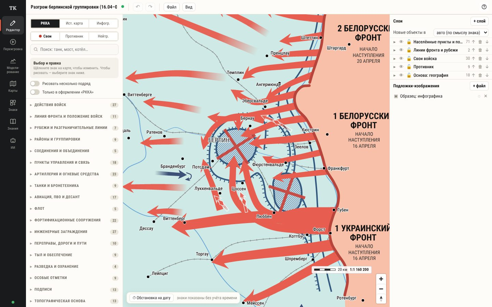

*Пример «Берлинская операция — инфографика» (меню «Файл → примеры»): стрелки ударов фронтов с привязкой хвостов к линии фронта, окружённые группировки, населённые пункты, железные дороги. Слева — палитра знаков по категориям, справа — слои.*

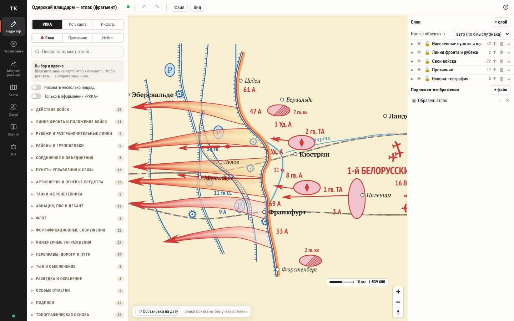

*Тот же редактор в оформлении «Историческая карта»: стрелки-клинья, овалы танковых армий, резервы «Р», рубежи обороны.*

Стрелка рисуется щелчками от хвоста к острию; хвост, начатый у линии фронта, привязывается к
ней и следует за линией при её правке. У стрелок настраиваются ширина и её сужение,
наконечник, заливка вдоль изогнутой оси, контур, блик и украшения на оси. Линии собираются из
параллельных слоёв с зубцами, засечками и пунктиром — так строятся многоцветные линии фронта,
рубежи, позиции подразделений. Правка: перетаскивание объекта и узлов, добавление и удаление
узлов, ручки ширины и наконечника; отмена и повтор, дублирование.

Для сложной графики исторических атласов у знаков есть дополнительные свойства:

- **Разветвлённая стрелка.** Ствол за развилкой расходится на сколько угодно ветвей, у каждой —
  своё острие; ветви уже ствола (доля задаётся). Контур и заливка общие, без швов в развилке.
  Знак «Разветвлённый удар» ставится с одной ветвью, пресет «Удар на три направления» — с двумя.
  Ещё одна ветвь — кнопкой «+» у острия выделенной стрелки на карте или «+ ветвь» в инспекторе:
  новая ветвь выходит из той же развилки в ту сторону от ствола, где ветвей меньше. Развилка
  (ромбик на стволе) и точки ветви перетаскиваются на карте; двойной клик по точке ветви удаляет
  её, по последней точке — ветвь целиком.
- **Окончание и дата.** Вместо наконечника — поперечная черта («рубеж достигнут») или ничего;
  у острия ствола и у каждой ветви — надпись, обычно дата выхода («25.4»). Надпись ставится за
  остриём по ходу стрелки, цветом наконечника (у контурной стрелки — цветом обводки).
- **Отметки на знаках соединений.** Штриховка всего знака (формируется) или его половины
  (выдвигается) и перечёркивание одной чертой (разгромлена) или крестом (уничтожена).

В палитре оформления «Историческая карта» к ним добавлены готовые знаки: разветвлённый удар,
выход на рубеж (стрелка с чертой), контурная стрелка (намеченный удар, перегруппировка), ось
наступления танковой армии (линия с ромбами), контрудар противника вилкой, передний край на
начало операции с подсветкой, положение на две даты, армии выдвигаются и формируются,
группировки противника разгромлена и уничтожена (поиск по слову «атлас»).

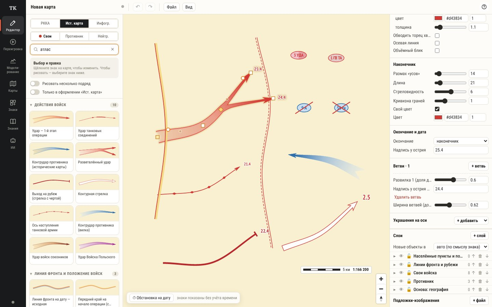

*Новые знаки «Исторической карты» на пустой карте: выбрана разветвлённая стрелка (ромбик на стволе — развилка, квадратики — точки ствола и ветви) с датами «25.4» и «24.4»; слева — передний край на начало операции с подсветкой, посередине — положение на две даты (сплошная и пунктир); ниже — ось наступления танковой армии с ромбами, выход на рубеж с чертой «22.4», контурная стрелка «2.5», контрудар противника; вверху справа — армии со штриховкой (выдвигается, формируется), ниже — перечёркнутые группировки противника. Справа в инспекторе — разделы «Окончание и дата» и «Ветви».*

### 3.2. Слои, масштаб, подложки

- **Слои.** Каждый знак лежит в слое: основа, линии фронта, свои войска, противник, подписи и
  свои слои. Слой можно скрыть, заблокировать, сделать полупрозрачным, переименовать,
  переставить. Новые знаки в режиме «авто» ложатся в слой по смыслу знака. В заголовке панели
  «Слои» — «👁 все» и «◌ все»: показать или скрыть все слои сразу (отменяется, как любая правка);
  Alt+щелчок по глазу слоя оставляет видимым только его.

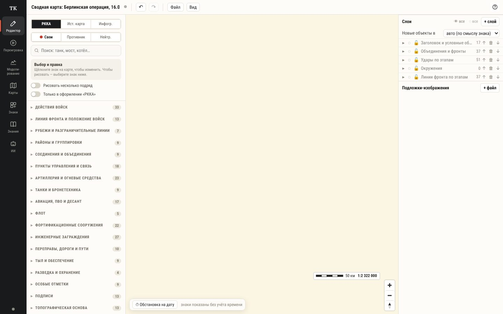

*Сводная карта в редакторе после «◌ все»: все пять слоёв скрыты (в панели «Слои» — серые, с пустым
глазом), на карте остались подложка, линейка масштаба и кнопки; «👁 все» в заголовке панели
возвращает их.*
- **Масштаб.** Размер знаков задаётся на масштабе, на котором они нарисованы; при зуме
  оформление растёт и уменьшается в пределах ×0,5–×1,5 (или постоянно, или как на местности).
  Слою и знаку можно задать масштабы, на которых он виден: стрелки фронтов — на мелких,
  дивизии — на крупных, как на штабных картах. Экспорт — всегда со всеми знаками.
- **Подложки.** «Бумага», OpenStreetMap, OpenTopoMap, спутник, любая XYZ/WMS без кода, свои
  карты из раздела «Карты» (работают без интернета) и сканы, привязанные за углы, с прозрачностью.

### 3.3. Время и реестр объектов

Под картой — шкала времени: карта показывает обстановку на выбранный момент, знаки появляются и
исчезают по своим периодам и движутся между положениями плавно или скачком; есть проигрывание с
выбором скорости. Время — московское и местное (по месту событий, с историческими правилами
часовых поясов).

Знак можно связать с **объектом реестра** («5 уд. А», «Рейхстаг»): характеристики объекта
(номер, ступень, род войск; во времени — подчинение, командир, численность, положение) хранятся
один раз и видны со всех карт. Изменения записываются фактами «с даты» со ссылкой на источник.
Реестр отвечает и на пространственно-временные вопросы: «какие объекты были в этом районе на
25 апреля».

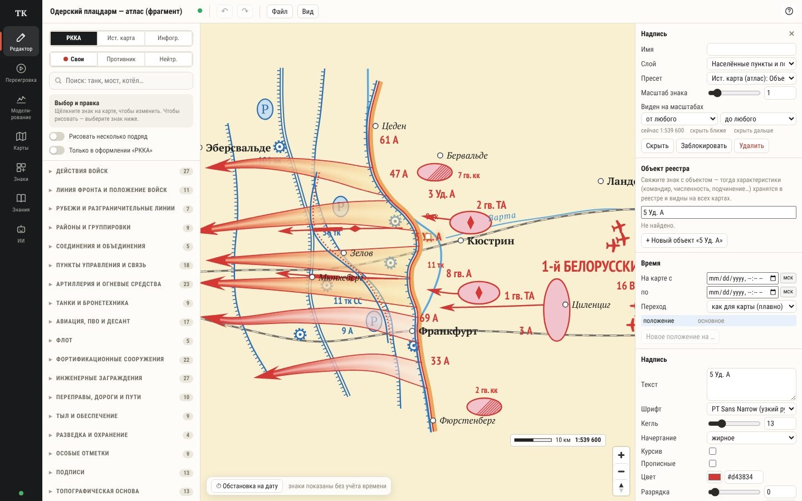

*Выбранная надпись «5 Уд. А»: слой и оформление, масштабы видимости, связь с объектом реестра (найти или создать), период присутствия на карте и положения по датам, параметры текста.*

### 3.4. Совместная работа, обмен, экспорт

- **Сервер.** Карты сохраняются на сервер с ревизиями (хранятся 50 последних). Если карту
  успели изменить, редактор предлагает перезаписать или загрузить свежую версию. Правки другого
  пользователя или внешней системы приходят потоком событий и подгружаются сами.
- **Без сервера** редактор работает целиком в браузере: карта сохраняется в браузере автоматически.
- **Файлы:** документ JSON; GeoJSON в обе стороны (на выбранный момент времени); SVG со слоями —
  группами Inkscape и Illustrator; PNG как на экране (с картой) и PNG только знаков, со
  встроенными шрифтами.
- **Внешние системы** могут владеть своим слоем карты и заливать в него данные в GeoJSON —
  остальная карта не затрагивается.

## 4. Библиотека знаков

249 элементов в 18 категориях: действия войск; линия фронта и положение войск; рубежи и
разграничительные линии; районы и группировки; соединения и объединения; пункты управления и
связь; артиллерия; танки и бронетехника; авиация, ПВО и десант; флот; фортификационные
сооружения; инженерные заграждения; переправы, дороги и пути; тыл; разведка и охранение;
особые отметки; подписи; топографическая основа. У каждого знака — описание, оформления,
учёт принадлежности (свои, противник, нейтральные) и источник со страницей. Знаки, которых в
первоисточнике нет, помечены «сверить» (28).

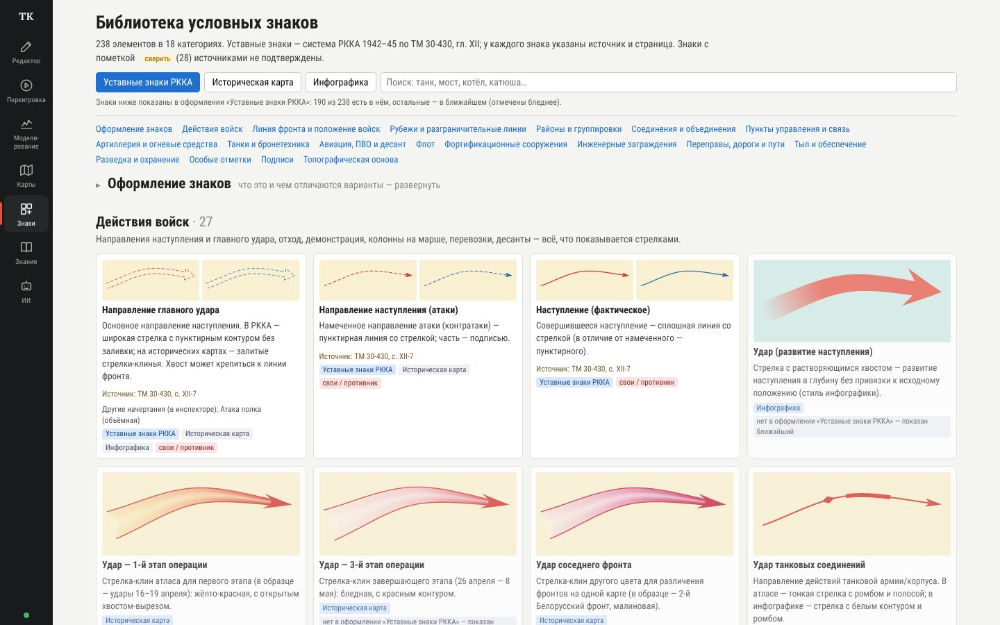

*Справочник знаков: переключение оформления, поиск, описание и источник у каждого знака. Полный перечень — [library.md](library.md), печатный справочник — [library.pdf](library.pdf).*

## 5. Карты: подложки и театры

**Подложки в закрытом контуре.** Сервис картографии хранит тайловые карты у себя и отдаёт их
редактору. Карты попадают туда тремя путями: загрузкой тайлов внешнего сервиса, пока он доступен
(район и уровни задаются, ход загрузки виден); нарезкой привязанного скана; пакетом из другой
установки. Импортируются и карты других программ: MBTiles, Locus/RMaps `.sqlitedb`,
OziExplorer `.map` с растром. Подложку можно показать районом или подложить под любую карту
системы. Подробно — [cartography.md](cartography.md).

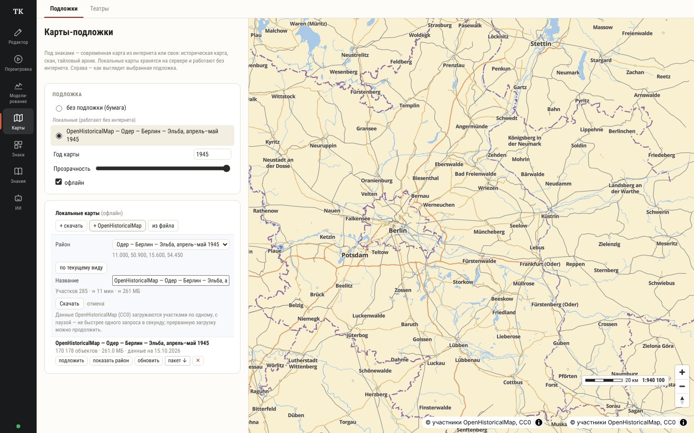

*Список своих карт и предпросмотр; «подложить» — показать под картами редактора и переигровки.*

**Театры** — карты местности для переигровки: сетка клеток с покровом (ESA WorldCover),
рельефом (Copernicus DEM), реками, дорогами, мостами, районами (OpenStreetMap) и укреплениями.
Новый театр собирается по области на сервере. **Исторический слой**: по подложенной карте того
времени стенд распознаёт по образцам цвета дороги, застройку, воду, лес и сравнивает дороги
карты с дорогами театра — современные дороги, которых в 1945 г. не было, можно убрать.

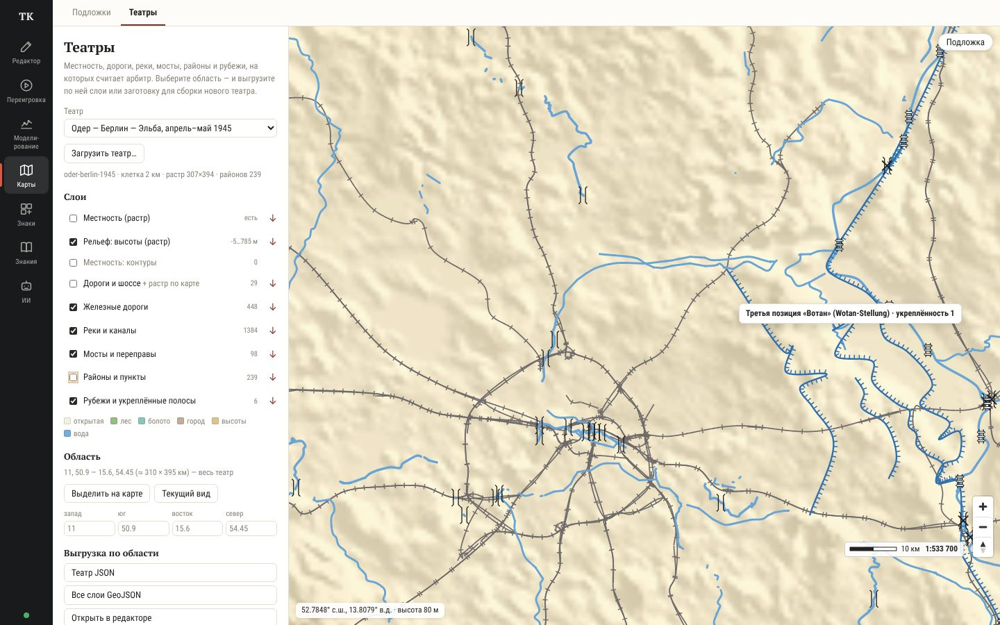

*Театр Одер — Берлин: рельеф, реки, железные дороги, мосты и укреплённые полосы («Вотан»); слева — слои театра, область и выгрузка.*

## 6. Переигровка и игра

**Переигровка.** Выбирается операция (Берлинская, бой в Берлине, Висло-Одерская или своя),
набор правил и число прогонов. Обе стороны получают исторические задачи; арбитр считает
движение (по дорогам, с разбросом путей вне городов), бои, подвоз, окружения, территорию.
Результат сравнивается с историей: доля положений в допуске, ключевые события по дням. Карта
показывает расчёт по ходам на трёх масштабах — тактическом, оперативном, стратегическом — с
историческими положениями и фронтом для сравнения, боями, рубежами, участками, полосами фронтов
и разграничительными линиями.

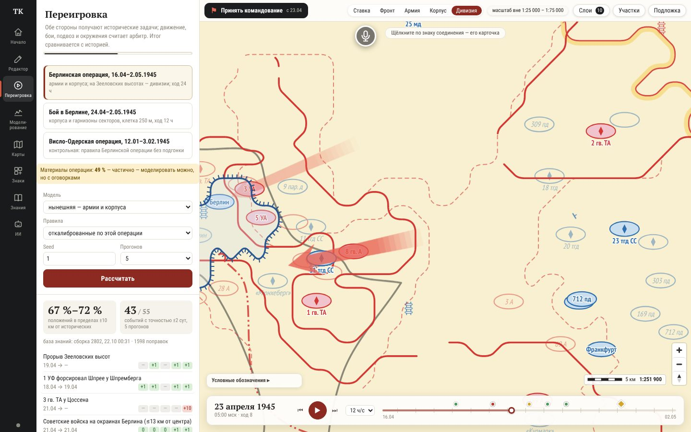

*Тактический масштаб, 23 апреля: расчётный фронт хода (красный), он же сутки назад (тонкий пунктир), передний край на начало операции (с жёлтой подсветкой) и исторический фронт (серый); бледные знаки — исторические положения, стрелки — бои за ход; штрихпунктиром — разграничительная линия по директиве; Берлин и Франкфурт (справа) — обводом крепости по застройке города, знаки понтонного моста — переправы. Слева — события по пяти прогонам.*

**Сохранённые переигровки.** Под результатом расчёта — «Сохранить»: переигровка сохраняется целиком
(карта, сводная карта, отчёт, события, сверка с историей; у агентной модели — и ход дивизий по часам с
историей) в хранилище браузера или окна приложения на этой машине. Вкладка «Сохранённые» над выбором
операции — список: название (по умолчанию — операция, модель или правила, seed), модель, когда сохранено,
доля положений в допуске и события; «Открыть» показывает переигровку без пересчёта — с теми же
настройками формы, картой и плеером, у агентной модели — с карточками агентов, разговором и «Принять
командование». Название можно изменить, сохранение — удалить.

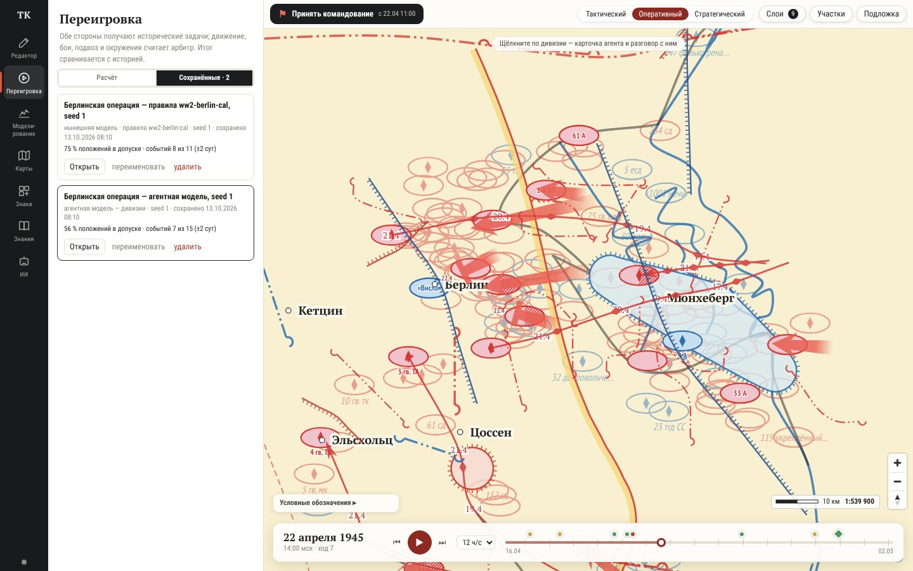

*Вкладка «Сохранённые»: две переигровки Берлинской операции — на нынешней модели (правила ww2-berlin-cal)
и на агентной (выделена — открыта); на карте — открытая агентная переигровка, 22 апреля, оперативный
масштаб.*

**Модель расчёта: нынешняя или агентная.** В настольном приложении (раздел 13) у Берлинской операции
есть выбор «Модель»: нынешняя (армии и корпуса, ход — сутки, считается в браузере) или агентная (каждая
из 347 дивизий со своим состоянием и штабами, шаг — час; раздел 7). Агентную модель считает ядро на
Rust внутри приложения (`crates/agents-core`, команды — `crates/agents-tauri`), карту по её ходу строит
тот же код, что и для нынешней: снимки через 6 ч, дивизии подчинены штабам армий и фронтов сценария,
поэтому работают все три масштаба, полосы, котлы и крепости. Сверка — с положениями дивизий по
документам (допуск сверх неопределённости источника) и с теми же ключевыми событиями; отчёт — краткий,
с таблицей событий. Правила и число прогонов у агентной модели не выбираются. В браузере без
приложения выбора нет.

**Агент на карте.** После расчёта на агентной модели щелчок по дивизии открывает справа её карточку —
на час, показанный на карте; выбранная дивизия обведена кольцом. «Карточка»: состояние и приказ,
окружение, переменные (люди, танки, орудия, боекомплекты, заправки, усталость, организованность) с
графиками за всю операцию, машина состояний с текущим подсостоянием, исходные данные с источниками,
положения по документам с расстоянием от расчёта и журнал агента с причинами; щелчок по строке
документа или журнала переводит карту на этот час. «Разговор» — вопрос агенту через языковую модель
(раздел 9): голос «Командир» знает только своё на этот час (состояние, свои приказы и события,
противника в 15 км), «Разбор» видит ещё исходные данные и документы. Модель отвечает по выданным
записям со ссылками вида [J3]; щелчок по ссылке переводит карту на час записи, записи раскрываются
под ответом.

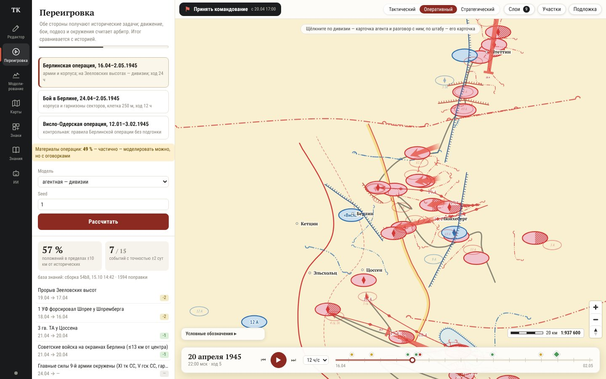

*Агентная модель в «Переигровке», 20 апреля 22:00, оперативный масштаб: армии собраны из дивизий агентной
модели — удары 3-й и 4-й гв. танковых армий к Цоссену и в обход Берлина, бледные знаки — исторические
положения дивизий; слева выбрана «агентная — дивизии»: 56 % положений в допуске, 7 событий из 15 с
точностью ±2 сут.*

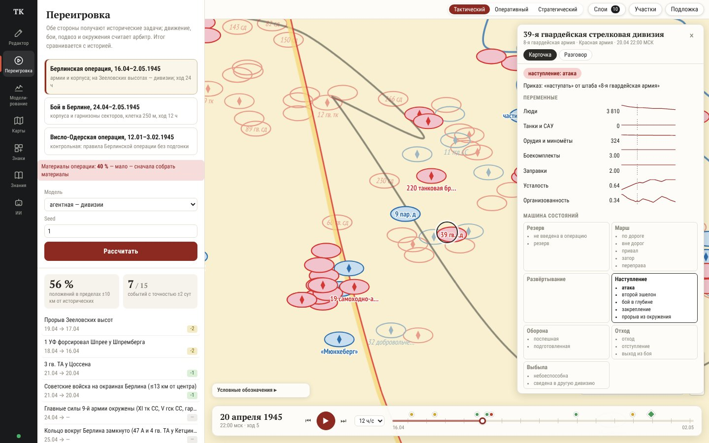

*Карточка 39-й гв. стрелковой дивизии (8-я гв. армия), 20 апреля 22:00, тактический масштаб: дивизия на
карте обведена кольцом; справа — «наступление: атака», приказ штаба армии «наступать», переменные с
графиками (люди 3 810, усталость 0,64, организованность 0,34) и машина состояний с выделенной группой
«Наступление»; вкладка «Разговор» — вопросы агенту.*

**Игра на агентной модели.** «Принять командование» после расчёта на агентной модели открывает тот же
экран командования, что и на нынешней модели (абзац «Игра» ниже в этом разделе): доклады, разведка с туманом войны,
решение, приказы, журнал, посредник, советник и варианты решения, штаб противника на языковой модели,
сохранение и продолжение игры. Меняется расчёт: ход (12 ч) считает ядро приложения по дивизиям.
Доклады — по дивизиям и по армиям и корпусам (силы — суммой по их дивизиям); приказ армии или корпусу
ядро доводит до всех их дивизий с задержкой штаба, приказ дивизии — ей одной, цель — пункт, соединение
противника (его место сейчас) или точка. Донесения за ход — значимые события дивизий из журнала агентов
(бой, отход, окружение, выход из строя, выполнение задачи). Штаб противника на модели получает свою
обстановку так же и отдаёт приказы через ядро; без него немецкая сторона идёт по приказам сценария.
Игра может идти дольше сценария агентной модели — до победы или предельного срока.

Распоряжения штаба — вкладки «Тыл», «Переправы», «Резервы», «Полосы» — работают так же, как на нынешней
модели: проверку, сроки и учёт ведёт она, а последствия исполняет ядро. Подвоз — от баз снабжения по
своей территории (территорию сторон даёт ядро): дальше предела в пути — подвоза нет, база далеко —
меньше, приоритетным объединениям — ×1,5, остальным — ×0,75; ядро получает множитель подвоза на ход
для каждой дивизии. Наведённая переправа к своему сроку позволяет дивизиям в 3 км от неё переходить
реку без задержки форсирования; подорванный мост перестаёт действовать. Будущие исторические наводки
переправ стороны игрока при передаче командования снимаются. Резервы стороны игрока сами не вводятся:
ввод — по распоряжению, дивизия появляется в районе сосредоточения к сроку. Линии между фронтами (по
директивам и решениям Ставки) и между армиями (распоряжения игрока) делят полосы: дивизии выбирают
путь своей полосой — клетки полосы соседа при выборе пути «дороже», время движения то же. Ставка на
модели рассматривает ходатайства и в игре на агентной модели. Посредник с поправками к боям — только
на нынешней модели.

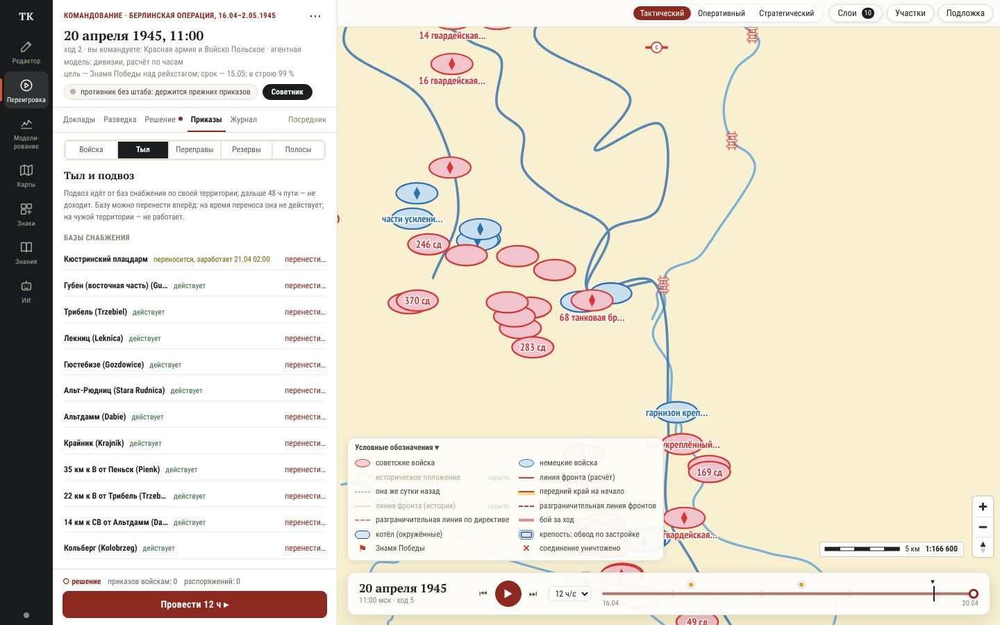

*Вкладка «Тыл» на агентной модели после хода, 20 апреля 11:00: база «Кюстринский плацдарм» переносится
и заработает 21.04 02:00, остальные базы действуют; рядом — вкладки «Переправы», «Резервы», «Полосы».*

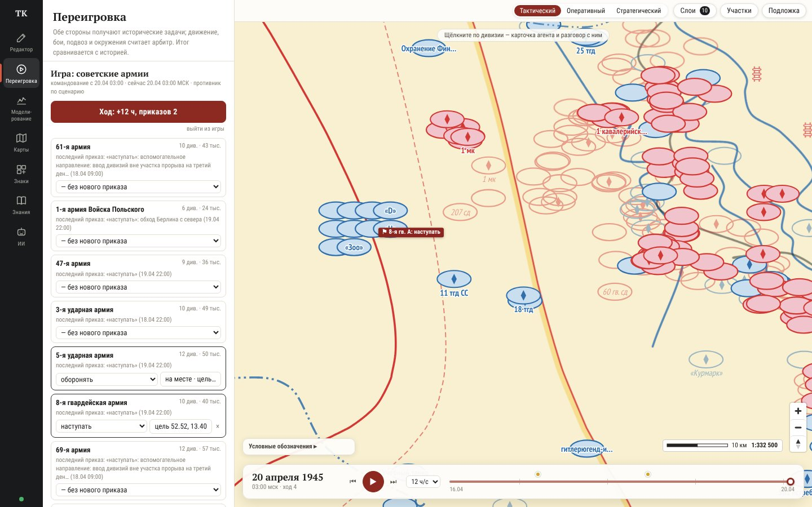

*Экран командования на агентной модели, 19 апреля 23:00: в шапке — «агентная модель: дивизии, расчёт по
часам»; во вкладке «Приказы» 8-й гвардейской армии отдан приказ «наступать» с целью Мюнхеберг (выбран из
ближайших пунктов), внизу — «Провести 12 ч».*

**Масштабы карты.** Переключатель над картой («Тактический», «Оперативный», «Стратегический»)
меняет степень обобщения — как на штабных картах разных инстанций. Расчёт один и тот же:
обобщённые знаки строятся из положений соединений по ходам. Выбор масштаба запоминается и
действует и в переигровке, и в игре.

| Масштаб | Что на карте | Направления | Окно |
|---|---|---|---|
| Тактический | каждое действующее соединение (дивизия, корпус, армия — как в сценарии) своим знаком, бои за ход | стрелки боёв | ход |
| Оперативный | объединения: армии и соединения, не входящие в армию; знак — овал, у танковых и механизированных — знак механизированного соединения | удар объединения, отход, рубеж обороны | сутки |
| Стратегический | в манере исторического атласа: фронты и группы армий — крупной надписью прописными, армии — подписью, танковые армии — овалом с ромбом; линия фронта — красная с оранжевой полосой; крепости и ключевые пункты | главный удар фронта (клин атласа), отход, оборона | двое суток |

Как строятся обобщённые знаки (оперативный и стратегический масштабы):

- **Группировка.** Каждое действующее соединение относится к ближайшему вышестоящему объединению
  нужной ступени по подчинённости сценария: на оперативном — к армии, на стратегическом — к
  фронту или группе армий. Соединение, у которого такого старшего нет, показывается само:
  например, 12-я армия, подчинённая ОКВ, на стратегическом масштабе идёт под надписью «ОКВ».
- **Место.** Знак или надпись стоит в центре тяжести своих соединений — среднем положении,
  взвешенном по численности; уничтоженные и ещё не введённые не учитываются. Знак движется по
  ходам вместе с войсками.
- **Состояние.** Подсказка у знака: сколько соединений, численность, танки и что объединение
  делает — наступает, обороняется, отходит или на марше и в резерве (если в этом положении больше
  40 % его людей). Состояние видно и по знаку (оперативный масштаб): на марше или в резерве
  (меньше 20 % людей наступают, обороняются или отходят) — правая половина овала заштрихована;
  разгромлено — осталось меньше половины наибольшей численности объединения или большая часть
  отрезана и потеряно больше 45 % — овал перечёркнут (у противника — красной чертой). Знак
  меняется не чаще раза в сутки, кроме перехода в «разгромлено»; из него — только если численность
  вернулась выше 75 %. На тактическом масштабе уничтоженное соединение остаётся на месте гибели
  перечёркнутым крестом.
- **Котлы.** На всех масштабах — контур окружения (кромка с зубцами внутрь): у противника — синяя,
  у своих — красная. Котёл — кусок территории стороны, отделённый от её основной территории не
  меньше чем тремя клетками чужой земли и не выходящий к краю театра, где есть её войска и большая
  часть их людей отрезана от подвоза; без учёта территории — отрезанные соединения, стоящие рядом.
  Подсказка: кто в котле и сколько людей. Слой «Котлы» и строка легенды.
- **Крепости** (гарнизоны с правом обхода — Festung: Франкфурт, Штеттин, Берлинский оборонительный
  район, Познань, Варшава) на оперативном и стратегическом масштабах — знаком города-крепости с
  названием; павшая — перечёркнута. Вокруг гарнизона — обвод крепости по застройке города
  (кромка с зубцами наружу, цветом стороны): контур клеток городской застройки слоя местности
  театра — по снимкам WorldCover или, если для театра применён исторический слой с местной
  карты РККА или плана города (раздел «Карты»), по нему; у Берлина — по плану 1945 г. Слой
  «Крепости» и строка легенды. В сценарии боя в городе (клетка мельче километра) обвода нет:
  там застроено всё. На обоих масштабах подписаны и места событий истории (кружок и
  название, одноимённые и близкие — один раз).
- **Переправы.** Наведённые переправы театра и переправы, наведённые сапёрами по ходу расчёта
  (раздел 19.5), — знаком понтонного моста, только на тактическом масштабе: на обзорных их знаки
  сливаются в «молотки».
- **Линия фронта по датам.** Кроме расчётной линии фронта хода на карте — та же линия суточной
  давности пунктиром (видно, куда сдвинулся фронт за сутки) и передний край на начало операции с
  жёлтой подсветкой — на всю операцию. Оба слоя включаются вместе с линией фронта (флажок
  «Линия фронта (расчёт)», строки легенды).
- **Направления армий** (оперативный масштаб). Стрелка — куда сместился центр тяжести армии
  за сутки, если не меньше 3 клеток. Удар — если армия наступает (в наступлении не меньше 30 %
  людей); отход — если больше 40 % людей отходит; иначе — по направлению на противника.
- **Ось танковой армии** (оперативный масштаб). Танковая армия вместо суточных стрелок ведёт
  ось с ромбами — линию через её положения на начало каждых суток от начала операции до текущего
  хода, с остриём у знака армии. У пройденных точек — даты («17.4», «18.4»): дата появляется,
  когда армия оттуда ушла, и остаётся до конца операции.
- **Главные удары фронта** (стратегический масштаб) собираются из ударов его армий за двое
  суток: удары, близкие по месту (до 30 км) и направлению (до 40°), сливаются в один, с весом по
  численности. На фронт — до трёх главных ударов и до двух отходов; слабее 6 км за двое суток
  не рисуются. Подпись стрелки называет армии, из которых сложен удар, например
  «1 БФ: удар на 24 км за 2 сут (8 гв. А, 1 гв. ТА)».
- **Расходящиеся удары** (стратегический масштаб). Два удара фронта из одного района (хвосты
  ближе 30 км), расходящиеся на 25–90°, рисуются одной разветвлённой стрелкой: ствол идёт от
  середины хвостов по общему направлению на половину меньшего из ударов, дальше каждая ветвь —
  своим направлением на остаток своей длины.
- **Удар остановлен.** Если за следующие сутки объединение (его центр тяжести) сместится меньше
  чем на полторы клетки, на острие вместо наконечника — поперечная черта «рубеж достигнут» и
  дата («23.4»), как на картах атласов. Размер даты — как у подписей знаков. У прочих стрелок
  даты нет: на карте по ходам все видимые стрелки относятся к одному моменту.
- **Привязка к линии фронта.** Хвост стрелки стоит на расчётной линии фронта этого хода —
  ближайшей к войскам (не дальше 20 км для армии, 35 км для фронта) и крепится к ней, как в
  редакторе. Остриё уходит в глубину на пройденное за окно расстояние, но не короче полутора
  порогов, — направление удара видно, даже если войска только начали движение. Если линии рядом
  нет, стрелка идёт от прежнего положения войск.
- **Оборона.** Если объединение почти не сдвинулось, а больше половины его людей в обороне, —
  рубеж обороны поперёк направления на противника, по ширине расположения его соединений,
  чуть впереди центра.
- **Туман войны.** В игре обобщённые знаки противника строятся только из обнаруженных
  разведкой соединений: группа армий, у которой видна одна дивизия, стоит там, где эта дивизия.

**Полосы фронтов и разграничительные линии.** На карте два слоя:

- **по директивам** — исторические разграничительные линии (раздел 17.1): 1-го Белорусского и
  1-го Украинского фронтов с 15.04 (до Люббен), с 23.04 (до Ангальтского вокзала), с 24.00 28.04
  (в Берлине — до ст. Рулебен) и с 6.05; 2-го и 1-го Белорусских фронтов (Арнсвальде — Шведт —
  Ангермюнде — Гранзее — Виттенберге); бомборазграничительная линия с ВВС союзников с 21.04.
  Каждая видна в сроки своего действия; в подсказке — пункты, документ, архивный шифр и
  достоверность;
- **расчётные полосы** — границы полос между фронтами (на всех масштабах) и между армиями
  одного фронта (на оперативном), по ходам: от переднего края в глубину до 40 км (в городе —
  до 5 км). Где действует директива, расчётная граница идёт по её линии; где директивы нет или
  за концами её линии — по расположению войск: клетка принадлежит тому объединению, чьи войска
  к ней ближе.

Оба слоя включаются в «Слоях» («Разграничительные линии: директивы и распоряжения», «Полосы фронтов и
армий (расчёт)») и строками легенды. В игре видны только свои полосы.

**Управление картой.** Управление — отдельной полосой над картой, карта начинается под ней и
кнопками не закрывается. В полосе: «Принять командование» (в переигровке), переключатель
масштаба, меню **«Слои»** (число — сколько слоёв включено), «Участки» и «Подложка». На узком
экране полоса переносится во вторую строку, а карта сдвигается ниже. В «Слоях» вверху — «Показать все» и
«Скрыть все» (все слои меню и подписи сразу; войска и подложка остаются), ниже флажками включаются подписи знаков, исторические положения, линия фронта
по истории и расчётная, бои за ход (только на тактическом масштабе), рубежи, разграничительные
линии по директивам и расчётные полосы; в игре — ещё
замысел (проект приказов), тыл и реки для переправ. Слои от масштаба не зависят, кроме исторических
положений: на тактическом масштабе — положения действующих соединений (у агентной модели —
дивизий), на оперативном — положения армий (у агентной модели — по её истории армий), на
стратегическом их нет, как в атласе; знаки исторических событий видны на всех масштабах. Легенда
показывает знаки выбранного масштаба; её строки тоже включают и выключают слои.

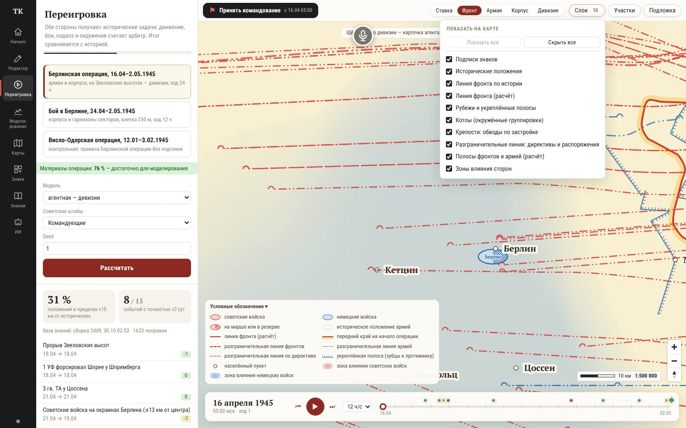

*Полоса управления над картой и открытое меню «Слои»: вверху кнопки «Показать все» (сейчас неактивна —
всё уже включено) и «Скрыть все», ниже — флажки подписей и слоёв.*

**Подписи.** Подписи соединений — сокращениями штабных карт: «8 гв. А», «26 гв. ск», «7 гв. кк»,
«545 нгд», «309 пд», «11 тгд СС», «XI тк СС», «гарн. Штеттин»; собственное имя номерной дивизии
(«Берлин», «Нордланд») на карту не выносится, у дивизии без номера подпись — её имя
(«Курмарк»). Полное название — в подсказке при наведении. Флажок «Подписи знаков» выключает
подписи на карте (остаются при наведении). На карте подписи **разрежаются**: подписи идут по важности — объединения выше
соединений, расчёт выше исторических положений, армия выше корпуса, корпус выше дивизии.
Подпись, которая налезла бы на уже поставленную подпись или зашла бы под чужой знак, не
рисуется. У знаков, лежащих прямо друг на друге, подпись одна — у верхнего, видимого. Знак без
подписи остаётся на месте, его название и состояние — в подсказке при наведении. Разрежение
действует только на экране: в выгрузке SVG и PNG все подписи на месте. Внутри коридора размеров
знаков результат от зума не зависит: знаки и расстояния между ними растут вместе.

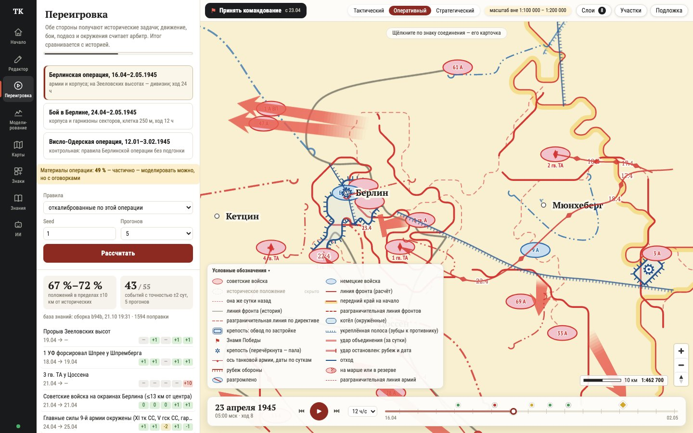

*23 апреля в оперативном масштабе (исторические положения скрыты): объединения в центре тяжести своих соединений; удары, после которых армия встала, — с чертой и датой «23.4»; справа вверху — ось 2-й гв. танковой армии с ромбами и датами «17.4», «18.4»; Берлин — обвод крепости по застройке города (синяя кромка с зубцами наружу); линия фронта хода — сплошная, сутки назад — пунктиром, передний край на начало — с жёлтой подсветкой; штрихпунктиром — разграничительные линии. Внизу — легенда в две колонки со строкой «крепость: обвод по застройке».*

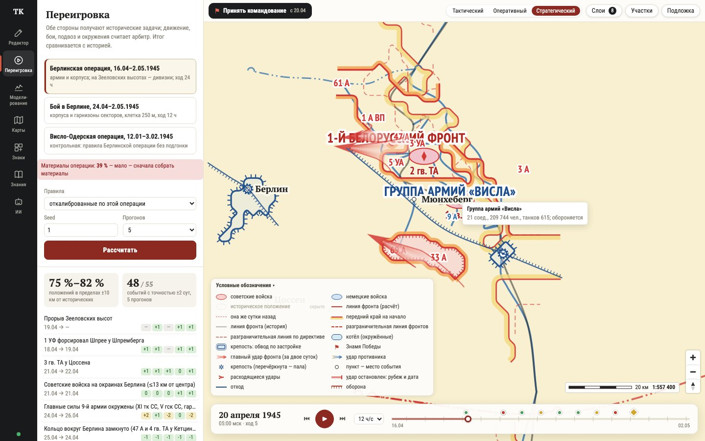

*Стратегический масштаб, 20 апреля (исторические положения скрыты): надписи фронтов и групп армий, подписи армий, удар 69-й и 33-й армий — клином атласа; линия фронта с оранжевой полосой, исторический фронт — серый; Берлин и Франкфурт — знаком крепости и обводом по застройке города (синяя кромка с зубцами наружу); внизу штрихпунктиром — разграничительная линия 1 БФ / 1 УФ по директиве.*

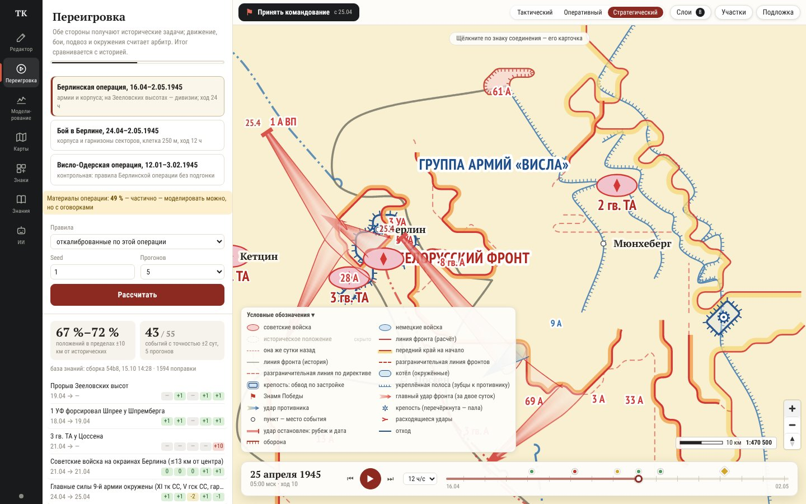

*25 апреля в манере атласа: «1-й Белорусский фронт», «Группа армий „Висла“» — прописными; армии — подписями, танковые — овалами с ромбом; удары фронта — клиньями атласа, слева — разветвлённый (расходящиеся удары с датой «25.4»); сине-белым — остановленный удар немецких войск; Берлин — знаком крепости внутри обвода по застройке, Франкфурт (справа) — обводом; Кетцин и Мюнхеберг — места событий; линия фронта — красная с оранжевой полосой.*

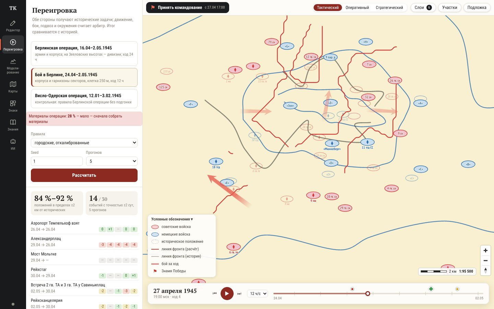

*Бой в Берлине (клетка 250 м, ход 12 ч), 27 апреля: советские корпуса у кольца S-Bahn, немецкие гарнизоны секторов A–H и Z. С юга на север — разграничительная линия 1 БФ / 1 УФ по директиве от 23.04 (Мариендорф — Ангальтский вокзал); западнее вокзала, где директива линию не установила, граница полос расчётная. В допуске ±2 км — 79–90 % положений.*

**Сводная карта операции.** Кнопка «Сводная карта →» под итогами прогона открывает в редакторе
одну карту всей операции — без шкалы времени, как лист исторического атласа. Её можно править,
выгрузить в SVG или PNG и сохранить, как любую карту.

- **Этапы.** Операция делится на этапы поровну по суткам: три — для операции от 9 суток, два —
  от 4, иначе один. Удары каждого этапа — своим цветом, как в атласе: 1-й — жёлто-красный,
  2-й — розово-красный, 3-й — бледный.
- **Линии фронта на рубежах этапов.** Передний край на начало операции — с жёлтой подсветкой,
  к концу каждого этапа — пунктиром, на конец операции — сплошной; у каждой линии одна дата (на
  самом длинном её куске).
- **Удары армий.** Для каждой армии и каждого этапа — стрелка через её положения (центр тяжести
  соединений) на начало каждых суток этапа. Хвост — на линии фронта начала этапа (если она ближе
  четырёх порогов), остриё — чуть впереди положения на конец этапа. У острия — дата конца этапа;
  если армия к ней встала или операция кончилась — черта «рубеж достигнут». У танковых армий —
  ромбы на оси. На карту выносятся только удары: армия наступала (в среднем за этап не меньше
  четверти людей), сместилась не меньше чем на два порога и шла, а не петляла (смещение — не
  меньше половины пройденного пути). Удары противника — сине-жёлтыми стрелками, его отход —
  тонкими синими.
- **Подписи и состояния.** Армии подписаны у исходного положения, фронты и группы армий —
  крупной надписью. Объединение, разгромленное к концу (по тому же правилу, что на оперативном
  масштабе), перечёркнуто на месте, где оно оказалось; отрезанные к концу соединения противника,
  стоящие рядом (до 25 км), обведены контуром окружения.
- **Заголовок и условные обозначения** — на самой карте: название операции, даты, правила и
  seed прогона; образцы ударов по этапам и линий фронта с короткими пояснениями — легенда узкая и
  стоит внизу у левого края окна, не заходя под линейку масштаба и кнопки карты. Карта открывается в
  исходном масштабе: лист целиком, с запасом снизу под полосу времени.

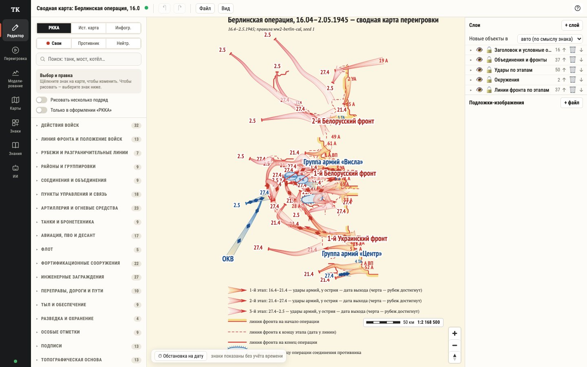

*Сводная карта Берлинской операции по прогону (seed 1), открытая в редакторе: заголовок, удары армий по трём этапам (16.4–21.4, 21.4–27.4, 27.4–2.5) с датами у острий, у танковых армий — ромбы; синим — удары и отходы немецких войск; передний край на начало — с подсветкой, линии к концу этапов — пунктиром; заголовок вверху и узкая легенда внизу у левого края — на белых подложках с тонкой рамкой; справа от легенды — линейка масштаба и кнопки карты. Справа — слои сводной карты.*

**Игра.** С любого момента переигровки можно принять командование одной стороной. Противником
командует **штаб на модели**: на каждом ходу он получает только то, что мог знать (свои войска,
противник в пределах разведки, итоги суток, ограничения сверху), и отдаёт приказы в той же форме,
что и человек. Игрок получает доклады и разведсводку (туман войны), принимает решение на ход
(оценка обстановки, замысел, риски, донесение), отдаёт приказы войскам и распоряжения по тылу,
переправам и резервам. Арбитр исполняет только приказы в строгой форме; свободный текст идёт в
журнал и советнику.

Цели в приказах штаба на модели и советника — названия словами; стенд сопоставляет их с театром.
Пункт ищется сразу среди ближних к войскам и всех пунктов театра. Точное название (с «ё» и
оригиналом в скобках, без «у», «в районе» и т. п. впереди) важнее похожего, поэтому «Альтфридланд»
не становится «Фридландом», «Берлин, Александерплац» — «Берлином», а «Лёкниц» (Loecknitz) —
«Лекницем» (Leknica). При равной похожести берётся ближний пункт. Место, переписанное из доклада
(«8,2 км к ЮЗ от Крайник»), — точка в стольких километрах по румбу от пункта, а не сам пункт.
Полное название соединения противника («Танковая дивизия «Мюнхеберг»») — цель «против него», а не
одноимённый город. Как понят каждый приказ, видно в «Посреднике».

**Резервы в игре.** Вкладка «Приказы → Резервы» собирает резервы по армиям. Сверху — сводка:
сколько объединений ждут ввода и сколько в них людей, танков и орудий. В карточке армии — её фронт,
число соединений, силы, с какого срока она готова к вводу и где стоит сейчас («на карте» показывает
это место). Армию можно ввести целиком: выбрать район сосредоточения из ближних пунктов или
щелчком по карте. Её соединения встают в этот район, разнесённые на 3–4 км (точка за линией фронта
пропускается — соединение встаёт в следующую), распоряжение — одной строкой с общим сроком. Отдельное соединение вводится из списка «Соединения». Ниже — то, что уже
вводится: введённые резервы и войска, прибывающие по графику сценария, со сроком и районом. Ещё
ниже — **резервы на театре**: свои соединения в резерве или на марше без боя; «приказ…» открывает
приказ этому соединению. На агентной модели резерв — дивизии армии (например, девять дивизий 28-й
армии), на нынешней — армия целиком.

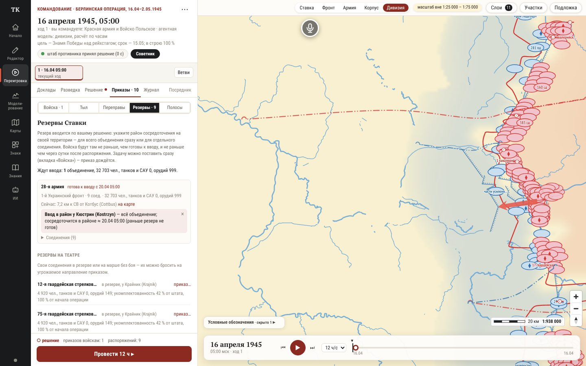

*Вкладка «Приказы → Резервы» на агентной модели, 17 апреля: 28-я армия (1-й Украинский фронт,
9 соединений) введена в район у Кюстрина одним распоряжением, срок сосредоточения — 20.04 05:00;
ниже — резервы на театре: дивизии на марше и в резерве с кнопкой «приказ…».*

**Полосы и директивы в игре.** В переигровке по истории линии действуют по расписанию
директив. После передачи командования они устроены как в жизни — сверху вниз:

- **Директивы Ставки вступают по обстановке.** Историческая директива вступает в силу, когда
  в игре сложилось то, что её вызвало: линию 23.04 — когда войска 1-го Украинского фронта вышли
  в район Ланквица, линию 28.04 — когда они вышли к Ангальтскому вокзалу; через несколько часов
  на её отдачу (6 и 4 ч). Не сложилось — действует прежняя линия. Уже вступившие к моменту
  передачи командования остаются.
- **Модель-Ставка** решает, когда директив по истории не хватает: срок исторической директивы
  прошёл, а её условие в игре не наступило; войска фронта второй ход подряд стоят в полосе
  соседа; командующий подал **ходатайство в Ставку** (поле во вкладке «Решение»). Модель
  видит фронты и их армии, действующие линии, повод, исторические директивы как образец и
  список пунктов; отвечает «оставить линии» или издаёт линию по пунктам. Директива проверяется
  (оба фронта есть, войска по разные стороны линии) и вступает в силу через указанные часы;
  ответ Ставки — в донесениях и в «Журнале». Включается в «Посреднике» («Модель-Ставка»),
  работает, когда в игре есть модель.
- **Линии армий — распоряжение игрока.** Во вкладке «Приказы → Полосы» выбирается фронт. Под ним —
  его армии с севера на юг: где стоят, какие линии с соседями у них уже есть; щелчок по строке
  показывает армию на карте. Дальше выбирается армия, и ближайшая общевойсковая армия того же
  фронта сама подставляется соседней (список соседей — по удалению, с километрами). Линию можно
  провести своими точками на карте (от тыла к переднему краю) или кнопкой «Предложить линию»:
  она пройдёт через середину между войсками двух армий в сторону противника — направление
  считается по ближайшему обнаруженному противнику для своих соединений в 40 км вокруг;
  предложенную линию можно поправить. Кто справа по ходу линии, стенд определяет по положению
  армий; линия вступает с задержкой доведения армиям и делит полосы армий этого фронта — армии
  идут к целям своей полосой.
- **За немецкую сторону — так же, по-немецки.** Линии между группами армий устанавливает
  **ОКХ** — та же модель высшего командования с немецкой постановкой (группы армий, приказы ОКХ;
  войска, подчинённые ОКВ, например 12-я армия, — тоже на нём); у игрока за вермахт — «Ходатайство
  в ОКХ», «Резервы ОКХ». Линии между армиями одной группы армий — распоряжение игрока
  («Приказы → Полосы»: группа армий, две её армии) или **штаба на модели**: в его решении есть
  распоряжение line — две свои армии и пункты линии по порядку; армии и пункты сопоставляются с
  обстановкой, линия проверяется теми же правилами (армии одного объединения, войска по разные
  стороны) и вступает с задержкой доведения. У немецкой стороны армии — штабы над корпусами и
  дивизиями: кто справа по ходу линии, стенд определяет по среднему положению их войск. Это
  распоряжение есть и у советского штаба на модели, когда игрок командует вермахтом.

Там же — свои полосы словами: с кем граничит каждый фронт и каждая армия, по каким пунктам
проходит линия (будущие директивы игрок не видит), кто стоит в полосе соседа. Если цель
приказа лежит в полосе соседа по действующей линии, редактор приказа предупреждает: войска
пойдут туда, но своей полосой, где можно, а выход в чужую полосу отметится в разборе. Штаб на
модели и советник получают те же сведения в обстановке. Директивы Ставки и распоряжения
записываются в игру, поэтому она восстанавливается по записи точно.

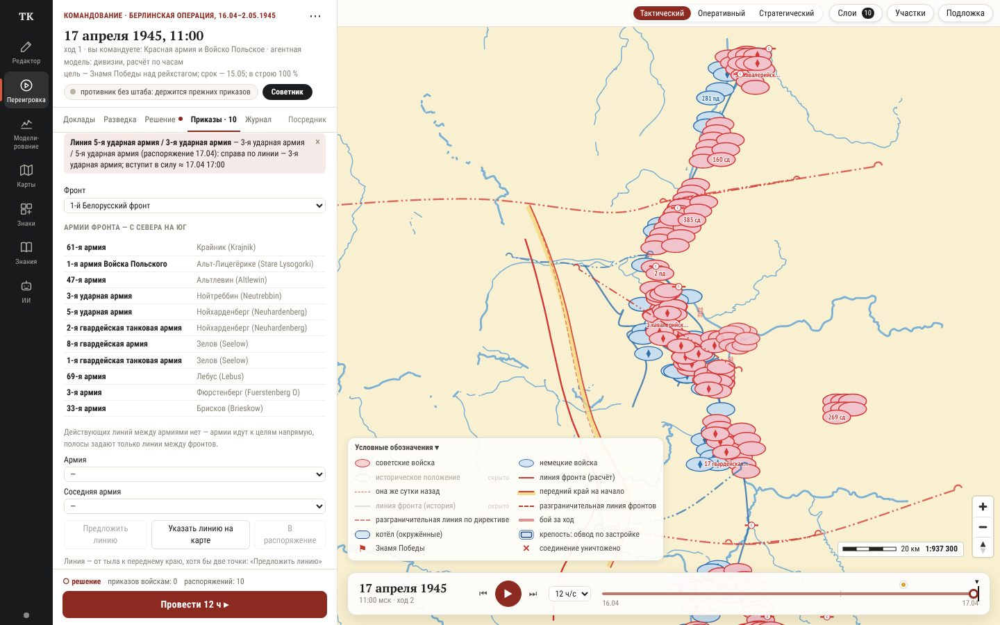

*Вкладка «Приказы → Полосы» на агентной модели, 17 апреля: вверху — распоряжение, линия между 3-й и 5-й ударными армиями, проведённая кнопкой «Предложить линию» (вступит в силу 17.04 17:00); ниже — армии 1-го Белорусского фронта с севера на юг с пунктами, у которых они стоят, и форма новой линии. На карте — линии между фронтами по директивам.*

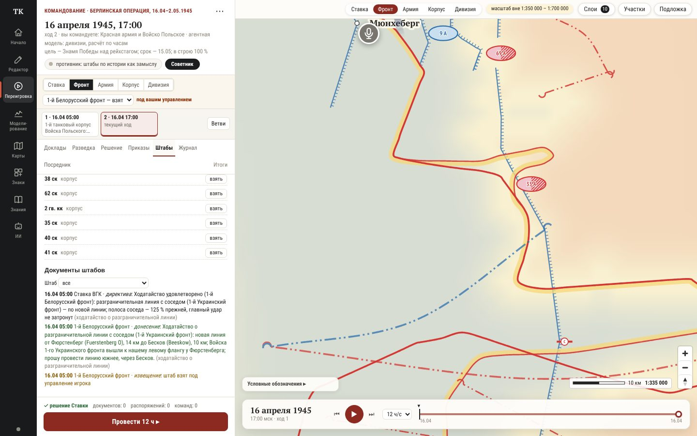

*Журнал хода: распоряжение о линии армий, директива Ставки по ходатайству командующего (подставная модель), донесения о вступлении обеих линий в силу.*

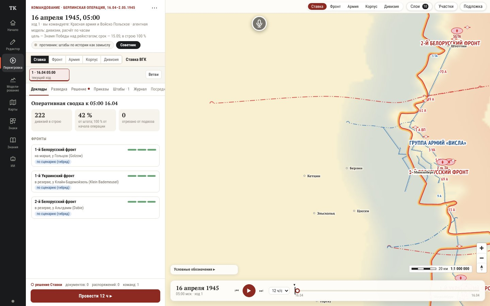

*Командование 1-м Белорусским фронтом: оперативная сводка, донесения за ход, доклады объединений.*

**Советник** отвечает на вопросы игрока, видя то же, что игрок, и точные правила арбитра;
готовит варианты решения на ход (решительный, осторожный, манёвренный), которые можно принять
целиком или по частям. Распоряжения — часть каждого варианта: перенос баз и приоритет подвоза,
наводка и подрыв переправ, ввод резервов, разграничительные линии между армиями. Для этого в
обстановке советника — до каких объединений подвоз не доходит или ослаблен, действующие мосты рядом с
войсками, наводимые переправы и свободные понтонные парки, резервы, готовые к вводу (по армиям). На
агентной модели советник и штаб противника видят не только дивизии, но и армии и корпуса — сводкой
по их дивизиям, с пометкой, что приказ армии ядро доводит до всех её дивизий; у каждой дивизии
указано, в какую армию она входит. Поэтому советник отдаёт приказы армиям, называет армии в
разграничительных линиях и вводит резервную армию целиком (в распоряжении — название армии): её
дивизии встают в районе на своей территории, точки за линией фронта пропускаются. Темы «По резервам»
в дереве вопросов — тоже по армиям. Ответ, где названы соединения противника вне разведки, проверяется
программно; противник, с которым свои войска вели бой за ход, считается опознанным (его название
есть в докладе о бое). **Посредник** показывает решения штаба противника — после игры или по желанию; по
выбору модель-посредник даёт ограниченную поправку к бою (в пределах 0,8–1,25) с опорой на
справку из базы знаний.

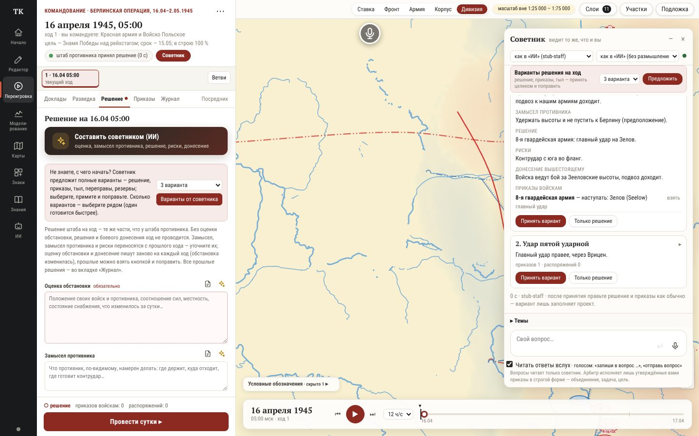

*Варианты решения на ход: оценка, замысел, приказы и распоряжения — каждый можно взять в проект.*

Игра идёт до победы или поражения, сохраняется в браузере после каждого хода и восстанавливается
по записи целиком (движок детерминирован). **Разбор операции** — отчётный документ модели по
записи игры от лица экспертов (замысел и ведение операции, разведка, тыл, переправы,
управление, резервы, сравнение с историей, оценка и уроки), с выгрузкой в PDF.

## 7. Моделирование

Раздел для тех, кто проверяет и развивает модель:

- **Модели** — наборы правил арбитра словами и числами (бой, оборона, движение, подвоз,
  калибровка), профили сторон, языковые модели по ролям;
- **Сравнение** — до четырёх наборов правил на одной операции против истории: положения по
  дням, события, отчёт;
- **Настройка** — свой вариант правил;
- **Калибровка** — подбор множителей правил по истории операции (обучение — первая половина,
  проверка — вторая), в браузере, параллельно;
- **Операции** — загрузка своей операции пакетом (сценарий, театр, история), проверка,
  контрольный прогон, подготовка к переигровке; материалы, полнота, сверка с базой, пересчёт
  (раздел 8).

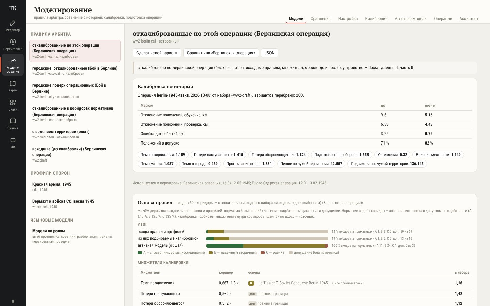

*Набор правил `ww2-berlin-cal`: блок калибровки (мерило до и после, множители) и таблицы арбитра словами.*

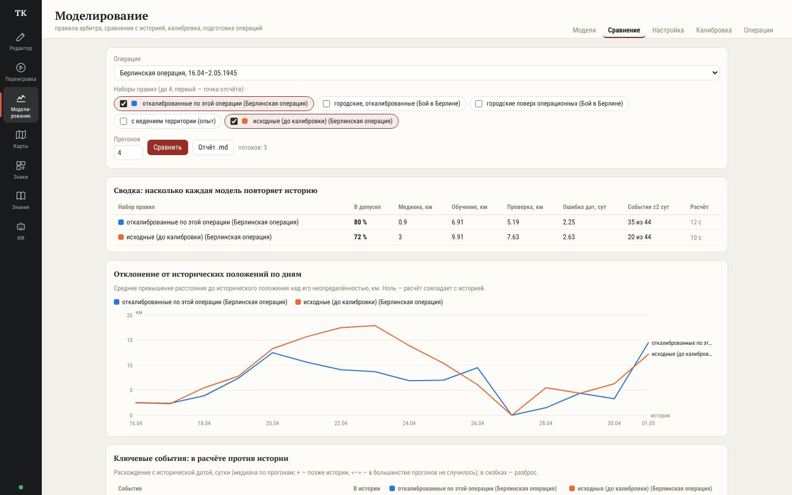

*Исходные и откалиброванные правила на Берлинской операции: доля положений в допуске, события, отклонение по дням.*

**Агентная модель (отдельное приложение, в разработке).** Переигровка снизу вверх: каждая дивизия — агент со
своим состоянием, штабы доводят приказы, бой — по нормативам дивизионного уровня; сценарии — вся Берлинская
операция (347 соединений трёх фронтов и немецкой стороны, 16.04–2.05) и Зееловские высоты (79 дивизий). Приложение `apps/agents` (Tauri: macOS, Windows, Linux) показывает ход по часам на карте
театра, карточку агента с переменными, машиной состояний, журналом и сверкой с документами и разговор с агентом
через локальную языковую модель. Немецкие штабы корпусов действуют по историческим приказам, решают сами по
доктрине или на выбранной языковой модели (знают и об окружении — могут приказать прорыв к своим); советские штабы —
по историческим приказам, по доктрине или на модели: задачи берутся из документов, а кем и когда наступать решает
штаб армии одним запросом за все её дивизии; модель штаба и модель разговора выбираются из списка сервера в панели
«Модель и штабы». Там же для штаба на модели — уровень размышлений, потолок токенов ответа (0 — без ограничения),
число одновременных запросов (вручную или замером под сервер и чип), решение всех штабов в один час и один запрос на
армию вместо запроса на корпус. Ответы модели — и в разговоре, и у штабов во время расчёта — идут потоком: видно
ожидание, размышления модели по мере прихода и сам ответ. Кроме дивизий, у немецкой стороны — части вне дивизий и около трёх десятков частей в тылу (учебные, гарнизоны городов, фольксштурм, боевые группы) по собранным источникам. Разгромленная немецкая дивизия выходит из боя и через сутки сводится в
соседнюю, советская стрелковая выводится в резерв армии (правила — по источникам о практике сторон в 1944–45 гг.);
выбывшая дивизия остаётся на карте перечёркнутой на месте выбытия. Панель «Ход операции» показывает вехи
(история, расчёт, вариант) и потери сторон; любой прогон можно сравнить с вариантом — немецкие штабы по доктрине,
без артподготовки, без отвода с первой позиции, советские или обе стороны по доктрине. Советские штабы
по доктрине сами решают, кем и когда наступать: эшелоны армий, ввод второго эшелона и танковых армий по правилам
советской доктрины наступления 1944–45 гг. Берлин — по обводам обороны (внешний, кольцо S-Bahn, «Цитадель»)
с темпом боя кварталами. Модель видит окружение: дивизия, у которой сутки нет пути к своим в обход войск противника,
окружена — без подвоза, в красном пунктирном кольце на карте; немецкая без боеприпасов сдаётся, с приказом на
прорыв — идёт колоннами через бреши с потерями (котёл у Хальбе и выход остатков 9-й армии к 12-й 1.05).
Для показа — кнопка «Показ»: проводка по ключевым моментам операции (артподготовка, Зееловские высоты, прорыв у
Мюнхеберга, поворот 1-го Украинского фронта на Берлин, кольцо, котёл у Хальбе, прорыв 9-й армии к 12-й, Рейхстаг) —
час, вид карты и подпись: что было по источникам, когда это случилось в расчёте и как это считает модель; «▶ до
следующего» проигрывает ход до следующего момента. Кнопка «Отчёт» — сверка положений с документами против нынешней
модели по участкам и периодам, вехи в расчёте и во всех вариантах, потери сторон по дням, советские потери по армиям
и фронтам против таблиц ЦАМО и Кривошеева (по готовым прогонам).
Замысел, состояние и результаты — [plans/agents.md](plans/agents.md).

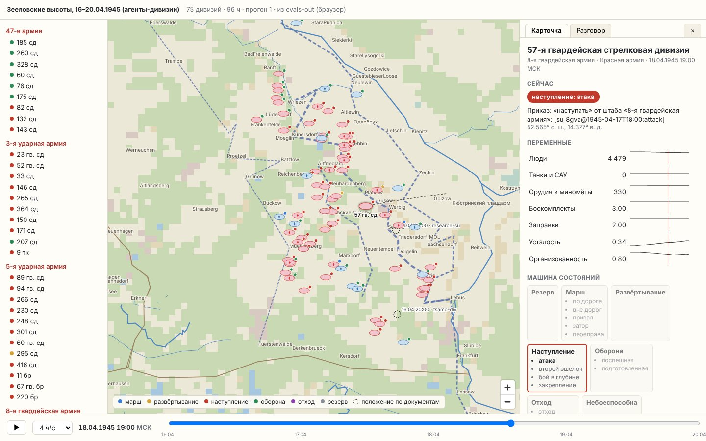

*Зееловские высоты, 18.04 19:00 МСК: выбрана 57-я гв. сд — её след и положение по документам на карте, справа
состояние, приказ, переменные с графиками и машина состояний; красным пунктиром обведены немецкие дивизии, которые
модель считает окружёнными.*

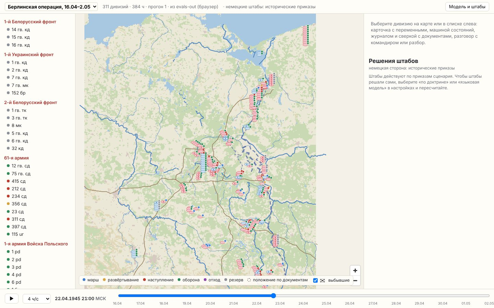

*Берлинская операция, 22.04 21:00 МСК: 347 соединений на карте театра, слева — штабы с соединениями, справа — потери
и вехи, в заголовке — выбор сценария, сравнение с вариантом, «Показ» и «Отчёт».*

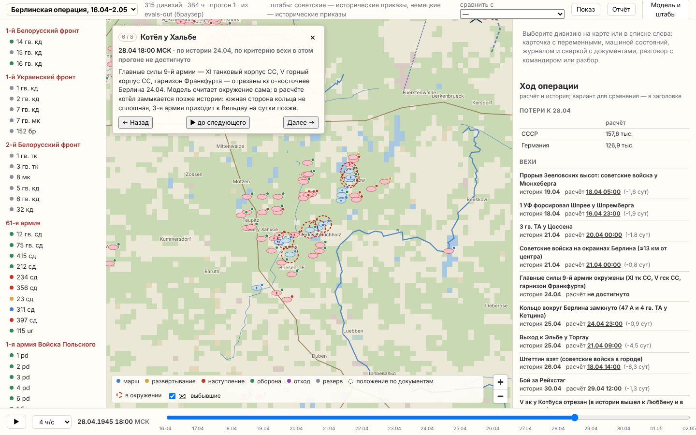

*Показ, момент 6 из 8 — «Котёл у Хальбе», 28.04 18:00 МСК: подпись с историей и тем, как это считает модель; на
карте окружённые дивизии 9-й армии в красных пунктирных кольцах; кнопки «Назад», «▶ до следующего», «Далее».*

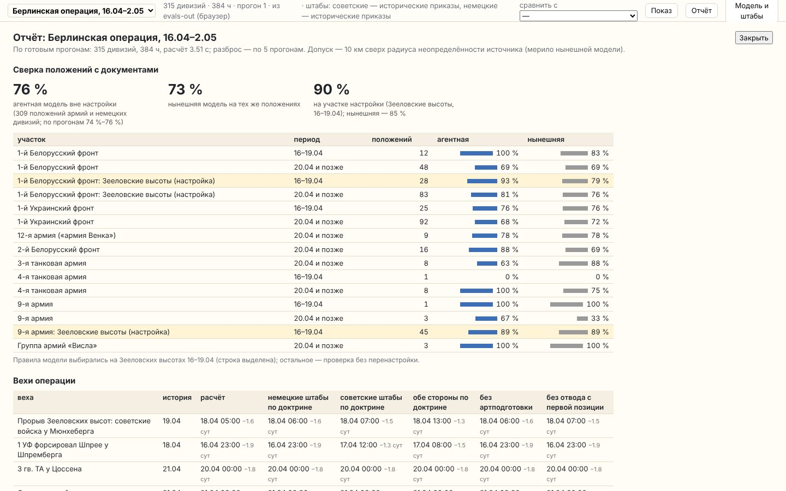

*Отчёт по Берлинской операции: доля положений в допуске вне настройки у агентной и у нынешней модели, на участке
настройки, таблица по участкам и периодам (участок настройки выделен) и начало таблицы вех — расчёт и пять вариантов.*

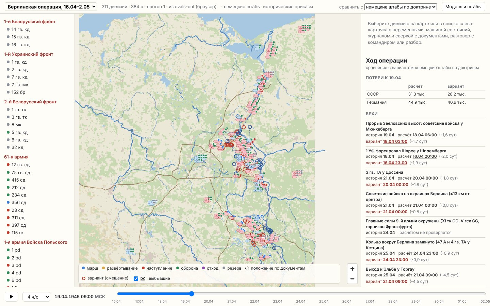

*Сравнение с вариантом «немецкие штабы по доктрине», 19.04 09:00 МСК: полые кружки на карте — где дивизии в
варианте, пунктирные кольца — окружённые; справа — потери сторон и вехи операции по истории, в расчёте и в варианте.*

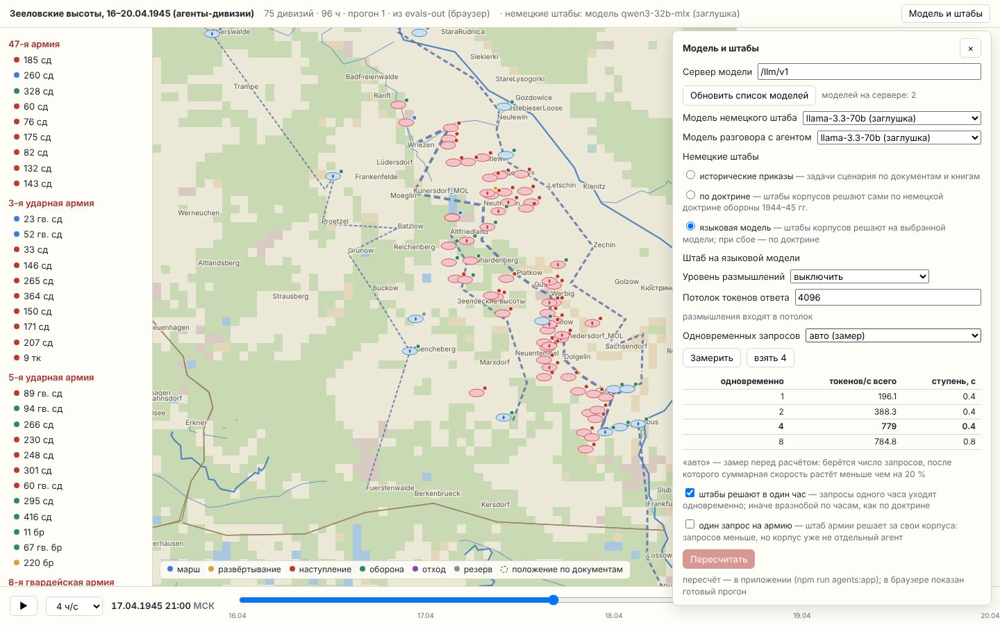

*Панель «Модель и штабы»: сервер модели, список моделей с сервера (здесь — проверочная заглушка), модель штаба и
модель разговора, источники решений советских и немецких штабов (здесь обе стороны — на модели), настройки штаба на
модели и таблица замера одновременных запросов.*

Как устроен расчёт, откуда числа и насколько модель совпадает с историей, — часть II.

## 8. База знаний и подготовка операции

**База знаний** — сведения по операциям в каркасе категорий: операции, сражения и бои,
формирования, командование, организация и доктрина, вооружение, театр, хронология, источники;
рубрикатор с нумерацией. У каждого факта — источник, достоверность (A, B, C) и, для извлечённых
из документов, дословная цитата. Материалы сгруппированы по операциям. Поиск — по словам и по
смыслу (эмбеддинги модели). Модель отвечает на вопросы и рассказывает по теме только по
материалам базы, со ссылками; советник в игре получает из неё справки (доктрину, технику — без
хода боёв в истории).

Начальная база собирается из данных проекта (`npm run kb:seed`): выписок из книг и справочников
(`docs/sources`), профилей сторон, части II этого описания и выписок из документов ЦАМО
(`docs/sources/vistula-oder-1945-tsamo*`, `berlin-1945-tsamo`). Каждое дело ЦАМО — запись-источник
(фонд, опись, дело, что прочитано и чего в деле нет). Из выписок в записи армий и корпусов идут
положения по дням, приказы и распоряжения с временем отдачи, запас горючего и боеприпасов; в записи
операций — все приказы и разведка о противнике; численность немецкой дивизии по разведке — фактом
её записи (достоверность B: оценка штаба противной стороны); рубежи армий — в хронологию по дням.
Тексты документов в базу не попадают: только короткие пересказы из выписок со ссылкой на лист.

В базу входит всё, на чём стоят модели: доктрины сторон — положения советского наступления (по
уставам, исследованиям и документам ЦАМО) и немецкой обороны 1945 г. по темам (ширина полос, эшелоны,
ввод подвижных групп, остановка, обход, артиллерия; построение обороны, контратаки, отход, резервы) с
нормативами; нормативы боя дивизии (ширина, темп, артиллерия, потери, соотношение сил, сроки, предел
потерь); правила распада дивизий и сведения остатков; все параметры агентной модели — значение и
источник или допущение с обоснованием; проверки нормативами (исторический показатель и ожидаемый
диапазон расчёта); артподготовка 16 апреля и отвод немцев с первой позиции; суточные потери и
численность армий; численность немецких соединений по датам, части вне дивизий и немецкий тыл
(запасные, учебные, тревожные части); мосты и переправы с состоянием по датам, полосы обороны,
крепости, узлы снабжения; составы и подчинённость по датам, положения по дням из исследований
источников; немецкие разграничительные линии; сроки отдачи приказов и исходные положения; реестр
всех дивизий-агентов; исследовательские отчёты о подвижности пехоты и автотранспорте и о немецкой
обороне на Висле. Источник каждого набора данных — своя запись-источник (одинаковое сокращение с
другой библиографической записью — под префиксом файла). Числа модели из профилей сторон и
откалиброванных правил (типы объединений, скорости марша, расход и подвоз, задержки приказов,
местность, укрепления, форсирование, потери) — тоже записями «Как это устроено в модели» с рубрикой
темы. Записи доктрины и нормативов разложены по рубрикам своей темы (прорыв, подвижные группы,
оборона, контрудары, артиллерия, авиация, управление). Справочные сведения общего характера —
вооружение и техника сторон (танки и САУ, артиллерия, стрелковое и противотанковое оружие, авиация),
окружение, подвижные группы и организация танковых войск, штурмовые группы, разведка боем,
артиллерийское наступление, ночные атаки с прожекторами и дымы, авиационное обеспечение, управление
и связь, погода и грунт, ремонт и медицинское обеспечение — черновиками с пометкой «сверить по
справочнику». Всего около 2150 записей.

Перед моделированием операции нужны материалы: численность и состав формирований, задачи,
положения по дням, события, состояние мостов и дорог. Стенд помогает их собрать и показывает,
чего не хватает.

### 8.1. Материалы операции и база знаний

В карточке операции («Моделирование → Операции») загружаются документы: книги, донесения,
журналы боевых действий (PDF с текстом, Word, HTML, txt) с указанием достоверности (A, B, C).
Модель разбирает документ по частям и выписывает:

- **записи в базу знаний** — в раздел этой операции (формирования, пункты, бои, хроника,
  нормативы) с дословной цитатой; без цитаты запись отбрасывается;
- **сведения об инфраструктуре** — мосты, переправы, дороги, железные дороги: что, где, в
  каком состоянии, с какой даты, чьими силами;
- **положения формирований по дням** — кто, когда, где (раздел 8.4);
- **разграничительные линии** — между какими объединениями, с какого числа, по каким пунктам,
  чьи пункты включительно (раздел 8.4).

Под документом видно, что извлеклось: сколько новых записей, дополнений, сведений об
инфраструктуре. Каждое сведение показано с цитатой и с тем, как оно ляжет на театр («в
расчёте: переправа действует с 17.04» или «на театре не найдено — останется сведением»).
Человек принимает или отклоняет; принятое попадает в расчёт и в базу знаний.

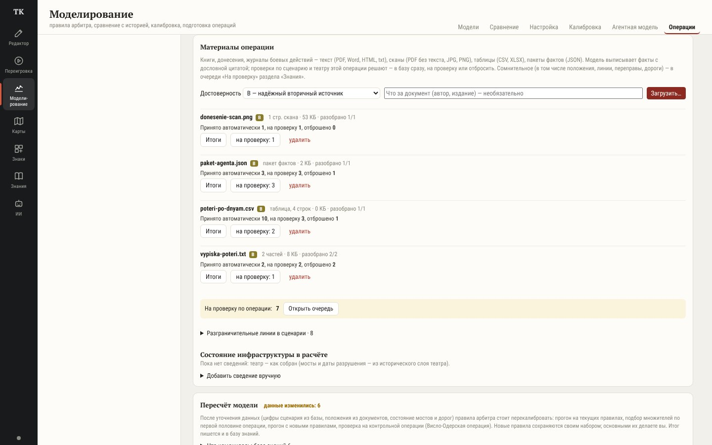

*Два проверочных документа — о переправах и с директивами о разграничительных линиях; вкладки извлечённого: инфраструктура, база знаний, положения, разграничительные линии. По переправам модель выписала три сведения — мост у Фюрстенвальде взорван 16.04 (на театре такого моста нет — останется сведением), понтонная переправа у Франкфурта наведена 17.04, шоссе у Зелова заминировано 16.04 (в радиусе 1,8 км дорога не даёт дорожного темпа).*

База знаний сгруппирована по операциям: у каждой операции свой раздел, а общие сведения
(организация, вооружение, доктрина) — отдельно, чтобы материалы разных операций не смешивались.
В разделе «Знания» операция выбирается вверху; модель отвечает на вопросы только по материалам
базы, со ссылками.

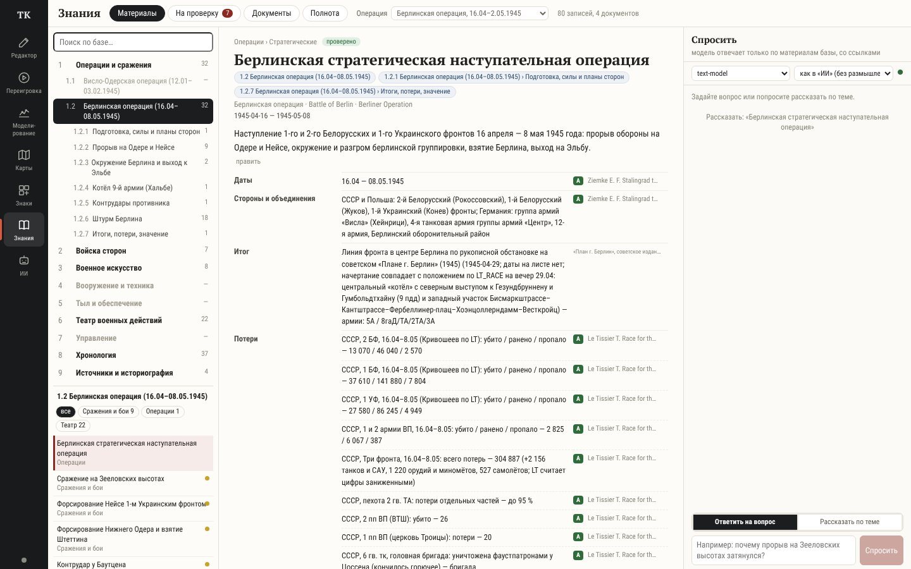

*Раздел «Знания»: рубрикатор слева, запись об операции с фактами, источниками и достоверностью, справа — вопросы к модели по базе.*

### 8.2. Полнота материалов по каркасу

Полнота — **не мнение модели**, а проверка по каркасу базы знаний: из данных операции
(сценарий, история, театр) стенд выводит, какие элементы должны быть описаны, и для каждого —
какие сведения должны быть, а затем ищет их в записях базы.

| Раздел | Группа | Что требуется | Вес |
|---|---|---|---|
| Войска и командование | Формирования | по каждому действующему: подчинённость, командир, состав, численность, танки, орудия, боевой путь в операции | 0,16 |
| | Командование | командующие армий и фронтов: звание, должность, ключевые решения | 0,06 |
| | Положения по дням | в какие дни известно положение формирования | 0,10 |
| | Исходные положения войск | положение каждого формирования на начало операции — входные данные расчёта: известно, достоверность A/B, неопределённость не больше 5 км | 0,12 |
| | Разграничительные линии | по каждой паре соседних фронтов (групп армий) стороны: линия известна (директива в сценарии или факт базы), источник, достоверность A/B | 0,02 |
| Местность и инфраструктура | Пункты и районы | цели приказов и места событий: что это, где, особенности, оборона, значение | 0,10 |
| | Рубежи и укрепления | где, устройство, кто оборонял, значение | 0,09 |
| | Реки | особенности, мосты и переправы, значение | 0,02 |
| | Мосты и переправы | известно ли состояние моста на большой реке района | 0,04 |
| Ход операции | Операция | даты, стороны, замысел, силы, итог, потери, разграничительные линии | 0,05 |
| | Сражения и бои | по каждому участку: даты, место, силы, ход, исход, потери | 0,08 |
| | События | запись о каждом ключевом событии истории (±1 сут) | 0,12 |
| | Погода и грунт | погода, дороги, ледостав | 0,02 |
| Стороны | Организация и тактика | наступление, оборона, бой в городе, форсирование, рода войск, тыл | 0,04 |
| | Вооружение и техника | тип, вооружение, броня, масса, скорость, экипаж, дальность | 0,04 |
| | Нормативы | нормативы и допущения модели для проверки правил: запись, источник, достоверность A/B (у допущения источника нет — пробел) | 0,02 |
| Источники | Источники | ≥ 3 документов операции, из них хотя бы один A; 80 % фактов с источником | 0,02 |

Полнота элемента — доля требуемых сведений, полнота группы — среднее по элементам (формирования
взвешены по уровню: фронт и армия весят больше дивизии), итог — взвешенное среднее групп.
Уровни: **от 75 %** — достаточно (✓, зелёный), **45–75 %** — частично (◐, жёлтый), **меньше 45 %** —
мало (✕, красный): сначала собрать материалы. Уровень всегда показан значком и словом, не только
цветом. Полнота видна в карточке операции, в «Знаниях» (вкладка «Полнота») и в «Переигровке».


*Полнота Берлинской операции: 39 % («мало»). По разделам: войска и командование 45 %, местность и инфраструктура 16 %, ход операции 51 %, стороны 36 %, источники 24 %. Ниже — что искать в первую очередь: орудия и миномёты (нет у 66 из 66 формирований), боевой путь, численность, дни с положением.*

**Полнота общих знаний.** Когда вверху выбрано «общие (без операции)» или «все материалы», вкладка
«Полнота» считает рубрики каркаса, не привязанные к операции: войска сторон, военное искусство,
вооружение, тыл, театр, управление, источники. По каждой рубрике — сколько записей и сколько из них
черновиков; сводка «заполнено — мало (1–2 записи) — пусто» и список «чего не хватает» со ссылками:
щелчок открывает рубрику в «Материалах». Операции и хронология считаются у операций. Ниже —
нормативы модели (norms.json): у каждого ли есть запись в базе с источником.

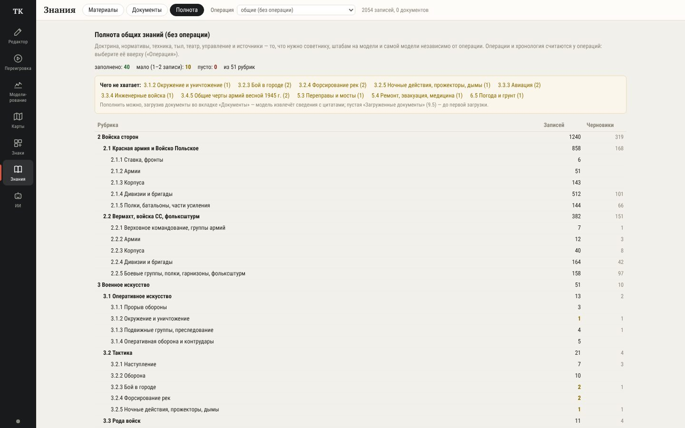

*Полнота общих знаний: 2054 записи без операции; из 51 рубрики 40 заполнены, в 10 — по одной-две
записи (окружение, бой в городе, форсирование, ночные действия, авиация, инженерные войска, общие
черты армий, переправы, ремонт и медицина, погода) — они перечислены вверху; ниже — таблица рубрик
с числом записей и черновиков.*

**Веса — по чувствительности к данным.** Веса групп сведены по тому, сколько сходства с историей
стоит плохое или отсутствующее сведение (раздел 21): исходные положения войск — новая группа с весом
0,12 (ошибка положений на допуск сравнения стоит 7–14 п. п.), рубежи и укрепления выросли до 0,09
(без полос Берлинская теряет 9,5 п. п.), формирования снизились до 0,16 (численность на положения
влияет слабо), а разграничительные линии (0,02), реки (0,02) и мосты (0,04) — снизились: сейчас
они сходство почти не меняют. Это не оценка важности для игрока и не пожелание, а следствие
двух расчётов; пересматривать веса нужно после каждого заметного изменения модели. Группа «Исходные
положения войск» берёт положение формирования на начало из истории операции (первая запись
в пределах полутора суток от начала) и считает его заполненным на треть за каждое из трёх: положение
известно, достоверность A или B, неопределённость не больше 5 км. По сценариям (формирования
кроме фронтов; известно / A или B / точность до 5 км):

| Операция | СССР | Германия |
|---|---|---|
| Берлинская | 23 / 20 / 0 из 23 | 24 / 15 / 9 из 24 |
| Бой в Берлине | 16 / 16 / 15 из 16 | 15 / 6 / 15 из 15 |
| Висло-Одерская | 14 / 6 / 0 из 27 | 28 / 14 / 1 из 28 |

Пробел главный в Висло-Одерской у советской стороны (положение на начало есть только у половины)
и во всех операциях по точности: оценки, а не привязки к документам.

**Наглядность дефицитов.** У каждой группы — полоса полноты и раскрывающаяся матрица «элемент ×
сведение» (есть / нет) с фильтром по стороне; над матрицей — по каждому сведению, у скольких
элементов оно есть. **Карта пробелов** показывает элементы на местности цветом уровня:
формирования (▲ СССР, ▼ Германия), пункты, мосты и переправы, участки боёв, события; щелчок по
знаку раскрывает его группу.

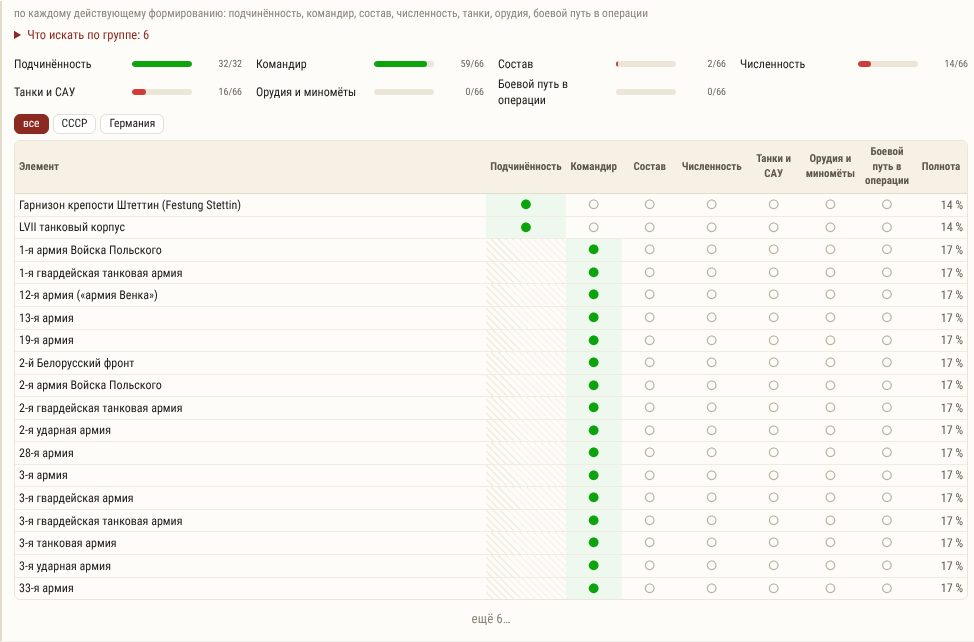

*Группа «Формирования»: подчинённость есть у 32 из 32, командир — у 59 из 66, а состав, численность, танки, орудия и боевой путь — почти ни у кого.*

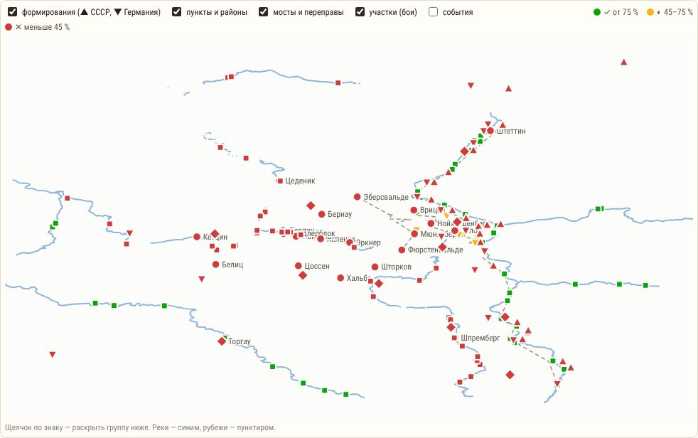

*Карта пробелов: красное — мало сведений, зелёное — достаточно. Хорошо описаны мосты на Одере (зелёные квадраты), плохо — пункты и формирования в глубине.*

**Разграничительные линии.** Пары соседей стенд находит по полосам в начале операции (раздел
19.8): чьи полосы граничат, те и соседи. Линия считается известной, если в сценарии есть линия
по директиве для этой пары или в записи одного из соседей есть факт «разграничительные линии», где
назван другой. Без линии полоса в модели — расчётная (по расположению войск); это и показывает
группа.

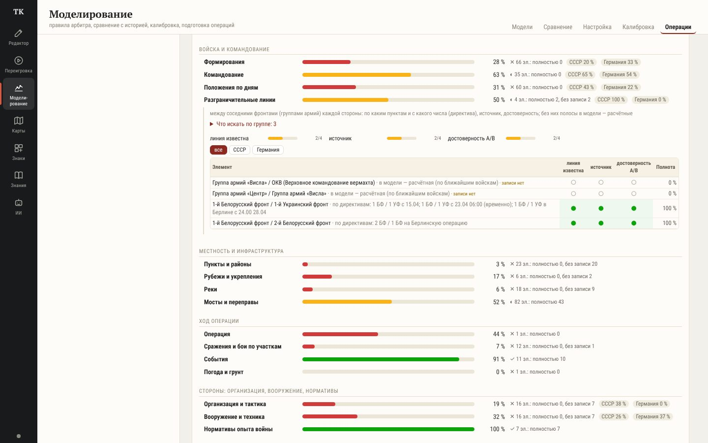

*Берлинская операция: обе пары советских фронтов — по директивам (A и B), пары немецких групп армий («Висла» / «Центр», «Висла» / ОКВ) — без записей: в модели расчётные.*

**Подсказки, что искать.** По дефицитам стенд составляет подсказки: что найти («Численность —
нет у 52 из 66 формирований»), зачем это модели (на что влияет в расчёте), где обычно есть такие
сведения (типы источников и известные издания: ЦАМО и «Память народа», «Боевой состав Советской
армии», журналы боевых действий, Le Tissier, Исаев, Ziemke), готовые поисковые запросы по-русски,
по-немецки и по-английски и элементы, у которых сведений нет. Порядок — по пользе для модели:
вес группы × важность сведения для расчёта × доля, которой не хватает. Весь список выгружается
файлом «Что собрать (.md)» — задание на поиск материалов.

### 8.3. Сверка базы знаний со сценарием

База знаний — общее место сведений об операции; расчёт же берёт численность, танки и орудия из
сценария. Панель «Сверка с базой знаний» в карточке операции связывает их в обе стороны.

**База → сценарий.** Для каждого действующего формирования стенд находит записи базы (по id
сценария в синонимах записи или по названию) и факты «численность», «танки и САУ», «орудия» на
начало операции: без даты или датированные не позже чем через двое суток после начала; факты с
оговоркой «не численность на …» не берутся. Из нескольких выбирается самый достоверный (A, затем
B, C). Танки и САУ, записанные отдельными фактами, складываются — в сценарии они вместе.
Численность в сценарии боевая (раздел 18.1), поэтому списочная численность из базы умножается на
долю боевых войск (0,6 — советские, 0,75 — немецкие), если факт не назван боевым. Расхождение
больше 5 % (и больше 500 человек, 5 танков, 20 орудий) — предложение исправить сценарий, с
источником, достоверностью и цитатой.

Принятое ложится **правкой операции** поверх сценария (встроенный сценарий в сборке не
меняется): прежнее значение запоминается, правку можно вернуть. Правки действуют везде — в
переигровке, игре, сравнении и калибровке.

**Сценарий → база.** Сведения, которыми расчёт уже пользуется, а в базе их нет, предлагается
внести в базу: цифры сценария (как оценку стенда — достоверность C, с пометкой, как получены),
подчинённость, а также **боевой путь** — положения по дням из истории сценария с её источниками.
Записи формирований, которых в базе нет, создаются. Так база знаний описывает то, на чём стоит
модель, и видно, что ещё держится на оценках.

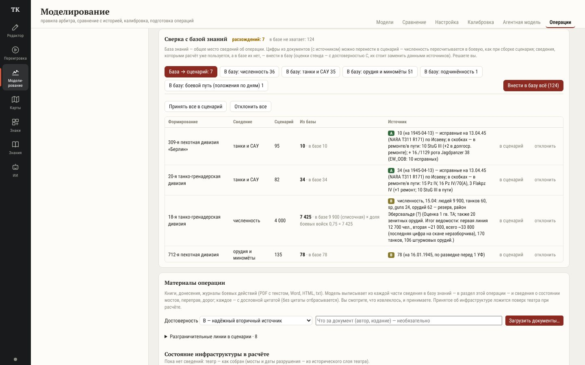

*Берлинская операция: три расхождения «база → сценарий» — танки трёх немецких дивизий (в сценарии — по распределению численности армии, в базе — исправные на 13.04 по Исаеву), и 187 сведений, которых в базе нет: численность, танки, орудия, боевой путь.*

### 8.4. Положения и разграничительные линии из документов

При разборе документа операции модель выписывает и положения формирований: кто, в какой день,
у какого пункта — с дословной цитатой. Положение без даты, без места или без цитаты в тексте
отбрасывается. Стенд сопоставляет формирование со сценарием (по названию, синонимам записей
базы или по номеру и роду: «8 гв. армия» — «8-я гвардейская армия») и пункт — с театром.

Принятое положение ложится:

- **в базу знаний** — фактом «боевой путь» записи формирования, с цитатой и документом;
- **в историю операции** — если формирование есть в сценарии, а пункт на театре: с
  неопределённостью по ступени (армия ±15 км, корпус ±8, дивизия ±5) и с достоверностью
  документа. По нему сверяется расчёт и идёт калибровка; полнота «Положения по дням» растёт.

Положения в истории видны списком; любое можно убрать (в базе факт остаётся).

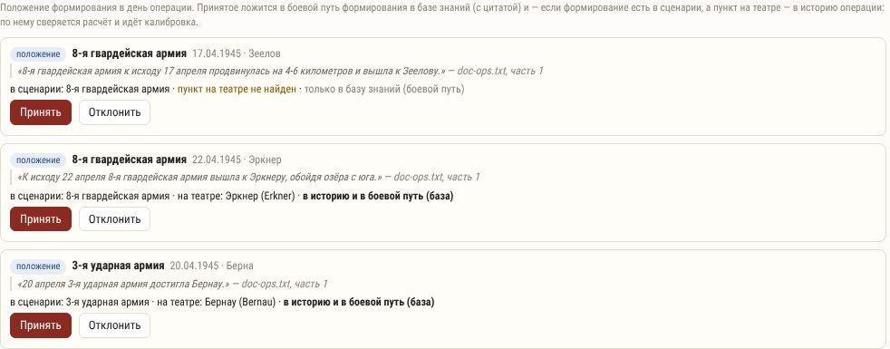

*Три положения из проверочного документа: два ложатся и в историю, и в базу; для третьего пункт «Зеелов» на театре не найден (там «Зелов») — только в базу.*

**Разграничительные линии.** Из директивы или приказа модель выписывает линию: два объединения
(если документ адресован одному из них — «с 1-м Белорусским фронтом», — второе берётся
адресатом), с какого и до какого числа, пункты по порядку, чьи пункты включительно, оговорки
(«до Люббен прежняя»), с цитатой. Без цитаты, без двух объединений или двух пунктов линия
отбрасывается. Стенд сопоставляет объединения со сценарием (включая фронты), пункты — с театром,
и определяет, чья полоса справа по ходу линии (по положению войск объединений в начале
операции). Принятая линия ложится:

- **в базу знаний** — фактом «разграничительные линии» в записи обоих объединений, с цитатой
  и документом;
- **в сценарий операции** — если оба объединения есть в сценарии, а на театре нашлись хотя бы два
  пункта: полосы в расчёте и линия на карте переигровки (ненайденные пункты — в примечании).
  Линия той же пары с тем же сроком заменяет прежнюю.

Линии сценария видны списком («Разграничительные линии в сценарии»); добавленную из документа
можно убрать (в базе факт остаётся).

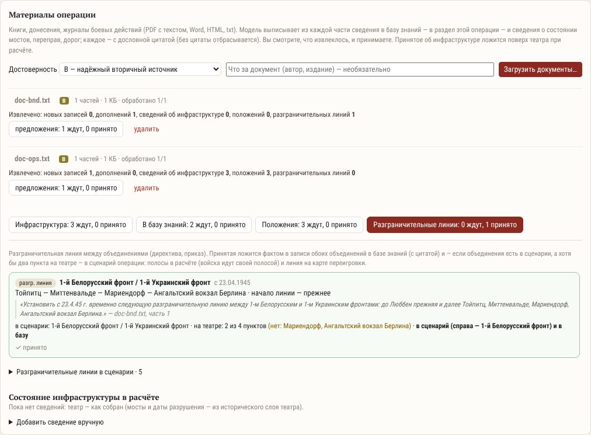

*Директива о линии 1 БФ / 1 УФ с 23.04: на театре найдены два пункта из четырёх (Тойпитц, Миттенвальде); справа по ходу линии — 1-й Белорусский фронт; линия принята в сценарий и в базу.*

### 8.5. Пересчёт модели

Каждое изменение данных операции записывается: правка сценария, положение в истории, сведение
об инфраструктуре, внесение в базу. Панель «Пересчёт модели» показывает, что изменилось после
последнего пересчёта, и одной кнопкой:

1. прогоняет операцию на текущих правилах (5 прогонов) — «до»;
2. подбирает множители правил (раздел 21) по первой половине операции: каждый вариант — по двум
   прогонам; 32, 64 или 128 вариантов;
3. перепроверяет три лучших варианта на тех же пяти прогонах, что и «до», и берёт лучший по
   мерилу; если лучше текущих правил ничего нет — правила остаются прежними, и это сказано;
4. прогоняет контрольную операцию (для Берлинской — Висло-Одерскую) со старыми и новыми
   правилами: стало хуже больше чем на 2 % положений — предупреждение о подгонке;
5. сохраняет новые правила своим набором и пишет отчёт: что изменилось в данных, до и после,
   множители, контрольная.

Основными новые правила делает человек («Сделать основными»): набор становится первым в
«Переигровке» и исходным для следующего пересчёта; вернуть встроенные можно в любой момент.
Если на контрольной операции стало хуже, стенд просит подтверждения.

**Итог пересчёта пишется в базу знаний** — в запись «Калибровка модели: <операция>» (рубрика
«Устройство модели стенда»): отчёт целиком и факт с числами до и после. Советнику в игре такие
записи не подаются.

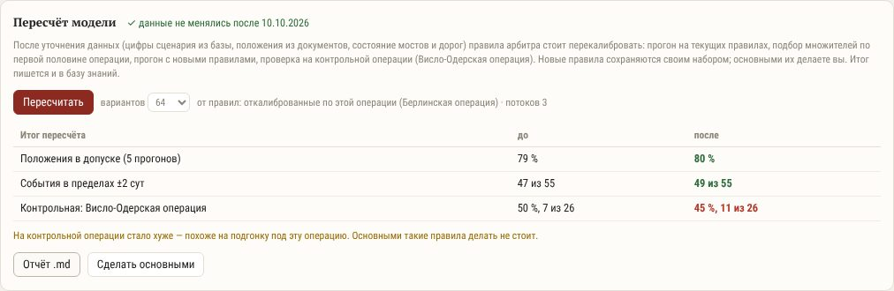

*Пересчёт после сверки и положений из документа (64 варианта): положения 79 → 80 %, события 47 → 49 из 55, но на контрольной операции положения 50 → 45 % — стенд предупреждает о подгонке и не предлагает делать такие правила основными без подтверждения.*

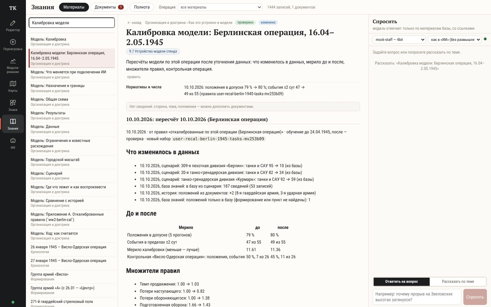

*Запись «Калибровка модели» в разделе «Знания»: что изменилось в данных, мерило до и после, сдвинутые множители.*

## 9. ИИ: языковые модели

Языковые модели работают на компьютере пользователя через LM Studio (или любой сервер с
совместимым API); данные наружу не уходят. Роли:

| Роль | Что делает |
|---|---|
| Штаб противника | решение на ход за немецкую сторону: оценка, замысел, приказы, доклады |
| Советник | ответы игроку, варианты решения на ход |
| Посредник | ограниченные поправки к боям с опорой на базу знаний (по выбору) |
| Ставка | разграничительные линии между фронтами в игре, когда обстановка разошлась с историей или есть ходатайство (по выбору) |
| Разбор | отчётный документ по записи игры |
| Знания | разбор документов, ответы и рассказы по базе |
| Эмбеддинги | смысловой поиск по базе знаний |

Для каждой роли можно выбрать модель и режим размышления. Без LM Studio систему проверяют на
подставной модели (`npm run llm:mock`): её ответы простые, только для проверки интерфейса.
Решения модели проверяются программно: что не сопоставилось с обстановкой, не исполняется и
помечается с причиной.

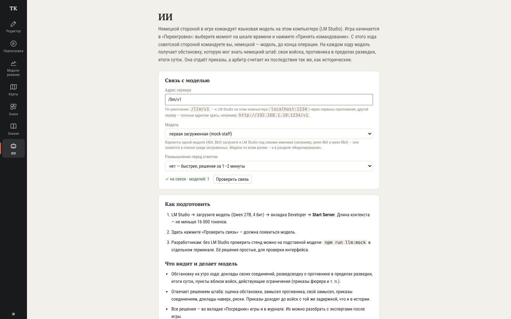

*Связь с моделью: адрес сервера, модель, размышление; как подготовить LM Studio и что видит модель.*

## 10. Архитектура

Монорепозиторий: библиотеки, микросервисы за API-шлюзом и редактор.

```
                 ┌────────────────────────── браузер ──────────────────────────┐
                 │  apps/editor (React)                                         │
                 │   ├─ @def-ops/core        — знаки, слои, SVG, GeoJSON        │
                 │   ├─ @def-ops/sim         — арбитр (в фоновых потоках)       │
                 │   ├─ @def-ops/knowledge   — база знаний, поиск, полнота      │
                 │   ├─ @def-ops/api-client  — клиент API                       │
                 │   └─ engine/MapEngine     — адаптер карты (MapLibre)         │
                 └──────────────┬──────────────────────────────┬────────────────┘
   внешние системы ─ ключ ─►  /api/*                         /llm ──► LM Studio (на машине пользователя)
                 ┌──────────────▼───────────────┐
                 │ services/gateway :8080       │ ключ → организация, маршрутизация, статика
                 └──┬──────────┬──────────┬─────┴──────────────┐
                    ▼          ▼          ▼                    ▼
              documents     render     registry          cartography
               :8101         :8102      :8103               :8104
            карты, ревизии  SVG,       объекты,           подложки офлайн:
            слои, события   GeoJSON    факты во времени   тайлы, сканы, пакеты
                    │                     │                    │
                    └────────► PostgreSQL + PostGIS ◄───────────┘    том tiles-data
```

| Часть | Ответственность |
|---|---|
| `packages/core` | модель документа, слои, геопривязка, рендер знаков в SVG, GeoJSON; без зависимостей от окружения — тот же код рисует в редакторе и на сервере |
| `packages/sim` | симулятор операций: театр, арбитр, игра, доклады, сравнение с историей, калибровка |
| `crates/agents-core` | ядро агентной модели (Rust, в разработке; считает в приложении `apps/agents` и в «Переигровке» настольного приложения): дивизии с машиной состояний, штабы, объекты, часовой шаг с параллельным и воспроизводимым расчётом; сценарии — вся Берлинская операция (347 соединений) и Зееловские высоты (79 дивизий) со сверкой с историей; замысел — [plans/agents.md](plans/agents.md) |
| `packages/knowledge` | база знаний: каркас, рубрикатор, поиск, извлечение из документов, полнота, подсказки, сверка со сценарием |
| `packages/service-kit`, `packages/db`, `packages/api-client` | каркас сервисов, PostgreSQL с миграциями по схемам, клиент API |
| `services/gateway` | единая точка входа: API-ключи → организации, маршрутизация, CORS, статика редактора |
| `services/documents` | хранение карт: ревизии, оптимистичная блокировка, слои, события (SSE) |
| `services/render` | SVG и GeoJSON по документу (в т. ч. на момент времени), импорт GeoJSON, каталог знаков; без состояния |
| `services/registry` | реестр объектов: типы и схемы характеристик, факты во времени, пространственно-временные запросы (PostGIS) |
| `services/cartography` | карты-подложки офлайн: тайловые пирамиды, загрузка тайлов, нарезка сканов, пакеты, импорт карт других программ |
| `services/staff` | промпты и разбор ответов языковой модели: штаб, советник, посредник, разбор; контрольные обстановки; подставная модель |
| `apps/editor` | приложение: все разделы |
| `crates/agents-tauri` | команды Tauri агентной модели (прогон, данные, языковая модель) — общие для `apps/agents` и `apps/desktop` |
| `apps/desktop` | настольное приложение (Tauri): редактор, сервисы фоновым Node-процессом, агентная модель в «Переигровке» с карточкой агента, разговором и игрой |
| `apps/agents` | приложение агентной модели (Tauri): карта театра, ход по часам, карточка агента, разговор с агентом; расчёт — `crates/agents-core` |

Принципы: предметная логика — в библиотеках без окружения; сервисы по ответственности, общение
по HTTP/JSON; снаружи доступен только шлюз; открытые форматы (JSON по OpenAPI, GeoJSON, SVG со
слоями); заменяемые части за интерфейсами — хранилище, картографический движок, подложки, шина
событий. Подробно — [architecture.md](architecture.md).

## 11. Данные и хранение

| Данные | Где |
|---|---|
| Карты (документы) с ревизиями | PostgreSQL, схема `documents` (без БД — файлы); в браузере — черновик |
| Реестр объектов и факты во времени | PostgreSQL + PostGIS, схема `registry` |
| Карты-подложки | том `tiles-data` (тайлы по организациям), описание — схема `cartography` |
| Встроенные операции: сценарии, театры, история, правила, профили | в сборке (`packages/sim/data`) |
| Исторические наборы данных (выписки из источников) | `docs/sources` — только факты и пересказы, без текстов книг |
| Начальная база знаний | в сборке (`packages/knowledge/data/seed.json`) |
| Свои операции, театры, правила, сведения об инфраструктуре, правки операций, игры | браузер (IndexedDB) |
| Слой пользователя базы знаний: записи, документы, предложения | браузер (IndexedDB); выгрузка и загрузка файлом |

У каждой организации — свои данные (`X-Tenant-Id` выставляет шлюз по ключу). Модель реестра и
времени — [data-model.md](data-model.md).

## 12. Интеграция

- **REST API** через шлюз (`/api/...`), контракт — [openapi.yaml](openapi.yaml);
  типизированный клиент `@def-ops/api-client` для браузера и Node.
- **GeoJSON** в обе стороны; внешняя система может владеть своим слоем карты.
- **Поток событий** (SSE): изменения карт, реестра, ход заданий картографии.
- **Другие картографические движки** — реализацией интерфейса `MapEngine`; подложки XYZ/WMS — без кода.
- **Языковая модель** — любой сервер с API, совместимым с OpenAI (LM Studio по умолчанию).

## 13. Развёртывание

**Одной командой** (Docker Desktop или Docker Engine с Compose v2; ~4 ГБ памяти):

```bash
./scripts/start-local.sh            # macOS / Linux
.\scripts\start-local.ps1           # Windows (PowerShell)
```

Открывается `http://localhost:8080/` — приложение со всеми сервисами и PostgreSQL + PostGIS.
`stop`, `logs`, `reset` — остановить, журналы, удалить данные; `PORT=…` — другой порт.

**Закрытый контур.** На машине с интернетом `./scripts/offline-bundle.sh` собирает архив со
всеми образами и конфигурацией (~300 МБ); на целевой машине — распаковать и `./install.sh`
(Windows: `install.ps1`). Карты-подложки переносятся пакетами из раздела «Карты». Языковая модель —
LM Studio на машине пользователя.

**Настольное приложение** (`apps/desktop`, Tauri: macOS, Windows, Linux) — вся система на одной машине без Docker и
СУБД: окно приложения поднимает сервисы фоновыми процессами на `127.0.0.1` (документы, рендер, реестр, картография,
шлюз), данные — в папке данных приложения (документы и тайлы — файлами, реестр и описания карт — в памяти с записью в
JSON-файл), редактор отдаёт шлюз, языковая модель — LM Studio на этой же машине (шлюз пропускает `/llm/…`). Сборка
театров (Python с GDAL) в приложении выключена. Агентная модель считается в самом приложении (ядро на Rust, данные —
`packages/sim/data` в ресурсах): «Переигровка» предлагает её как вторую модель расчёта (раздел 6). Разработка — `npm run desktop:app` (редактор из vite, сервисы из
исходников); сборка установщика — `npm run desktop:build` (Node, собранные сервисы и редактор — внутри приложения). Пока
сервисы поднимаются, окно показывает страницу запуска, затем открывает редактор. Backspace вне поля ввода
историю окна не листает (в WebKit это «Назад»); если окно всё же вернулось на страницу запуска при уже работающих
сервисах, оно сразу снова открывает редактор.

**Доступ.** `AUTH=keys` и `API_KEYS="ключ:организация,…"` — обязательные ключи по организациям;
в разработке ключ не нужен. Корпоративный прокси и свои сертификаты поддерживаются при сборке.

## 14. Разработка и проверка

```bash
npm ci                    # зависимости ровно по package-lock.json
npm run dev               # приложение: http://localhost:5173/
npm run dev:services      # сервисы для разработки (шлюз :8080); без БД — файлы и память
npm run llm:mock          # подставная модель вместо LM Studio
npm run sim:demo          # переигровка трёх операций из терминала, отчёты и карты
npm test                  # 221 проверка: ядро, сервисы через шлюз, симулятор, база знаний
npm run typecheck
npm run agents:test       # ядро агентной модели (нужен Rust: cargo)
npm run agents:bench      # замер ядра: 400 дивизий, 23 суток по часу, на разном числе потоков
npm run agents:berlin     # агентная модель: вся Берлинская операция, сверка по участкам вне настройки (report.md, summary.json — для «Отчёта»)
npm run agents:berlin-data # сборка сценария всей операции из реестра и переписи
npm run agents:berlin:variants # варианты для сравнения в браузере: штабы по доктрине, без артподготовки, без отвода
                          # (agents:app и agents:web сами пересчитывают устаревшие прогоны — scripts/agents-prepare.mjs)
npm run agents:seelow     # агентная модель: Зееловские высоты на дивизиях, сверка с историей и нынешней моделью
                          # (--de doctrine — штабы по доктрине; --de llm --llm-model <id> — на языковой модели;
                          #  --llm-reasoning, --llm-max-tokens, --llm-parallel auto|N, --llm-sync, --llm-by-army, --llm-probe)
npm run agents:app        # приложение агентной модели (Tauri; в браузере — npm run agents:web)
npm run desktop:app       # настольное приложение всей системы (Tauri): редактор, сервисы на этой машине
npm run desktop:build     # установщик настольного приложения для этой платформы
```

PDF и Word этого документа — `npm run docs:system` (нужны pandoc, python3 с python-docx и браузер
Playwright). Описание обновляется в том же коммите, что и доработка.


# Часть II. Модель переигровки

Часть описывает, как устроена симуляция в `packages/sim`. Она отвечает на вопросы: как
считается ход операции, на каких данных, откуда взяты числа, как модель проверяется по
истории и где она ошибается. Она написана для двух читателей: для специалистов-историков,
которые оценивают достоверность, и для разработчиков, которые будут развивать модель
(в первую очередь — подключать слой ИИ).

Запуск и просмотр — в [simulation-quickstart.md](simulation-quickstart.md), замысел всего
стенда — в [plans/simulation.md](plans/simulation.md).

## 15. Назначение и границы

**Что это.** Арбитр оперативного уровня: на карте реальной местности он двигает фронты, армии,
корпуса и дивизии, разрешает бои, ведёт подвоз и окружения. Каждая сторона получает приказы, а
арбитр считает, что из них получится. Сейчас обе стороны получают **исторические задачи** (из
книг и мемуаров). На следующем этапе немецкой стороной будет командовать языковая модель
(«немецкий штаб»), и арбитр будет так же считать последствия её решений.

**Чего модель не делает.** Она не воспроизводит историю по записанным положениям: положения
войск в расчёте получаются из задач, сил, местности и боёв. Исторические положения служат
только для проверки. Модель не моделирует батальоны, отдельные танки и авиацию поимённо:
единица — соединение или объединение с численностью, числом танков и орудий.

**Принцип универсальности.** Движок не знает про Берлин. Всё, что относится к конкретной
операции, лежит в данных: карта местности, профили сторон, правила боя, сценарий. Новая
операция — это новые данные, а не новый код. Это проверено на второй операции (Висло-Одерской)
без изменения правил (раздел 22).

**Масштабы.** Оперативный: клетка местности 2 км, ход 24 часа (Берлинская и Висло-Одерская
операции). Городской: клетка 250 м, ход 12 часов (бой в Берлине 24.04–2.05).

## 16. Общая схема

```
 Источники: книги, мемуары, Ziemke, Википедия с опорой на монографии
   │  извлечение фактов: положения, задачи, численность, события
   │  (у каждой записи — источник и достоверность)
   ▼
 Исторические наборы ............................ docs/sources/*.json
   │
   ▼
 Рецепт сценария ................... data/scenarios/src/*.recipe.json
   │
   ▼
 Сценарий + ожидаемая история ........ data/scenarios/*.json, *.history.json
   │
   │   Карта местности ................... data/theatres/*.json
   │     ◄ сборщик ◄ рецепт местности
   │     ◄ ESA WorldCover, Copernicus DEM, OpenStreetMap
   │     ◄ дорожная карта РККА 1:1 000 000, «План г. Берлин» 1945
   │     ◄ исторический слой по карте пользователя (раздел «Карты»)
   │   Состояние инфраструктуры операции  мосты, переправы, дороги
   │     ◄ документы операции (разбор моделью, с цитатой) или вручную
   │   Профили сторон, правила боя ....... data/profiles, data/rules
   ▼
 Движок: ход за ходом ................ packages/sim/src/step.ts
   ├─► сравнение с историей: положения, события ......... report.md
   ├─► калибровка правил по истории (обучение / проверка)
   └─► карта для редактора: знаки по ходам, фронт, бои, отметки ... map.json

 Документы операции ──► база знаний (раздел операции) ──► полнота по каркасу
                              │  ▲                        └─► подсказки: что искать
          сверка: цифры ──────┘  └── сведения сценария и истории, итоги калибровок
                    ▼
   сценарий, история (положения по дням) ──► пересчёт: калибровка, контрольная
```

## 17. Данные

### 17.1. Исторические наборы (`docs/sources/`)

| Файл | Что | Объём |
|---|---|---|
| `infantry-mobility-1944-45/` | Моторизация и темп стрелковых соединений 1944–45: штаты (04/550), автотранспорт армий (Davie, JSMS 2018 и 2021), нормы марша БУП-42, темпы в преследовании в других операциях (Glantz, Радзиевский, Сборник ВИМ ВОВ), русскоязычные источники; четыре файла заметок с достоверностью A/B/C, страницей и цитатой, выводы исследователей помечены как выводы | 4 файла |
| `german-defence-vistula-1945/` | Немецкая оборона перед Висло-Одерской: численность, плотность, глубина, резервы, соотношения сил — русские источники (БСЭ, Мурьев, Чуйков, Конев, Жадов) и зарубежные (Ziemke, Lakowski через Wikipedia); достоверность A/B/C, страница, цитата; чего нет — перечислено | 2 файла |
| `orders-timing-1945.json` | Сроки отдачи приказов и директив по документам: директивы Ставки и фронтов («Русский архив», тт. 15 и 16, A), воспоминания командующих (B); источник со страницей и цитатой; часовой пояс — МСК | 35 записей |
| `start-positions-1945.json` | Исходные положения войск на начало операций по источникам A/B: участки и районы с неопределённостью по самому источнику; точных (до 5 км) положений в доступных источниках нет; в сценарии не внесены | 48 записей |
| `berlin-1945-positions.json` | Берлинская операция: объединения (фронты, армии, корпуса), численность на 16.04, положения по дням, линии фронта, события; справочник мест | 54 объединения, 260 положений, 22 участка линии фронта, 40 событий |
| `berlin-1945-oob.md` | Боевой состав и численность с разбором источников | — |
| `berlin-1945-seelow-divisions.json` | Дивизии на Зееловских высотах (LVI тк, XI тк СС, CI ак) и советские корпуса первого эшелона; оборонительные полосы | 18 немецких дивизий и бригад, 23 советских корпуса, 165 положений |
| `berlin-1945-halbe.json` | Котёл Хальбе по Le Tissier, *Slaughter at Halbe* | 202 формирования, 187 положений, 91 приказ |
| `berlin-1945-reichstag.json` | Бой в Берлине по Le Tissier, *Race for the Reichstag*: секторы обороны A–H, Z, рубежи, положения, артиллерия, справочник мест города | 638 формирований, 208 положений, 50 приказов |
| `berlin-1945-conquest.json` | Факты для калибровки по Le Tissier, *Soviet Conquest: Berlin 1945* (темпы, потери, продолжительность боёв) | 89 фактов |
| `berlin-1945-city-garrison.json` | Гарнизоны секторов Берлина (доли от ~60 000) и гарнизон башни «Зоо» | — |
| `berlin-1945-plan-frontline.json` | Линия фронта на 29.04 по советскому «Плану г. Берлин» 1945 г. (обвод по карте) | 201 точка |
| `berlin-1945-boundaries.json` | Разграничительные линии фронтов по директивам Ставки ВГК № 11059/11060 (с 15.04), 11074 (с 23.04), 11077 (с 24.00 28.04), 11078 (с 6.05), линия 2 БФ / 1 БФ по мемуарам К. К. Рокоссовского, бомборазграничительная линия с ВВС союзников (директива Генштаба № 10850): пункты с координатами, сроки, чьи пункты включительно, архивные шифры (ЦА МО РФ, Ф. 3 Оп. 11556 Д. 18), короткие цитаты; пробелы в данных | 6 линий, 25 пунктов |
| `german-1945-boundaries.json` | Разграничительные линии немецких групп армий и армий: Берлинская операция — 3 ТА / 9 А (Хоэнзатен — Одерберг — Финов-канал — Либенвальде, 16–21.04), ГА «Висла» / ГА «Центр» с 16.04 (Фюрстенберг — Либерозе — Люббен) и с 20.04, когда V ак перешёл в 9 А (Форст — южнее Котбуса — Калау), ГА «Висла» / 12 А (ОКВ) с 23.04 (Хеннигсдорф — Кремен — Нойруппин — Кириц — Дёмиц); Висло-Одерская — ГА «А» / ГА «Центр» по Висле от Модлина, 9 А / 4 ТА, 4 ТА / 17 А (12–19.01), ГА «Висла» / ГА «А» с 27.01 (Глогау — Шпротау — Загань). Приказов и оперативных карт ОКХ в открытом доступе нет: линии восстановлены по Э. Зимке («Stalingrad to Berlin»), обзорам с опорой на журнал боевых действий ОКВ и по флангам соединений; достоверность B (точки стыка) и C (ход линии в глубину), у каждой точки — основание; пробелы и где их закрыть (фонды BArch RH 19-XV, NARA T-311) | 8 линий (7 в сценариях: в Висло-Одерском нет ГА «Центр»), 33 точки |
| `vistula-oder-1945.json`, `vistula-oder-1945-divisions.json` | Контрольная операция: армии, корпуса и дивизии, положения, задачи, события | 46 + 34 формирования, 220 + 83 положения, 137 + 61 задача |
| `vistula-oder-1945-tsamo.json` | Висло-Одерская по журналам боевых действий армий и корпусов (ЦАМО РФ, через портал «Память народа»): по дням — рубеж главных сил, передовые отряды, КП армии, характер действий; у каждой записи — шифр (фонд, опись, дело, лист) и ссылка на документ, координаты с радиусом неопределённости. Главные силы армий внесены в историю сценария (надёжность A) вместо прежних записей B/C тех же армий за те же дни | 12 армий, 403 записи (300 — главные силы, 56 — передовые отряды, 47 — КП) |
| `vistula-oder-1945-tsamo-2/` | Вторая выборка ЦАМО по Висло-Одерской: журналы 1 УФ за январь — 3.02, журналы 1 гв. ТА, 3 гв. ТА, 47, 60, 61 А, 5 гв. А, 9, 11, 31 тк, 7 гв. кк, доклад 4 ТА об операции. Пять файлов по схеме `docs/tsamo-agent-task.md`: положения по дням (`positions.json`), приказы и директивы с временем отдачи и получения (`orders.json`), немецкие соединения по разведсводкам — прибытие, район, численность (`enemy.json`), горючее и боеприпасы в заправках и боекомплектах, дни «без горючего» (`supply.json`), перечень дел с прочитанными листами и пробелами (`manifest.json`) | 25 дел; 431 положение, 133 приказа (в том числе директива 1 БФ на прорыв от 2.01), 82 записи о противнике, 52 о снабжении (справки 1 БФ на 1, 10, 20.01, отчёт тыла 1 гв. ТА, тыловые сводки 3 гв. ТА за апрель) |
| `berlin-1945-tsamo/` | Берлинская операция по журналам 1 БФ за апрель — май, 1 УФ за апрель и май, 3, 28, 33 А: положения армий по дням (`positions.json`), распоряжения фронтов армиям (`orders.json`), разведсводки — окружённая 9-я армия, Берлинский гарнизон, группировка у Гёрлица и Бауцена (`enemy.json`); перечень дел — в `vistula-oder-1945-tsamo-2/manifest.json` | 404 положения, 47 приказов, 27 записей о противнике |
| `../document-requests.md` | Какие документы нужны для уточнения модели и где их искать (журналы боевых действий и отчётные карты армий, сводки фронтов, немецкие карты обстановки) | — |

**Каждая запись имеет источник и достоверность:**

- **A** — первоисточник или академическое исследование, прочитанное при составлении (журналы боевых действий армий из ЦАМО; Ziemke, *Stalingrad to Berlin*, CMH 1968; книги Le Tissier; Lexikon der Wehrmacht по дивизиям);
- **B** — Википедия (ru/de/en/pl) со ссылкой на монографии: Исаев, Lakowski, «История Второй мировой войны» т. 10, Конев, Рокоссовский и др.;
- **C** — вывод составителя (интерполяция между соседними фактами, положение по полосе корпуса, оценка численности). Причина указана в примечании записи.

У каждого положения есть **радиус неопределённости** `approx_km`: насколько точно известно,
где находились главные силы. В черте Берлина это 0,2–5 км, для армии в поле — 5–15 км, для оценок
составителя — 15–50 км. Этот радиус учитывается при сравнении с расчётом (раздел 20).

**Расхождения источников** не сглаживаются: оба варианта отмечены (⚠) в примечании, в данных
выбран один с объяснением. Например, окружение 9-й армии 24.04: у Ziemke встреча у Бонсдорфа,
по de-wiki — Шёнефельд; пункты в ~5 км, взята середина.

Тексты книг в репозитории не хранятся — только извлечённые факты и короткие пересказы.

**Разграничительные линии** взяты из опубликованных подлинных директив (сборник «Русский архив:
Великая Отечественная», т. 15 (4-5), М., 1995) — достоверность A; линия 2-го и 1-го Белорусских
фронтов — по пересказу директивы № 11053 в мемуарах Рокоссовского (B), её текст не найден.
Координаты пунктов — по OpenStreetMap (Nominatim) с пометкой, как определён пункт; «оз.
Енсдорфер-зее» прочитано по созвучию (озеро у Яновице, точность ~5 км). Не найдены: линия групп
армий «Висла» и «Центр», линии армий внутри фронтов, линия 1 БФ / 1 УФ в Висло-Одерской
операции — там полосы в модели расчётные (раздел 19.8); где искать — в файле и в подсказках
полноты (раздел 8.2). Сборщик сценария (`build_scenario.ts`, поле рецепта `boundaryFiles`)
берёт линии, оба объединения которых есть в сценарии и сроки которых пересекают его.

### 17.2. Местность (`data/theatres/`)

Карта местности — сетка клеток с классом покрова, дорогами, реками, мостами и укреплениями.
Её собирает `tools/theatre/build_theatre.py` по рецепту.

| Слой | Источник | Как используется |
|---|---|---|
| Покров (открытая, лес, болото, застройка, вода) | ESA WorldCover 10 m 2021 | доля классов в клетке по порогам рецепта (вода ≥ 50 %, застройка ≥ 35 %, болото ≥ 30 %, лес ≥ 50 %) |
| Высоты | Copernicus DEM GLO-90 | перепад в окрестности 3×3 клеток после сглаживания; «высоты» — перепад ≥ 35 м |
| Реки и каналы | OpenStreetMap (Overpass) | большие реки (Одер, Нейсе, Шпрее, Эльба, Хафель, Варта…) и проливы у побережья (Свина, Дзивна, Пенештром) — преграда; малые — задержка |
| Дороги, железные дороги | OpenStreetMap | шоссе — только автобаны, построенные к 1945 г. (по номерам дорог); остальные магистрали — обычные дороги |
| Мосты | пересечения дорог с большими реками | разрушены к датам по книгам (Одер — к 1.03, Нейсе — к 20.02, Эльба — к 20.04); советские переправы с датой открытия (Кюстрин с 31.03, Нейсе 16.04 и т. д.) |
| Оборонительные полосы | книги (Исаев, Le Tissier) | уровень укреплений 1–3, глубина, сторона: главная полоса на Одере (2, глубина 5 км), «Харденберг» (3), «Штейн», «Вотан», Нейсе; в городе — Цитадель, кольцо городской железной дороги (S-Bahn-Ring), внешнее кольцо |
| Районы | справочник мест наборов данных | цели задач и места событий |

**Историческая поправка.** Открытые данные описывают современность. Для Берлинской операции
подключены исторические карты:

- **дорожная карта РККА 1:1 000 000** заменяет современную сеть основных дорог на всём театре
  от Одера до Эльбы;
- **«План г. Берлин» 1945 г.** задаёт застройку, парки и воду города того времени;
  современная застройка, которой на плане нет, переводится в открытую местность.

Обе карты переведены в маски клеток инструментом `tools/theatre/raster_overlay.ts`: пиксели
классифицируются по цвету (тон, насыщенность, яркость) согласно «легенде» карты.

**Исторический слой по своей карте.** То же самое пользователь может сделать в стенде без
инструментов: в разделе «Карты → Театры» он выбирает подложенную карту того времени (свою,
загруженную в «Подложки»), указывает образцы цвета для дорог, шоссе, застройки, воды, леса и
болота (или готовую легенду), допуск цвета и уровень тайлов — и стенд в фоновом потоке
классифицирует пиксели по тону, насыщенности и яркости, сводя их в маски клеток театра.

Дороги — главное, ради чего это делается: современная сеть дорог гуще и проходит иначе, чем в
1945 г. Поэтому после распознавания показывается **сравнение дорог** карты и театра: сколько
клеток с дорогой совпадает, сколько есть только на исторической карте (они добавятся) и сколько
только в театре (послевоенные или не распознанные). Перечисляются дороги театра, которых на
карте почти нет (≥ 70 % длины), — обычно это поздние автобаны и объездные. Пользователь
выбирает, что делать с современными дорогами в охвате карты: оставить, убрать дороги (шоссе
оставить) или убрать все. Если совпадений мало (меньше четверти), стенд предупреждает: скорее
всего распознаны надписи, реки или сетка, а не дороги, — образцы надо поправить.

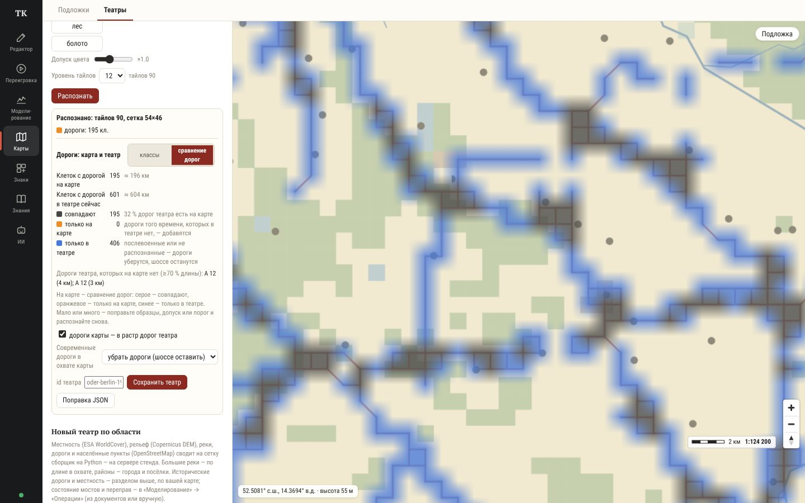

*Сравнение дорог: серое — совпадают, синее — есть только в театре (на исторической карте их нет), оранжевое — только на карте. Справа таблица: 195 клеток совпадают, 406 — только в театре.*

Результат сохраняется как новый театр (`id` задаёт пользователь) и используется в расчёте так
же, как встроенный.


*Раздел «Карты → Театры»: театр Одер — Берлин со слоем рельефа (Copernicus DEM) и реками; слои дорог, районов и растра местности выключены.*

**Состояние инфраструктуры операции.** Театр описывает мосты и переправы, известные при его
сборке. Сверх этого у операции есть список сведений об инфраструктуре: мост разрушен с такой-то
даты, переправа наведена, шоссе заминировано, железная дорога перекрыта. Сведения приходят из
документов операции (модель выписывает их с дословной цитатой, человек принимает) или вводятся
вручную. Каждое сведение привязывается к театру и ложится поверх него при расчёте и в игре:

| Сведение | Как действует в расчёте |
|---|---|
| мост разрушен | мост театра закрыт с даты сведения |
| мост цел, переправа наведена | переправа действует с даты (до даты окончания, если есть) |
| дорога перекрыта, заминирована, непроходима | в радиусе (по умолчанию 1,5 км) дорога не даёт дорожного темпа |
| железная дорога разрушена или перекрыта | препятствие в радиусе |
| повреждён, но проходим; рубеж без привязки | в расчёт не входит, остаётся сведением в базе знаний |

Исходный театр при этом не меняется: сведения хранятся отдельно, по операции, и попадают в
пакет операции при выгрузке.

**Ледостав.** Карта местности может указать период, когда большие реки скованы льдом.
Для Висло-Одерской операции это 20.12.1944–10.02.1945: реки преодолимы всеми родами войск с
задержкой на переправу. В Берлинской операции (апрель) льда нет.

| Карта | Охват | Клетка | Содержание |
|---|---|---|---|
| `oder-berlin-1945` | 11,0–15,6° в. д., 50,9–54,45° с. ш. | 2 км | 6 оборонительных полос, 98 мостов и переправ, 239 районов |
| `berlin-city-1945` | Берлин | 250 м | 3 кольца обороны, 21 мост, 246 районов |
| `vistula-oder-1945` | 14,0–22,6° в. д., 49,6–53,8° с. ш. | 2 км | 3 полосы, 132 моста и переправы, 163 района; без исторической поправки |

### 17.3. Профили сторон (`data/profiles/`)

Профиль описывает армию эпохи: типы частей, скорости, расход, подвоз, задержку доведения
приказов. Числа профилей — порядок величин по уставным нормам и обобщённым данным, не калибруются.

| | РККА 1945 | Вермахт 1945 |
|---|---|---|
| Скорость по дорогам, км/сут: пешие / авто / гусеничные | 30 / 150 / 100 | 28 / 120 / 80 |
| Вне дорог, открытая местность (пешие / авто / гусеничные) | 25 / 60 / 50 | 22 / 50 / 40 |
| Лес / болото / застройка (пешие) | 15 / 8 / 12 | 14 / 7 / 12 |
| Задержка доведения приказа, ч: армия / корпус / дивизия | 6 / 4 / 3 | 8 / 6 / 4 |
| Подвоз в сутки, боекомплектов / заправок | 0,6 / 0,6 | 0,3 / 0,2 (острый дефицит горючего) |
| Запас не более, боекомплектов / заправок | 3 / 2 | 2 / 1 |
| Дальность подвоза (автотранспортом по своей территории) | 48 ч | 48 ч |

Типы частей и их качество (выучка, слаженность; 1 — норма эпохи) и ширина полосы обороны:

| РККА | качество | полоса, км | Вермахт | качество | полоса, км |
|---|---|---|---|---|---|
| общевойсковая армия | 1,0 | 24 | армейский корпус | 0,95 | 24 |
| ударная армия | 1,05 | 20 | танковый корпус | 1,0 | 18 |
| гвардейская армия | 1,1 | 20 | танковый корпус СС | 1,05 | 18 |
| танковая армия | 1,1 | — | горный корпус | 0,9 | 20 |
| стрелковый корпус | 1,0 | 8 | пехотная / парашютная дивизия | 0,9 | 8 |
| танковый корпус | 1,05 | — | танковая дивизия | 1,0 | 5 |
| механизированный корпус | 1,05 | — | моторизованная дивизия (и СС) | 1,0 / 1,05 | 6 |
| кавалерийский корпус | 1,0 | — | гарнизон крепости | 0,8 | 6 |
| | | | фольксштурм | 0,5 | 6 |

Гарнизон крепости помечен как **узел, который обходят**: подвижные соединения, чья цель
дальше крепости, обходят её, а не штурмуют (Познань в январе 1945 г.).

### 17.4. Правила боя (`data/rules/`)

Правила — это таблицы и коэффициенты арбитра. Их форма задана по обобщённым данным о боях
Второй мировой войны, числа подобраны калибровкой по Берлинской операции (раздел 21).

| Файл | Что |
|---|---|
| `ww2-draft.json` | исходные правила до калибровки |
| `ww2-berlin-cal.json` | откалиброванные по Берлинской операции (основные; с блоком `calibration`: на чём и как подобраны) |
| `ww2-berlin-city.json`, `ww2-berlin-city-cal.json` | городской масштаб (раздел 23) |

Полные таблицы — в приложении А.

## 18. Сценарий

Сценарий собирается из рецепта (`tools/scenario/build_scenario.ts`). Рецепт перечисляет, какие
формирования действуют, их численность, задачи, источники подвоза и события для проверки.

### 18.1. Состав и численность

Численность известна в основном для фронтов и армий в целом. Она распределяется по
действующим формированиям сверху вниз по подчинённости:

1. **Боевая доля.** От списочной численности фронта берётся боевая: 0,6 для советских фронтов
   (без воздушной армии, тыла, фронтовых частей) и 0,75 для немецких армий (Kampfstärke). Одно
   мерило для обеих сторон — обязательное условие: иначе калибровка подгоняет коэффициенты под
   разницу в учёте, а не под бой.
2. **Явные цифры** (например, 1-я гв. ТА — 854 танка по Катукову) вычитаются из общего пула.
3. **Остаток** делится между формированиями без явных цифр пропорционально числу дивизий.
   Орудия — с весом: на направлениях главного удара — артиллерийские корпуса прорыва (у 8 гв. А
   и 5 уд. А до 270 орудий на километр; вес до 2,0).

Пример: 1-й Белорусский фронт — 908 500 человек, 3155 танков, 16 934 орудия (Кривошеев);
9-я немецкая армия — 112 143 человека, 512 танков, 2500 орудий и минометов (с зенитками в
наземной роли).

На Зееловских высотах немецкие корпуса разложены на дивизии; корпус остаётся штабом, задача
штаба передаётся его действующим дивизиям.

### 18.2. Задачи

Обе стороны получают исторические **задачи** (не положения): наступать на пункт или на
формирование противника, обороняться, держаться любой ценой, отходить, прорываться,
перегруппироваться, стоять в резерве. Формат в рецепте:

```
[формирование, "ММ-ДД[TЧЧ]", задача, цель, примечание с источником]
["su_8gva", "04-16", "attack", "Seelow", "главный удар с Кюстринского плацдарма (Ziemke p.474)"]
["de_xi_ss", "04-21T17", "hold", null, "приказ Гитлера держать фронт на Одере (Le Tissier, Halbe)"]
```

Цель — пункт из справочника, координаты или `@формирование`. Если час не указан, приказ
отдаётся в 18:00. Исполнитель получает его с **задержкой доведения** по профилю (армии РККА
6 ч, корпусу вермахта 6 ч). В Берлинской операции 245 приказов, в Висло-Одерской — 232.

Ключевые исторические решения заложены как задачи, например: приказы Гитлера держаться на
Одере для XI тк СС, V гск СС и V ак (21.04, отход разрешён 23.04) — без них не получается котёл
9-й армии; контрудары резервов на Зееловских высотах («Курмарк», 25-я и 18-я мд, «Мюнхеберг»,
«Нордланд»); приказ Хейнрици оставить крепость Штеттин 25.04.

### 18.3. Подвоз

Каждой стороне задаются **источники подвоза**: переправы, станции, тыловые районы. Источники
могут появляться и пропадать по датам (склады идут за наступлением; узел, потерянный
противником, перестаёт снабжать). В Берлинской операции советские источники — переправы на
Одере и Нейсе (Кюстрин, Губин, Гоздовице…), немецкие — Бранденбург, Магдебург, Ратенов,
Нойбранденбург, Росток, Дрезден, Каменц. Берлин — не источник: склады города снабжают гарнизон,
а подвоза в 9-ю армию через город не было.

## 19. Ход: как считается

Ход длится `turnHours` (24 ч на оперативном масштабе). Порядок внутри хода фиксирован;
каждое изменение записывается в журнал с причиной. Ход не меняет состояние на месте, а
возвращает новое — поэтому любой ход можно повторить и разобрать.

1. **Приказы**, дошедшие до исполнителя к концу хода (с учётом задержки доведения). Дошедший
   в любой момент хода приказ действует на **весь** ход: приказ в 18:00 действует с начала
   хода, на сутки раньше (раздел 19.3, «Приказ внутри хода»).
2. **Территория и подвоз** на начало хода.
3. **Бои**: все наступающие в соприкосновении с противником.
4. **Движение** остальных по маршрутам.
5. **Расход и подвоз, усталость, подготовка обороны, потеря боеспособности.**
6. **Территория**: клетки, через которые прошли войска, переходят к их стороне.
7. **Прорыв полос**: клетки чужих укреплённых полос, занятые противником, считаются прорванными.

### 19.1. Боевой потенциал

```
сила = (люди/1000 · 1,0 + танки · 0,08 + орудия · 0,03) · качество · снабжение · усталость
```

- *снабжение* — при боекомплекте меньше 0,5 сила падает линейно до 0,4; техника без горючего — 0,5;
- *усталость* — `1 − усталость · 0,4` (усталость от 0 до 1).

Веса означают: 1000 человек ≈ 12,5 танка ≈ 33 орудия. Это упрощение; оно одинаково для обеих
сторон.

### 19.2. Бой

**Кто с кем.** Наступающий вступает в бой, если противник ближе дистанции соприкосновения
(6 км) или ближе половины ширины полосы обороны противника. Например, армейский корпус в
обороне связывает боем всех в радиусе 12 км. Наступающие, у которых общие обороняющиеся,
образуют одно сражение.

**Соотношение сил:**

```
оборона = сила · местность · подготовка · укрепления
соотношение = Σ сила наступающих / Σ оборона · случайность
```

| Поправка обороны | Откалиброванное значение |
|---|---|
| местность: лес / высоты | 1,35 |
| болото | 1,47 |
| застройка | 1,59 |
| подготовленная оборона (стоит в обороне ≥ 24 ч) | 1,66 |
| укрепления | 1 + 0,32 · уровень полосы (1–3) |
| случайность | `exp(0,2 · N(0,1))`, то есть ±20 % в типичном бою |

**Темп продвижения** (км/сут) берётся из таблицы по соотношению сил (интерполяция в
логарифмической шкале) и умножается на поправку местности обороняющихся: застройка 0,47,
болото 0,5, лес 0,6, высоты 0,8. В укреплённой полосе темп не выше предела для её уровня:
14,7 / 9,2 / 5,5 км/сут для уровней 1 / 2 / 3. Это «прогрызание» обороны: на Зееловских
высотах 17–18.04 фактически до 4 км в сутки (Le Tissier), у 8 гв. А 16.04 — 3–6 км (Исаев).

| Соотношение | 1 | 1,5 | 2 | 3 | 4 | 6 | 10 |
|---|---|---|---|---|---|---|---|
| Темп, км/сут | 0 | 1,2 | 3,5 | 7,0 | 11,6 | 20,9 | 34,8 |
| Потери наступающих, % в сутки | 5,7 | — | 3,5 | 2,1 | — | 1,1 | 0,7 |
| Потери обороняющихся, % в сутки | 2,3 | — | 4,5 | 6,8 | — | 13,5 | 22,5 |

**Прорыв** — темп без предела полосы не меньше 10 км/сут. Предел полосы ограничивает скорость,
но не исключает прорыв.

**Прорванная полоса не держит** (правило `beltBreachKm`, по умолчанию выключено). Полоса держит,
пока не прорвана её клетка; на плацдармах полоса проведена по их периметру, и наступающий, прорвав её
в одном месте, дальше идёт вдоль фаса той же полосы и каждый ход ведёт «бой в полосе» с её пределом
темпа (8 гв. А на Магнушевском плацдарме — четверо суток по 9,2 км). С правилом обороняющемуся не
засчитываются укрепления, если в пределах `beltBreachKm` от него та же полоса уже прорвана; следующие
полосы не затрагиваются (номер полосы клетки хранит театр). Почему оно выключено — раздел 21.

**«Держаться любой ценой».** Обороняющиеся с этим приказом и окружённые не отходят, несут
полуторные потери, а наступающие не продвигаются, пока оборона не прорвана. Исключение —
**уличный бой**: если все обороняющиеся в застройке, наступающие берут квартал за кварталом
с городским темпом, а гарнизон остаётся на месте. Без этого исключения армия стояла бы перед
гарнизоном Берлина (в оперативном сценарии — одна точка), пока он не рухнет целиком.

**Потери** распределяются: личный состав — по таблице; танки — в 1,3 раза больше; орудия — в 0,8.
Формирование, у которого осталось меньше 15 % исходной численности, теряет боеспособность.

**Отход.** Обороняющиеся (кроме держащихся) отходят на расстояние продвижения противника. Из 16
направлений выбирается то, где подвоз ближе (к своим тылам); при равенстве — прочь от
наступающих. Отход в воду и туда, куда подвоз не доходит, исключён.

**Журнал боя** хранит все факторы: силы сторон, местность, подготовку, укрепления, случайность,
темп, предел полосы, исход («прорыв», «продвижение», «отражено», «удержано»). Отчёт показывает
каждый бой, поэтому любой исход можно объяснить.

### 19.3. Движение

**Маршрут** — кратчайший по времени путь по клеткам (алгоритм A*). Время клетки зависит от
скорости по профилю: по шоссе — полная дорожная скорость, по дороге — 85 % от неё, вне дорог —
по классу местности. Сверх этого добавляются задержки:

| Причина | Задержка |
|---|---|
| большая река без моста | пешим 12 ч; технике — непроходима (если нет ледостава) |
| малая река | 4 ч |
| клетка чужой укреплённой полосы (пока не прорвана) | 4 ч за уровень |
| клетка территории противника | `клетка / темп по чужой территории`: пешим 42,6 км/сут, технике 136 км/сут (заслоны, разрушения, зачистка) |

Все скорости умножаются на общий множитель движения (1,09 после калибровки).

**Дороги.** Клетка с дорогой даёт дорожную скорость, поэтому кратчайший по времени путь сам
тянется к дорогам: на марше и в городе войска идут дорогами и улицами, а не по прямой через
кварталы. Перекрытая или заминированная дорога (раздел 17.2) дорожной скорости не даёт, и
маршрут её обходит.

**Разброс путей.** Вне города дорога — не единственный выбор: соединение может пойти лесом или
полем напрямик. Чтобы этот выбор не терялся, при выборе пути время каждой клетки умножается на
плавный шум (районы 2–4 км) от 1 до 1 + 2 · *v*, где *v* — параметр правил `routeVariety`
(0,2 в откалиброванных правилах, то есть «кажущаяся» выгода клетки различается до 40 %).
Шум свой у каждого формирования и приказа и постоянен на прогон: путь не дёргается от хода к
ходу, а разные seed дают разные пути. Шум влияет **только на выбор пути**: время движения по
выбранному пути считается по местности, без шума, — средний темп не меняется.

**Показ на карте.** Расчёт ведёт войска по клеткам. Для карты путь хода перестраивается по
дорожной сети театра — графу из линий дорог, шоссе и улиц (перекрёстки — общие вершины и
пересечения линий): участок пути по клеткам с дорогой заменяется кратчайшим путём по графу между
точками, где войска вошли на дорогу и сошли с неё. Если весь ход шёл дорогами или городом, а
путь по улицам не длиннее полутора расчётных, ход целиком показывается улицами. Вне дорог (поле,
лес) путь остаётся таким, как в расчёте, только сглаженным, — показ не прячет выбор пути вне
дорог. Знак движется по вершинам пути, время — пропорционально пройденному расстоянию.

**Остановка у противника.** Наступающие останавливаются, войдя в соприкосновение (бой — в
следующий ход), остальные — не доходя до противника. Уже стоящий рядом с противником может
подойти до дистанции боя, но не сквозь него: пройти через противника без боя нельзя.

**Обход крепостей.** Подвижные соединения (танковые, механизированные), чья цель дальше
крепости, не вступают с ней в бой и обходят её. Пехота крепость штурмует.

**Своя полоса.** Где действует разграничительная линия по директиве, клетки полосы соседнего
фронта при выборе пути «дороже» в 1 + `sectors.foreign` раз (раздел 19.8). Как и разброс путей,
это влияет только на выбор пути, не на время движения.

**Приказ внутри хода.** Ход — 24 часа, и приказ, дошедший до исполнителя в любой момент хода,
действует на весь ход: приказ в 18:00 с задержкой доведения 6 ч отправляет войска в путь с начала
хода, то есть на 13 ч раньше, чем он отдан. Поэтому срок приказа внутри хода ничего не меняет, а
сроки сценария — условные: приказ ставится на то время, с которого войска в расчёте начинают
действовать. Правило `orderPartialTurn` (по умолчанию выключено) делает приказ действующим с момента
доведения: в ход, когда он дошёл, формирование движется только оставшееся время. Документальные
сроки 28 приказов Берлинской и Висло-Одерской операций (директивы Ставки и фронтов в «Русском
архиве», тт. 15 и 16, достоверность A, час и страница; где документа нет — воспоминания
командующих, B) записаны в поле `basis` приказа: `documented` — срок по документу, `issuedAt` —
условный срок модели. Приказы, у которых документ — планирующая директива за 3–47 суток до
исполнения (Ставка № 11059 от 2.04, № 11060 от 3.04 21:00, директива 1 БФ № 00539/оп от 12.04
03:00), и сопоставления, где документ — не тот же приказ (Ставка № 11077 — линия в Берлине, а не
приказ 3 гв. ТА; приказ 47 А с другой целью), в `basis` не записаны.

Проверка на трёх операциях (пять прогонов; положения в допуске / события в пределах двух суток):

| Правила и сроки | Берлинская | Бой в Берлине | Висло-Одерская |
|---|---|---|---|
| условные сроки, весь ход (принято) | 80 % / 46 из 55 | 86 % / 10 из 30 | 51 % / 18 из 65 |
| документальные сроки как `issuedAt` | 79 % / 44 из 55 | 86 % / 10 из 30 | 51 % / 18 из 65 |
| + `orderPartialTurn` | 70 % / 32 из 55 | 89 % / 9 из 30 | 43 % / 23 из 65 |
| то же, множители перекалиброваны по Берлинской | 70 % / 41 из 55 | 89 % / 9 из 30 | 48 % / 24 из 65 |

Ни документальные сроки сами по себе, ни частичный ход с перекалибровкой (120 вычислений, обучение
до 25.04) не улучшили сходство: Берлинская теряет 10 п. п. положений, Висло-Одерская выигрывает по
событиям (+6) и теряет по положениям (−3). Калибровка прежних правил подбиралась под условные
сроки, а модель медленно набирает темп в первые дни прорыва (раздел 25.1, п. 13); условный срок «на
сутки раньше» этот медленный старт компенсировал. Поэтому в модель вошли условные сроки, а документальные
хранятся как данные.

### 19.4. Территория — сплошная полоса

Без территории фронт был бы цепочкой точек с пустыми промежутками, через которые танковые
корпуса проходили бы за сутки по 150 км. Поэтому каждая клетка принадлежит одной из сторон.

- **Исходная территория.** Каждая сторона «растекается» от своих войск и источников подвоза
  по клеткам. Переход через большую реку стоит 40 км пути, через чужую укреплённую полосу —
  20 км; оба штрафа платятся один раз, при входе в преграду. Поэтому граница ложится по Одеру,
  Нейсе и главной полосе обороны, а не посередине между ближайшими частями.
- **Изменение.** Клетки в радиусе 4 км от пути соединения за ход переходят к его стороне, если
  противник к ним не ближе. Клетка, где стоит соединение, — его стороны. Отходящие чужую
  территорию не занимают: иначе отход сквозь тыл противника рвал бы его коридоры подвоза.
- **Закрепление земли за фронтом.** Каждый ход клетка противника переходит к стороне, если там
  перевес влияния её войск (карта контроля: влияние войск по силе и удалению, радиус 10 км), войск
  противника нет ближе 9 км (1,5 радиуса соприкосновения), а своя земля есть по крайней мере с трёх
  сторон из четырёх в пределах 24 км — то есть клетка в тылу своего фронта, а не перед ним. Без
  этого земля между коридорами наступающих армий оставалась чужой, и любая обойдённая немецкая
  часть, стоявшая в коридоре, отрезала армию от тыла: модель «окружала» 52-ю армию, 2-ю армию
  Войска Польского, 5-ю гвардейскую армию на 9–13 суток. Обойдённые узлы, где войска противника
  есть, остаются его островами — это и есть котлы.
- **Следствия:** в тылу противника движение медленнее; прорвавшаяся танковая армия снабжается
  только по коридору, который сама пробила; соединения, оставшиеся в чужом тылу, оказываются в
  котле.

**Линия фронта** на карте — граница территорий сторон, сглаженная. Она строится только там,
где обе стороны ближе 50 км.

### 19.5. Подвоз и окружение

**Время подвоза** к каждой клетке считается от источников стороны по своей территории
(автотранспортом по дорогам) с обходом мест, где стоят войска противника (радиус 3 км).
Формирование снабжается, если подвоз доходит до любой клетки в радиусе 3 км от него не дольше
48 ч. Армия занимает полосу в несколько километров, подвоз приходит к её тылу, а не к точке знака.

**Окружение и отрыв от тылов — разные вещи.** Если путь подвоза есть, но длиннее 48 ч,
формирование **оторвалось от тылов**: подвоза нет, боеприпасы и горючее тают, но оно не скованно
и окружённым не считается (так в конце Висло-Одерской операции армии 1-го Белорусского и
1-го Украинского фронтов ушли на 400 км от баз на Висле). **Окружение** — пути подвоза нет совсем
дольше 36 ч (два хода подряд); разовый разрыв на стыке котлом не считается. Окружённые не
пополняются и не могут отойти: держатся на месте с повышенными потерями. На карте — контур котла.

**Крепость с запасами.** У гарнизонов крепостей (тип «гарнизон крепости»: Франкфурт, Штеттин,
Берлинский оборонительный район, Познань, Варшава) — склады на 30 суток боя (по Познани:
окружена 25.01, капитулировала 23.02). Окружённый гарнизон получает подвоз со складов, пока они
не кончились; в осаде без штурма склады расходуются вдвое медленнее.

**Капитуляция.** Окружённое формирование без складов, у которого боеприпасов меньше 0,25 бк,
сдаётся через 96 ч окружения (с приказом «удерживать любой ценой» или на прорыв — через 192 ч:
прорывающиеся пробиваются к своим, а не сидят в кольце); в журнале — капитуляция и число
пленных, на карте — перечёркнутый знак. Сдаются ли окружённые, задаёт профиль стороны: вермахт
1945 г. — да, Красная армия 1945 г. — нет (окружённые части держались до деблокирования).

**Подвоз как пропускная способность (блок правил `supplyFlow`).** Без блока подвоз —
порог: путь не длиннее 48 ч — пополнение полное, длиннее — нулевое. Блок `supplyFlow` делает его
пропускной способностью: пока путь подвоза не длиннее `fullHours` (по умолчанию 12 ч — один рейс
автотранспорта в сутки) пополнение полное, дальше — `fullHours` / часы пути, до прежнего предела;
горючее подвижных частей на марше тратится по пройденному пути (`fuelPer100km`, по умолчанию 1 запр.
на 100 км — немецкая единица расхода Verbrauchssatz), а не по суткам. Танки без горючего идут
пешком. В откалиброванных правилах блок **включён** (значения по умолчанию): расход и пополнение
физичнее порога, хотя на трёх операциях сходство с историей он практически не меняет (пять
прогонов; положения в допуске / события в пределах двух суток / ошибка дат, сут):

| Правила | Берлинская | Бой в Берлине | Висло-Одерская |
|---|---|---|---|
| без блока | 80 % / 46 из 55 / 1,67 | 86 % / 10 из 30 / 3,67 | 51 % / 19 из 65 / 4,23 |
| 12 ч, 1 запр. на 100 км | 80 % / 46 из 55 / 1,67 | 86 % / 10 из 30 / 3,67 | 51 % / 18 из 65 / 4,34 |
| 6 ч, 1,5 запр. | 80 % / 47 из 55 / 1,71 | 86 % / 10 из 30 / 3,67 | 51 % / 19 из 65 / 4,25 |
| 3 ч, 2,5 запр. | 80 % / 47 из 55 / 1,69 | 86 % / 10 из 30 / 3,67 | 51 % / 22 из 65 / 4,11 |

Частей без горючего (seed 1) при этом больше: в Берлинской 16 → 20 → 23 → 26, в Висло-Одерской
42 → 56 → 56 → 57, но положения не меняются: сопротивление в этих сценариях задано приказами и
маршрутами, а не горючим. Параметры — допущения без опоры в источниках (раздел 21, нормативы):
срок рейса — по аннотации статьи Davie (армейский автотранспорт ≈ 300 т, суточный ход ≈ 150 км), расход на
100 км — по справочнику вермахта; для советских частей размер заправки в километрах не подтверждён.

**Сапёры.** В переигровке по истории тылом и переправами никто не распоряжается, а в данных
театра — только переправы, известные по источникам. Поэтому переправы через большие реки наводят
сапёры сами: там, где сторона держит оба берега, её войска не дальше 12 км, а противника нет
ближе радиуса соприкосновения, — наплавной мост, открытый через 24 ч; не больше двух в ход на
сторону и не ближе 15 км друг к другу. Без этого армии 2-го Белорусского фронта, форсировавшие
Одер у Штеттина, и 61-я армия оставались за рекой без моста — «в окружении». Переправы прогона
хранятся в его состоянии (на театр не записываются) и видны на карте тактического масштаба.
В игре, где тылом управляет штаб, переправы — его распоряжения, как раньше.

**Прорыв.** Выход из котла — исторические приказы на прорыв (9-я армия к Белицу 28.04, корпус
Неринга в январе) или решение игрока и штаба на модели. Вырвавшиеся выносят 30 % танков и орудий:
тяжёлое вооружение бросают (так 9-я армия вышла к 12-й без техники).

### 19.6. Расход, усталость, оборона

| Состояние | Боекомплектов в сутки | Заправок в сутки |
|---|---|---|
| наступление | 0,5 | 0,5 |
| оборона | 0,25 | 0,05 |
| марш | 0,02 | 0,4 |
| отход | 0,15 | 0,4 |
| резерв | 0 | 0,02 |

Вне боя расход боеприпасов — 30 % от нормы. Усталость растёт в бою (+0,15 в сутки) и на марше
(+0,08), снижается на отдыхе (−0,1). Оборона становится подготовленной после 24 ч на месте.

### 19.7. Случайность и воспроизводимость

Случайность одна — разброс исхода боя. Генератор задаётся числом seed: один seed — один и тот
же расчёт до последнего знака. Разброс исходов оценивается прогоном с разными seed (обычно 5).

### 19.8. Полосы фронтов и разграничительные линии

**Объединение формирования** — его фронт (группа армий) по подчинённости сценария; на
оперативном масштабе — армия. Соединение без подчинения в сценарии (дивизия СС) относится к
единственной группе армий своей стороны, если она одна; армия без фронта (12-я армия при ОКВ)
остаётся отдельной полосой.

**Расчётные полосы.** Театр делится сеткой с шагом в две клетки (4 км; в городе 0,5 км). Клетка
стороны принадлежит объединению, чьи войска к ней ближе (не дальше 80 км). Это деление по
ходам: полосы сдвигаются вместе с войсками.

**По директиве.** Пока действует разграничительная линия (с `from` до `until`), клетки двух
объединений пары делятся по сторонам линии: справа по ходу линии — `right`, слева — `left`.
Клетки за концами линии (ближайшая точка линии — её конец, а клетка дальше конца) остаются
расчётными: линия 15.04 «оборвана» у Люббен, и западнее полосы 1 БФ и 1 УФ делятся по войскам —
так директива и оставила путь 1 УФ на Берлин открытым. Чьи пункты «включительно», в модели —
справка, на деление не влияет.

**Где полосы используются:**

| Где | Как |
|---|---|
| выбор пути (раздел 19.3) | клетки полосы соседа по директиве при выборе пути — × (1 + `sectors.foreign`); в правилах операции 1 (вдвое «дороже»), в городских — 0 |
| карта (раздел 6) | границы полос от переднего края в глубину до 40 км (в городе — до 5 км), сглаженные; по директиве — сама линия директивы |
| отчёт (раздел 20) | выходы формирований в полосу соседа по директиве: кто, в чьей полосе, сколько ходов, с какого момента |
| игра и штаб на модели | своя полоса словами: соседи, линии фронтов и армий (только уже действующие), кто в полосе соседа; предупреждение о цели приказа в чужой полосе; поводы для модели-Ставки |
| полнота (раздел 8.2) | пары соседних фронтов в начале операции: известна ли линия |

**Немецкая сторона.** Линии групп армий и армий вермахта (раздел 17.1) делят полосы так же; в
сценариях Берлинской операции их четыре, в Висло-Одерской — три. На исторических прогонах
Берлинской операции они ничего не изменили (79 и 85 % положений в допуске, события — те же), в
Висло-Одерской — на процент (53 % вместо 54; Калиш на сутки ближе к истории, Катовице на сутки
дальше): немецкие соединения там в основном держатся на месте, и полосы на их пути почти не
сказываются.

**В игре** (после передачи командования) линии сценария с условием вступления (`trigger`:
войска объединения в радиусе от точки) вступают не по сроку, а когда условие выполнено, через
`delayHours`; срок линии — до следующей вступившей линии той же пары. Условия записаны по самим
директивам: № 11074 — «ввиду выхода правофланговых частей 1-го Украинского фронта в район
Ланквиц» (радиус 10 км), № 11077 — выход войск 1 УФ к Ангальтскому вокзалу по докладу Жукова
28.04 (6 км в операции, 3 км в бою в городе). По историческим приказам условия срабатывают близко
к истории: линия 23.04 вступает 22.04 11:00 — 23.04 11:00 (в истории 23.04 06:00), линия 28.04 —
29.04 09:00 (в истории 29.04 00:00); в городе при части seed условие не наступает — тогда
решает модель-Ставка. Линии, изданные в игре (`SimState.boundaries`: директивы модели-Ставки
между фронтами и распоряжения игрока между армиями), делят полосы так же; линии армий — на
уровне армий одного фронта, множители выбора пути фронта и армии перемножаются. Вступление
линии в силу пишется в журнал хода.

**Почему в городе вес 0.** В Берлине войска 1 УФ (3 гв. ТА) заходили в полосу 1 БФ — из-за этого
28.04 директивой № 11077 линию и передвинули. Штраф уводил их с исторических мест: пять
прогонов без штрафа — 84–92 % положений в допуске и 14 событий из 30, со штрафом — 77–90 % и 12
при меньшем числе ходов вне полосы (18 против 30). В операции штраф точности не меняет (доля в
допуске та же), событий в пределах двух суток — 46 против 44 из 55.

### 19.9. Режимы боевых действий

Бой в городе, прорыв укреплённой полосы, бой за переправу, марш, охват и преследование — разные по
природе действия, и одна таблица темпа с общими множителями описывает их с разной точностью
(раздел 21, «Режимы боевых действий: сравнение»). Поэтому в движке у каждого режима могут быть свои
поправки — блок правил `regimes`; движок один, режим выбирается на каждый ход по обстановке. Режим
боя — первый подходящий сверху:

| Режим | Когда | Поправки |
|---|---|---|
| бой в котле | обороняются окружённые, или окружённые прорываются (приказ на прорыв) | темп боя, потери сторон |
| бой в застройке | все обороняющиеся в этом бою — в городской застройке | темп боя, потери сторон |
| бой в укреплённой полосе | обороняющиеся в клетках укреплённой полосы | темп боя, потери сторон |
| бой за переправу | между наступающими и обороняющимися — большая река | темп боя, потери сторон |
| бой в лесу и болоте | бо́льшая часть обороняющихся в лесу или болоте | темп боя, потери сторон |
| бой на открытой местности | прочие бои | темп боя, потери сторон |
| марш | движение вне боя с приказом не на наступление и не на отход (марш, выдвижение резерва) | темп движения |
| отход | движение вне боя с приказом на отход | темп движения |
| выдвижение к противнику | наступающие вне соприкосновения, но противник ближе `pursuitClearKm` (по умолчанию две дистанции соприкосновения, 12 км): охват, сближение | темп движения |
| преследование подвижными соединениями | танковые и механизированные наступающие, противника ближе `pursuitClearKm` нет | темп движения |
| преследование общевойсковыми армиями | пешие наступающие, противника ближе `pursuitClearKm` нет | темп движения |

Поправки — множители поверх общих правил (`advance` — к темпу боя, `attackerLoss` и
`defenderLoss` — к потерям, `speed` — к темпу движения: ход длится как бы в `speed` раз дольше);
нет блока или режима — множители 1, поведение прежнее. Режим пишется в журнал (бой и движение), в
разборе боя множитель темпа виден отдельной строкой. Подбор множителей режимов — раздел 21,
«Калибровка по режимам». В откалиброванных правилах (`ww2-berlin-cal`) включён один множитель —
преследование общевойсковыми армиями ×1,5; городские правила режимы не наследуют (`regimes: null`).

### 19.10. Выделение корпуса и передового отряда

Армия в модели — одна точка. Чтобы она могла оставить корпус штурмовать крепость и идти дальше
главными силами или выслать вперёд подвижный отряд, в сценарии такая часть описывается отдельным
формированием с полем `detachFrom`: из какого формирования она выделяется и сколько забирает — долю
`share` его людей, танков и орудий или заданные числа. В момент `enterAt` она появляется там, где
стоит родитель, родитель теряет отданное (вместе с исходной численностью — укомплектованность не
меняется), а дальше часть действует по своим приказам; в журнал пишется «выделено». В Висло-Одерской
так выделены 29 гв. ск из 8 гв. А и 91 ск из 69 А (по трети армий) для штурма Познани и армейский
подвижной отряд 5 УА (220 тбр, 396 отсап) на Одер у Киница — по журналам боевых действий (раздел 22.3).

### 19.11. Корпус за армией

У корпуса, приданного армии, в сценарии часто одна задача — на первый рубеж (в Висло-Одерской
9 тк и 11 тк — «на Радом»). Дойдя до цели, модель останавливала его до конца операции, а по
журналам корпуса шли впереди армии до Одера. Правило `followParentKm`: наступающее соединение,
подошедшее к цели своего приказа ближе этого расстояния, идёт к цели наступления вышестоящего
(армии), пока не получит новый приказ; это запоминается, и корпус не возвращается к своей прежней
цели. Документальный приказ корпусу правило отменяет. В откалиброванных правилах — 6 км (радиус
соприкосновения): Висло-Одерская 46,2 → 49,0 % положений, 28 → 34 события из 65 (5 прогонов, мерило —
журналы ЦАМО, раздел 22.3); Берлинская не меняется (80,2 %, 48 из 55). Норматива у правила нет —
это допущение (`assume-follow-parent`).

## 20. Сравнение с историей

**Положения.** Каждое историческое положение «за день» сравнивается с первым снимком расчёта
не раньше его времени. Отклонение — расстояние между расчётным и историческим положением.
**Сверх неопределённости** — отклонение за вычетом радиуса `approx_km` исторической записи.
Положение считается **в допуске**, если превышение не больше 10 км (в городе — 2 км).

**События.** Проверяются ключевые события с датой:

| Вид | Когда считается случившимся |
|---|---|
| выход к пункту | войска стороны в радиусе пункта; для «город взят» — и нет боеспособных частей противника в том же радиусе |
| окружение | хотя бы одно из перечисленных формирований отрезано (или уничтожено) |
| встреча | все перечисленные формирования в радиусе пункта |

Событие не может случиться до начала сценария. Событию можно назначить **отметку на карте**:
так, взятие Рейхстага ставит Знамя Победы в момент события в расчёте и бледное знамя — на
историческое время (30.04, 22:40 по советским донесениям).

**Отчёт** (`report.md`) содержит: события (история / расчёт / расхождение в сутках);
разграничительные линии по директивам и выходы в полосу соседа; отклонения по дням и по
формированиям; наибольшие расхождения с историческим местом, источником
и достоверностью; журнал боёв с факторами; разброс по прогонам.

## 21. Калибровка

**Что подбирается.** 11 множителей к исходным правилам:

| Параметр | Границы поиска | Итог |
|---|---|---|
| темп продвижения (вся таблица) | ×0,3…1,6 | ×1,16 |
| потери наступающих | ×0,5…2 | ×1,42 |
| потери обороняющихся | ×0,5…2 | ×1,12 |
| подготовленная оборона | 1,0…2,2 | 1,66 |
| укрепления, за уровень | 0…0,8 | 0,32 |
| показатель местности (поправки обороны в степени) | 0,5…2,5 | 1,15 |
| скорость движения | ×0,4…1,2 | ×1,09 |
| темп в застройке | 0,05…0,6 | 0,47 |
| предел темпа в полосе | ×0,4…2 | ×1,83 |
| темп по чужой территории, пешие, км/сут | 10…80 | 42,6 |
| то же, техника | 15…150 | 136 |

**Мерило:**

```
мерило = среднее превышение отклонения положений над неопределённостью (каждое — не больше 50 км)
       + 3 × средняя ошибка дат событий (сут; не случилось — 6 сут)
```

**Обучение и проверка.** Подбор идёт только по положениям и событиям **до 25.04 включительно**;
дни после 25.04 — проверка: по ним видно, не подогнана ли модель под конкретные числа. Поиск:
40 % вычислений — случайные точки по всему диапазону, затем уточнение вокруг лучшей точки с
уменьшающимся шагом; каждая точка оценивается по двум прогонам (seed 101, 102). 200 вычислений
занимают около 11 минут.

**Итог:** обучение — превышение 9,6 → 5,2 км, ошибка дат событий 3,25 → 0,75 сут;
проверка — 6,8 → 4,4 км.

**Выбор между двумя калибровками.** После последних исправлений движка калибровка была
повторена; новые правила дали на пяти прогонах 48 событий из 55 в пределах двух суток против 50
у прежних, и прежние оставлены. Этот выбор сделан по всем событиям, включая проверочные, —
поэтому проверка здесь уже не вполне независима. Независимая проверка общих множителей —
контрольная Висло-Одерская операция (раздел 22); множители режимов подбирались по первой половине
обеих операций, для них независима только вторая половина.

**Анализ чувствительности.** Какие из 11 множителей вообще влияют на сходство с историей и насколько
сильнее шума от seed, показывает `npm run sim:sensitivity`. Глобальный скрининг Морриса: траектории
по сетке в границах подбора калибровки, для каждого множителя — среднее абсолютное влияние μ*
(изменение показателя при сдвиге множителя на весь диапазон) и разброс σ (велик — влияние
нелинейно или зависит от остальных множителей). Локально — отклонения ±20 % от откалиброванных
значений. Показатели: доля положений в допуске, медиана превышения, доля событий в пределах двух
суток, ошибка дат и мерило калибровки. Шум — тот же набор правил на пяти seed; все точки считаются
на одних и тех же seed, поэтому разности точек точнее разброса между seed. Результат —
`evals-out/sensitivity/report.md` (`--part morris`, `--part local` на сценарий, затем `--report`);
`--part scan --key … --values …` — один множитель по списку значений.

**Чувствительность к данным.** Какие данные ценнее собирать, показывает `npm run sim:data-sensitivity`:
правила не меняются, ухудшаются данные сценария и театра. Ошибка заданной величины — сроки приказов
до ±24 ч, исходные положения (на допуск сравнения: 10 или 2 км), численность, танки и орудия ±20 %,
по сторонам отдельно, две независимые выборки ошибки; отсутствие данных — база снабжения и её фазы,
разграничительные линии, дороги, рельеф, перепады высот, реки, укреплённые полосы театра. Показатели
те же, все варианты на одних seed; падение в пределах двух σ шума незначимо. Результат —
`evals-out/data-sensitivity/report.md` (`--scenario …`, затем `--report`).

**Режимы боевых действий: сравнение.** `npm run sim:regimes` сравнивает одинаковые режимы
(раздел 19.9) в разных операциях. Мерило режима — **темп**: для каждой пары соседних исторических
положений формирования (промежуток, где оно сдвинулось в истории не меньше чем на 5 км)
сравнивается пройденное в истории и в модели за те же сутки; режим промежутка — тот, в котором
формирование было в эти ходы чаще всего (по прогону с исходными правилами). Отношение темпов
(история / модель) равно 1, если темп режима верный. В отличие от отклонения положения, темп не
копит ошибку прошлых суток: отставание, набранное на медленном прорыве, не приписывается следующему
за ним преследованию. Для справки рядом — положения того же режима: превышение, доля в допуске,
знаковое отставание вдоль оси движения. Отношение темпов (три прогона; в скобках — промежутков на
прогон; Висло-Одерская — с положениями армий по журналам боевых действий, раздел 22.3):

| Режим | Сторона | Берлинская: без множителей → с ними | Висло-Одерская: без множителей → с ними |
|---|---|---|---|
| преследование общевойсковыми армиями | СССР | 1,11 → 0,95 (19–22) | 1,20 → 0,91 (99–103) |
| преследование подвижными соединениями | СССР | 0,67 → 0,65 (7) | 1,07 → 1,04 (14) |
| выдвижение к противнику | СССР | 1,03 → 0,99 (7) | 1,21 → 1,22 (33–34) |
| отход | Германия | 1,10 → 1,18 (5) | 1,09 → 1,04 (11) |
| бой на открытой местности | СССР | 1,10 → 1,09 (8–9) | 1,09 → 1,30 (3–5) |
| бой в укреплённой полосе | СССР | 1,24 → 1,12 (15–16) | 1,70 → 1,95 (5–7) |
| бой в укреплённой полосе | Германия | 2,28 (13) | — |
| бой в котле | СССР | 2,06 (9–10) | 2,45 → 2,91 (3–4) |
| марш | СССР | 0,83 (1) | 1,28 → 1,32 (8–19) |
| марш | Германия | — | 1,69 → 1,68 (6–8) |

С множителем преследования общевойсковых армий их темп близок к истории в обеих операциях: 15,6
км/сут против 14,9 в Берлинской и 25,8 против 23,4 в Висло-Одерской. Подвижные соединения в
Висло-Одерской идут вровень с историей, в Берлинской — быстрее (на 7 промежутках). Выдвижение к
противнику (охват, сближение — наступающие вне боя, но рядом с противником) в Берлинской верно, в
Висло-Одерской медленнее истории в 1,2 раза. Бой в укреплённой полосе модель ведёт медленнее
истории в обеих операциях, но по-разному: в 1,1–1,2 раза в Берлинской и в 1,7–2 раза в
Висло-Одерской (там полосы слабее — «цепочка опорных пунктов», раздел 25.1, п. 13); отход немцев в
полосе в Берлинской — в 2,3 раза медленнее. Бой в котле, за переправу, в лесу и в городе сравнить
нельзя: в Висло-Одерской на них по 0–4 промежутка на прогон. Отчёт — `evals-out/regimes/report.md`.

**Калибровка по режимам.** `npm run sim:calibrate-regimes` подбирает множители режимов
(раздел 19.9) по двум операциям сразу (Берлинская и Висло-Одерская, три прогона на вариант), и
подбирает так же, как сравнивает: множитель режима — по темпу на промежутках своего режима на
первой половине каждой операции (вторая — проверка), и только если операции согласны. Нужно не
меньше пяти промежутков обучения в режиме на прогон в каждой операции и значение, при котором у
каждой отношение темпов в пределах ×/÷1,15 от 1 (или не хуже её лучшего более чем на 5 %); из
таких берётся значение с наименьшей суммой |ln отношения| (операции — с равным весом, а не по числу
записей). Нет согласия — множитель не меняется, режим отмечается как расхождение операций: искать
причину в данных. Раскладка промежутков по режимам после исходного прогона не меняется, чтобы подбор
не «улучшал» режим, вытесняя из него трудные записи. Подбор покоординатный по сетке, два прохода.
Затем согласованные множители проходят **отбор по полной проверке** — пять прогонов, все положения
и все события обеих операций: прямой отбор, на каждом шаге пробуются все оставшиеся множители и
принимается лучший по средней доле положений в допуске, если ни одна операция не теряет против
исходных правил больше 3 п. п. положений и больше двух событий в пределах двух суток, а средняя доля
растёт не меньше чем на 2 п. п. (разброс прогонов). В сочетании множители могут мешать друг другу
(пришли раньше — иначе пошёл бой). `--write` записывает принятые в правила. Отчёт —
`evals-out/regimes-cal/report.md`.

Итог (подбор от правил без множителей режимов; сравнивались пять режимов, у остальных мало
промежутков хотя бы в одной операции):

| Режим | Согласие по темпу | Полная проверка (5 прогонов): Берлинская; Висло-Одерская | Итог |
|---|---|---|---|
| без множителей | — | 80 %, 46 событий; 47 %, 19 событий | — |
| преследование общевойсковыми армиями | ×1,5 | 80 %, 48; 61 %, 25 | **принят** |
| выдвижение к противнику | ×2,16 | 78 %, 43; 51 %, 19 | не принят: Берлинская −3 события |
| преследование подвижными соединениями | ×2 | 78 %, 46; 46 %, 22 | не принят: положения хуже |
| бой на открытой местности | ×1,08 | 80 %, 45; 46 %, 20 | не принят: прирост меньше разброса |
| бой в укреплённой полосе | нет (Берлинская ×1, Висло-Одерская ×1,25) | — | расхождение операций |

Вторым шагом ни один из оставшихся множителей не прошёл (выдвижение к противнику вместе с
преследованием даёт Висло-Одерской 65 %, но Берлинской — 76 % и 43 события). Подбор сделан на
приказах, уже исправленных по журналам боевых действий (раздел 22.3). Множитель записан в
`ww2-berlin-cal` (блок `regimes`); городские правила его не наследуют (у городского боя своя
калибровка, `regimes: null`). Результаты с ним — раздел 22.

Как к этому пришли. Первая попытка — подбор по положениям записей своего режима и общий множитель
на обе операции — дала противоречие: преследование общевойсковыми армиями в Висло-Одерской
требовало ×2, в Берлинской ×1. Причина — отклонение положения копит ошибку прошлых суток; по темпу
противоречия нет. Вторая — отбор по положениям на трёх прогонах и только на проверочной половине —
принимала множители на шуме (подвижные соединения ×1,25 и ×1,56, выдвижение к противнику ×2,16);
на пяти прогонах со всеми положениями и событиями они оказывались хуже, отсюда полная проверка.
Третья поправка — режим «выдвижение к противнику»: пока ускорялось любое движение наступающих вне
боя, 3-я армия, охватывавшая котёл 9-й армии, уходила от него, и кольцо размыкалось до приказа на
прорыв 28.04; преследование теперь — только когда противника ближе двух дистанций соприкосновения нет.

**Бой в полосе: плотность обороны и прорванные полосы.** Медленный прорыв полос на Висле (раздел
«Режимы боевых действий: сравнение») — не от слабой плотности обороны в модели: в боях за полосу
сила немецкой обороны на километр её полосы в Висло-Одерской даже выше, чем в Берлинской (медиана
1,42 против 1,19), потому что немецкие дивизии на Висле заданы шаблонами штатов (раздел 22.3), а не
«цепочкой опорных пунктов» источников; правило «темп от плотности» без данных о немецкой численности
ничего не исправит. Вторая причина — геометрия: главная полоса проведена по периметру плацдармов, и
наступающий долго идёт вдоль её фаса. Правило «прорванная полоса не держит» (`beltBreachKm`, раздел
19.2) по полной проверке (пять прогонов, при множителе преследования ×1,5):

| `beltBreachKm` | Берлинская: положения; события | Висло-Одерская: положения; события |
|---|---|---|
| выключено | 80,0 %; 48 | 60,8 %; 25 |
| 6 км | 78,3 %; 49 | 63,2 %; 27 |
| 10 км | 77,8 %; 48 | 63,3 %; 29 |
| 24 км | 77,7 %; 51 | 63,5 %; 28 |

События улучшаются в обеих операциях, Висло-Одерская прибавляет 2,5 п. п. положений, Берлинская
теряет 2–2,5; средняя доля положений почти не растёт (+0,35 п. п. при 6 км — меньше порога 2 п. п.).
Общие множители Берлинской подобраны под прежнее поведение полос, поэтому правило проверено и вместе с
их перекалибровкой (`sim:calibrate`, 200 вариантов, по Берлинской, с подвозом пропускной способностью и
множителем режима; пять прогонов, после выделения частей из армий, раздел 19.10):

| Правила | Берлинская: положения; события | Висло-Одерская: положения; события |
|---|---|---|
| текущие (правило выключено) | 80,0 %; 48 | 60,0 %; 28 |
| перекалиброваны с правилом, 10 км | 77,7 %; 50 | 56,1 %; 26 |
| перекалиброваны без правила | 77,9 %; 43 | 41,1 %; 23 |

Подбор общих множителей по одной Берлинской переобучается — Висло-Одерская падает до 41 %; правило
этот вред заметно снижает (+15 п. п.), но лучше текущих правил не получается. Правило оставлено
выключенным, текущие множители — без изменений.

**Горючее танковых армий.** 4 ТА в модели остаётся без горючего 21.01, после 240 км за четверо суток,
2 гв. ТА — 24.01; по журналу боевых действий 2 гв. ТА горючее кончилось 30.01, после ≈600 км за
14 суток. Заправка на 200 км вместо 100 (`supplyFlow.fuelPer100km` 0,5) сдвигает это на 28.01, но
положения и события Висло-Одерской хуже (60,8 → 59,4 %, 25 → 21 событие): танковые армии на юге ещё
сильнее опережают историю. Норма не менялась; запись журнала — опора норматива `fuel-per-100km`.

**Что показала чувствительность к данным** (пять прогонов на вариант; падение положений в допуске, п. п.;
шум среднего по пяти прогонам ≈ 1,4 в Берлинской, 2,1 в бое в Берлине и 1,1 в Висло-Одерской):

| Данные | Берлинская | Бой в Берлине | Висло-Одерская |
|---|---|---|---|
| исходные положения немецких войск (ошибка на допуск) | −9,2 | −6,5 | +0,3 |
| исходные положения советских войск (ошибка на допуск) | −7,5 | −14,0 | +0,5 |
| укреплённые полосы театра (нет) | −9,5 | −3,2 | **+3,9** |
| сроки приказов (ошибка до ±24 ч) | −4,8 | −0,7 | −3,7 |
| численность немецких войск (±20 %) | −1,8 | +1,2 | −1,3 |
| базы снабжения (нет) | 0,0 | −0,6 | **+2,5** |
| реки и мосты (нет) | −0,7 | 0,0 | **+3,0** |
| дороги (нет) | **+1,4** | −0,3 | **+1,4** |
| рельеф местности (нет) | −1,6 | +0,7 | +1,3 |
| разграничительные линии, фазы подвоза, перепады высот (нет) | ≈ 0 | ≈ 0 | ≈ 0 |

- **В Берлинской и в бое в Берлине точность ограничена данными.** Ошибка положений войск на величину
  допуска стоит 7–14 п. п., отсутствие укреплённых полос — 3–9,5, ошибка сроков приказов — до 4,8.
  Потери по событиям: база снабжения — 16 п. п. в Берлинской и 20 в бое в Берлине (положения при этом
  не меняются). Значит, точность исходных положений (особенно немецких, где многие — оценки), полос и
  сроков приказов важнее, чем подбор множителей.
- **В Висло-Одерской данные не помогают, а мешают.** Без укреплённых полос, рек, баз снабжения, дорог и
  рельефа точность *растёт* (до +3,9 п. п. и до +9 п. п. по событиям). Причина — не плохие данные, а
  модель: пехотные армии идут медленнее исторического (раздел 25.1, п. 13), и любое препятствие
  в данных их замедляет ещё. Пока механизм скорости не исправлен, пополнение этих слоёв точности не
  даст; их стоит проверить на согласованность с правилами (например, полосы театра — не
  завышены ли по уровню).
- **Не дают ничего:** разграничительные линии в нынешнем виде, фазы подвоза, перепады высот.
- **Рельеф, реки и дороги.** Без них точность не падает (в Берлинской без рельефа события даже лучше:
  95 % против 84 %): правила откалиброваны вместе с этими слоями и подстроились под них, поэтому их
  ценность по этому методу занижена; вывод — не «слои не нужны», а «калибровка и данные не
  разделены».

**Что показал анализ** (три сценария, 8 траекторий Морриса, 2 прогона на точку, шум — 5 seed):

- **Положения почти не зависят от множителей.** Самый влиятельный множитель при сдвиге на весь
  диапазон подбора меняет долю положений в допуске на 9 п. п. в Берлинской операции (темп
  продвижения), на 22 п. п. в бое в Берлине (влияние местности) и на 21 п. п. в Висло-Одерской
  (темп марша). Положения определяются прежде всего задачами и маршрутами, а не множителями.
- **Берлинская операция — локальный оптимум.** При ±20 % от откалиброванных значений ни один
  множитель не даёт эффекта выше шума (σ шума по положениям 3,2 п. п.): тонкая подстройка
  бесполезна, дальнейший выигрыш — только от устройства модели. Глобально сильнее всего темп
  продвижения (9,1 п. п.), прогрызание полос (5,9) и темп марша (5,6); слабее всего темп в
  городе (0,9).
- **Потери по положениям и датам не откалибровать.** Потери наступающего и обороняющегося меняют
  положения всего на 2,6–2,7 п. п. на всём диапазоне подбора; их надо проверять по нормативам
  потерь, а не по положениям.
- **Бой в Берлине.** Доминирует влияние местности (21,8 п. п.; ±20 % — 10,6 п. п. при шуме
  4,6) и темп в городе (9,6); прогрызание полос и темп по чужой территории не влияют. События в
  этом сценарии (6 штук) слишком шумные (σ шума 24 п. п.) для выводов по ним.
- **Висло-Одерская.** Заметен один множитель — темп марша: ±20 % меняет положения на 8,4 п. п.
  при шуме 2,4 (втрое выше шума).

Скан темпа марша (множитель 1,09 — откалиброванное значение, верхняя граница подбора 1,2; пять
прогонов; положения в допуске / события в пределах двух суток):

| Темп марша | Берлинская операция | Бой в Берлине | Висло-Одерская (контрольная) |
|---|---|---|---|
| 0,9 | 79 % / 76 % | 89 % / 43 % | 47 % / 29 % |
| 1,09 | 80 % / 84 % | 89 % / 37 % | 51 % / 29 % |
| 1,2 | 79 % / 87 % | 81 % / 20 % | 52 % / 29 % |
| 1,3 | 79 % / 82 % | 83 % / 40 % | 55 % / 35 % |
| 1,4 | 76 % / 80 % | 83 % / 43 % | 58 % / 38 % |
| 1,5 | 75 % / 89 % | 84 % / 50 % | 62 % / 43 % |

Висло-Одерская монотонно выигрывает от роста множителя, Берлинская до 1,3 не меняется, а бой в
Берлине теряет около 6 п. п. Один общий множитель торгует операции между собой, поэтому дело не
в его величине, а в устройстве. Подвоз и сезон не объясняют отставание (проверено — раздел 19.5 и
25.1, п. 13): отстают пехотные армии, идущие медленнее исторического темпа. Общий множитель не
менялся: вместо него — множитель только преследования общевойсковыми армиями, подобранный по темпу
там, где обе операции согласны (раздел 19.9 и «Калибровка по режимам» ниже).

**Нормативы опыта войны и допущения.** Кроме сверки с историей, правила проверяются по
нормативам: темпы, потери, сроки переправ, задержки приказов, ширина полос, котлы и крепости
(`packages/sim/data/rules/norms.json`, отчёт `npm run sim:norms` — `docs/norms-check.md`). У каждого
норматива — запись базы знаний, источник, достоверность и способ измерить его в модели: прогоном
сценария или прямо по правилам. Правило, для которого опоры в опыте войны нет, записано в ту же
таблицу как **допущение**: отчёт показывает его значение и какие документы нужны, а покрытие
операции (раздел 8.2) — как пробел, пока у него нет источника. Котлы и крепости (раздел 19.5)
по трём прогонам:

| Норматив | Опыт (источник, достоверность) | Модель | Итог |
|---|---|---|---|
| склады крепости | Познань: 29 суток от окружения до капитуляции (de-wiki, B) | 30 сут | в пределах |
| что выносят вырвавшиеся из котла | у Хальбе — вся техника потеряна (Le Tissier, B) | 30 % танков и орудий | выше опыта |
| потери котла 9-й армии 25.04–2.05 | от ≈55 до ≈85 %: оценки окружённых расходятся в 3–4 раза (Le Tissier, C) | 38 % (20–68 %) | ниже опыта |
| капитуляция окружённых | — | 96 ч | допущение |
| закрепление территории за фронтом | — | 9 км | допущение |
| переправы сапёров без штаба | срок — по нормативу «мост через Одер» | 24 ч | допущение |
| множители режимов боевых действий | — | преследование общевойсковыми армиями ×1,5 | допущение (подобран по темпу, раздел 21) |
| суточный переход пехоты, нормальный марш | 30 км (БУП-42 §817, A) | 33 км/сут | в пределах |
| темп стрелковых соединений в преследовании | 20–25 км/сут за 5–10 суток (Glantz, B) | 27 км/сут номинально; фактически в преследовании 15,6 (Берлинская) и 25,8 (Висло-Одерская) с множителем режима ×1,5 | в пределах |
| подвоз: полный до удаления базы | армейский автотранспорт: рейс в сутки (Davie, по аннотации) | 12 ч пути | допущение |
| расход горючего на 100 км марша | вермахт: единица расхода на 100 км (TM-E 30-451, A) | 1 запр. | допущение (для советских частей) |

Котёл 9-й армии в модели тает медленнее, чем в истории: часть окружённых к 2.05 ещё держится, а
вырвавшиеся выносят слишком много техники. Правила по этим строкам не менялись: изменение
проверяется прогонами до и после.

## 22. Результаты

Пять прогонов на сценарий (seed 1–5), команда `npm run sim:demo`. Расчёт — с движением по
дорогам, разбросом путей (раздел 19.3) и полосами по директивам (раздел 19.8). Правила
откалиброваны до того, как в движок добавлено
движение по дорогам, и после этого не перекалибровывались; множитель режима (раздел 19.9:
преследование общевойсковыми армиями ×1,5) подобран позже по темпу на первой половине Берлинской и
Висло-Одерской операций (раздел 21, «Калибровка по режимам»).

### 22.1. Берлинская операция, 16.04–2.05.1945

54 действующих формирования (25 советских, в том числе 3 гв. ск, выделяемый из 28 А; 29 немецких),
246 приказов, 385 исторических положений для сравнения. В допуске ±10 км — **70–75 %** (по прогонам
75, 75, 74, 70, 73 %). Мерило стало строже: по прежним 223 положениям (в основном из книг) было
75–82 %, на новых при прежнем сценарии — 69 % (журналы фронтов, ниже).

**Положения армий по журналам фронтов.** Журналы боевых действий 1 БФ за апрель — май (ЦАМО, ф. 233,
оп. 2356, д. 739) и 1 УФ за апрель и май (ф. 236, оп. 2673, д. 2583, 2609), журналы 3, 28 и 33 А
(`docs/sources/berlin-1945-tsamo/`): 300 положений главных сил армий по дням, из них внесено 277
надёжности A вместо 114 записей B/C и 23 книжных записей A (Ziemke) тех же армий за те же дни. Запись
из документа ЦАМО теперь заменяет за тот же день любую запись не из ЦАМО: где они были обе, книга
расходится с журналом в среднем на 9 км. Сильнее всего расходились армии у котла 9-й армии (69, 3 и
28 А — 8–25 % в допуске). По распоряжениям 1 БФ исправлены их данные: 3 А до 21.04 стояла в резерве
восточнее Одера и с рассвета 21.04 шла к Геритцу (в сценарии — у Кюстрина с начала операции), с 25.04
наступала на юг к Гросс-Керису, а не переходила к обороне; 69 А 22–25.04 по трём распоряжениям
фронта шла на юг и юго-запад — Бад-Заров, Керигк, Рипплос, Штреганц, а не на V горный корпус СС к
Франкфурту. 28 А по журналу 1 УФ 20.04 была у Коттбуса (58 251 чел. по ведомости на 20.04) и
введена «для развития удара на Берлин»: с 22.04 её главные силы с 3 гв. ТА в южной части Берлина, а
3 гв. ск 26.04 по тревоге ушёл к Баруту против прорыва 9-й армии — он выделяется из армии
(раздел 19.10). Как менялось сходство (5 прогонов):

| Шаг | Положения в допуске | События ±2 сут |
|---|---|---|
| Прежнее мерило (223 положения) | 80,2 % | 48 из 55 |
| Новое мерило (385 положений), сценарий прежний | 69,0 % | 48 |
| Приказы 3 А и 69 А по распоряжениям 1 БФ | 72,4 % | 49 |
| 28 А по журналам: вход у Коттбуса, удар на Берлин, 3 гв. ск у Барута | 73,4 % | 43 |

Событие «3 гв. ТА у Цоссена» прежде засчитывала 28 А, стоявшая по оценке (C) у Барута в 10 км от
Цоссена; 3 гв. ТА в модели проходит в 20 км западнее, и по документам событие наступает в одном
прогоне из пяти. Остальные изменения событий — в пределах разброса прогонов.

События (расхождение в сутках по пяти прогонам; «—» — не случилось):

| Событие | История | Прогоны 1–5 |
|---|---|---|
| Прорыв к Мюнхебергу | 19.04 | — +1 — +1 +1 |
| 1 УФ форсировал Шпрее у Шпремберга | 18.04 | +1 +1 — +1 +1 |
| 3 гв. ТА у Цоссена | 21.04 | — — — — +10 |
| Окраины Берлина | 21.04 | 0 0 0 +1 +1 |
| Котёл 9-й армии | 24.04 | +1 +1 −2 +1 −1 |
| V ак у Котбуса отрезан | 24.04 | −3 −3 −2 +3 +2 |
| Кольцо у Кетцина | 25.04 | −1 −1 −1 −1 −1 |
| Торгау | 25.04 | −2 −2 0 −2 −2 |
| Штеттин взят | 26.04 | −1 — −1 −1 −1 |
| Бой за Рейхстаг | 30.04 | −2 −2 −2 −2 −2 |
| Рейхстаг взят — Знамя Победы | 30.04 | −2 −2 −2 −1 −1 |

**43 из 55** в пределах двух суток. Прорыв к Мюнхебергу засчитывается в трёх прогонах из пяти (на
сутки позже истории); V ак у Котбуса отрезается от трёх суток раньше до трёх позже истории (в
истории он вышел к Люббену и попал в котёл 9-й армии вместе с ней). Штеттин берётся на сутки раньше
истории: после закрепления территории за фронтом и наведения переправ сапёрами 2 БФ не считается
отрезанным за Одером. Выходы в полосу соседа по директиве (seed 1, пять): 49 А — в полосе 1 БФ в
первые двое суток (линия 2 БФ / 1 БФ), 1 гв. ТА (с 24.04, пять ходов) — в полосе 1 УФ, 3 гв. А — в
полосе 1 БФ (по линиям 23.04 и 28.04), V ак — один ход в полосе группы армий «Висла». Котёл 9-й
армии замыкается от двух суток раньше до суток позже истории; 28.04–1.05 его остатки прорываются на
запад по историческому приказу, теряя большую часть танков и орудий. Бой за Рейхстаг — на 2 суток раньше, Знамя Победы — на 1–2 суток раньше. Сравнение
исходных и откалиброванных правил в стенде (4 прогона) — на снимке в разделе 7:
80 % против 72 % положений, 35 против 20 событий из 44.

### 22.2. Бой в Берлине, 24.04–2.05.1945

31 действующее формирование: советские корпуса и немецкие дивизии LVI тк, гарнизоны секторов
A–H и Z, гарнизон башни «Зоо». В допуске ±2 км — **79–90 %** (по прогонам 85, 90, 79, 89, 89 %).

| Событие | История | Прогоны 1–5 |
|---|---|---|
| Аэропорт Темпельхоф взят | 26.04 | 0 +1 0 0 0 |
| Александерплац | 29.04 | −3 −4 — −4 −4 |
| Мост Мольтке | 29.04 | — — — — — |
| Рейхстаг | 30.04 | −1 — — 0 — |
| Встреча 2 гв. ТА и 3 гв. ТА у Савиньиплац | 2.05 | −2 — −3 −3 −3 |
| Рейхсканцелярия | 2.05 | −2 — — −2 — |

**10 из 30** в пределах двух суток. Темпельхоф — в срок во всех прогонах, Рейхстаг и
рейхсканцелярия — в двух; Александерплац — на 3–4 суток раньше истории; мост Мольтке не
засчитывается ни в одном прогоне. Причина —
гарнизон сектора в модели представлен точкой, а не районом (раздел 25).

### 22.3. Висло-Одерская операция, 12.01–3.02.1945

Правила Берлинской операции; общие множители по ней не подгонялись, но первая половина её
положений (до 23.01) участвовала в подборе множителя режима вместе с Берлинской (раздел 21) —
независимая проверка теперь только вторая половина. 58 действующих формирований (немецкие —
дивизиями, из них 13 — подкрепления по разведсводкам, см. ниже) и три части, выделяемые из армий
в ходе операции (раздел 19.10), 279 приказов, 511 положений для сравнения. В допуске ±10 км —
**55–60 %** (по прогонам 60, 56, 55, 55, 60 %). Мерило стало строже: по прежним 314 положениям было
58–62 %, на новых при прежнем сценарии — 46 % (вторая выборка журналов, ниже).

**Положения армий по журналам боевых действий.** Для 12 советских армий положения главных сил по
дням взяты из журналов боевых действий армий (ЦАМО РФ через портал «Память народа»,
`docs/sources/vistula-oder-1945-tsamo.json`): 171 запись надёжности A с радиусом неопределённости
по документу (обычно 3–10 км) вместо 51 прежней записи B/C тех же армий за те же дни. Прежние
положения были ближе всего к главным силам (47 случаев из 55; к передовым отрядам — 7, к КП — 1),
то есть это не головные части, а неточные главные силы: в среднем (медиана) 18 км от рубежа по
журналу. Проверка стала строже: без множителей режимов на прежних данных было 49–51 % из 185 положений, на новых — 41–48 % из 307.
По журналам исправлены и данные сценария: 3-я ударная армия стояла не южнее, а северо-восточнее
Варшавы и с утра 20.01 по приказу фронта шла маршем через Лович и Кутно на Бромберг (в сценарии
была в резерве до 27.01, отставала на 126 км); 21-я армия с 13.01 шла форсированным маршем от Вислы
(35–40 км/сут) и 19.01 с марша атаковала на Варте (в сценарии — резерв до 19.01, отставала на
52 км). Сверка остальных армий по суточному отставанию от главных сил по журналу показала ту же
ошибку — армия дошла до цели приказа и стоит, а следующий приказ в сценарии позже, чем по журналу:
3 УА пошла маршем ночью на 19.01, а не 20.01; 6 А 17.01 выведена во второй эшелон, с 19.01 шла за
3 гв. А, в ночь на 23.01 — на запад к Щерцуву, 29.01 — тремя переходами к Волау (в сценарии стояла
у Островца с 17 по 25.01, отставала на 133 км); 33 А после Калиша 24.01 не останавливалась (в
сценарии — до 27.01, отставала на 104 км); 3 гв. А 18.01 повернула на северо-запад (в сценарии —
20.01). Главные силы 8 гв. А и 69 А Познань обходили, город штурмовали 29 гв. ск и 91 ск; в модели
армия неделима, и приказ «на Познань» втягивал в городской бой всю армию — приказы главных сил
заменены на дальнейшее наступление на запад (25.01), а 29 гв. ск и 91 ск (по трети армий) выделяются
25.01 для штурма Познани; армейский подвижной отряд 5 УА выделяется 25.01 и идёт на Одер у Киница
(раздел 19.10; положения отряда и 29 гв. ск — по тем же журналам). Все приказы — с основанием и шифром документа
(поле `basis`). Положения в допуске после этих правок — с 55,2 до 60,8 % (пять прогонов).

**Вторая выборка журналов.** Журналы 1 УФ (ЦАМО, ф. 236, оп. 2673, д. 2520, 2537, 2539 — 1.01–27.02),
1 гв. ТА, 3 гв. ТА, 47, 60, 61 А, 5 гв. А, доклад 4 ТА об операции, журналы 9, 11, 31 тк и
7 гв. кк (`docs/sources/vistula-oder-1945-tsamo-2/`: положения, приказы, противник, снабжение и
перечень дел с листами, которые прочитаны). Положения главных сил армий и отдельных корпусов —
250 записей надёжности A, вместо 58 прежних B/C тех же формирований за те же дни (инструмент
`packages/sim/tools/scenario/tsamo-positions.ts`; корпуса в составе танковых армий, КП и передовые
отряды не вносятся). Где по армии уже была запись из её журнала, журнал фронта расходится с ней в
среднем на 8,5 км — это шум самих документов при допуске 10 км. Как менялось сходство (Висло-Одерская,
5 прогонов; Берлинская на каждом шаге — 80,2 %, 48 из 55):

| Шаг | Положения в допуске | События ±2 сут |
|---|---|---|
| Прежнее мерило (314 положений) | 60,0 % | 28 из 65 |
| Новое мерило (506 положений), сценарий прежний | 46,2 % | 28 |
| Корпус за армией (раздел 19.11) | 49,0 % | 34 |
| Приказы по журналам: 3 гв. ТА, 47, 61 А, 31 тк, 7 гв. кк, 9 тк и др. | 56,8 % | 35 |
| Приказы по журналу 1 УФ: 4 ТА, 5 гв. А, 13, 52, 60 А | 56,6 % | 34 |
| Немецкие подкрепления по разведсводкам; 4 гв. тк — с 59 А | 57,0 % | 32 |
| Отход немецких дивизий от Кракова; событие «Оппельн» — выход к Одеру | 56,8 % | 35 |
| Директива 1 БФ на прорыв: 5 УА — на Гощин, Бленджув; 29 гв. ск у Познани по журналу корпуса | 57,2 % | 36 |

Приказы сценария из вторичных источников расходились с журналами так же, как в первой выборке:
3 гв. ТА в сценарии поворачивала на Оппельн 20.01 и уходила к Штейнау 29.01, по журналу фронта —
21.01 в 4.10 и 31.01 в 4.50 (в допуске 14 → 59 %); 47 А и 61 А 17.01 и 16.01 получали задачу «на
Варшаву», по своим журналам наступали на Лешно, Кампинос и Груец, Сохачев, а 47 А 27.01 не
переходила к обороне — 28.01 наступала «строго на запад» (47 А: 22 → 67 %); у 7 гв. кк был один
приказ, по журналу корпуса — четыре (6 → 69 %); 31 тк с 21.01 в подчинении 21 А наступал на Глейвиц;
4 гв. тк 13.01 шёл на Краков в одиночку, а по журналу фронта был передан 59 А и вводился с ней
(«взятие» Кракова на 6 суток раньше истории было этим рывком). Директивы фронта 3 гв. А, 21 А и 59 А
не внесены: их приказы в сценарии взяты из журналов самих армий и точнее по срокам (с директивами
фронта сходство хуже на 2,2 п. п.). Приказы 31.01 на Нижне-Силезскую операцию (с 5.02) — за пределами
периода.

**Немецкие подкрепления.** По справкам разведотдела 1 УФ о прибывших соединениях и о группировке на
1.02 внесены 13 формирований с датой прибытия, районом и численностью, где она указана: 344, 75, 712,
269 пд, 28 и 100 лпд, 97 гсд, 20 пд СС, 8 и 20 тд, группа у Гурау («Герман Геринг», «Бранденбург»,
603 пд — 12 тыс.), гарнизоны Бреслау (с 408 пд — 17,8 тыс., 40 танков, 190 орудий) и Шнайдемюля
(6 тыс., 15 танков). Численность пяти — по шаблону (в справке не указана). Отход 359 и 371 пд от
Кракова — к Пщине и Рыбнику, где их показывает сводка 1.02 (раньше в сценарии 359 пд с 22.01
оборонялась южнее Кракова, а у 320 нгд точка «отхода в Западные Карпаты» стояла в центре города).
Левобережную часть Оппельна и плацдарм северо-западнее его на 1.02 удерживали 712 пд и 20 пд СС,
поэтому событие «Оппельн — 3 гв. ТА на Одере» считается выходом к реке, а не взятием города.
Положений подкрепления почти не меняют; события — в пределах разброса. Гарнизон Познани — свыше
30 тыс. человек и 80 танков (журнал 29 гв. ск по итогам боёв и пленный 25.01 в журнале 1 гв. ТА; ранняя
оценка того же пленного — 7,5 тыс., в цитадели 19.02 — 5,6 тыс.) вместо прежней оценки 17,5 тыс. (C);
на окружение Познани численность гарнизона не влияет. Исходная группировка 9-й армии перед 1 БФ
на 12.01 по разведсводке фронта (8 ак — 251, 6, 45 пд перед Магнушевским плацдармом, 56 тк — 17, 214 пд
перед Пулавским, оперативная плотность 15 км на дивизию; резервы — 19 и 25 тд) совпадает с
расстановкой сценария; численности дивизий в ней нет.

**Горючее по документам.** Журналы дают запас в заправках по армиям (справки об обеспеченности
1 БФ на 1, 10 и 20.01 и 1 УФ на 31.01, отчёт тыла 1 гв. ТА, журналы 3 гв. ТА, 5 гв. А, 31 тк) и дни
«без горючего» (4 ТА 21 и 23.01, 47 А 25.01, 7 гв. кк 31.01, 11 тк, 1 гв. ТА 1.02). Сверка с моделью
(три прогона): по 29 числовым записям модель ошибается в среднем на 1,01 заправки, «нет горючего»
совпадает в 6 случаях из 7. На 20.01 у танковых армий 1 БФ по справке 2,1–3,1 заправки, в модели около 1;
у 3 УА и 1 ПА, которые ещё не наступали, — 0,7–0,9 против 2. Перед операцией 1 гв. ТА имела в войсках
2,9 заправки автобензина и 5,2 вместе с армейским запасом, а потолок запаса в модели — 2 (`maxFuel`,
допущение профиля). Потолок 3 при старте с 3 сверку не улучшает (1,13 заправки, «нет горючего» —
4 из 7), события Висло-Одерской хуже (36 → 33) и не принят. Подвоз в 1 гв. ТА шёл с плечом 350 км с
20.01 и свыше 580 км к концу операции, в обход окружённой Познани (отчёт тыла армии). Расход на 100 км
(допущение, раздел 19.5) ошибку не объясняет: при 0,7 и 0,5 заправки сверка и положения хуже. Модель
ошибается в распределении: 52 А и 5 гв. А у неё без горючего, когда по справке 1,5 и 2,4 заправки, а
6 А и 59 А — с запасом 1,3–1,4 при 0,3–0,4. Нужны армейские склады и станции снабжения по фазам
(5 гв. А 23.01 — Рудники, Ченстохов, Трусколясы), а не другой расход.

| Событие | История | Прогоны 1–5 |
|---|---|---|
| Кельце взят | 15.01 | +1 +1 +1 +1 +1 |
| Радом взят | 16.01 | −2 −2 −2 −2 −2 |
| Варшава освобождена | 17.01 | −1 −1 −1 −1 −1 |
| Ченстохов взят | 17.01 | −3 −3 −3 −3 −3 |
| Лодзь освобождена | 19.01 | −1 −1 −1 −1 −1 |
| Краков освобождён | 19.01 | — — — — — |
| 4 ТА на Одере у Штейнау | 22.01 | — — — — — |
| Калиш взят | 23.01 | −3 0 −3 −3 −3 |
| Оппельн — 3 гв. ТА на Одере | 24.01 | −3 −2 −4 −2 −1 |
| Познань окружена | 25.01 | +1 +2 — +3 — |
| Катовице взят | 28.01 | −6 −6 −6 −6 −6 |
| Прорыв Мезерицкого УР | 29.01 | −2 −2 −2 −2 −2 |
| Выход к Одеру у Кинитца | 31.01 | −1 −1 −1 0 −1 |

**36 из 65** в пределах двух суток: Кельце, Радом, Варшава, Лодзь, прорыв Мезерицкого укреплённого
района, выход к Одеру у Киница — во всех прогонах, Оппельн — в трёх, Познань — в трёх (на 1–3 суток
позже истории: кольцо замыкается, только когда земля вокруг переходит к советской
стороне). Ченстохов берётся на 3 суток раньше (31 тк в модели выходит из прорыва быстрее журнала),
Калиш — на 3 суток раньше в четырёх прогонах (9 тк и 7 гв. кк по журналам вели за город бои 22–23.01,
немецкой обороны Калиша в сценарии нет), Катовице — на 6 суток раньше: 4 гв. тк проходит к городу
22.01, а немецкая оборона Силезского района в сценарии — только подкрепления по разведсводкам, без
гарнизонов и рубежей. Краков 4 гв. тк и 59 А занимают 19–20.01, как в истории, но событие не
засчитывается: отходящие немецкие дивизии остаются в 6–8 км от центра. Не наступает выход 4 ТА к
Одеру у Штейнау: 4 ТА 21–25.01 без горючего — по докладу армии об операции у неё в эти дни тоже нет
горючего, и она растянулась на 100–120 км, но в истории её передовые части вышли к Одеру 22.01.

**Немецкая оборона на Висле: что известно из источников.** Численность немецких дивизий в
сценарии — шаблоны штатов (8 791 / 9 906 / 11 428 / 12 877 / 14 625 человек), а не фактические цифры
января 1945 г. Надёжных (A/B) данных по отдельным дивизиям найдено мало (русские и зарубежные
источники, `docs/sources/german-defence-vistula-1945/`): 168-я, 304-я и 68-я пехотные против
Сандомирского плацдарма — до 6 000 человек, 60–80 в роте (Жадов, B; в сценарий внесено вместо
9 906), у XXXXVIII тк — цепочка опорных пунктов, один человек на 14 м, около дюжины штурмовых
орудий на дивизию (Ziemke, с. 420, B); перед 4-километровым участком 32 ск на Магнушевском
плацдарме — 2,5 батальона (1 250 штыков), 57 орудий и миномётов, 14 танков и штурмовых орудий,
не более 0,6 батальона на километр (Мурьев, 1957, A/B); резервы — 19-я и 25-я танковые дивизии у
Радома и Белобжегов (Мурьев; Ziemke); общая оценка группы армий «А» — около 400 тысяч человек,
4 103 орудия и миномёта, 1 136 танков и штурмовых орудий против 1,5 миллиона человек, 37 033
орудий и 7 042 танков и САУ (БСЭ, A; советская оценка без источника; Ziemke с. 416 повторяет её по
«Военно-историческому журналу» 1965 г.). Численности на 1.01.1945 по дивизиям (группа армий «А»
400 556 человек, 4-я танковая армия 133 474, 9-я армия 110 930) — только вторичные (C, через
Wikipedia со ссылкой на Lakowski, DRZW 10/1, с. 504; единица подсчёта неизвестна) и в сценарий
не вносились. Численность немецких сил на положения почти не влияет: при немецких силах ×0,35,
×0,5, ×0,7 от шаблона положения в допуске — 50, 50 и 51 % против 51 %.

Что показала Висло-Одерская операция: главная ошибка сценария — приказы из вторичных источников
(сроки и направления), а не правила; с приказами по журналам сходство растёт на 8–10 п. п. при
неизменных правилах. Правила Берлинской переносятся на неё в фазе прорыва
(первые 5–7 дней); в фазе преследования без режимов модель отставала, с множителем
преследования общевойсковых армий (раздел 19.9) их темп совпадает с журналами боевых действий, но
на юге (Краков, Катовице) модель теперь опережает историю. Прочие причины расхождений: немецкая
оборона на юге в данных неполна (у 12 из 29 дивизий положение — оценка); укреплённые полосы на
Висле модель прорывает вдвое медленнее истории (раздел 21); местность без исторической поправки.
Контрольная операция также выявила четыре ошибки движка, исправленные до финальной калибровки
(предел темпа в полосе исключал прорыв; тупик у противника; нет обхода крепостей; нет ледостава).

## 23. Городской масштаб

Бой в городе считается на отдельной карте (клетка 250 м, ход 12 ч) с правилами, наследующими
откалиброванные с поправками:

- дистанция соприкосновения — 1,5 км вместо 6;
- «держаться» — не отходить по своей воле, но под натиском уступать кварталы;
- крепости не обходятся: в городе гарнизоны и есть цель;
- темп и потери подобраны отдельно по дням до 28.04 (проверка — 29.04–2.05).

Гарнизон города (~60 000) распределён по секторам обороны A–H и Z по долям из Le Tissier.
Советские корпуса — с оценочной численностью (C).

## 24. Что меняется при подключении ИИ

Правила арбитра не меняются. Меняется источник приказов немецкой стороны: вместо исторических задач —
решения модели, которая на каждом ходе получает обстановку (свои силы, известное о противнике,
местность, подвоз, приказы сверху) и отдаёт приказы в том же формате (задача, цель, примечание
с обоснованием). Модель видит только то, что мог знать немецкий штаб на эту дату; её решения
проходят через ту же задержку доведения. Отчёт сравнения покажет, где решения модели увели
операцию от истории и к чему это привело.

**Посредник на модели** (по желанию, в игре и в проверке `npm run llm:umpire`). Перед ходом модель видит
ожидаемые бои (наступающий и противник в пределах 1,5 дистанции соприкосновения: состав, численность, боеприпасы,
усталость, местность, полоса, водная преграда) и справки из базы знаний — доктрину, нормативы, технику (не ход боёв
в истории: это подсказка исхода). Она может дать поправку к бою — множитель силы наступающих, силы обороны, темпа
или потерь в пределах 0,8–1,25 — только с причиной и опорой на справку или обстановку. То, что арбитр уже
учитывает (соотношение сил, местность, подготовленная оборона, полосы, усталость, снабжение), повторно не
поправляется. Поправка действует один ход на бои с участием названных формирований, в журнале боя видна как
множитель «посредник: …», записывается в игру — переигровка точна. Полезность проверяется сравнением прогонов
с посредником и без (сверка с историей и нормативы; контрольная — Висло-Одерская).

## 25. Ограничения и развитие

### 25.1. Модель переигровки: известные расхождения

1. **Соединение — точка с полосой.** Гарнизон сектора или корпус в обороне — точка с радиусом,
   а не занимаемый район. Отсюда в городе события в центре наступают раньше истории.
2. **Местность современная** там, где нет исторической поправки: железные дороги, построенные
   после войны каналы, выросшие пригороды. Для Висло-Одерской операции поправки нет совсем
   (её можно сделать в стенде по своей карте — раздел 17.2). Разлив Одербруха в апреле 1945 г.
   не учтён.
3. **Дороги на показе и в расчёте.** Расчёт ведёт войска по клеткам (2 км; в городе 250 м),
   на карте путь перестраивается по линиям дорог. Поэтому показанный путь может немного
   отличаться от расчётного, а время хода — нет. Где у театра дороги есть только растром (без
   линий), путь показывается по клеткам.
4. **Исходные точки на реке.** 52-я армия и 2-я армия Войска Польского у Ротенбурга стоят прямо
   на Нейсе; территория вокруг делится неудачно, и они числятся отрезанными со второго хода.
   На события это не влияет.
5. **Численность** части объединений — оценка (C), в том числе боевые доли 0,6 и 0,75.
6. **Авиация** не моделируется отдельно; её вклад сидит внутри откалиброванных таблиц темпа и
   потерь. Артиллерия — числом орудий в силе соединения.
7. **Калибровка по одной операции.** Контрольная проверка — одна операция другого типа.
   Для уверенных выводов нужны ещё операции.
8. **Исторические задачи** записаны составителем по книгам: выбор формулировки и даты влияет
   на расчёт. Каждая задача снабжена источником.
9. **Полнота материалов — не оценка модели.** Она показывает, есть ли в базе знаний сведения по
   каждому элементу операции, но не проверяет, верны ли они. Сверка базы со сценарием
   (раздел 8.3) переносит только численность, танки и орудия; состав, подчинённость и задачи
   сценария из базы не меняются.
10. **Пересчёт по одной операции.** Подбор множителей идёт по истории одной операции и легко
    подгоняется под неё; контрольная операция и перепроверка на пяти прогонах это ловят, но не
    исключают. Основными правила делает человек.

11. **Разграничительные линии.** По директивам известны линии советских фронтов в Берлинской
    операции; немецкие линии групп армий и армий восстановлены по вторичным источникам и флангам
    соединений (достоверность B–C, приказов ОКХ нет); советские полосы армий и полосы фронтов в
    Висло-Одерской операции — расчётные (по расположению войск). Линия — мягкое ограничение выбора
    пути, а не запрет: приказ с целью в чужой полосе исполняется. Пункты, не найденные на театре,
    в линию из документа не входят. В игре условие вступления директивы — простое (войска в
    радиусе от точки); модели высшего командования строят линии только по пунктам театра.
12. **Котлы.** Подвоз морем не учитывается: корпусная группа «Свинемюнде» на островах в расчёте
    окружена с 17.04 и сдаётся 29.04, а в истории держалась до начала мая. Короткие «окружения»
    советских армий на 1–6 суток остаются там, где немецкие войска действительно перерезали пути
    (52-я армия и 2-я армия Войска Польского у Бауцена 24–26.04), и там, где армия на плацдарме
    ждёт переправы сапёров. Склады крепостей — одна величина на все крепости (30 суток).
13. **Преследование: пехотные армии отстают.** Без множителей режимов (раздел 19.9) и по прежним
    данным о положениях в Висло-Одерской танковые армии идут вровень с историей (3 гв. ТА — на 17 км впереди, 1 гв. ТА — на 3 км, 2 гв. ТА и 4 ТА — на 32 км позади), а
    общевойсковые отстают: 5 УА на 71 км, 21 А на 64, 8 гв. А на 63, 3 гв. А на 57 (seed 1). Причина
    не в подвозе и окружениях (боеприпасы 5 УА не ниже 2,95 бк до конца операции; блок `supplyFlow`
    ничего не меняет — раздел 19.5), не в сезоне (болот на театре 51 клетка из ≈67 тысяч) и, по
    независимым источникам, **не в скорости пешего марша**: стрелковые дивизии не были
    моторизованы (штат 04/550: 125 грузовиков на 9 435 человек, две трети груза на лошадях; армейские
    автобатальоны возили грузы, а не людей — Davie, JSMS 2018 и 2021; БУП-42), норма устава —
    30 км/сут нормальным маршем и 40–45 форсированным (§817), в преследовании стрелковые
    соединения 1944 г. держали 20–25 км/сут за 5–10 суток (Glantz, Belorussia 1944), модельные 21–27
    в этом диапазоне (нормативы `march-foot-normal`, `pursuit-rifle-sustained`). Отставание
    набирается в первые дни: 5 УА 15–17.01 проходит 10 км/сут против 34 по истории, 8 гв. А — 8
    против 21–22, затем темп сопоставим. Вероятные причины — слабая немецкая оборона на Висле
    («цепочка опорных пунктов», один человек на 14 м, Ziemke с. 420), которую модель не отличает от
    укреплённой (данные об обороне: у 12 из 29 дивизий положение — оценка, раздел 22.3), и ошибки
    данных. Журналы боевых действий армий (раздел 22.3) показали, что прежние положения армий —
    неточные главные силы, а не передовые отряды, и что две армии (3 УА, 21 А) в сценарии слишком
    долго стояли в резерве. Общий множитель темпа марша выигрывает Висло-Одерскую, но вредит бою в
    Берлине (раздел 21, скан); множитель только преследования общевойсковыми армиями (×1,5, раздел
    19.9) согласуется по темпу с обеими операциями (15,6 и 25,8 км/сут против исторических 14,9 и
    23,4) и поднимает Висло-Одерскую с 47 до 61 % положений в допуске (в среднем по пяти прогонам).
14. **Срок приказа внутри хода не учитывается.** Приказ действует на весь ход, поэтому сроки
    сценария — условные, а документальные (поле `basis`) модель не использует; с `orderPartialTurn`
    сходство падает (раздел 19.3): калибровка подбиралась под условные сроки.
15. **Режимы боя между операциями сравнимы лишь отчасти.** Режимы в движке есть (раздел 19.9), и
    подбор их множителей идёт только там, где две операции согласны по темпу (раздел 21). Сравнить
    удаётся преследование (оба вида), выдвижение к противнику, бой на открытой местности и бой в
    укреплённой полосе; в Висло-Одерской на бой за переправу, в лесу, в городе и в котле — по 0–4
    промежутка на прогон, а марша советских войск нет в Берлинской. Бой в полосе модель ведёт
    медленнее истории в обеих операциях, но по-разному (в 1,1–1,2 раза в Берлинской, в 1,7–2 раза в
    Висло-Одерской), поэтому множитель не подбирается: нужна поправка на силу обороны полосы, а не
    общий темп. Выдвижение к противнику в Висло-Одерской медленнее истории в 1,2 раза, но множитель
    ×2,16, согласованный по темпу, стоит Берлинской трёх событий и не принят. Подвижные соединения в
    Берлинской быстрее истории, в Висло-Одерской — вровень. Для боёв в котле, за переправу и в городе
    нужна третья операция или журналы дивизий и корпусов.

16. **Выделение частей — по сценарию.** Армия в модели — одна точка; корпус или передовой отряд
    выделяется из неё, только если это записано в сценарии (`detachFrom`, раздел 19.10). Так в
    Висло-Одерской выделены корпуса для штурма Познани и подвижной отряд 5 УА к Одеру; в остальном
    армия неделима, а штаб-модель в игре выделять части пока не умеет. Окружение Познани наступает
    на 2–3 суток позже истории: кольцо замыкается через переход земли, а не по положению корпусов.
    Корпусам, у которых в сценарии одна задача, правило «корпус за армией» (раздел 19.11) даёт
    дальнейшее направление — цель армии, а не свою ось наступления: 9 тк к 21.01 опережает журнал
    на 50–80 км (по журналу — бои за Калиш 22–23.01, которых в модели нет).
17. **Сила немецкой обороны на Висле — шаблоны.** Плотность обороны в боях за полосы в модели на
    Висле выше, чем на Зееловских высотах, хотя по источникам там была «цепочка опорных пунктов»
    (раздел 21). Пока нет данных о численности немецких дивизий (документы — `docs/document-requests.md`,
    приоритет 5), поправка темпа прорыва на плотность обороны не имеет опоры. Правило «прорванная
    полоса не держит» есть, но выключено до перекалибровки общих множителей (раздел 21).
    Подкрепления 17-й и 4-й танковой армий по разведсводкам 1 УФ внесены (раздел 22.3), но гарнизонов
    и рубежей Силезского промышленного района, Калиша и Кракова в сценарии нет: Катовице и Калиш
    берутся раньше истории.
18. **Приказы 1-го Белорусского фронта — по вторичным источникам.** Для армий 1 УФ, 47, 61 А, 3 УА,
    1 гв. ТА и корпусов приказы сверены с журналами; для 5 УА, 8 гв. А, 33 А, 69 А и 2 гв. ТА — только
    директива на прорыв от 2.01 (ЖБД 1 БФ, приложения): директивы фронта после 17.01 (поворот к
    Одеру, на Познань) в выборке есть лишь в пересказе армейских журналов. 5 УА в модели после 25.01
    идёт на запад по 52-й параллели, а по журналу — на северо-запад, к Одеру севернее Кюстрина. В
    Берлинской по распоряжениям 1 БФ исправлены 3 А и 69 А; у 13 А, 5 гв. А и 2 гв. ТА документальных
    приказов в выборке нет (13 А в модели с 25.04 обороняется, по журналу 1 УФ наступает на Виттенберг).
19. **Горючее распределено не так, как в документах.** Средняя ошибка запаса — 0,93 заправки, дни
    «без горючего» совпадают в 5 случаях из 7 (раздел 22.3); у одних армий модель пуста при 1,5–2,4
    заправки по справке, у других полна при 0,3–0,4. Подвоз идёт от баз сценария по фазам; армейских
    складов и станций снабжения по документам в сценарии нет.

**Стратегический показ.** Надпись фронта стоит в центре тяжести его войск: у растянутой
группировки (группа армий «Висла» от Штеттина до Одербруха) она оказывается не на участке, а
между флангами. Полосы показываются границами между ними, без заливки. Исторические положения
показываются по соединениям на любом масштабе — на стратегическом их лучше выключать.

### 25.2. Система: что заменить при развитии

| Сейчас | Затем |
|---|---|
| свои операции, игры и слой базы знаний — в браузере | хранение на сервере, общий доступ команды |
| API-ключи из переменной | OIDC (Keycloak), роли и права на слои |
| шина событий в памяти сервиса | NATS, Kafka или Redis Streams |
| растры подложек в документе, тайлы на диске | объектное хранилище, MBTiles или PMTiles |
| немецкой стороной модель командует войсками; тыл, переправы и резервы противника — по историческому графику | штабная работа модели целиком |
| модель откалибрована по одной операции, проверена на второй | больше операций для калибровки и проверки |
| из базы в сценарий переносятся численность, танки, орудия | состав, подчинённость и задачи из базы |

## 26. Где что лежит и как воспроизвести

| Путь | Что |
|---|---|
| `packages/sim/src/step.ts` | ход: приказы, бои, движение, подвоз, территория |
| `packages/sim/src/rules.ts` | сила, интерполяция таблиц |
| `packages/sim/src/control.ts` | территория, проходимость для подвоза, поле времени подвоза |
| `packages/sim/src/theatre.ts` | сетка местности, маршруты, скорости, переправы |
| `packages/sim/src/roadnet.ts` | дорожная сеть театра и показ пути по дорогам |
| `packages/sim/src/infrastructure.ts` | сведения об инфраструктуре и их наложение на театр |
| `packages/sim/src/overlay.ts` | исторический слой по карте: классы по цвету, наложение, сравнение дорог |
| `packages/sim/src/history.ts` | прогон, сравнение с историей, события |
| `packages/sim/src/sectors.ts` | полосы фронтов и армий, разграничительные линии и их сроки в игре, условия вступления директив, выходы в полосу соседа, полосы словами |
| `services/staff/src/live/stavka.ts` | модель-Ставка: поводы, обстановка, линии по пунктам → директивы |
| `packages/sim/src/publish.ts` | карта переигровки для редактора (по ходам, три масштаба) и сводная карта операции |
| `packages/sim/tools/scenario/build_scenario.ts` | сборка сценария из рецепта |
| `packages/sim/tools/scenario/tsamo-positions.ts` | положения из выписок журналов боевых действий (схема `docs/tsamo-agent-task.md`) — в историю сценария |
| `packages/sim/tools/theatre/build_theatre.py` | сборка карты местности |
| `packages/sim/tools/run/history.ts`, `calibrate.ts` | исторический прогон и калибровка |
| `packages/sim/tests/` | проверки движка (56) |
| `packages/knowledge/src/coverage.ts`, `hints.ts` | полнота по каркасу и подсказки, что искать |
| `packages/knowledge/src/operations.ts`, `extract.ts` | разделы операций в базе, разбор документов |
| `apps/editor/src/modeling/Materials.tsx`, `Coverage.tsx` | материалы операции, полнота в стенде |
| `apps/editor/src/HistLayer.tsx` | исторический слой по своей карте |
| `packages/knowledge/src/sync.ts` | сверка базы со сценарием, формирование по названию из документа |
| `apps/editor/src/modeling/sync.ts`, `SyncPanel.tsx` | правки сценария и положения из документов, панель сверки |
| `apps/editor/src/modeling/RecalcPanel.tsx` | пересчёт модели: калибровка, перепроверка, контрольная, отчёт |
| `apps/editor/src/sim/userdata.ts` | правки операции поверх сценария и истории, журнал изменений |

```bash
npm run sim:demo                                   # три сценария, отчёты и карты
npm run sim:history -- --scenario berlin-1945-tasks --runs 5
npm run sim:calibrate -- --evals 200 --seeds 2     # ~11 минут; --patch '{"orderPartialTurn":true}' — подбор с правкой правил
npm run sim:calibrate-regimes                      # ~14 минут; множители режимов (раздел 19.9), --write — в правила
npx tsx packages/sim/tools/scenario/tsamo-positions.ts --scenario vistula-oder-1945 \
  --from docs/sources/vistula-oder-1945-tsamo-2/positions.json --write   # выписки ЦАМО → история
npm test
```

## 27. Документы

| Документ | О чём |
|---|---|
| [simulation-quickstart.md](simulation-quickstart.md) | переигровка, игра, знания — по шагам |
| [architecture.md](architecture.md) | архитектура платформы |
| [data-model.md](data-model.md) | реестр объектов и время |
| [cartography.md](cartography.md) | карты-подложки в закрытом контуре |
| [library.md](library.md), [library.pdf](library.pdf) | библиотека условных знаков |
| [openapi.yaml](openapi.yaml) | контракт API |
| [system.pdf](system.pdf), [system.docx](system.docx) | это описание в PDF и Word |
| [plans/simulation.md](plans/simulation.md) | замысел и этапы переигровки |

## Приложение А. Откалиброванные правила (`ww2-berlin-cal`)

| Параметр | Значение |
|---|---|
| Дистанция соприкосновения | 6 км |
| Случайность исхода боя (σ логнормального множителя) | 0,2 |
| Прорыв | темп ≥ 10 км/сут |
| Поправки обороны по местности | открытая 1; лес 1,352; высоты 1,352; болото 1,472; застройка 1,593 |
| Подготовленная оборона | ×1,658 после 24 ч на месте |
| Укрепления | +0,32 за уровень |
| Темп по местности обороняющихся | застройка 0,469; лес 0,6; болото 0,5; высоты 0,8 |
| Предел темпа в полосе, уровни 1/2/3 | 14,65 / 9,16 / 5,49 км/сут |
| Задержка: большая река без моста | 12 ч (пешим) |
| Задержка: клетка укреплённой полосы | 4 ч за уровень |
| Режимы боевых действий (раздел 19.9) | преследование общевойсковыми армиями ×1,5; остальные ×1 |
| Корпус за армией (раздел 19.11) | выполнив задачу (ближе 6 км к цели), идёт к цели армии |
| Территория | радиус занятия 4 км; темп по чужой: пешие 42,6, техника 136,1 км/сут |
| Окружение | подвоз не доходит 36 ч |
| Нехватка боеприпасов / горючего | сила до ×0,4 / ×0,5 |
| Влияние усталости | до −40 % силы |
| Множитель скорости движения | 1,087 |
| Полоса соседа по директиве при выборе пути | ×2 (`sectors.foreign` = 1; в городских правилах 0) |

Таблицы темпа и потерь — в разделе 19.2.
